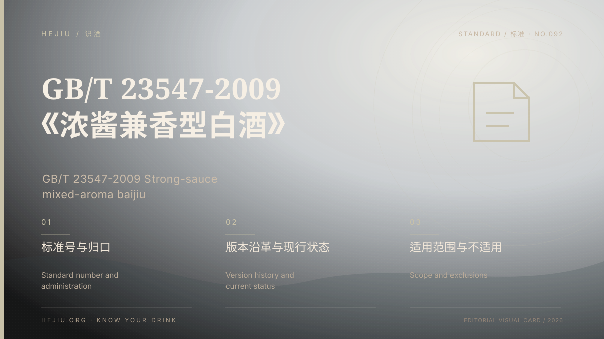

# GB/T 23547-2009《浓酱兼香型白酒》

GB/T 23547-2009 是浓酱兼香型白酒的第一部国家标准，2009-04-14 发布，2009-12-01 实施。它把“浓香兼酱香”的复合风格写进定义，并按酒精度把产品分为高度酒与低度酒，分别规定感官与理化要求。湖北[白云边](ref:baiyunbian)与安徽[口子窖](ref:kouzijiao)常被视为这一香型的代表，但标准本身覆盖整个品类。需要先说清楚：这项标准已于 2022-06-01 废止，全部由 GB/T 10781.8-2021《白酒质量要求 第8部分：浓酱兼香型白酒》代替；本页介绍的是历史文本，现行生产与检验应查阅新标准。

图：GB/T 23547-2009《浓酱兼香型白酒》 双语视觉卡（项目自绘 SVG）。不是实拍。

## 标准号与归口

标准号是 GB/T 23547-2009，属于推荐性国家标准（GB/T），不是强制性标准，也不是食品安全国家标准。它由国家质量监督检验检疫总局、国家标准化管理委员会发布，由全国食品工业标准化技术委员会提出，由全国白酒标准化技术委员会（SAC/TC 358）归口。标准以 QB/T 2524-2001《浓酱兼香型白酒》为基础制定，并在本标准实施之日起使该行业标准自行作废。起草单位包括湖北白云边股份有限公司、黑龙江省玉泉酒业有限责任公司与中国食品发酵工业研究院，这解释了为什么标准文本带有明显的湖北与黑龙江产业经验。

## 版本沿革与现行状态

浓酱兼香型白酒最初以行业标准 QB/T 2524-2001 规范，2009 年上升为国家标准。2009 年版建立了“定义、产品分类、感官、理化、卫生、分析方法、检验规则与标签”的完整框架，按高度酒 41%vol 至 68%vol、低度酒 18%vol 至 40%vol 分类，并在两张理化表中分别设优级、一级。2021-11-26，GB/T 10781.8-2021 发布，2022-06-01 实施，全部代替本标准。新标准把名称改为“白酒质量要求 第8部分：浓酱兼香型白酒”，删除产品分类，只保留优级、一级；理化指标增加酸酯总量与“己酸+己酸乙酯”，删除正丙醇，并按产品自生产日期一年内、一年后分别要求。新旧标准不是简单换号，检验项目与限值都变了。

## 适用范围与不适用

标准适用于浓酱兼香型白酒的生产、检验与销售。它覆盖以粮谷为原料，经传统固态法发酵、蒸馏、陈酿、勾兑而成，未添加食用酒精及非白酒发酵产生的呈香呈味物质，具有浓香兼酱香独特风格的白酒。它不适用于单一浓香型或单一酱香型白酒，也不适用于液态法白酒、固液法白酒或以食用酒精加香精调配的配制酒。它不规定产区、年份、价格或品牌等级，不能用来证明一瓶酒来自湖北或安徽。卫生要求在当时引用 GB 2757，现行合规还要结合 GB 2762、GB 2760 等食品安全国家标准。

## 关键指标与限值

定义强调三点：粮谷原料；传统固态法发酵、蒸馏、陈酿、勾兑；不添加食用酒精与非白酒发酵产生的呈香呈味物质。风格描述是“浓香兼酱香”，不是两种香型的简单相加，而是同一酒体中浓香的己酸乙酯体系与酱香的高温制曲、堆积体系相互协调。

产品按酒精度分为高度酒 41%vol 至 68%vol、低度酒 18%vol 至 40%vol。理化指标分高度酒、低度酒两张表，各设优级、一级，检验项目包括酒精度、总酸（以乙酸计）、总酯（以乙酸乙酯计）、己酸乙酯、正丙醇与固形物。可核对的具体限值举例：高度酒总酸优级不低于 0.50 g/L、一级不低于 0.30 g/L。其余项目在标准正文表 3、表 4 中按酒精度与等级分别列出，本文不复述未经逐项核对的具体数值；查阅时应以标准正文为准。酒精度实测值与标签标示值的允许差为 ±1.0%vol。

需要区分“2009 年版的限值”与“2021 年版的限值”。作为参照，现行 GB/T 10781.8-2021 规定：酒精度 25.0%vol 至 68.0%vol；固形物不大于 0.60 g/L；产品自生产日期一年内，总酸优级不低于 0.60 g/L、一级不低于 0.40 g/L，总酯优级不低于 1.60 g/L、一级不低于 1.00 g/L，己酸乙酯优级 0.60 g/L 至 2.00 g/L、一级 0.60 g/L 至 1.80 g/L；一年后改考核酸酯总量，优级不低于 35.0 mmol/L、一级不低于 30.0 mmol/L，己酸+己酸乙酯优级不低于 1.20 g/L、一级不低于 0.80 g/L，均按 45.0%vol 折算。这些数字属于新标准，不能倒推旧标准。

## 检测方法

感官要求与理化要求按 GB/T 10345《白酒分析方法》执行；酒精度后来改按 GB 5009.225 测定。净含量按 JJF 1070 检验。卫生要求按 GB 2757 执行。检验规则和标志、包装、运输、贮存按 GB/T 10346 执行，标签按 GB 10344 执行。标准没有为“浓酱兼香”设计单独的仪器判定方法，风格仍靠感官描述；理化指标只能证明酸、酯、醇与固形物落在范围内，不能单独证明香型。实际检验应采用现行有效版本的引用标准，因为 GB/T 10345、GB/T 10346 与 GB 2757 都已换版。

## 与相邻标准的区别

与 GB/T 10781.8-2021 相比，2009 年版有产品分类、有正丙醇指标、没有酸酯总量与“己酸+己酸乙酯”，且部分指标按酒精度分档；新标准删除分类、删除正丙醇、增加两项酸酯指标，并把折算基准统一为 45.0%vol。与浓香型标准相比，本标准要求同时呈现酱香的高温制曲与堆积特征，己酸乙酯不是唯一主体。与酱香型标准相比，本标准不以高温大曲、多轮次取酒为必要条件，风格上保留浓香的绵甜。与 GB/T 15109-2021 相比，后者只定义术语；与 GB/T 17204-2021 相比，后者负责饮料酒大类归属；与 GB 2757-2012 相比，后者是强制性安全底线。三者层次不同，不能互相替代。

## 合规与标签要求

标签应标明产品名称、香型、酒精度、净含量、生产日期、生产者与执行标准。酒精度以“%vol”表示，允许差为 ±1.0%vol。2009 年版允许在标签上使用“浓酱兼香型白酒”名称，并可按优级、一级标示质量等级；企业应对应其实际执行的版本，不能一边标注旧标准号，一边引用新标准的指标。2022-06-01 之后生产的产品应以 GB/T 10781.8-2021 为执行标准；旧产品流通到市场上的标签合规性，要结合生产日期与监管过渡要求判断。食品安全方面，甲醇、氰化物、铅、食品添加剂等仍须符合现行食品安全国家标准。

## 常见误区

第一，把 GB/T 23547-2009 当成现行标准。它已废止，现行标准是 GB/T 10781.8-2021。第二，把“兼香”理解成把浓香酒与酱香酒按比例勾兑。标准要求的是同一固态发酵体系形成的复合风格，不是简单混合两种成品酒。第三，把 41%vol 至 68%vol 当成质量优劣的分界。它只是分类边界。第四，把“优级”当成跨品牌可比的评分。优级只是标准内的等级，不是竞赛名次。第五，认为理化指标能单独判定香型。香型判定仍以感官风格为主，理化只是辅助。第六，把旧标准的“正丙醇”继续套到新标准上；新标准已删除该指标，改用酸酯总量与己酸+己酸乙酯。

## 另见

- [浓酱兼香型白酒](ref:mixed-aroma)：风格、工艺与代表产品。
- [白酒](ref:baijiu)：白酒分类与基本工艺。
- [白云边](ref:baiyunbian)：湖北兼香型代表品牌。
- [口子窖](ref:kouzijiao)：安徽兼香型代表品牌。
- [湖北](ref:hubei)：兼香型重要产区。
- [安徽](ref:anhui)：兼香型重要产区。
- [GB/T 15109-2021](ref:gbt-15109)：白酒工业术语。
- [GB/T 17204-2021](ref:gbt-17204)：饮料酒术语和分类。
- [制曲](ref:qu-making)：兼香型曲药与发酵。
