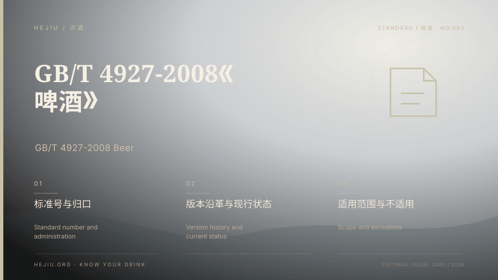

# GB/T 4927-2008《啤酒》

GB/T 4927-2008 是现行啤酒产品国家标准。它于 2008-12-29 发布，2009-10-01 实施，代替 GB 4927-2001。标准把啤酒定义为以麦芽、水为主要原料，加啤酒花（包括酒花制品），经酵母发酵酿制而成的、含有二氧化碳的、起泡的、低酒精度的发酵酒，并在注中说明包括无醇啤酒（脱醇啤酒）。它按色度建立产品分类，另设特种啤酒，并规定感官、理化、检验规则与标签要求。理解这份标准，能区分“啤酒”这个法定类别与市场上各种风格、工艺和营销说法。

图：GB/T 4927-2008《啤酒》 双语视觉卡（项目自绘 SVG）。不是实拍。

## 标准号与归口

标准号是 GB/T 4927-2008。它最初以 GB 4927-2008 发布，标准前言明确“3.1、8.1 为强制性，其余为推荐性”；根据 2017 年第 7 号中国国家标准公告和强制性标准整合精简结论，该标准转化为推荐性国家标准，标准代号由 GB 改为 GB/T，顺序号与年代号不变，自公告之日起不再强制执行。因此今天引用时应写 GB/T 4927-2008，不能再说它是强制性标准。标准由全国食品工业标准化技术委员会提出，由全国酿酒标准化技术委员会（TC471）归口，主管部门为中国轻工业联合会。标准正文的著作权归发布机构，本站只作事实性介绍。

## 版本沿革与现行状态

啤酒国家标准历经 GB 4927-1985、GB 4927-1991、GB 4927-2001 和 GB 4927-2008 四个版本。2008 年版与上一版相比，把特种啤酒的定义移入术语章，修改了干啤酒、冰啤酒、低醇啤酒、小麦啤酒、浑浊啤酒的定义，增加了无醇啤酒与果蔬类啤酒；增加了产品分类；把净含量负偏差改为净含量；质量等级取消二级；酒精度改用体积分数（%vol）表示；并调整了淡色、浓色与黑色啤酒的泡持性、酒精度、原麦汁浓度、总酸和二氧化碳指标。该标准目前仍为现行版本，尚未被新版代替。引用时必须带年代号，否则会与 2001 年版混淆。

## 适用范围与不适用

标准适用于啤酒的生产、检验与销售。它覆盖以麦芽和水为主要原料、加啤酒花并经酵母发酵的发酵酒，包括无醇啤酒；也覆盖以小麦芽、果蔬汁或果蔬香精等改变原辅料或工艺、具有特殊风格的特种啤酒。它不适用于葡萄酒、黄酒、白酒等其他饮料酒，也不适用于以食用酒精加香精调配的配制酒。它不是食品安全国家标准；卫生要求在当时引用 GB 2758《发酵酒卫生标准》，现行合规还应结合 GB 2760、GB 2762、GB 7718 等食品安全与标签标准。它也不评价“精酿”“工坊”等风格身份，这些不是本标准的产品分类。

## 关键指标与限值

产品分类只看色度：淡色啤酒为 2 EBC 至 14 EBC，浓色啤酒为 15 EBC 至 40 EBC，黑色啤酒为大于或等于 41 EBC，另设特种啤酒。熟啤酒、生啤酒、鲜啤酒是按杀菌或除菌方式划分的术语，不是第 4 章的产品类别；这一点常被误读为“按杀菌工艺分类”。

特种啤酒的定义包括：干啤酒实际发酵度不低于 72%；冰啤酒经冰晶化工艺处理、浊度不大于 0.8 EBC；低醇啤酒酒精度 0.6%vol 至 2.5%vol；无醇啤酒酒精度不大于 0.5%vol 且原麦汁浓度不低于 3.0°P；小麦啤酒以小麦芽（占麦芽 40% 以上）、水为主要原料；浑浊啤酒浊度不小于 2.0 EBC；果蔬类啤酒分果蔬汁型与果蔬味型。

淡色啤酒的理化要求按原麦汁浓度分档。酒精度下限：原麦汁浓度大于或等于 14.1°P 时为 5.2%vol，12.1°P 至 14.0°P 为 4.5%vol，11.1°P 至 12.0°P 为 4.1%vol，10.1°P 至 11.0°P 为 3.7%vol，8.1°P 至 10.0°P 为 3.3%vol，小于或等于 8.0°P 为 2.5%vol。原麦汁浓度以标签标注值 X 为准，大于或等于 10.0°P 允许负偏差 0.3°P，小于 10.0°P 允许负偏差 0.2°P。

总酸上限：大于或等于 14.1°P 为 3.0 mL/100mL，10.1°P 至 14.0°P 为 2.6 mL/100mL，小于或等于 10.0°P 为 2.2 mL/100mL；浓色、黑色啤酒为 4.0 mL/100mL。二氧化碳为 0.35% 至 0.65%（质量分数），桶装鲜、生、熟啤酒不得小于 0.25%。双乙酰优级不大于 0.10 mg/L、一级不大于 0.15 mg/L。对生啤酒与鲜啤酒，蔗糖转化酶活性应呈阳性。感官上，淡色啤酒优级浊度不大于 0.9 EBC、一级不大于 1.2 EBC，并要求泡沫洁白细腻、有一定泡持性。

## 检测方法

感官要求、净含量与理化要求按 GB/T 4928《啤酒分析方法》检验；净含量同时执行《定量包装商品计量监督管理办法》。卫生要求按当时引用的 GB 2758 执行，但该标准后来已被 GB 2758-2012 代替，现行检验应以现行食品安全国家标准为准。检验规则分为出厂检验与型式检验：出厂检验项目为净含量、感官要求、理化要求；型式检验覆盖全部要求，至少每半年一次，原辅材料大变、设备更换或停产复产、与前次结果差异较大、监管抽检时也应进行。组批以同一清酒罐、同一包装线、连续生产、当天包装出厂且质量检验报告单相同的产品为一批。标签按 GB 10344 执行，实际还应符合现行预包装食品标签与饮料酒标签规定。

## 与相邻标准的区别

与 GB/T 17204-2021《饮料酒术语和分类》相比，后者是顶层分类，回答啤酒在饮料酒中的位置；本标准是产品标准，回答啤酒应满足哪些质量要求。与 GB 2758 相比，后者是发酵酒的卫生标准，规定安全指标；本标准规定质量与标签，两者不能互相替代。与 GB/T 4928 相比，后者只规定分析方法，不规定限值。与白酒、葡萄酒、黄酒的产品标准相比，本标准的核心指标是原麦汁浓度、酒精度、总酸、二氧化碳与双乙酰，而蒸馏酒关注总酸、总酯与甲醇，葡萄酒关注总糖、干浸出物与挥发酸。中国目前没有以“精酿”为名的强制性或推荐性产品标准，精酿啤酒仍按本标准或企业标准组织生产。

## 合规与标签要求

标签应标明产品名称、原麦汁浓度、酒精度、净含量、生产日期、保质期、生产者与执行标准。酒精度以“%vol”表示。原麦汁浓度是标签上的关键信息，也是理化指标分档的依据，标注值必须与实际相符，并满足允许负偏差。产品名称应与分类或特种啤酒定义对应，例如标“无醇啤酒”就必须满足酒精度不大于 0.5%vol 且原麦汁浓度不低于 3.0°P；标“低醇啤酒”就必须落在 0.6%vol 至 2.5%vol。玻璃瓶啤酒的包装容器应符合 GB 4544，运输包装、瓶盖、啤酒桶等也各有引用标准。企业声明执行 GB/T 4927-2008 后，该标准即成为产品的明示质量要求。

## 常见误区

第一，把 GB/T 4927-2008 说成强制性标准。它在 2008 年发布时只有 3.1 与 8.1 两条强制，2017 年后整体转为推荐性 GB/T。第二，认为产品按杀菌工艺分类。标准第 4 章只按色度分类并另设特种啤酒；熟、生、鲜是术语。第三，把“原麦汁浓度高”等同于“品质好”。原麦汁浓度影响酒体与酒精度，但风味还取决于麦芽、酒花、酵母与发酵控制。第四，把“无醇”理解成完全不含酒精。标准允许酒精度不大于 0.5%vol，并非绝对零酒精。第五，把“精酿”当成法定类别。本标准没有精酿分类，标签上的“精酿”是商业描述。第六，认为符合本标准就自动符合食品安全要求；卫生指标另由食品安全国家标准约束。

## 另见

- [啤酒](ref:beer)：啤酒的定义、原料与风格家族。
- [拉格](ref:lager)：低温下层发酵与长期贮酒。
- [皮尔森](ref:pilsner)：淡色拉格的代表风格。
- [啤酒花](ref:hop)：苦味与香气的来源。
- [大麦](ref:barley)：麦芽与酶活力的基础。
- [发酵](ref:fermentation)：酵母与双乙酰控制。
- [GB/T 17204-2021](ref:gbt-17204)：饮料酒术语和分类。

对照阅读：[啤酒](ref:beer)、[皮尔森啤酒](ref:pilsner)。
