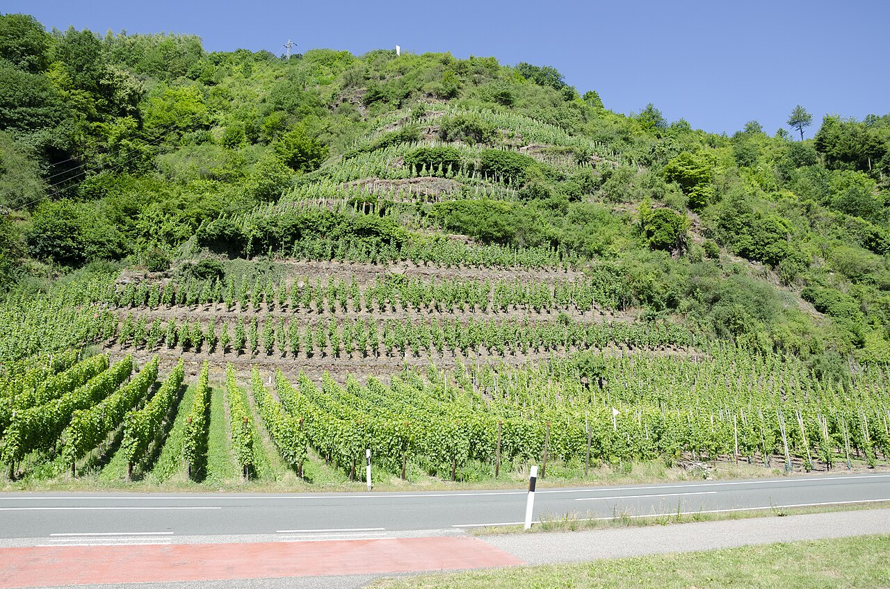

# 德国葡萄酒法

德国葡萄酒法常被简化为“看糖度分级”，这只说对了一半。糖度确实是 Prädikat 体系的基础，但 2021 年的改革把重心移向产地：从 2026 年采收开始，酒标上的地理层级将比“Kabinett”或“Spätlese”更能说明一瓶酒的身份。

这次改革是德国葡萄酒法第 10 次大修，2021 年 1 月 27 日生效。它没有废除旧等级，而是在旧等级之上叠加一套新的产地金字塔，并把欧盟 PDO/PGI 的框架翻译成德国可执行的条款。

图：德国有 13 个法定产区；图为摩泽尔河畔 Neef 村的葡萄园。图片：Peulle，CC0，via Wikimedia Commons（[原图页面](https://commons.wikimedia.org/wiki/File:Vineyards_Neef_jun_2018.jpg)）。

## 2021 年改革与 2026 年生效

改革的核心目标有两个：让消费者更容易理解“这瓶酒来自哪里”，以及让产区在气候变化下拥有更灵活的规则工具。新规则从 2026 年采收适用，在此之前是过渡期，酒庄可以按旧标签销售库存。

另一个目标是简化。旧法把“质量等级”和“成熟度”缠在一起，消费者很难分清 Qualitätswein 与 Prädikatswein 的差别。新法保留等级名称，但把产地信息提到更显眼的位置。

## 四个质量等级

第一级是 Deutscher Wein，德国产葡萄酒，无更具体的地理标识。第二级是 Landwein，对应欧盟 PGI，产区范围较大。第三级是 Qualitätswein，对应欧盟 PDO，必须来自 13 个指定产区之一。第四级是 Prädikatswein，同样属于 PDO，但对成熟度有更高要求。

四个等级不是简单的“越贵越好”。Deutscher Wein 可以是清爽的日常酒，Prädikatswein 也可以是甜型或干型；等级说明的是产地与成熟度门槛，不是风格。

## 13 个 Anbaugebiete

德国有 13 个法定产区：Ahr、Baden、Franken、Hessische Bergstraße、Mittelrhein、Mosel、Nahe、Pfalz、Rheingau、Rheinhessen、Saale-Unstrut、Sachsen、Württemberg。它们从北到南分布，气候差异极大。

Mosel 的板岩坡地、Rheingau 的莱茵河向阳坡、Pfalz 的温暖平原、Baden 的南部阳光，构成德国葡萄酒的地理底色。产区名称是 Qualitätswein 及以上的必要条件，也是消费者判断风格的第一线索。

## Prädikat 六级

Prädikatswein 内部按采收时的糖度分为六级：Kabinett、Spätlese、Auslese、Beerenauslese、Eiswein、Trockenbeerenauslese。糖度越高，潜在酒精度或残糖越高，但酒庄可以通过发酵控制做成干型或甜型。

这意味着“Prädikat 越高越甜”是一个常见误解。Trockenbeerenauslese 几乎总是甜酒，但 Auslese 可以是干型；Eiswein 依赖冬季结冰采收，产量极低。等级是原料指标，不是成品风格。

## 新的产地金字塔

2021 年改革引入四级产地结构：Anbaugebiet（大产区）、Region（子产区）、Ortswein（村庄酒）、Lagenwein（地块酒）。越往下，地理范围越小，规则越严。Lagenwein 要求 100% 来自标注的地块，并满足更低的产量上限。

与之并行的是一套私人分级：VDP 的 Großes Gewächs 与 Erstes Gewächs。 Großes Gewächs 要求每公顷不超过 50 百升，且必须手工采收；它不是法定等级，但在市场上影响力很大。消费者需要分清“法定 Lagenwein”与“VDP 特级园”的差别。

## 标签与 AP 号

德国酒标的核心是一串“Amtliche Prüfungsnummer”（AP 号），由产区检验机构发放，包含产区、检验批次与年份信息。标签还必须出现产区、年份、品种、酒精度、容量与装瓶者信息。

“Trocken”“Halbtrocken”“Feinherb”等干型标识有法定含义，不能随意使用。2026 年新规对 Lagenwein 的标签格式、字体大小与附加地理名称做了细化，出口商需要更新模板。

AP 号由产区检验机构在酒液通过理化与感官检验后发放，编号本身包含产区代码、检验年份与批次。它既是追溯工具，也是消费者判断“这瓶酒是否经过官方检验”的依据。2026 年新规生效后，旧库存仍可继续销售，但新酒必须使用新的产地层级与标签格式；酒庄通常会在 2025 年提前设计模板，以免换标时断货。

干型标识的收紧也影响出口：同一款酒在德国标“Trocken”，在海外市场可能被理解为“完全不甜”，实际残糖仍可能有几克。酒庄因此常在背标补充英文说明。对消费者而言，最可靠的做法不是看“Trocken”，而是看酒精度、残糖与酸度的组合。

对酒庄而言，最大的成本不是改版，而是让海外经销商理解新层级；这需要培训与样酒，而不仅是换一张标签。规范改变标签，市场改变习惯，两者并不同步。这也是 2026 年改革最容易被低估的部分。

## 争议与过渡期

第一重争议是过渡成本。小酒庄要重新设计标签、更新追溯系统，而库存酒仍按旧规销售，市场上会同时出现两套标签。第二重争议是气候变化：成熟度上升让 Prädikat 的糖度门槛更容易达到，等级膨胀的风险上升。

第三重争议是“法定分级”与“私人分级”的张力。VDP 的名气有时超过法定等级，消费者容易把 Großes Gewächs 当成法律概念。德国葡萄酒法能管住标签，却管不住市场对“特级园”的想象。

## 另见与参考资料

- 德国产区的整体格局，见 [德国](ref:region-germany)。
- 摩泽尔的板岩坡地，见 [摩泽尔](ref:region-mosel)。
- 莱茵高的向阳坡，见 [莱茵高](ref:region-rheingau)。
- 法尔茨的温暖平原，见 [法尔茨](ref:region-pfalz)。
- 德国啤酒的原料规则，见 [德国啤酒纯净法](ref:standard-reinheitsgebot)。
- 葡萄酒的基本分类，见 [葡萄酒](ref:drink-style-wine)。

1. Gesetze im Internet，Weingesetz，访问于 2026 年 11 月 20 日。
2. Wines of Germany，Wine law and regulations in Germany，访问于 2026 年 11 月 20 日。
3. Wines of Germany，New origin pyramid，访问于 2026 年 11 月 20 日。
4. BMEL，Wein — Politik und Regelungen，访问于 2026 年 11 月 20 日。
5. EUR-Lex，Regulation (EU) No 1308/2013，访问于 2026 年 11 月 20 日。

对照阅读：[德国](ref:region-germany)、[莱茵高](ref:region-rheingau)。

**关键事实。**

| 项目 | 内容 |
| --- | --- |
| 一句话定位 | 德国葡萄酒法在 2021 年完成最近一次大修，新的产地分级从 2026 年采收起适用；它保留四个质量等级与六级 Prädikat，同时把重心从“糖度”转向“产地层级”，并用 13 个 Anbaugebiete 组织全国产区 |
| 发布机构 | 德国联邦食品与农业部（BMEL） |
| 标准编号 | Weingesetz (WeinG) |
| 生效日期 | 2021-01-27 |
| 适用范围 | 德国葡萄酒的生产、分级、产地标识与标签 |

**来源与边界。** 本页关于「德国葡萄酒法」的关键事实，主要由以下来源交叉核对：Gesetze im Internet（现行法律文本）、Wines of Germany（2021 年改革、2026 年生效与四个质量等级；Anbaugebiet、Region、Ortswein、Lagenwein 四级产地结构）、Bundesministerium für Ernährung und Landwirtschaft（联邦层面的政策目标与产区数量）等 5 条来源。价格、批次与状态会变，涉及这些字段时以页面所列来源的最新版本为准。正文为项目自写，来源只作核验，不复制原文。

**并读。** 把「德国葡萄酒法」与「德国」、「摩泽尔」、「莱茵高」放在一起读时，先确认它们是同一层级还是上下游关系：先确认适用范围与强制或推荐属性，再比较术语、标签与检测方法。本页负责给出标准的基本坐标，对照条目补上具体案例与差异；读完再回到本页，才能分清哪些差别属于标准本身，哪些只是产地、批次或品牌选择。

**适用边界。** 对「德国葡萄酒法」而言，标准文本会修订，引用时以发布机构的最新版本为准；本页是导读，不替代原文。

**更新提示。** 「德国葡萄酒法」最近核对于 2026-11-20；标准版本、过渡期与检测方法会更新，执行前以现行标准文本为准。
