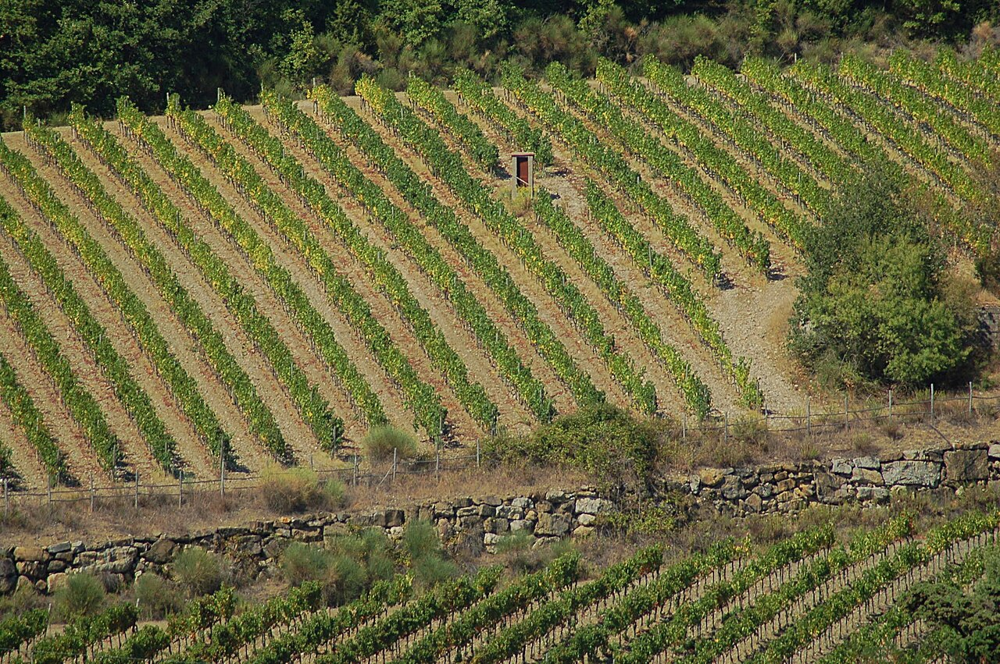

# 意大利 DOCG 制度

在意大利酒标上，DOCG 是最高的法定等级。它不是“最好喝”的保证，而是一套最严格的生产与检验条件：更低的产量、更长的陈年、更小的装瓶容量，以及逐批的化学与感官审查。

这套制度诞生于 1963 年。那一年，意大利以总统令 DPR 930/1963 建立法定产区体系，设立 DOC 与 DOCG 两级；1992 年的 Legge 164 又加入 IGT，形成今天的四级金字塔。1980 年，Brunello di Montalcino 成为第一个 DOCG。

图：DOCG 是意大利最高法定等级；图为基安蒂经典产区的葡萄园。图片：Tom Chance，CC BY-SA 2.0，via Wikimedia Commons（[原图页面](https://commons.wikimedia.org/wiki/File:Vineyards_in_the_Chianti_Classico_valleys.jpg)）。

## 1963 年制度与 1980 年第一个 DOCG

DPR 930/1963 首次把“产地名称”变成国家法律工具：划定区域、登记葡萄园、规定品种与产量、设立品鉴委员会。它的背景是二战后意大利葡萄酒质量参差、出口受阻，政府希望用法定产区重建信誉。

DOCG 的设立初衷是给“特别有价值的 DOC”加一层担保。1980 年授予 Brunello di Montalcino 后，Barolo、Barbaresco、Chianti Classico 等陆续跟进。今天意大利有 70 多个 DOCG、300 多个 DOC，数量在欧洲名列前茅。

## 金字塔：DOCG、DOC、IGT

最底层是 vino（日常餐酒），其上是 IGT（地理指示葡萄酒），再上是 DOC，顶端是 DOCG。欧盟层面，DOC 与 DOCG 都对应 PDO，IGT 对应 PGI；因此意大利在国内分两级，在欧盟只算一类。

PDO 要求 100% 的葡萄来自划定区域，且酿造在区域内完成；PGI 的门槛是至少 85% 的葡萄来自该区域。这个比例是欧盟统一规则，意大利不能自行放宽。

## DOCG 的额外条件

第一，产区必须先以 DOC 身份存在至少 7 年，才有资格申请 DOCG。第二，DOCG 的产区规范必须比原 DOC 更严：产量更低、品种更窄、陈年更长。

第三，装瓶容量不得超过 6 升；每瓶必须加贴国家发放的封条（fascetta），封条上有编号，用于追溯。第四，每批酒在装瓶前要通过化学分析与感官品鉴，任何一项不合格都不能上市。

## 代表产区

Barolo 与 Barbaresco 用 Nebbiolo，强调结构与陈年；Brunello di Montalcino 用 Sangiovese，要求至少两年橡木桶与四年总陈年；Chianti Classico 是托斯卡纳的核心，黑公鸡标志是历史符号。

威尼托的 Prosecco 与 Franciacorta 代表起泡酒的两条路径；坎帕尼亚的 Taurasi 用 Aglianico，被称为“南方的 Barolo”。DOCG 的地理分布并不均衡，北部与中部密度最高。

## 标签与市场

标签必须出现“Denominazione di Origine Controllata e Garantita”或缩写 DOCG，以及产区名称。标注“Riserva”需要满足更长的陈年要求，具体年限由各产区规范规定，不是统一的数字。

DOCG 在出口市场有溢价，尤其是 Barolo、Brunello 与 Chianti Classico。溢价来自稀缺性与品牌，而不是等级本身；同一 DOCG 内，酒庄之间的价格可以相差数倍。

## 与法国 AOC 的差别

法国的 AOC 以地块与产区为单位，强调“climat”与分级；意大利的 DOCG 以产区规范为单位，强调品种、产量与检验。两者都受欧盟 PDO 保护，但法律技术不同。

另一个差别是数量。法国 AOC 约 360 个，意大利 DOCG 与 DOC 加起来超过 400 个；意大利的平均产区面积更小，规范差异更大。消费者很难凭等级判断风格，只能回到产区与酒庄。

## 争议：通胀、气候与南方

第一重争议是 DOCG 通胀。批评者认为，等级数量增加稀释了顶端价值；支持者认为，更多产区获得保护，有利于小农。

第二重争议是气候变化。成熟度上升、酸度下降，传统采收窗口被压缩；部分产区申请调整品种与产量规则，但 DOCG 的修改程序缓慢。

第三重争议是南北失衡。南部产区品质提升明显，但市场认知仍集中在托斯卡纳与皮埃蒙特。DOCG 能保护名字，却不一定能改变消费者的偏见。

从生产端看，DOCG 的成本主要落在三处：更低的产量意味着每公顷收入减少；国家封条按瓶计费；逐批检验需要时间与实验室费用。对小酒庄，这些成本可能吞掉溢价；对已经建立品牌的大酒庄，它们反而构成护城河。等级制度从来不是中性的。

另一个现实是，DOCG 的产区规范由各部委与产区 consortium 博弈形成，修改周期长。气候变暖后，有的产区希望允许更晚采收或调整品种，但规范修订往往要数年。制度的稳定性是优点，也是应对变化的负担。

消费者端，DOCG 标签的辨识度并不高。多数人记得 Barolo、Brunello 这样的名字，却不一定知道它们是 DOCG；产区名比等级更有市场价值。这也是意大利酒标上最常见的信息层级：产区在前，等级在后。

另一层信息是酒庄名与葡萄品种。许多 DOCG 允许若干品种，酒标上的品种比例往往比等级更能说明风格；例如 Chianti Classico 以 Sangiovese 为主，具体比例由规范规定。产区、品种、酒庄，这三层信息比 DOCG 三个字母更实用。

## 另见与参考资料

- 基安蒂经典产区，见 [基安蒂经典](ref:region-chianti-classico)。
- 巴罗洛产区，见 [巴罗洛](ref:region-barolo)。
- 蒙塔奇诺产区，见 [蒙塔奇诺](ref:region-montalcino)。
- 托斯卡纳的整体格局，见 [托斯卡纳](ref:region-tuscany)。
- 红葡萄酒的基本分类，见 [红葡萄酒](ref:drink-style-red-wine)。
- “原产地命名”的概念，见 [原产地命名](ref:term-appellation)。

1. Federdoc，The evolution of the pyramid of Italian wines，访问于 2026 年 11 月 20 日。
2. Federdoc，Italian PDO wines，2025 年。
3. Valoritalia，Disciplinare di produzione DOCG Barbaresco，访问于 2026 年 11 月 20 日。
4. Masaf，访问于 2026 年 11 月 20 日。
5. EUR-Lex，Regulation (EU) No 1308/2013，访问于 2026 年 11 月 20 日。

对照阅读：[基安蒂经典](ref:region-chianti-classico)、[蒙塔希诺](ref:region-montalcino)。

**关键事实。**

| 项目 | 内容 |
| --- | --- |
| 一句话定位 | DOCG 是意大利葡萄酒金字塔的顶端，1963 年随 DOC 体系建立，1980 年授予第一个 DOCG；它要求产区先以 DOC 存在至少 7 年，装瓶容量不超过 6 升，并通过逐批化学与感官检验、加贴国家封条 |
| 发布机构 | 意大利农业、食品主权与林业部（Masaf） |
| 标准编号 | DPR 930/1963；Legge 164/1992；D.Lgs 61/2010 |
| 生效日期 | 1963-07-12 |
| 适用范围 | 意大利法定产区葡萄酒的分级、生产规范与标签 |

**来源与边界。** 本页关于「意大利 DOCG 制度」的关键事实，主要由以下来源交叉核对：Federdoc（1963 年 DPR 930、1992 年 Legge 164 与 DOCG 的设立；DOCG 的七年 DOC 前置、六升上限与国家封条）、Valoritalia（查看一份 DOCG 产区规范的实际结构）、Masaf（确认主管部委与产区认可程序）等 5 条来源。价格、批次与状态会变，涉及这些字段时以页面所列来源的最新版本为准。正文为项目自写，来源只作核验，不复制原文。

**并读。** 把「意大利 DOCG 制度」与「基安蒂经典」、「巴罗洛」、「蒙塔希诺」放在一起读时，先确认它们是同一层级还是上下游关系：先确认适用范围与强制或推荐属性，再比较术语、标签与检测方法。本页负责给出标准的基本坐标，对照条目补上具体案例与差异；读完再回到本页，才能分清哪些差别属于标准本身，哪些只是产地、批次或品牌选择。

**适用边界。** 对「意大利 DOCG 制度」而言，标准文本会修订，引用时以发布机构的最新版本为准；本页是导读，不替代原文。

**更新提示。** 「意大利 DOCG 制度」最近核对于 2026-11-20；标准版本、过渡期与检测方法会更新，执行前以现行标准文本为准。
