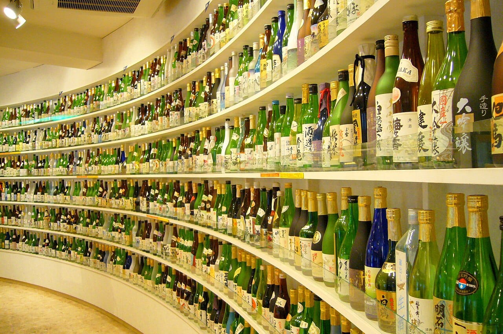

# 日本《酒税法》

日本《酒税法》（酒税法，昭和28年法律第6号）是日本国会制定的法律，规定什么是“酒类”、酒类如何分类、制造与销售需要什么许可，以及酒税如何征收。它常被误读成“清酒等级法”或“酒标法”：前者是国税厅的清酒标识制度，后者涉及食品表示法与酒类表示基准。理解《酒税法》，先要把它放回“税”的位置，而不是把它当成品质分级。

图：日本清酒与烧酎信息中心的清酒瓶陈列；酒类税制的对象示例，不是税率表、税标或税务文件。图片：Yusuke Kawasaki，CC BY 2.0，via Wikimedia Commons（[原图页面](https://commons.wikimedia.org/wiki/File:Sake_bottles_on_display_at_Japan_Sake_and_Shochu_Information_Center_-_Jan_18,_2007.jpg)）。

> **先给结论**
> **一句话：** 这页讲清日本《酒税法》的适用范围、限制和容易误读的地方。
>
> - **适合谁：** 需要快速理解日本《酒税法》的适用范围和限制的人。
> - **不适合谁：** 需要标准全文或合规裁定的人。
> - **先看这两点：**
>   - 税率表的第一部分是《酒税法》第 23 条关系，按四大类与品目列出基本税率；第二部分是租税特别措施法第 87 条之 2 关系。
>   - 《酒税法》公布于 1953-02-28，现行文本经过多次修订。

## 法律框架与适用范围

《酒税法》公布于 1953-02-28，现行文本经过多次修订。e-Gov 法令检索将其列为“昭和二十八年法律第六号”，并标注现行施行日与未施行改正。法律的核心对象是“酒类”：酒精度在 1 度以上、可供饮用的饮料，包括可以兑水或其他物品稀释后饮用的制品。酒类以外的含酒精制品，若明显不作为饮料使用，通常按其他法律或税目处理，不能因为“含酒精”就自动套用酒税法。

酒税是国税，不是地方税，也不是消费税。消费税按消费行为征收，酒税按酒类的制造与移出征收；两者在价格里叠加，但法律依据、纳税环节和税率都不同。酒税法还配套《酒税法施行令》《酒税法施行规则》与国税厅通达，具体计算时要看整套规则，而不是只看法律条文的一句话。

## 酒类的四类划分

国税厅的分类资料把酒类分为四大类：发泡性酒类、酿造酒类、蒸馏酒类和混成酒类。发泡性酒类包括啤酒、发泡酒和其他发泡性酒类；酿造酒类包括清酒、果酒和其他酿造酒；蒸馏酒类包括连续式蒸馏烧酎、单式蒸馏烧酎、威士忌、白兰地、原料用酒精和烈酒；混成酒类包括合成清酒、味醂、甘味果酒、利口酒、粉末酒和杂酒。分类不是按品牌，而是按原料、工艺和酒精分等法定要件。

清酒的法定定义是：以米、米曲和水为原料，发酵后过滤而成，酒精分低于 22 度；或者以米、米曲、水及清酒粕等政令规定物品为原料，发酵后过滤而成，酒精分低于 22 度。威士忌的定义是：以发芽谷物和水为原料，糖化后发酵，再蒸馏而成的酒精含有物。烧酎则按蒸馏方式分为连续式与单式，连续式酒精分低于 36 度，单式低于 45 度。把这些定义与“清酒”“烧酎”的日常用法混在一起，容易把工艺不同的酒当成同一类。

## 计税方式：从量税

酒税的基本计税方式是“从量”：按酒类的数量（千升，kl）与酒精分等计算税额，而不是按销售额的百分比。税率表以“1 kl 当たり”为单位，也就是每一千升的税额；不同品目、不同酒精分对应不同税率。这样的设计，使酒税与酒类的物理数量、酒精含量直接挂钩，便于在生产环节征收，也让不同酒种之间的税负比较容易比较。

以 2026-10-01 起的国税厅税率表为例：清酒为 100,000 日元/kl；啤酒为 155,000 日元/kl；威士忌在 37 度时为 370,000 日元/kl，超过 37 度后每增加 1 度加 10,000 日元/kl。按这个表，一瓶 720 ml 的清酒，酒税约为 72 日元；一瓶 700 ml、40 度的威士忌，酒税约为 280 日元（计算方式为 370,000 + 3×10,000 = 400,000 日元/kl，再乘 0.7 kl）。这些数字只是税额示例，不含消费税、运费、渠道加价与品牌溢价。

## 2026 年税率表怎么读

税率表的第一部分是《酒税法》第 23 条关系，按四大类与品目列出基本税率；第二部分是租税特别措施法第 87 条之 2 关系，对酒精分低于 13 度（利口酒低于 12 度）的非发泡酒类适用另一套税率；第三部分是第 87 条关系的中小酿造者减轻措施，按年度酒税累计额与课税移出数量分档；第四部分是令和 5 年法律第 3 号附则的过渡措施，对前年度课税移出数量不超过 1,300 kl 的品目，在当年 200 kl 以内给予一定比例的减轻。这些减轻条款不是“所有酒厂自动适用”，需要申请、承认与实绩报告。

读税率表时，先确认三个变量：品目、酒精分、课税移出数量。再看适用的是基本税率、特别措施税率还是过渡减轻。只记住“清酒 100,000 日元/kl”不够，因为清酒还有可能适用过渡措施；只记住“威士忌 370,000 日元/kl”也不够，因为超过 37 度要加算。税率表是分段函数，不是一张单一价格表。

## 许可、移出与纳税环节

酒类的制造需要酒类制造免许，销售需要酒类贩卖免许；不同品目、不同规模与不同业务形态，许可条件不同。酒税的纳税义务通常在生产场移出酒类时成立，生产者按规定申报、纳税；未纳税酒类的移出、储存与处理受严格管理。进口酒类则在进口环节缴纳酒税。这套制度把“制造—移出—纳税”串成一条链，许可与税额是同一套行政管理的两面。

酒税法也规定酒类的分析、检定与记录义务，防止未纳税酒类流入市场。对消费者而言，这些环节看不见，但它们决定了酒类为什么需要许可、为什么价格里含有税、为什么跨县销售与网购也有规则。把酒税理解成“价格里的一个数字”，会忽略它作为生产许可与流通监管工具的作用。

## 与标识、消费者的关系

酒税法管税，不管所有的标签内容。酒类的标示事项主要受食品表示法、酒类表示基准与国税厅告示约束，包括品名、原料、酒精分、容量、制造者、产地、保存方法等。清酒的“纯米”“吟酿”“大吟酿”等用语，有专门的标识基准；这些用语不是酒税法规定的税率类别，不能拿税率表去推断清酒等级。反之，酒税法里的“清酒”“烧酎”“威士忌”是税目分类，不等于市场上的全部品质标签。

消费者看价格时，可以注意酒税是“从量”的：同样容量，酒精度越高、品目税率越高，税额通常越大；但酒税只占最终价格的一部分，品牌、包装、渠道和消费税也会影响售价。把“贵”直接归因于酒税，或者把“便宜”直接归因于偷税，都是过度简化。要判断一款酒是否合规，应该看许可、标签、进口证明与销售渠道，而不是只看价格。

## 常见误读

第一，酒税法不是清酒等级法。纯米、吟酿、大吟酿属于清酒标识制度，不是酒税税率。第二，酒税不是消费税。酒税在制造/进口环节征收，消费税在消费环节征收；两者可以同时出现在价格里，但法律依据不同。第三，酒税不是按售价的百分比。基本方式是按千升与酒精分从量计征，具体税额要看品目、度数与数量。

第四，“清酒”不是所有日本酒的统称。酒税法对清酒有原料、工艺和酒精分的定义；烧酎、威士忌、利口酒是不同税目。第五，“零度”或“无醇”酒并不当然免税。酒税法以酒精分 1 度以上为酒类的基本门槛，低于门槛的饮料可能按其他类别处理，但仍受食品、广告与未成年人保护法规约束。第六，税率表不是 permanent 不变。日本近年分阶段调整酒税，2026-10-01 是一个节点；引用时必须注明适用期间。

## 对写作者与从业者的意义

写日本酒类内容时，最稳妥的做法是把“税”“标识”“品质”分开叙述。提到清酒等级，用标识制度的术语；提到酒税，注明品目、酒精分、数量和适用期间；提到价格，说明税额只是成本的一部分。不要把“酒税高”写成“品质好”，也不要把“税率低”写成“酒更纯”。

对从业者来说，酒税是产品设计、定价与市场准入的硬约束。酒精度、容量、品目分类、制造许可、移出数量与减轻申请，都会影响最终税负。跨境电商与出口还要考虑目的地市场的关税、消费税与标签规则，不能把日本的酒税表直接套到别的国家。把税制当成一套可核验的规则，而不是一段传说，才能做出经得起检查的内容。

相关条目：[清酒](ref:sake)、[日本烧酒](ref:shochu)、[日本](ref:japan)。

## 延伸阅读与另见

- [清酒](ref:sake)：酒税法中的核心品目之一。
- [日本烧酒](ref:shochu)：按蒸馏方式与度数分类的另一品目。
- [日本](ref:japan)：酒类税制与消费的地理背景。
- [清酒现代化](ref:modernization)：清酒产业与税制变迁的历史线索。
- [日本清酒标识](ref:labelling)：与酒税法不同的标签规则。
