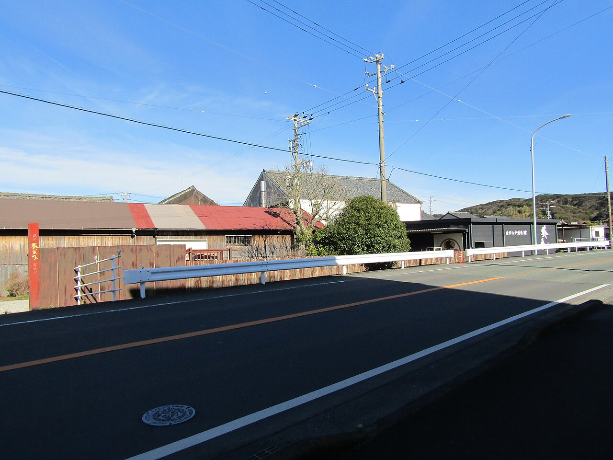

# 日本清酒标识

清酒酒标上的“纯米大吟酿”“本酿造”“吟酿”，不是酒厂自创的形容词，而是日本国税厅以告示形式规定的“特定名称”。1989 年 11 月 22 日的告示第 8 号确立了这套规则，此后经过多次修订，形成了今天的标签体系。

这套体系的核心不是“等级越高越好”，而是“名字必须对应工艺”。标了“大吟酿”，精米步合就必须在 50% 以下；标了“纯米”，就不能添加酿造酒精。消费者看到名字，就能反推出工艺参数。

图：清酒的特定名称必须与工艺参数对应；图为静冈县远州一家清酒酒造。图片：Halowand，CC BY 4.0，via Wikimedia Commons（[原图页面](https://commons.wikimedia.org/wiki/File:ENSHU_YAMANAKA_SHUZO_sake_brewery_01.jpg)）。

## 告示第 8 号与法律位置

告示第 8 号的全称是《清酒の製法品質表示基準》，依据酒税法与食品表示法制定。它规定清酒的制法、品质表示与标签，属于强制性规则，不是行业推荐。

它经历过多轮修订，其中 1997 年、2003 年、2015 年与 2019 年的调整较重要，涉及特定名称的条件、原料标示与地理标志。每次修订都会影响酒厂的标签模板，因此出口商需要跟踪最新版本。

## 清酒的定义

清酒是以米、米麹与水为原料，经发酵、过滤而成的酿造酒。它与合成清酒、烧酒、味醂不同：合成清酒允许添加其他成分，烧酒是蒸馏酒，味醂是调味料。

清酒的酒精度通常在 15% 左右，但法规允许一定范围。原料米的品种、精米步合、水质与酵母，决定了风味的方向；标签只能告诉你一部分信息。

## 八个特定名称

现行规则允许八个特定名称：纯米大吟酿、纯米吟酿、纯米酒、大吟酿、吟酿、本酿造、特别纯米酒、特别本酿造酒。

- 纯米系：只使用米、米麹与水，不添加酿造酒精。
- 吟酿系：使用“吟酿造”工艺，低温长期发酵，精米步合更低。
- 本酿造系：允许少量酿造酒精，用于调整香气与口感。
- “特别”系：在精米步合或工艺上有额外条件。

名字不能随便组合。标“纯米大吟酿”，必须同时满足纯米与精米步合 50% 以下两个条件；标“本酿造”，精米步合必须在 70% 以下。

## 精米步合与麹米比例

精米步合是把米粒外层磨掉后剩下的比例。大吟酿要求 50% 以下，吟酿要求 60% 以下，本酿造要求 70% 以下。纯米酒没有统一上限，但标“特别纯米”通常要求 60% 以下或采用特殊工艺。

麹米必须占原料米总量的 15% 以上。这个比例决定了糖化能力：麹太少，发酵无力；麹太多，风味过重。酿造酒精的添加上限是原料米重量的 10%，纯米系则为零。

## 标签必填项

强制标示包括品名、原料、精米步合、内容量、酒精度、制造者名称与地址、制造年月或批次。特定名称必须与工艺条件一致，不能只作为营销词使用。

“日本酒度”不是强制项目，它表示酒的比重与糖分倾向，不等于甜度。“山田锦”“雄町”等酒米品种可以标，但必须真实。消费者常把“精米步合越低越好”当成规则，其实低精米步合只说明磨得多，不代表风味更好。

## 地理标志“日本酒”

日本国税厅为“日本酒”设立了地理标志保护，规定原料、产地与工艺条件。只有满足条件的清酒才能使用该标识，出口到欧盟等市场时也受对应保护。

地理标志与特定名称是两套不同的标识：前者保护“日本酒”这个产地品牌，后者描述一瓶酒的工艺类型。两者可以同时出现，但不能互相替代。

## 与消费者理解

清酒的标签信息密度很高，但消费者常只看“大吟酿”三个字。实际上，纯米酒的米香、吟酿的果香、本酿造的清爽，是三条不同的风格路径，没有高下之分。

温度也重要：同一瓶酒在 5°C、15°C 与 40°C 下表现完全不同。标签不会告诉你最佳温度，这是清酒文化里需要经验补足的部分。

## 争议：精米竞争、添加酒精与气候

第一重争议是精米步合的军备竞赛。部分酒厂以 35% 甚至更低的精米步合为卖点，但过度精磨会损失米味，成本也大幅上升。

第二重争议是酿造酒精。本酿造允许少量添加，用于调整香气与保存性；纯米派认为添加酒精稀释了米味。法规不判断优劣，只要求如实标示。

第三重争议是气候与米价。高温年份米粒更软，发酵控制难度上升；优质酒米价格波动，直接挤压小酒厂的利润。

## 另见与参考资料

- 清酒的整体分类，见 [清酒](ref:drink-style-sake)。
- 纯米酒，见 [纯米酒](ref:drink-style-junmai-sake)。
- 吟酿酒，见 [吟酿酒](ref:drink-style-ginjo-sake)。
- 大吟酿酒，见 [大吟酿酒](ref:drink-style-daiginjo-sake)。
- 日本的产区格局，见 [日本](ref:region-japan)。
- “精米步合”这个概念，见 [精米步合](ref:term-polishing-ratio)。

1. 国税庁，清酒の製法品質表示基準（告示第8号），1989 年 11 月 22 日。
2. 国税庁，清酒の表示に関するガイドブック，访问于 2026 年 11 月 20 日。
3. 国税庁，清酒の製造と表示の手引き，2025 年。
4. 国税庁，地理的表示「日本酒」の保護，访问于 2026 年 11 月 20 日。
5. Japan Sake and Shochu Information Center，访问于 2026 年 11 月 20 日。

对照阅读：[清酒](ref:drink-style-sake)、[吟酿](ref:drink-style-ginjo-sake)。

**关键事实。**

| 项目 | 内容 |
| --- | --- |
| 一句话定位 | 日本国税厅 1989 年以告示第 8 号制定《清酒制法品质表示基准》，用八个“特定名称”区分纯米、吟酿、本酿造等类型，并规定精米步合、麹米比例与酿造酒精上限；它不是等级表，而是一套标签与工艺的对应规则 |
| 发布机构 | 日本国税厅（National Tax Agency） |
| 标准编号 | 国税庁告示第8号（平成元年11月22日） |
| 生效日期 | 1989-11-22 |
| 适用范围 | 日本清酒的制法、品质表示与标签 |

**来源与边界。** 本页关于「日本清酒标识」的关键事实，主要由以下来源交叉核对：国税庁（告示原文；官方标签指南）、JSS（对照行业对特定名称与风味的解释）。价格、批次与状态会变，涉及这些字段时以页面所列来源的最新版本为准。正文为项目自写，来源只作核验，不复制原文。

**并读。** 把「日本清酒标识」与「清酒」、「纯米酒」、「吟酿」放在一起读时，先确认它们是同一层级还是上下游关系：先确认适用范围与强制或推荐属性，再比较术语、标签与检测方法。本页负责给出标准的基本坐标，对照条目补上具体案例与差异；读完再回到本页，才能分清哪些差别属于标准本身，哪些只是产地、批次或品牌选择。

**适用边界。** 对「日本清酒标识」而言，标准文本会修订，引用时以发布机构的最新版本为准；本页是导读，不替代原文。

**更新提示。** 「日本清酒标识」最近核对于 2026-11-20；标准版本、过渡期与检测方法会更新，执行前以现行标准文本为准。
