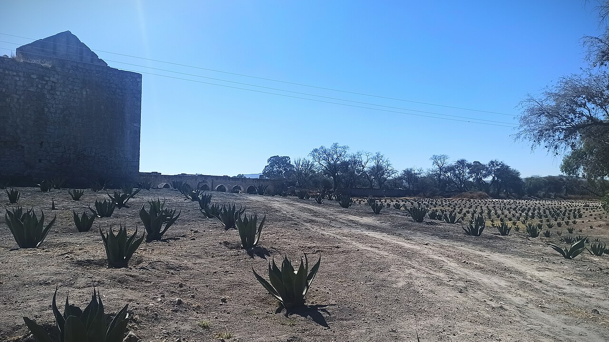

# 梅斯卡尔 NOM-070

梅斯卡尔常被描述为“龙舌兰酒的表亲”，但两者在法律上并不是亲戚关系。NOM-070-SCFI-2016 给 mezcal 下了一个很干脆的定义：100% 龙舌兰蒸馏酒。没有“最多 20% 其他糖类”的余地，也没有“混合原料”的灰色地带。

这部标准 2016 年修订、2017 年 2 月 23 日在官方公报发布。它最重要的变化，是把过去靠形容词表达的“手工”“传统”，拆成了三套可核查的设备与工序组合。于是“Artesanal”不再是一句好听的标签，而是一份必须对得上的生产记录。

图：梅斯卡尔允许多种龙舌兰；图为瓜纳华托州用于梅斯卡尔的龙舌兰种植。图片：Juan Carlos Fonseca Mata，CC BY-SA 4.0，via Wikimedia Commons（[原图页面](https://commons.wikimedia.org/wiki/File:Cultivo_de_agave_para_industria_del_mezcal_(Jaral_de_Berrio).jpg)）。

## 从 1994 到 2016：一次收紧

1994 年版的 NOM-070 允许在发酵前添加最多 20% 的其他糖类，这让 mezcal 的原料边界相对宽松。2016 年版取消了这一空间，把 100% 龙舌兰写成硬条件，并新增 Artesanal 与 Ancestral 两个类别。

收紧的背景是市场。2010 年代 mezcal 在北美与欧洲快速走红，价格上升，掺糖、混品种与假手工的案例随之增加。标准制定者选择用“工艺证据”而不是“品牌故事”来区分产品。

## 原料：多种龙舌兰，但必须成熟

与 tequila 只认一个品种不同，mezcal 允许使用多种龙舌兰（maguey）。可以是栽培的，也可以是野生的，但必须达到生理成熟，地块要在认证机构登记并做地理坐标记录，采运还要有凭证。

标签必须写出所用龙舌兰的科学名或当地俗名；如果用了两种以上，要按比例从多到少排列。这一条对消费者很有用：Espadín、Tobalá、Tepeztate 的风味差异，往往比“年份”更能解释一瓶酒的性格。

## 三类工艺：Mezcal、Artesanal、Ancestral

标准按四个环节的设备组合分类。第一类 Mezcal 的弹性最大：蒸煮可用土坑、砖窑或高压釜，粉碎可用石磨、机械磨或扩散器，发酵可用木槽、石槽或不锈钢罐，蒸馏可用铜壶或连续柱。

第二类 Artesanal 要求更传统：蒸煮限于土坑或砖窑，粉碎限于木槌、石磨或撕裂机，发酵限于石穴、土坑、木槽、陶罐或兽皮，蒸馏必须直火加热铜壶或陶壶。

第三类 Ancestral 最严：土坑蒸煮、木槌或石磨粉碎、石穴/土坑/木槽/陶罐/兽皮发酵、陶壶直火蒸馏，四个环节都要保留龙舌兰纤维参与。三类都必须是 100% 龙舌兰，差别在工艺，不在原料。

## 陈年与“abocado con”

- Blanco 或 Joven：未经陈年，或仅在惰性容器中静置。
- Madurado en Vidrio：在玻璃容器中陈放，时间必须标出。
- Reposado：在木质容器中至少 2 个月。
- Añejo：在小于 1000 升的木质容器中超过 12 个月，时间必须标出。
- Abocado con：直接加入龙舌兰虫、达米阿那、蜂蜜、柑橘等允许配料，干浸出物上限为 60 克/升。

“Abocado con”常被误译成“调味”。它其实是一种明确标注的加法：加了什么、加了多少，都要在标签上写清楚。与之相对的“Destilado con”是把配料参与蒸馏，两者不能混用。

## 标签：100% agave 是必填项

梅斯卡尔标签的强制信息包括：类别名称（Mezcal、Mezcal Artesanal 或 Mezcal Ancestral）、陈年/处理类别、酒度（35% 至 55%）、净含量、龙舌兰名称、产地州、生产者或灌装者的名称与税号，以及“100% Maguey”或“100% Agave”字样。

“Denominación de Origen Protegida”字样必须以大写、不小于 3 毫米的字高印在主展示面。认证由经济部认可的符合性评估机构执行，生产者与地块都要登记。出口到欧盟的产品还受地理标志注册保护。

## 市场、生态与争议

梅斯卡尔的热度带来两个副作用。其一是野生龙舌兰被过度采挖，尤其是生长十几年的 Tobalá 与 Tepeztate；其二是产区村落的地价与劳动结构被改变，年轻采割者外出，传统知识出现断层。

争议还包括：Artesanal 与 Ancestral 的认证成本是否把小生产者挡在门外；机械化蒸馏是否应被允许进入“Mezcal”大类；以及 mezcal 与 tequila 的边界是否被人为放大。标准给出了答案，但答案本身仍在被市场检验。

价格层面，mezcal 的出厂价与龙舌兰品种强相关：Espadín 产量大、成熟快，价格相对亲民；Tobalá 与 Tepeztate 生长慢、出酒率低，单瓶价格可以是前者的数倍。消费者若只按“100% agave”判断，很容易忽略品种差异。

另一个变化是产区外灌装。标准要求 100% agave 在产区内装瓶，但普通 Mezcal 允许在特定条件下外装；这给大品牌提供了成本空间，也让“产地”与“灌装地”的区分变得重要。这些规则并不完美，却是目前最可执行的边界。对消费者，最实用的判断顺序是：先看类别（Mezcal / Artesanal / Ancestral），再看龙舌兰品种，最后看产地与灌装地。三者都清楚，才谈得上理解一瓶 mezcal。标签上的信息越多，越需要按顺序读。这也是墨西哥小农面对市场时最现实的难题。

相关条目：[瓦哈卡](ref:region-oaxaca)。

## 另见与参考资料

- 梅斯卡尔的风格与产区，见 [梅斯卡尔](ref:drink-style-mezcal)。
- 瓦哈卡的地理与村落，见 [瓦哈卡](ref:region-oaxaca)。
- 与龙舌兰酒的对照，见 [龙舌兰酒](ref:drink-style-tequila)。
- 龙舌兰酒的标准，见 [龙舌兰 NOM-006](ref:standard-nom-006-scfi-2012)。
- 另一种龙舌兰蒸馏酒，见 [Sotol](ref:drink-style-sotol)。

1. NOM-070-SCFI-2016，Diario Oficial de la Federación，2017 年 2 月 23 日。
2. Diario Oficial de la Federación，访问于 2026 年 11 月 20 日。
3. Consejo Regulador del Mezcal，访问于 2026 年 11 月 20 日。
4. Profeco，bebidas alcohólicas，访问于 2026 年 11 月 20 日。
5. European Commission，EU geographical indications register，访问于 2026 年 11 月 20 日。

对照阅读：[梅斯卡尔](ref:drink-style-mezcal)、[龙舌兰酒](ref:drink-style-tequila)。

**关键事实。**

| 项目 | 内容 |
| --- | --- |
| 一句话定位 | 墨西哥官方标准 NOM-070-SCFI-2016 把 mezcal 限定为 100% 龙舌兰蒸馏酒，并按蒸煮、粉碎、发酵、蒸馏的设备组合分成 Mezcal、Artesanal、Ancestral 三类；它让“手工”不再是形容词，而是可以逐项核查的工艺清单 |
| 发布机构 | 墨西哥经济部（Secretaría de Economía） |
| 标准编号 | NOM-070-SCFI-2016 |
| 生效日期 | 2017-02-23 |
| 适用范围 | 梅斯卡尔的生产、灌装、标签与商业信息 |

**来源与边界。** 本页关于「梅斯卡尔 NOM-070」的关键事实，主要由以下来源交叉核对：Consejo Mexicano Regulador de la Calidad del Mezcal（标准全文）、Gobierno de México（官方公报；用于确认 2017 年 2 月 23 日的发布记录）、CRM（认证机构、产区与生产者登记制度）等 5 条来源。价格、批次与状态会变，涉及这些字段时以页面所列来源的最新版本为准。正文为项目自写，来源只作核验，不复制原文。

**并读。** 把「梅斯卡尔 NOM-070」与「梅斯卡尔」、「瓦哈卡」、「龙舌兰酒」放在一起读时，先确认它们是同一层级还是上下游关系：先确认适用范围与强制或推荐属性，再比较术语、标签与检测方法。本页负责给出标准的基本坐标，对照条目补上具体案例与差异；读完再回到本页，才能分清哪些差别属于标准本身，哪些只是产地、批次或品牌选择。

**适用边界。** 对「梅斯卡尔 NOM-070」而言，标准文本会修订，引用时以发布机构的最新版本为准；本页是导读，不替代原文。

**更新提示。** 「梅斯卡尔 NOM-070」最近核对于 2026-11-20；标准版本、过渡期与检测方法会更新，执行前以现行标准文本为准。
