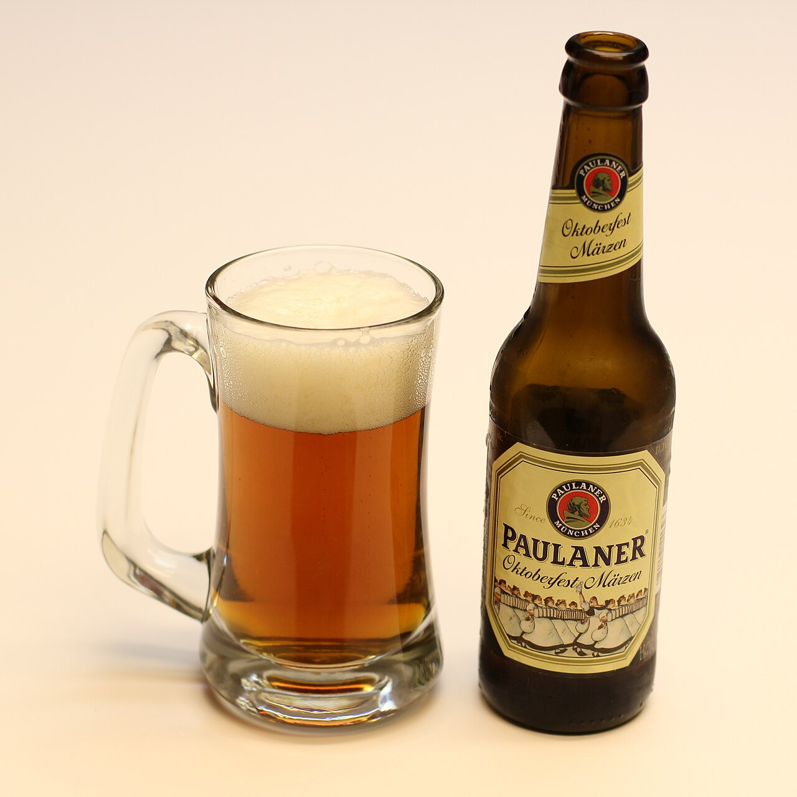

# 德国啤酒纯净法

“德国啤酒只能用水、麦芽、啤酒花和酵母酿造”——这句话在酒桌上被重复了无数遍，但它并不是一条从 1516 年原封不动搬来的法律。1516 年的文本只提到大麦、啤酒花与水；酵母是后来才被加入名单的，而今天的执行依据是 1993 年的《临时啤酒法》。

要把这条法令讲清楚，必须把三个时间点分开：1516 年的巴伐利亚地方条例、1906 年的全国适用、以及 1987 年欧洲法院对进口啤酒的裁决。三者共同塑造了今天的规则。

图：纯净法规定德国啤酒的原料范围；图为德国啤酒与酒杯。图片：Scott A. Miller，CC BY 3.0，via Wikimedia Commons（[原图页面](https://commons.wikimedia.org/wiki/File:Paulaner_Oktoberfest_Marzen_11.2oz_bottle_and_beer_mug.jpg)）。

## 1516 年文本说了什么

1516 年 4 月 23 日，巴伐利亚公爵威廉四世与路德维希十世在因戈尔施塔特召开的邦议会上颁布法令。它首先规定啤酒售价：冬季与夏季的每升价格上限不同，违反者要被没收酒桶。

真正影响后世的是原料条款：啤酒只能用大麦、啤酒花与水。文本没有提酵母，因为当时人们还不知道酵母是发酵的主体。法令的动机也不只是品质：限制小麦与黑麦的使用，可以把这些谷物留给面包。

## 为什么是巴伐利亚，而不是全德国

在 1516 年之前，慕尼黑在 1487 年、纽伦堡在 1305 年前后已有类似规定。1516 年的版本之所以著名，是因为它把地方惯例上升为公国法令，并在后来被更多德意志邦国采用。

1871 年德国统一时，巴伐利亚把纯净法作为加入帝国的条件之一推动全国适用；1906 年，它成为全德国有效的法律。这一路径解释了为什么“Reinheitsgebot”在德国被视为国家传统，而不只是巴伐利亚的地方记忆。

## 原料名单的演变

今天的《临时啤酒法》第 9 条把原料写成四类：水、麦芽、啤酒花、酵母。对下层发酵啤酒，只允许大麦麦芽；对上层发酵啤酒，允许使用其他谷物麦芽，也允许使用糖与糖色。

此外还有技术例外：某些特种啤酒、出口啤酒与进口啤酒不受同一限制。法律保护的是“德国生产的啤酒”这个概念，而不是所有在德国销售的啤酒。

## 与欧盟法的冲突

1987 年，欧洲法院在 Commission v Germany 案中裁定，纯净法对进口啤酒的原料限制构成对商品自由流通的障碍。此后，不符合纯净法的外国啤酒可以在德国销售，但不能标为“德国啤酒”。

德国国内生产者仍须遵守第 9 条。这一“内外有别”的结构常被误解为双重标准，实际上是欧盟单一市场原则与成员国传统规则妥协的结果。

## 今天的实际约束

对德国酿酒厂而言，纯净法意味着不能使用酶制剂、稳定剂、防腐剂、人工香料与色素。澄清剂与过滤材料属于工艺助剂，不在原料名单内，但成品中不得残留。

这套限制让德国啤酒的风味相对“干净”，也提高了成本：酿酒厂必须靠麦芽配方、酒花品种与发酵控制来创造差异，而不能靠添加物。德国约 1500 家啤酒厂、约 7000 个品牌，正是在这个约束下形成的多样性。

## 迷思与事实

迷思一：纯净法是“世界上最古老的食品法”。更准确的说法是，它是最古老的、仍在实际执行的食品原料规则之一，且现行文本经过多次重写。

迷思二：所有德国啤酒都只含四种原料。上层发酵啤酒可以使用其他麦芽与糖；进口啤酒完全不受限制。

迷思三：纯净法保证了品质。它保证的是原料范围，不是工艺水平、卫生条件或风味好坏。好啤酒仍然取决于酿酒师。

迷思四：纯净法只适用于巴伐利亚。1906 年起它已是全德国法律，今天写在联邦《临时啤酒法》里；巴伐利亚只是最早颁布，并一直最积极维护这套传统。把“巴伐利亚”当成适用范围，会误判德国其他产区的合规义务。

迷思五：纯净法禁止一切现代辅料。实际上，澄清剂、过滤助剂与包装气体不属于原料，只要不残留即可使用；真正被禁止的是改变风味与延长保质期的添加物。酒厂因此可以在保持原料纯净的同时，使用现代工艺控制氧化与微生物。这也是德国啤酒能在工业化生产中保持稳定风味的原因之一。这也是德国啤酒在海外被视为“纯酿造”的原因，但“纯”不等于“好”，只等于原料表短。原料越窄，工艺越需要精确，二者并不矛盾。

## 另见与参考资料

- 啤酒的基本分类，见 [啤酒](ref:drink-style-beer)。
- 下层发酵的代表，见 [拉格](ref:drink-style-lager)。
- 皮尔森的风格，见 [皮尔森](ref:drink-style-pilsner)。
- 巴伐利亚产区，见 [巴伐利亚](ref:region-bavaria)。
- 德国的葡萄酒法规，见 [德国葡萄酒法](ref:standard-german-wine-law)。
- 一款德国小麦啤酒，见 [唯森酵母小麦啤酒](ref:drink-germany-weihenstephaner-hefe-weissbier)。

1. Deutscher Brauer-Bund，Unser Reinheitsgebot — Fragen und Antworten，访问于 2026 年 11 月 20 日。
2. Bayerisches Bier，Bayerisches Reinheitsgebot — Geschichte und Bedeutung，访问于 2026 年 11 月 20 日。
3. Deutscher Bundestag，Vorgaben für das Selbstbrauen und Vermarkten von Bieren，2020 年。
4. Gesetze im Internet，Vorläufiges Biergesetz，访问于 2026 年 11 月 20 日。
5. EUR-Lex，Commission v Germany, Case 178/84，访问于 2026 年 11 月 20 日。

对照阅读：[啤酒](ref:drink-style-beer)、[皮尔森啤酒](ref:drink-style-pilsner)。

**关键事实。**

| 项目 | 内容 |
| --- | --- |
| 一句话定位 | 1516 年 4 月 23 日，巴伐利亚公爵在因戈尔施塔特颁布法令，规定啤酒只能使用大麦、啤酒花与水；今天它的原则写在德国《临时啤酒法》第 9 条里，成为世界上少数仍在执行的古老食品原料规则 |
| 发布机构 | 巴伐利亚公国（今德国巴伐利亚州） |
| 标准编号 | Reinheitsgebot / § 9 Vorläufiges Biergesetz |
| 生效日期 | 1516-04-23 |
| 适用范围 | 德国境内啤酒酿造的原料限制 |

**来源与边界。** 本页关于「德国啤酒纯净法」的关键事实，主要由以下来源交叉核对：Deutscher Brauer-Bund（德国酿酒商协会官方问答）、Bayerisches Bier（因戈尔施塔特、4 月 23 日与两位公爵的颁布背景）、Deutscher Bundestag, Wissenschaftliche Dienste（《临时啤酒法》第 9 条的现行措辞与进口啤酒例外）等 5 条来源。价格、批次与状态会变，涉及这些字段时以页面所列来源的最新版本为准。正文为项目自写，来源只作核验，不复制原文。

**并读。** 把「德国啤酒纯净法」与「啤酒」、「拉格啤酒」、「皮尔森啤酒」放在一起读时，先确认它们是同一层级还是上下游关系：先确认适用范围与强制或推荐属性，再比较术语、标签与检测方法。本页负责给出标准的基本坐标，对照条目补上具体案例与差异；读完再回到本页，才能分清哪些差别属于标准本身，哪些只是产地、批次或品牌选择。

**适用边界。** 对「德国啤酒纯净法」而言，标准文本会修订，引用时以发布机构的最新版本为准；本页是导读，不替代原文。

**更新提示。** 「德国啤酒纯净法」最近核对于 2026-11-20；标准版本、过渡期与检测方法会更新，执行前以现行标准文本为准。
