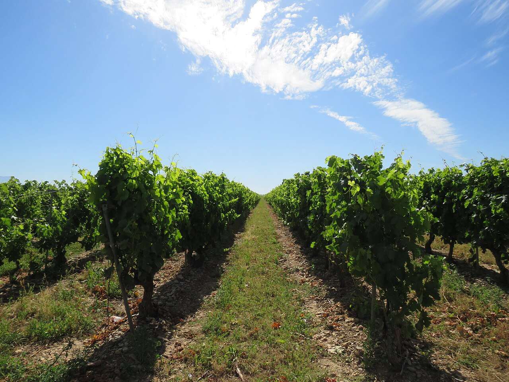

# 西班牙 DO 制度

西班牙的葡萄酒产地制度，核心不是“哪一个产区最好”，而是“哪一个名字受法律保护、要满足什么条件”。这套制度由 2003 年 7 月 10 日的《葡萄与葡萄酒法》（Ley 24/2003）确立，取代了 1970 年的旧《葡萄酒章程》。

与法国、意大利相比，西班牙的 DO 数量多、平均面积大，合作社比重高。理解这一点，才能理解为什么同一瓶里奥哈在不同酒庄之间价格差异巨大，也能理解 DOCa 为什么只有少数产区能拿到。

图：西班牙的 DO 以较大行政区为单位；图为拉里奥哈 Rodezno 的葡萄园。图片：Nicolás Pérez Gimilio，CC BY-SA 4.0，via Wikimedia Commons（[原图页面](https://commons.wikimedia.org/wiki/File:Vi%C3%B1edos_en_Rodezno,_La_Rioja.jpg)）。

## 2003 年法律与分级

Ley 24/2003 把产区分为几层：Vino de Mesa（餐酒）、Vino de la Tierra（对应欧盟 IGP）、Denominación de Origen（DO，对应 PDO）、Denominación de Origen Calificada（DOCa，更高的 PDO），以及 Vino de Pago（单一庄园，VP）。

等级越高，地理范围越小，规则越严。DOCa 目前只有里奥哈、普里奥拉托与里贝拉·德尔杜埃罗等少数产区；VP 则强调单一庄园的风土，不以行政区划为基础。

## DO 的条件

一个 DO 必须同时满足三件事：葡萄来自划定区域，酿造在区域内完成，且 100% 的葡萄来自该区域。申请之前，该地区必须先作为“地理指示葡萄酒”存在至少 5 年。

管理由 Consejo Regulador（监管委员会）负责：登记葡萄园与酒庄、制定产区规范、检查产量与标签、组织感官品鉴。委员会不是行业协会，而是具有公法地位的监管机构。

## DOCa：更高一级

DOCa 的门槛更高：产区必须先作为 DO 存在至少 10 年；酒必须在区内注册酒庄装瓶，不能把散装酒运到区外灌装；控制体系要独立，逐批做理化与感官检查。

这套条件意味着 DOCa 不只是“更好的 DO”，而是“更封闭、更可追溯的 DO”。对消费者，它是品质信号；对酒庄，它是成本与约束。里奥哈在 1991 年获得 DOCa，普里奥拉托在 2000 年跟进，里贝拉·德尔杜埃罗在 2008 年加入。

## 代表产区

里奥哈以 Tempranillo 为主，混酿 Garnacha、Graciano 与 Mazuelo，白葡萄酒用 Viura。里贝拉·德尔杜埃罗以 Tinto Fino（Tempranillo 的当地克隆）为核心，风格更浓缩。普里奥拉托的 llicorella 板岩与 Garnacha、Cariñena 组合，酒精度高、矿物感强。

西北的 Rías Baixas 以 Albariño 闻名，Rueda 以 Verdejo 为主，Jerez 则以 Palomino 与生物陈年体系独立成章。西班牙约有 70 个 DO，覆盖从大西洋湿润区到地中海干燥区的广泛气候。

## 标签与陈年术语

DO 酒标必须出现“Denominación de Origen”与产区名。DOCa 则写“Denominación de Origen Calificada”。常见的陈年术语有 Joven、Crianza、Reserva、Gran Reserva：红葡萄酒的 Crianza 至少 2 年，Reserva 至少 3 年，Gran Reserva 至少 5 年，其中橡木桶时间另有规定。

这些术语是全国统一的传统标识，不是每个产区自定。消费者可以用它们判断陈年长度，但不能据此判断风格；里奥哈的 Reserva 与普里奥拉托的 Reserva 可能完全不同。

陈年术语只约束时间，不约束桶型。里奥哈传统用美国橡木桶，近年更多酒庄转向法国桶；杜埃罗则偏好法国桶与更长的桶陈。消费者若把“Reserva”当成统一风格，容易误判。

另一个容易被忽略的点是白葡萄酒与起泡酒。Cava 有自己的 DO 与陈年规则，不适用红葡萄酒的 Crianza 体系；Rías Baixas 的 Albariño 通常不经过橡木桶，标“Joven”更常见。把这些酒放进同一套陈年术语里比较，没有意义。因此，读西班牙酒标，先看产区，再看术语。

还有一层是酒庄是否自产葡萄。大型酒庄可能收购葡萄或原酒，小酒庄则全程自控；同一 DO、同一陈年术语，来源不同，质量差异可能很大。酒标上的“Bodega”与“Viña”并不告诉你这一点，需要查酒庄资料。同理，年份表也只说明时间，不说明质量。

## 与法国、意大利的差别

法国的 AOC 以地块与村庄为单位，意大利的 DOCG 以产品规范与检验为单位，西班牙的 DO 则以较大的行政区域为单位。结果是，西班牙的 DO 内部差异更大，酒庄之间的水平参差更明显。

另一个差别是合作社。西班牙许多 DO 的产量集中在合作社，酒庄自有葡萄园的比例较低。这影响了定价权与品质提升的速度，也解释了为什么西班牙葡萄酒的整体均价低于法国。

## 争议：产量、气候与分级

第一重争议是产量。部分 DO 长期以高产为目标，导致低端市场供过于求；欧盟改革后，减产与转产压力上升。

第二重争议是气候。干旱与高温使南部产区面临成熟过快、酸度不足的问题；灌溉限制与水资源分配成为政治议题。

第三重争议是分级。DOCa 的数量少、门槛高，是否应该扩大？VP 是否应成为独立的高端体系？这些问题没有统一答案，只有产区之间的利益博弈。

## 另见与参考资料

- 里奥哈产区，见 [里奥哈](ref:region-rioja)。
- 里贝拉·德尔杜埃罗，见 [里贝拉·德尔杜埃罗](ref:region-ribera-del-duero)。
- 普里奥拉托，见 [普里奥拉托](ref:region-priorat)。
- 西班牙的整体格局，见 [西班牙](ref:region-spain)。
- 红葡萄酒的基本分类，见 [红葡萄酒](ref:drink-style-red-wine)。
- “原产地命名”的概念，见 [原产地命名](ref:term-appellation)。

1. Boletín Oficial del Estado，Ley 24/2003，访问于 2026 年 11 月 20 日。
2. Boletín Oficial del Estado，Ley 6/2015，访问于 2026 年 11 月 20 日。
3. MAPA，vinos，访问于 2026 年 11 月 20 日。
4. OEMV，Observatorio Español del Mercado del Vino，访问于 2026 年 11 月 20 日。
5. Wine of Spain，appellations，访问于 2026 年 11 月 20 日。

对照阅读：[里奥哈](ref:region-rioja)、[普里奥拉托](ref:region-priorat)。

**关键事实。**

| 项目 | 内容 |
| --- | --- |
| 一句话定位 | 西班牙的 DO 制度由 2003 年《葡萄与葡萄酒法》确立，分 DO、DOCa、VP 与 IGP 等级；一个产区要先作为地理指示葡萄酒存在 5 年才能申请 DO |
| 发布机构 | 西班牙农业、渔业与食品部（MAPA） |
| 标准编号 | Ley 24/2003, de 10 de julio, de la Viña y del Vino |
| 生效日期 | 2003-07-11 |
| 适用范围 | 西班牙葡萄酒的产地命名、分级、管理与标签 |

**来源与边界。** 本页关于「西班牙 DO 制度」的关键事实，主要由以下来源交叉核对：Boletín Oficial del Estado（法律全文；跨自治区 DOP/IGP 的认可与管理制度）、MAPA（产区名录与监管机构）、OEMV（产量、出口与市场价格数据）等 5 条来源。价格、批次与状态会变，涉及这些字段时以页面所列来源的最新版本为准。正文为项目自写，来源只作核验，不复制原文。

**并读。** 把「西班牙 DO 制度」与「里奥哈」、「杜埃罗河岸」、「普里奥拉托」放在一起读时，先确认它们是同一层级还是上下游关系：先确认适用范围与强制或推荐属性，再比较术语、标签与检测方法。本页负责给出标准的基本坐标，对照条目补上具体案例与差异；读完再回到本页，才能分清哪些差别属于标准本身，哪些只是产地、批次或品牌选择。

**适用边界。** 对「西班牙 DO 制度」而言，标准文本会修订，引用时以发布机构的最新版本为准；本页是导读，不替代原文。

**更新提示。** 「西班牙 DO 制度」最近核对于 2026-11-20；标准版本、过渡期与检测方法会更新，执行前以现行标准文本为准。

**编者注。** 本页把「西班牙 DO 制度」作为标准条目处理：定义、流程与关键数字以正文表格为准，与「里奥哈」、「杜埃罗河岸」的差异用对照阅读验证；遇到价格、批次或地址，回到页面所列来源核对。
