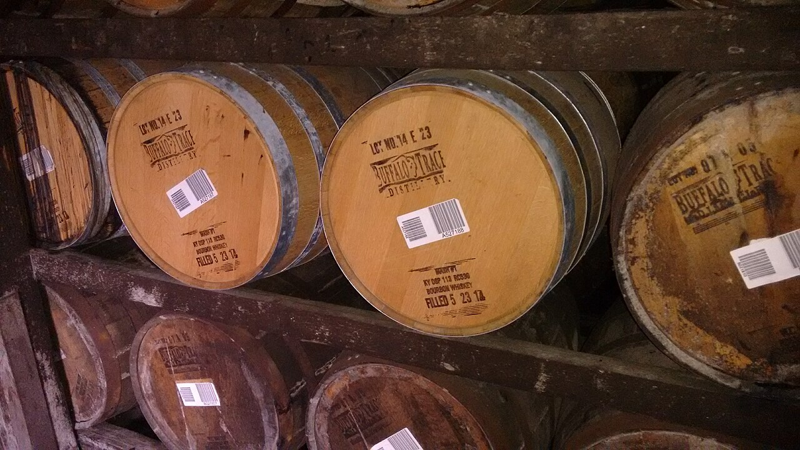

# 美国蒸馏酒标识 27 CFR 5

在美国，一瓶威士忌能不能叫“bourbon”，不是酒厂说了算，而是联邦法规说了算。第 27 编第 5 部分（27 CFR Part 5）把这件事写成了可执行的条款：先定义品类，再规定标签。它由财政部下属的烟酒税务与贸易局（TTB）执行，与食品安全监管分开。

这套规则的法律性格很特别。它不追求“最低安全标准”，而是追求“名称与内容一致”。消费者看到“straight bourbon whiskey”，应当能推导出原料比例、蒸馏酒度、橡木桶类型与最短陈年；如果推导不出来，标签就不合规。

图：美国蒸馏酒的身份标准规定原料、蒸馏与陈年；图为肯塔基州一处酒厂的波本橡木桶。图片：Acdixon，CC0，via Wikimedia Commons（[原图页面](https://commons.wikimedia.org/wiki/File:Buffalo_Trace_barrels.jpg)）。

## 法规的位置：TTB 与联邦法规第 27 编

27 CFR 是美国的酒精、烟草与火器法规汇编。第 4 部分管葡萄酒，第 5 部分管蒸馏酒，第 7 部分管啤酒。第 5 部分覆盖身份标准、标签、广告与包装，TTB 通过前置审批与市场抽查执行。

TTB 的前身是财政部的酒精、烟草与火器局（ATF）。2003 年，酒精与烟草职能移入新设的 TTB，火器职能留在 ATF。这一拆分解释了为什么美国酒标上常见“TTB”批准编号，而枪械管理完全是另一套体系。

## “身份标准”：名字不是营销词

Part 5 用“standards of identity”规定每一类蒸馏酒的原料与工艺边界。威士忌必须以谷物发酵、蒸馏后装入橡木桶陈年；波本威士忌的谷物配方中玉米至少占 51%，蒸馏酒度不得超过 160 proof，且必须使用新的、经火烤的橡木桶。

金酒必须以杜松子为主要风味来源；伏特加被定义为经活性炭或其他方式处理、无明显风味特征的中性酒精；龙舌兰在美国也有独立的品类定义。一个酒厂可以创造新名字，但只要使用受保护的品类名，就必须落进对应的定义里。

## 陈年、straight 与 bottled in bond

美国法规不要求所有威士忌标注陈年，但一旦短于 4 年，就必须如实标出。标注“straight”的威士忌必须陈年至少 2 年；若陈年 2 至 4 年，还要在标签上说明。这个“4 年门槛”是美国酒标最容易出错的地方之一。

“Bottled in bond”是另一套更严的自愿标注：同一蒸馏季、同一酒厂、至少陈年 4 年、装瓶酒度恰为 100 proof。它原本是 1897 年《保税酒法》的监管工具，如今成了品质信号。田纳西威士忌则在波本的基础上增加了枫木炭过滤（林肯县工艺）与州内生产要求。

## 标签上必须出现的信息

强制信息包括品牌名、品类名称、酒精含量（按体积百分比）、净含量、负责方名称与地址、进口酒的原产国，以及政府健康警示语。警示语自 1989 年起强制，措辞与字号都有规定，不能只放一个图标。

对于经过调配的酒，标签还要说明“blended”“a blend”或具体成分；对添加了色素的酒，也有披露要求。2020 年前后，TTB 对部分过时条款做了现代化修订，简化了审批流程，但身份标准的核心没有被放松。

## 与欧盟规则的关键差别

欧盟靠地理标志与品类名称两套系统管理烈酒：干邑、苏格兰威士忌受 GI 保护，伏特加、金酒则有品类定义。美国没有同等级的 GI 注册体系，波本、田纳西威士忌的保护更多依赖国内法与国际协定。

结果是，同一款酒在两地上市时，标签策略不同。欧盟更强调产地与传统术语，美国更强调“这瓶酒由什么原料、经过什么工艺、陈了多久”。两者并不冲突，但合规团队必须分别准备材料。

还有一个常被忽略的差别：美国对进口蒸馏酒同样执行 Part 5 的标签要求，但对“在外国生产、按当地法规标注”的部分信息有豁免。出口商若直接把欧洲标签贴到美国市场，常因缺少政府警示语或酒度单位不符而被退回。美国要求酒度以 ABV 表示，proof 只能作为补充；欧盟则允许以体积百分比为主，但各国格式不同。这也是跨境酒类合规最常见的退货原因之一。合规不是一次性工作，而是随配方与市场变化的持续流程。

## 争议与改革

争议集中在三处：身份标准是否限制了小酒厂的创新；州级法规与联邦法规叠加，造成跨州销售困难；以及“天然”“手工”等营销词缺乏统一定义。TTB 近年通过指南与个案审批回应，但没有大规模重写 Part 5。

另一个长期问题是资源。TTB 同时管理酒、烟、火器与税收，审批积压常被行业批评。对出口商而言，这意味着时间成本有时比合规成本更高。

相关条目：[威士忌](ref:drink-style-whisky)。

## 另见与参考资料

- 波本威士忌的原料与陈年，见 [波本威士忌](ref:drink-style-bourbon)。
- 威士忌的完整谱系，见 [威士忌](ref:drink-style-whisky)。
- 肯塔基产区，见 [肯塔基](ref:region-kentucky)。
- 一款具体的波本，见 [Buffalo Trace](ref:drink-usa-buffalo-trace)。
- 美国葡萄酒的产地制度，见 [美国 AVA 制度](ref:standard-us-ava)。

1. Electronic Code of Federal Regulations，27 CFR Part 5，访问于 2026 年 11 月 20 日。
2. TTB，Distilled spirits labeling，访问于 2026 年 11 月 20 日。
3. TTB，Appellations of origin，访问于 2026 年 11 月 20 日。
4. U.S. Government Publishing Office，CFR Title 27, Volume 1, Part 5，访问于 2026 年 11 月 20 日。
5. Cornell Law School, Legal Information Institute，27 CFR Part 5，访问于 2026 年 11 月 20 日。

对照阅读：[波本威士忌](ref:drink-style-bourbon)、[肯塔基州](ref:region-kentucky)。

**关键事实。**

| 项目 | 内容 |
| --- | --- |
| 一句话定位 | 美国联邦法规第 27 编第 5 部分，由烟酒税务与贸易局（TTB）执行；它用“身份标准”规定威士忌、波本、金酒、伏特加等品类必须具备的原料与工艺条件，并规定标签上必须出现哪些信息 |
| 发布机构 | 美国烟酒税务与贸易局（TTB） |
| 标准编号 | 27 CFR Part 5 |
| 生效日期 | 1935-08-29 |
| 适用范围 | 美国蒸馏酒的身份标准、标签与广告 |

**来源与边界。** 本页关于「美国蒸馏酒标识 27 CFR 5」的关键事实，主要由以下来源交叉核对：Electronic Code of Federal Regulations（现行法规全文）、Alcohol and Tobacco Tax and Trade Bureau（TTB 官方页面；对照美国对产地名称的保护方式）、U.S. Government Publishing Office（旧版条文的编号与措辞）等 5 条来源。价格、批次与状态会变，涉及这些字段时以页面所列来源的最新版本为准。正文为项目自写，来源只作核验，不复制原文。

**并读。** 把「美国蒸馏酒标识 27 CFR 5」与「波本威士忌」、「威士忌」、「肯塔基州」放在一起读时，先确认它们是同一层级还是上下游关系：先确认适用范围与强制或推荐属性，再比较术语、标签与检测方法。本页负责给出标准的基本坐标，对照条目补上具体案例与差异；读完再回到本页，才能分清哪些差别属于标准本身，哪些只是产地、批次或品牌选择。

**适用边界。** 对「美国蒸馏酒标识 27 CFR 5」而言，标准文本会修订，引用时以发布机构的最新版本为准；本页是导读，不替代原文。

**更新提示。** 「美国蒸馏酒标识 27 CFR 5」最近核对于 2026-11-20；标准版本、过渡期与检测方法会更新，执行前以现行标准文本为准。
