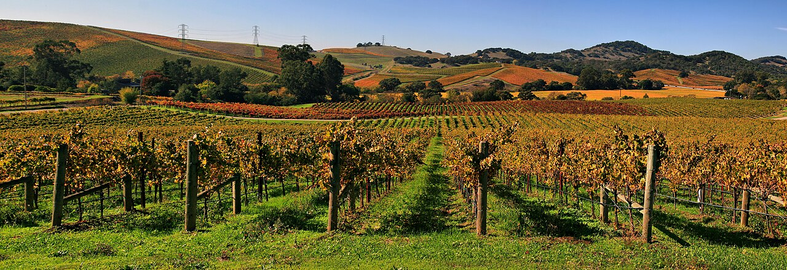

# 美国 AVA 制度

AVA 是美国葡萄酒最容易被误解的制度。很多人以为它相当于法国的 AOC 或意大利的 DOCG，其实它只管一件事：给一块葡萄种植区划边界、起名字。它不规定种什么品种，不限制产量，也不要求某种酿造工艺。

这套制度 1978 年建立，1980 年出现第一个 AVA——密苏里州的 Augusta，1981 年纳帕谷获批。今天美国有 200 多个 AVA，从几百公顷的单一山坡到跨州的大区域都有。

图：AVA 只划定地理边界；图为纳帕谷葡萄园。图片：Brocken Inaglory，CC BY-SA 3.0，via Wikimedia Commons（[原图页面](https://commons.wikimedia.org/wiki/File:Vineyards_in_Napa_Valley_7.jpg)）。

## 1978 年建制与第一个 AVA

在 AVA 之前，美国酒标主要用州名或县名。1978 年，烟酒税务与贸易局的前身 ATF 建立 AVA 制度，目的是让“产地”有一个可核查的地理定义，而不是营销词。

1980 年，Augusta AVA 成为第一个获批的 AVA；1981 年，Napa Valley AVA 获批，随后成为美国最有影响力的葡萄酒产地品牌。TTB 接管酒精职能后，继续负责 AVA 的申请与边界修订。

## 什么是 AVA

American Viticultural Area 是一个地理边界，依据气候、土壤、海拔、地形与历史种植记录划定。它不是行政县，不是邮政编码，也不是一个质量等级。

27 CFR Part 9 逐个列出每个 AVA 的名称与边界描述。边界可以跨县、跨州，也可以完全位于一个县内。AVA 内部还可以有子 AVA，例如 Napa Valley 之下的 Oakville、Rutherford 与 Stags Leap District。

## 85% 规则

酒标上标注 AVA 名称，至少 85% 的葡萄酒必须来自该 AVA 范围内的葡萄。这是 27 CFR Part 4 的标签规则，不是种植规则。

如果标注“单一葡萄园”，要求提高到 95%；标注县名或州名，门槛是 75%。混酿可以跨 AVA，但标签只能标一个 AVA，且必须满足 85% 的比例。

## 申请与边界

AVA 的申请可以由生产者、土地所有者、地方团体或政府机构提出。申请人要提交地图、边界理由、气候与地理证据，证明该区域与周边地区存在可辨识的差异。

TTB 会公开征求意见，处理反对意见，然后发布最终规则。整个过程可能持续数年。边界扩大是常见争议：原有产区内的酒庄担心品牌被稀释，外围土地所有者则希望分享溢价。

## 与欧洲 PDO 的差别

欧洲的 PDO 通常同时规定地理范围、品种、产量、酿造方式与标签；AVA 只规定地理范围。加州的酒庄可以在同一个 AVA 内种几十个品种，用任何工艺，只要标签比例合规。

因此，AVA 更像一个“地理标签”，而不是“质量保证”。它保护的是地名，不保护风格。消费者看到 Napa Valley，知道葡萄来自那里，但不知道品种、甜度或陈年方式。

AVA 也不限制灌溉、产量或 rootstock 选择，这些由酒庄与地方政府决定。加州的部分县对灌溉有额外规定，但那是地方水法，不是 AVA 规则。把 AVA 当成“种植规范”会高估它的约束力。

另一个差别是标签语言：欧洲 PDO 常把“Appellation Contrôlée”印在酒标上，美国 AVA 只写地名，不附带“controlled”字样。消费者因此更容易把 AVA 当成纯地理信息，而不是质量等级。

申请 AVA 的证据门槛也不低：申请人要证明边界内的气候、土壤或地形与外部存在实质差异，且该差异能反映在酒的风格上。TTB 不要求申请人提交感官数据，但要求地理与农业证据；这也是许多申请耗时数年的原因。AVA 的边界一旦获批，不会因市场热度自动扩大；每一次修改都要重新走公众评论程序。这也是它与欧洲 PDO 最大的制度差异。

对酒庄，申请 AVA 是一场长期投资：证据、律师与公众评论缺一不可，成功后的地名溢价却不一定能覆盖成本。对小产区，最大的风险不是被拒绝，而是边界被扩大后名字失去稀缺性。AVA 保护地名，但不保护品质；真正决定一瓶酒的，仍是葡萄、年份与酿酒师。地名可以申请，风格无法申请。

## 代表 AVA

Napa Valley 是美国最知名的 AVA，内部细分出 Oakville、Rutherford、Stags Leap District 等子区。Sonoma 有 Sonoma Coast、Russian River Valley 等，俄勒冈的 Willamette Valley 以 Pinot Noir 闻名。

华盛顿州的 Columbia Valley 面积巨大，覆盖多个子 AVA；中央海岸的 Paso Robles 与 Santa Barbara County 近年热度上升。不同 AVA 的气候差异极大，从凉爽的海岸雾带到内陆的高温河谷。

## 争议：边界、气候与品牌

第一重争议是边界扩张。把新地块纳入已有 AVA，会让原产区的稀缺性下降；不纳入，则可能把实际相连的葡萄园排除在外。

第二重争议是气候变化。传统边界依据历史气候数据划定，温度上升后，适合种植的范围发生移动，AVA 边界却难以及时更新。

第三重争议是品牌溢价。Napa Valley 的名字可以带来数倍价格，但同一 AVA 内的酒质差异巨大。消费者买的是地名，不一定是品质。

## 另见与参考资料

- 纳帕谷产区，见 [纳帕谷](ref:region-napa-valley)。
- 索诺马产区，见 [索诺马](ref:region-sonoma)。
- 美国葡萄酒的整体格局，见 [美国](ref:region-usa)。
- 葡萄酒的基本分类，见 [葡萄酒](ref:drink-style-wine)。
- 美国蒸馏酒的标签规则，见 [美国蒸馏酒标识 27 CFR 5](ref:standard-us-27-cfr-5)。
- “原产地命名”的概念，见 [原产地命名](ref:term-appellation)。

1. TTB，Appellations of origin，访问于 2026 年 11 月 20 日。
2. Electronic Code of Federal Regulations，27 CFR Part 9，访问于 2026 年 11 月 20 日。
3. TTB，Wine appellations — final rule and AVA list，访问于 2026 年 11 月 20 日。
4. Electronic Code of Federal Regulations，27 CFR Part 4，访问于 2026 年 11 月 20 日。
5. Wine Institute，appellations and AVAs，访问于 2026 年 11 月 20 日。

对照阅读：[纳帕谷](ref:region-napa-valley)、[美国](ref:region-usa)。

**关键事实。**

| 项目 | 内容 |
| --- | --- |
| 一句话定位 | AVA 是美国葡萄酒的地理标签制度，1978 年建立，1980 年出现第一个 AVA；它只划定地理边界，不规定品种、产量或工艺 |
| 发布机构 | 美国烟酒税务与贸易局（TTB） |
| 标准编号 | 27 CFR Part 9 |
| 生效日期 | 1978-06-02 |
| 适用范围 | 美国葡萄酒产地名称的划定、申请与标签使用 |

**来源与边界。** 本页关于「美国 AVA 制度」的关键事实，主要由以下来源交叉核对：Alcohol and Tobacco Tax and Trade Bureau（TTB 官方说明；AVA 清单与边界描述）、Electronic Code of Federal Regulations（法规全文；逐个列出 AVA 的边界与名称；85% AVA、95% 单一园与 75% 州县标识规则）、Wine Institute（对照行业对 AVA 的解释与产区分布）。价格、批次与状态会变，涉及这些字段时以页面所列来源的最新版本为准。正文为项目自写，来源只作核验，不复制原文。

**并读。** 把「美国 AVA 制度」与「纳帕谷」、「索诺马」、「美国」放在一起读时，先确认它们是同一层级还是上下游关系：先确认适用范围与强制或推荐属性，再比较术语、标签与检测方法。本页负责给出标准的基本坐标，对照条目补上具体案例与差异；读完再回到本页，才能分清哪些差别属于标准本身，哪些只是产地、批次或品牌选择。

**适用边界。** 对「美国 AVA 制度」而言，标准文本会修订，引用时以发布机构的最新版本为准；本页是导读，不替代原文。

**更新提示。** 「美国 AVA 制度」最近核对于 2026-11-20；标准版本、过渡期与检测方法会更新，执行前以现行标准文本为准。

**编者注。** 本页把「美国 AVA 制度」作为标准条目处理：定义、流程与关键数字以正文表格为准，与「纳帕谷」、「索诺马」的差异用对照阅读验证；遇到价格、批次或地址，回到页面所列来源核对。
