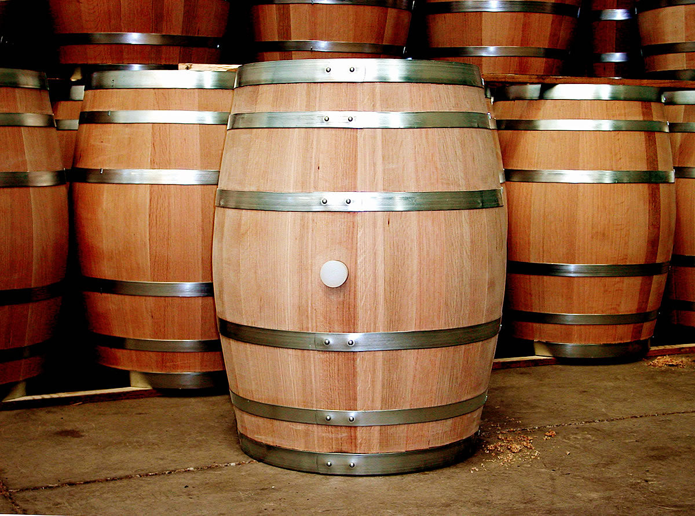

# 天使分享（angel's share）

天使分享（angel's share）指烈酒在木桶中陈年时，通过桶壁蒸发到空气中的那部分酒液。名字很浪漫，描述的事情却很实际：橡木桶不是密封容器，乙醇和水会随着时间持续逸出，桶里的酒越来越少，酒度也可能变化。

图：天使分享（angel's share）。图片：Gerard Prins，CC BY-SA 3.0，via Wikimedia Commons（[原图页面](https://commons.wikimedia.org/wiki/File:Oak-wine-barrel-at-toneleria-nacional-chile.jpg)）。

## 定义与边界

天使分享的边界是“通过桶壁的正常蒸发”。它不包括桶体破损、桶塞松动造成的泄漏，也不包括人为倒桶、取样、过滤带来的体积损失。它也不等于“陈年”本身：陈年是时间与容器共同作用的过程，天使分享只是其中可测量的一项损失。

这个术语适用于所有桶陈烈酒，威士忌、干邑、雅文邑、朗姆酒、龙舌兰酒与部分白酒都存在同样的物理过程。它描述体积与酒度的变化，不描述风味变化；风味来自木材、氧气与时间的共同作用，蒸发只是让剩余酒液浓缩。

## 词源与来源

英语 angel's share 与法语 part des anges、西班牙语 parte de los ángeles 同义，通俗解释是“天使喝掉的那一份”。这一说法在威士忌行业流传已久，但确切的最早出处难以考证，属于行业俗称而非法规术语。中文译作“天使分享”或“天使份额”，保留了拟人化色彩。

法规只规定陈年年限、桶型与标注方式，并不规定蒸发率。因此，“每年 2%”始终是经验值，不是法律条文。把俗语当法规，是讨论天使分享时最常见的起点错误。

## 机制与参数

橡木桶由一块块桶板拼接而成，木材本身具有孔隙，乙醇与水以水汽形式穿过木材，扩散到外表面后蒸发。驱动力是桶内外的温度差与水汽压差，因此仓库环境比“桶龄”更能解释不同酒厂之间的差异。

温度升高会加快蒸发。相对湿度则改变乙醇与水的相对逸出比例：湿度高时，乙醇比水更容易逸出，酒度可能缓慢下降；湿度低时，水逸出更快，酒度可能相对上升。桶容也重要，小桶的表面积与体积之比更大，单位体积损失更快；常见 200 升桶的年损失率通常高于 500 升大桶。仓库类型同样参与：传统平库温度变化平缓，多层货架库的上层更热，损失更快。此外，桶内液面下降会增大顶空，带来额外的氧化风险，因此有些酒厂会定期补桶。

## 在酒业中的实际用法

酒厂把天使分享纳入库存与成本模型：装瓶时的可用酒量少于装桶时的体积，高年份产品需要更多原桶才能达到目标瓶数。投资与保险估算也会用蒸发率推算残值。补桶（topping up）可以缩小顶空、减缓氧化，但无法挽回已经蒸发的部分。

在标签与产品设计中，天使分享与[桶强](ref:cask-strength)相关但不同：桶强指不加水稀释的装瓶酒度，蒸发会改变乙醇与水的比例，从而影响最终酒度，但不能用酒度直接反推蒸发量。[过桶](ref:barrel-finishing)等二次陈年环节会带来额外损失，计算总损耗时需要一并考虑。

## 易混术语对照

- **天使分享与泄漏**：前者是酒液穿过完好木材的正常蒸发，后者是桶缝、桶塞或破损造成的异常流失；泄漏通常可修、可查，蒸发不可逆。
- **天使分享与补桶**：补桶是往桶里加酒以缩小顶空，属于人为维护；天使分享是已经损失的体积，补桶不能“找回”。
- **天使分享与酒龄**：酒龄是时间长度，天使分享是随时间累积的体积与酒度变化；同一酒龄的两桶酒，损失可以差别明显。
- **天使分享与桶强**：桶强是装瓶强度，受乙醇与水的相对损失影响；把桶强当作蒸发量的直接证据，是因果倒置。

## 常见误用与争议

第一，把“每年 2%”当作全行业统一值或法规标准。它只是苏格兰常见的量级参考，温暖产区、小桶或高温仓库可能更高，大桶与低温仓库可能更低。第二，把损失多等同于品质高。浓缩确实可能提高风味密度，但过度蒸发会带来过度氧化与木质味。第三，以为天使分享只发生在威士忌。第四，以为蒸发只减少体积、不改变酒度，忽略了乙醇与水逸出比例不同。

争议之一是高湿与低湿对酒度的影响常被简化成二分法。真实仓库中温度、湿度、空气流动与桶材厚度同时作用，结果需要实测而不是套公式。另一个争议是高年份酒的价格归因：稀缺、仓储、资金占用、品牌与税费都参与定价，不能全部归给天使分享。

天使分享的比例受桶型、环境温湿度与陈年时间影响，不是固定常数；把它当年份越久一定越少，会忽略仓储条件，仓储记录比传说可靠。

每年约 2% 是行业常用估算，不是法规常数；桶型、仓库湿度与温度都会改变实际损失率。

## 典型数值与例子

- 苏格兰行业常引每年约 2% 的体积损失；苏格兰威士忌协会的投资指引写作“roughly 2% of its contents through evaporation each year”。
- 以 200 升桶计算，2% 约为每年 4 升，相当于五到六瓶 700 毫升装。
- 按 2% 复利估算，十年后剩余约 82%，累计损失约 18%；三十年可损失一半以上。
- 苏格兰威士忌法定最低陈年为 3 年（The Scotch Whisky Regulations 2009）。
- 例：同一酒厂的两桶酒，一桶放在湿润的海风仓库，一桶放在内陆干燥仓库，十年后酒度可能相差数个点，说明环境参数比“年份”更能解释差异。

相关条目：[威士忌](ref:whisky)、[年份（vintage）](ref:vintage)。

## 另见

- [威士忌](ref:whisky)：威士忌的陈年与桶型基础。
- [桶强](ref:cask-strength)：装瓶强度与稀释的关系。
- [过桶](ref:barrel-finishing)：二次陈年的目的与做法。
- [年份](ref:vintage)：年份标注与酒龄的区别。

**来源与边界。** 本页关于「天使分享（angel's share）」的关键事实，主要由以下来源交叉核对：Scotch Whisky Association（苏格兰威士忌陈年与蒸发损失的基本表述；“每年约 2% 通过蒸发损失”的行业表述）、Encyclopaedia Britannica（威士忌陈年、桶型与蒸发的一般描述）、UK Government（苏格兰威士忌法定最低陈年 3 年的要求）。价格、批次与状态会变，涉及这些字段时以页面所列来源的最新版本为准。正文为项目自写，来源只作核验，不复制原文。

**并读。** 把「天使分享（angel's share）」与「过桶（barrel finishing）」、「桶强（cask strength）」、「威士忌」放在一起读时，先确认它们是同一层级还是上下游关系：先确认定义与计量口径，再比较相邻术语与常见误用。本页负责给出术语的基本坐标，对照条目补上具体案例与差异；读完再回到本页，才能分清哪些差别属于术语本身，哪些只是产地、批次或品牌选择。
