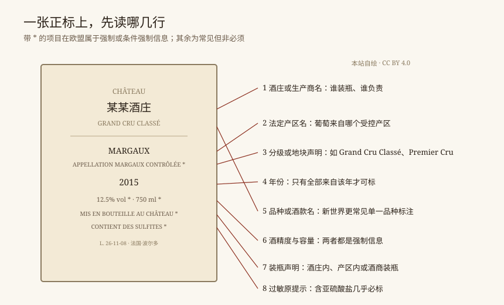

# 原产地命名（appellation）

原产地命名（appellation）是一类法定地理标识：它把某个产品的生产范围与一套规则绑定，只有位于划定区域内、按规则生产的产品，才能使用该名称。法国称之为 appellation d'origine contrôlée（AOC），后扩展为 appellation d'origine protégée（AOP）；意大利有 DOC 与 DOCG，西班牙有 DO 与 DOCa，欧盟层面则分为 PDO 与 PGI。

图：一张法国 AOC 正标的常见信息位置，带 * 的项目在欧盟属于强制或条件强制信息。本站自绘，CC BY 4.0。

## 制度要解决什么问题

在没有规则的情况下，“某地产的酒”可以随便写。消费者无法判断一瓶酒是否真的来自那个地方、是否按当地传统生产。原产地命名制度通过三条约束回应这个问题：划定地理范围、规定生产条件、建立检查与标识规则。

生产条件通常包括允许的品种、最低种植密度、单位面积产量上限、采收方式、酿造方法、最低酒精度、陈年要求等。不同产区的要求差异很大，因此不能把一套规则套到所有地方。规则的目标是保护地方传统与消费者，而不是给酒打分。

## 主要体系

法国的 AOC 制度在 20 世纪初逐步成形，由 INAO 负责管理。AOC 覆盖葡萄酒、烈酒、乳制品与农产品；在葡萄酒中，从大区级到村庄级、再到具体葡萄园，层级越细，规则通常越严。

意大利的 DOC 与 DOCG 采用类似逻辑，DOCG 常附加更严的产量、陈年与装瓶要求。西班牙的 DO 与 DOCa 同样把区域与规范绑定。欧盟把地理标识分为 PDO（受保护原产地名称）与 PGI（受保护地理标志）：PDO 要求生产、加工与准备都在特定地区完成，PGI 允许至少一个生产环节在该地区完成。

烈酒也有对应的地理标识，例如干邑、苏格兰威士忌、龙舌兰等都有法定产区与工艺要求。它们的法律结构各不相同，不能与葡萄酒的 AOC 直接类比。

## 名称的层级与标签

同一产区内常有不同层级的名称。以大区名称标示的酒，规则较宽；以村庄名标示的酒，范围更小、要求更严；以具体葡萄园（如法国的 climat、意大利的 cru）标示的酒，范围最小。层级越高不等于品质越好，但通常意味着更窄的范围与更具体的规范。

标签上同时出现品牌名与产区名时，两者回答的是不同问题：品牌说明生产者，产区名说明地理归属与规则。把产区名当成品牌，或把品牌当成产地保证，都会误读标签。

## 与风土的关系

原产地命名常被当作[风土](ref:terroir)的制度化形式。它确实把“地方”写进了法规，但法规只规定最低条件，不保证每一瓶酒都呈现典型风格。同一边界内，土壤、坡向、小气候、年份与生产者选择仍会造成明显差异。

因此更准确的读法是：产区名告诉你“这瓶酒来自哪里、至少按什么规则生产”，而不是“这瓶酒一定有某种味道”。想看风格，还要回到品种、年份、工艺与生产者资料。

## 不是质量排名

一个常见误解是把 AOC、DOCG、PDO 当作质量等级。这些体系的核心是地理归属与生产规范，检查重点在合规，而不是感官评分。日常餐酒也可能好喝，法定产区酒也可能平庸。价格与等级相关，但等级不是品质的充分条件。

另一个误解是认为地理标识等于绝对排他。实际上，制度允许在规则框架内创新，也允许同一名称下有不同风格。规则越细，创新空间越小，这是制度设计的取舍，不是缺陷。

## 中国的对应制度

中国有地理标志产品保护、农产品地理标志与地理标志商标等不同路径，管理机构与法律依据与欧盟体系并不相同。白酒、黄酒、茶叶等产品也有以地名标示的传统，例如茅台镇、杏花村等，但这些表达的法律含义需要具体核对，不能直接等同于 AOC。

讨论中国酒类的地理名称时，应区分三种情况：法定的地理标志、企业的商品名称、行业或民间的地域称呼。三者的约束力完全不同。

原产地命名把地理范围与生产规范绑定，核心是“哪里产、按什么规则产”，而不是“谁更好”。法国 AOC/AOP、意大利 DOC/DOCG、西班牙 DO 与欧盟 PDO/PGI 各有层级与标签规则；同一款酒可以同时有产地标识与品种标识，但两者说明的是不同维度。把 appellation 当成质量排名，是最常见的误读。同一片土地可能同时存在区域级、村庄级与地块级标识，层级越高通常规则越细，但并不自动等于更好；产量、年份与酒农实践仍会拉开差距。读标签时先确认标识覆盖的范围，再谈品质。

## 参考与延伸阅读

- [风土](ref:terroir)：自然条件与人的实践如何形成地域特征。
- [葡萄酒](ref:wine)：葡萄酒的类别、年份与标签规则。
- [起泡酒](ref:sparkling-wine)：以产地命名的起泡酒与其工艺要求。

补充阅读：[酸度（acidity）](ref:c-extra-1)。

对照阅读：[风土（terroir）](ref:terroir)、[起泡酒](ref:sparkling-wine)。

相关条目：[葡萄酒](ref:wine)。

**来源与边界。** 本页关于「原产地命名（appellation）」的关键事实，主要由以下来源交叉核对：INAO（法国 AOC/AOP 制度的管理机构、地理范围与生产规范框架）、European Commission, Directorate-General for Agriculture and Rural Development（欧盟 PDO、PGI 与 GI 的分类与登记框架）、International Organisation of Vine and Wine (OIV)（地理标识在葡萄酒定义与标签规则中的位置）等 4 条来源。价格、批次与状态会变，涉及这些字段时以页面所列来源的最新版本为准。正文为项目自写，来源只作核验，不复制原文。

**并读。** 把「原产地命名（appellation）」与「风土（terroir）」、「葡萄酒」、「起泡酒」放在一起读时，先确认它们是同一层级还是上下游关系：先确认定义与计量口径，再比较相邻术语与常见误用。本页负责给出术语的基本坐标，对照条目补上具体案例与差异；读完再回到本页，才能分清哪些差别属于术语本身，哪些只是产地、批次或品牌选择。

**适用边界。** 对「原产地命名（appellation）」而言，术语在不同法规与行业语境中含义不同；先看定义来源，再看用法。

**更新提示。** 「原产地命名（appellation）」最近核对于 2026-11-21；定义、计量口径与相邻术语会因文献不同，引用前以标准或权威辞书为准。

**编者注。** 本页把「原产地命名（appellation）」作为术语条目处理：定义、流程与关键数字以正文表格为准，与「风土（terroir）」、「葡萄酒」的差异用对照阅读验证；遇到价格、批次或地址，回到页面所列来源核对。若只记一件事，先确认它在术语体系中的位置，再记住一个可观察的差异。
