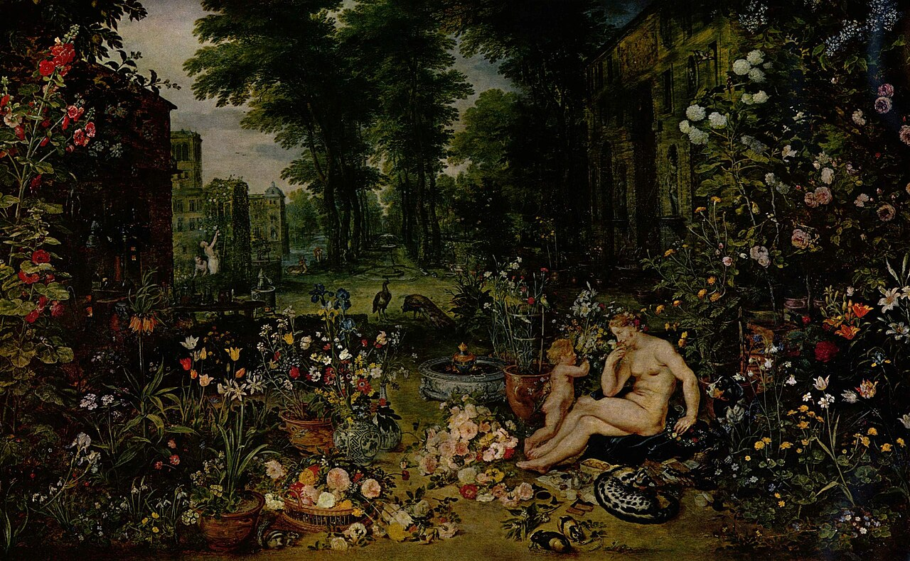

# 香气（aroma）

香气（aroma）是鼻子感知到的挥发性气味。它是品鉴的第一道信息，也是判断酒款类型、状态与复杂度的重要线索。香气不等于入口后的风味：香气主要发生在鼻腔，风味则来自口腔与鼻腔的共同感知，两者需要分开记录。

图：香气（aroma）。图片：Jan Brueghel the Elder / Peter Paul Rubens，Public domain，via Wikimedia Commons（[原图页面](https://commons.wikimedia.org/wiki/File:Jan_Brueghel_d._O._-_Allegorie_van_de_geur.jpg)）。

## 定义与边界

香气描述的是“闻到了什么”，不是“喝起来什么味道”。专业品鉴会区分正向嗅闻（orthonasal，举杯闻香）与反向嗅闻（retronasal，吞咽后气味从口腔后部上升）。同一款酒在两种路径下可能给出不同印象，因此记录香气时要说明闻香方式。

边界还在于“风格香气”与“缺陷气味”。果香、花香、香料、橡木与陈年气息属于风格范围；氧化、还原、软木塞污染、细菌污染则属于缺陷。把缺陷当成风格，或把风格当成缺陷，都会影响判断。香气浓淡也不是质量高低的直接证据。

## 词源与来源

“aroma”源自希腊语，原意是香料、香草与甜味气味，后来进入拉丁语与英语，指令人愉悦的挥发性气味。“bouquet”来自法语，原意是“花束”，在葡萄酒语境中引申为发酵与陈年形成的复合香气。两个词的来源不同，语义也并非完全重合。

现代感官科学把香气按来源分层：品种香气来自原料，发酵香气来自微生物代谢，陈年香气来自橡木、瓶陈与长期贮存。这套分层不是严格的时间顺序，而是“气味从哪里来”的分类工具。它帮助品鉴者把葡萄、酵母与容器各自贡献的部分拆开。

## 机制与参数

香气来自数百种挥发性化合物，浓度、阈值与组合决定最终感知。单萜类中的芳樟醇、香叶醇与橙花醇常带来玫瑰、荔枝与花香；甲氧基吡嗪类常带来青豌豆、青椒与泥土感；酯类中的乙酸异戊酯常带香蕉味；二乙酰常带黄油味。这些化合物不是孤立的“味道”，而是与酒精、酸度和温度共同作用。

温度、杯型、醒酒时间与口腔状态都会改变香气。低温压抑挥发，高温放大酒精与甜感；杯口收窄的杯子更容易聚集香气；醒酒让部分酒款展开，也可能让脆弱的香气过快散失。闻香时先静置，再轻轻摇杯，分两三次记录，能减少第一印象的偏差。酒精刺激本身不是香气，但高酒度会掩盖细微气味。

## 在酒业中的实际用法

在[葡萄酒](ref:wine)品鉴中，香气描述常分为果香、花香、植物香、香料香、橡木香与陈年香；生产者也会用香气判断成熟度、发酵状态与是否受污染。在[威士忌](ref:whisky)中，常用谷物、水果、花香、泥煤、木质与香料来描述；在[啤酒](ref:beer)中，BJCP 风格指南把 aroma 作为首要评价项，用来判断麦芽、酒花、酵母与发酵副产物。

[清酒](ref:sake)的香气常被描述为米香、果香（苹果、香蕉）与乳酸感。不同酒类的香气词汇不能直接互换：把葡萄酒的“矿物感”套到啤酒上，往往缺乏对应基础；把啤酒的“酒花香气”套到清酒上，也会失真。跨品类比较时，先确认词汇在该品类中的定义。

## 易混术语对照

第一组是 aroma 与 bouquet。按常见行业用法，aroma 更偏向葡萄品种带来的原始香气，bouquet 更偏向发酵与陈年形成的复合香气；也有作者把两者当作同义词，因此在正式文本中应说明采用哪种定义。第二组是香气与风味。香气是嗅觉，风味是味觉与嗅觉的综合；闻起来像蜂蜜的酒，入口后可能并不甜。

第三组是品种香气与发酵香气。前者来自原料，后者来自酵母与微生物；同一款酒的果香可能来自葡萄，也可能来自酯类，不能只凭“像水果”就归为品种香。第四组是香气与酒精感。高酒度带来的灼热是刺激，不是气味；把它写进香气描述，会让品鉴记录失去区分度。

## 常见误用与争议

第一，把香气等同于风味。第二，把香气浓等同于质量高。第三，认为香气越复杂越好；有些酒的价值在于干净与直接。第四，把酒精刺激当成香气。第五，只用“香”“果香”这类笼统词，不记录具体气味。

争议主要集中在“矿物感”这类词汇。它常被用来描述石板、湿石与盐感，但科学上难以对应到单一化合物，不同品鉴者的理解也不同。另一个争议是“香气词典”的作用：背单词能提供共同语言，却不能替代实际闻香训练。把词典条目直接套到酒款上，容易产生先入为主的判断。

## 典型数值与例子

雷司令的陈年汽油味有明确的化合物解释：TDN，即 1,1,6-三甲基-1,2-二氢萘，来自葡萄中的前体物质，在陈年过程中逐渐形成；适量时构成复杂度，过量时可能压过果香。赤霞珠等品种的青椒味常与甲氧基吡嗪有关；霞多丽经苹乳发酵与酒泥接触后，二乙酰可带来黄油气息。

在[雷司令](ref:riesling)的品鉴中，汽油、蜂蜜、柑橘与湿石常被并列记录；在啤酒中，BJCP 会分别描述麦芽甜香、酒花香气与酵母特征。把这些具体化合物与感官词对应起来，比笼统地说“香气复杂”更有信息量。

## 另见

- [葡萄酒](ref:wine)：理解香气（aroma）在葡萄酒语境中的类别、年份与产地规则。
- [威士忌](ref:whisky)：谷物、泥煤与陈年香气。
- [啤酒](ref:beer)：麦芽、酒花与酵母香气。
- [清酒](ref:sake)：米香、果香与乳酸感。
- [雷司令](ref:riesling)：品种香气的典型样本。

对照阅读：[葡萄酒](ref:wine)、[啤酒](ref:beer)。

**来源与边界。** 本页关于「香气（aroma）」的关键事实，主要由以下来源交叉核对：Oxford University Press（提供关于香气、嗅觉与品鉴的条目）、International Organisation of Vine and Wine (OIV)（葡萄酒感官评价相关定义）、Beer Judge Certification Program（啤酒风格描述中 aroma 的用法）等 7 条来源。价格、批次与状态会变，涉及这些字段时以页面所列来源的最新版本为准。正文为项目自写，来源只作核验，不复制原文。

**并读。** 把「香气（aroma）」与「葡萄酒」、「威士忌」、「啤酒」放在一起读时，先确认它们是同一层级还是上下游关系：先确认定义与计量口径，再比较相邻术语与常见误用。本页负责给出术语的基本坐标，对照条目补上具体案例与差异；读完再回到本页，才能分清哪些差别属于术语本身，哪些只是产地、批次或品牌选择。

**适用边界。** 对「香气（aroma）」而言，术语在不同法规与行业语境中含义不同；先看定义来源，再看用法。
