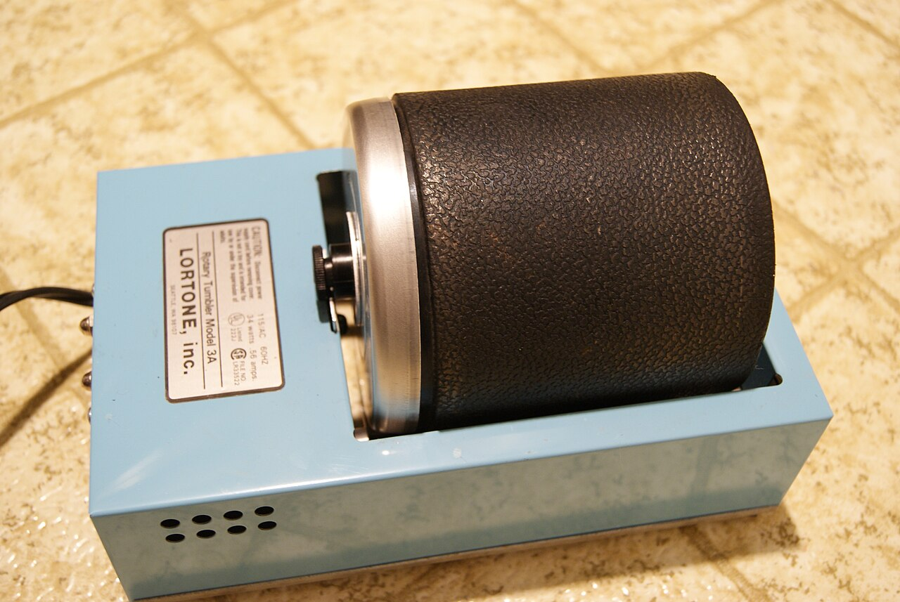

# 过桶（barrel finishing）

过桶（barrel finishing，也称二次陈年）指酒液在主要陈年结束之后，从原来的容器转入另一种桶，再存放一段时间，以增加、调整或统一风味。它描述的是一段后续工艺，不是“全程都用这种桶”。过桶在[威士忌](ref:whisky)、[葡萄酒](ref:wine)与啤酒中都能见到，但目的、时间与法规约束各不相同。

图：过桶（barrel finishing）。图片：Zul32，CC BY-SA 3.0，via Wikimedia Commons（[原图页面](https://commons.wikimedia.org/wiki/File:RockTumbler2.JPG)）。

## 定义与边界

过桶的关键是“先主要陈年，再换桶”。如果一款酒从入桶到装瓶都待在同一个桶里，那是单一桶陈年，不是过桶；如果酒液只是换桶后短暂存放数周，也通常称为 finish 而不是完整陈年。过桶的时间一般短于主要陈年，常见为数月到两三年，但并没有统一的法定时长。

边界还在于桶是否仍属于法定陈年容器。以苏格兰威士忌为例，法规要求酒液只在容量不超过 700 升的橡木桶中陈年，且陈年期不少于三年；过桶桶也必须满足这些条件，过桶时间才可以计入法定陈年。若换到不合规的容器，那一段就不能算作苏格兰威士忌的合法陈年。

## 词源与来源

“barrel”来自古法语表示木桶的词，“finish”有“完成、收尾”的意思，合起来就是“用桶收尾”。英语行业里也常用 secondary maturation、cask finishing 或简称为 finish；中文“过桶”强调酒液“经过”另一种桶，而“二次陈年”强调它是第二段陈年。这些说法描述的是同一类工艺位置，但语气与侧重点不同。

从工艺史看，过桶并非新发明。酒厂很早就会把酒液从原桶转入旧酒桶、葡萄酒桶或雪莉桶，以借用残留风味。现代标签把“finished in”写成卖点，是市场沟通的结果；它不改变工艺本质，只让消费者更容易知道最后一段用了什么桶。

## 工艺机制与参数

过桶的效果来自桶材与桶内残留物。新桶会释放更多木质素、单宁、香草醛与内酯，带来香草、椰子、香料和甜木质气息；旧桶释放较弱，更多起到柔化与微氧化的作用。桶的烘烤程度、桶板厚度、桶的容量与存放环境的温湿度都会改变提取速度。桶越小，单位体积接触面越大，通常变化越快。

“首填”（first-fill）与“再填”（refill）是重要参数。首填桶指第一次用于装这款酒（不一定第一次装任何酒），风味贡献通常更强；再填桶已经用过一次或多次，贡献更轻。若前一段装过雪莉酒、波特酒或葡萄酒，桶中残留的糖、酸与香气会进入下一段酒液；这也是“雪莉桶过桶”“葡萄酒桶过桶”的由来。过桶时间过短，风味可能只停留在表面；过长，则可能压过基酒本身。

## 在酒业中的实际用法

在威士忌中，典型安排是先在 ex-bourbon 桶或再填桶中完成主要陈年，再转入 ex-Oloroso 雪莉桶、波特桶或葡萄酒桶数月至两三年。[苏格兰](ref:scotland)产品常用“finished in”标注最后一段桶型；[麦卡伦](ref:macallan)以雪莉调味橡木桶风格著称，[格兰菲迪 18 年](ref:glenfiddich)也用桶型组合构建风味。读标签时要区分“全程陈年于此桶”和“最后过桶于此桶”。

朗姆酒行业也常见类似逻辑：先在 ex-bourbon 桶中完成主体陈年，再用曾装过葡萄酒、雪莉或其他烈酒的桶做二次陈年，以增加干果、香料或甜感。啤酒领域的做法更直接：把基酒放入木桶或曾装过威士忌、葡萄酒的桶中存放，BJCP 的木桶陈酿风格明确要求基酒风格仍可辨识，木味应明显但不能压过整体平衡。葡萄酒的[橡木桶陈年](ref:oak-ageing)同样包括新桶、旧桶、桶型与烘烤选择，但许多风格刻意避免橡木影响。

## 易混术语对照

第一组是过桶与主要陈年。主要陈年是酒液在首个容器中完成的大部分熟成，决定基础结构与酒龄；过桶是之后的短段调整，不能替代主要陈年。第二组是过桶与桶强。桶强描述装瓶时是否加水稀释，过桶描述陈年容器顺序；一款过桶威士忌完全可以是常规 40% vol 装瓶，也可以是桶强。

第三组是过桶与桶内发酵。葡萄酒的“barrel fermented”指发酵在桶中进行，过桶指发酵结束后的陈年转移；两者可以同时出现，但不是同一件事。第四组是过桶与“陈年更久”。过桶增加的是一个风味层，不一定延长总陈年时间；把“finish”当成“额外陈年三年”是常见误解。第五组是过桶与“调味”。过桶借的是桶材与残留物，不是直接添加香料或糖。

## 常见误用与争议

第一，把过桶等同于全程桶陈。第二，认为过桶一定提升质量；过桶的效果取决于基酒与桶的匹配，过度过桶会让桶味主导。第三，把过桶与桶强混为一谈。第四，忽略过桶时间与桶型，只看“finished in”字样。第五，把桶味当成品种本身的风味。

争议集中在标签披露。有的产品只写“过桶”，不写桶型、时间或是否为首次使用；有的产品把多个桶的短时间混合称为 finish，消费者难以判断实际影响。另一个争议是“湿桶”与“干桶”：桶内残留液体的多少会改变提取强度，但标签通常不披露。对饮者来说，最可靠的做法是把过桶信息与基酒年份、酒精度和品鉴记录一起看。

## 典型数值与例子

苏格兰威士忌的法定框架提供三个可核对数字：橡木桶容量不超过 700 升、陈年不少于三年、装瓶酒度不低于 40% vol。过桶桶也必须符合橡木与容量要求，过桶时间才能计入法定陈年。常见过桶时长从数月到两三年不等；例如“先在 ex-bourbon 桶陈 12 年，再在 ex-Oloroso 雪莉桶过桶 9 个月”，就是标签上常见的“matured in ... finished in ...”结构。

葡萄酒方面，波尔多式小桶（barrique）常见容量约 225 升，勃艮第式小桶（pièce）约 228 升；桶越小，单位体积的木材接触面越大。啤酒方面，BJCP 的木桶陈酿风格要求木味“明显但不失衡”，并允许描述旧桶中曾装过的酒精饮料带来的风味。把这些参数与[威士忌](ref:whisky)、[葡萄酒](ref:wine)的实际标签对照，能更准确地判断过桶在酒中扮演的角色。

## 另见

- [威士忌](ref:whisky)：威士忌的类型、原料与工艺。
- [葡萄酒](ref:wine)：理解过桶（barrel finishing）在葡萄酒语境中的类别、年份与产地规则。
- [橡木桶陈年](ref:oak-ageing)：桶型、烘烤与提取的基本原理。
- [苏格兰](ref:scotland)：苏格兰威士忌的法定陈年要求。
- [麦卡伦](ref:macallan)：雪莉桶风格的典型样本。
- [格兰菲迪 18 年](ref:glenfiddich)：桶型组合的对照样本。