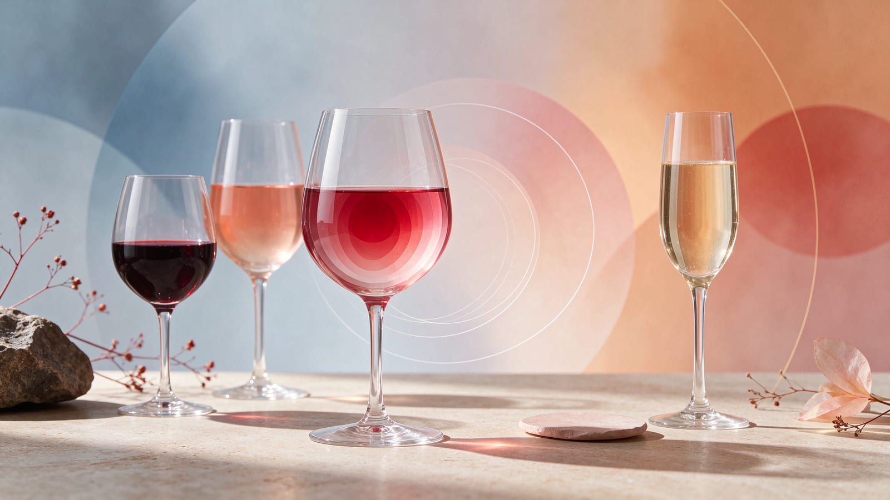

# 酒体（body）

图：酒体的编辑插图：不同杯型与酒液颜色深浅，用色带表达酒体轻重；AI 辅助绘制，不是实拍。 图片：Hejiu 编辑团队，项目自有。

## 定义与边界

酒体（body）是品鉴时对酒液“重量感”的描述：入口后，酒在舌面上显得轻盈、适中还是厚重。它不是酒精度的同义词，也不是质量评分。酒体是多种成分共同作用的结果，理解它的构成，比记住“轻/中/重”三个词更有用。专业品鉴常用 light-bodied、medium-bodied 与 full-bodied 三档，但三档之间并没有硬性分界。

还有一层区别需要说清楚。酒体回答“这口酒在嘴里有多大分量”，不回答“这口酒有多好喝”，也不回答“香气有多浓”。一款香气浓烈的酒可能酒体轻盈；一款香气内敛的酒也可能酒体厚重。酒体还与温度、杯型和气泡有关：同一款酒在低温下往往显得更紧致，在高温下显得更松散。

## 词源与来源

body 来自古英语 bodig，本义是“躯干、身体”，后来引申为“实体、主体”。葡萄酒品鉴借用这个词，把酒液在口中的“实体感”比作身体的分量。中文“酒体”是直译，保留了“体”的隐喻：不是指酒的化学组成，而是指它在口腔里的存在感。

这个隐喻也带来局限。身体有高矮胖瘦，酒体却只有重量与饱满度的连续谱；把“酒体”理解成“酒的骨架”会与单宁、酸度构成的结构概念混淆。较准确的用法是把酒体当作触觉与口感层面的描述，而不是结构、香气或质量的替代词。

## 机制或参数

第一是[酒精度](ref:abv)。酒精带来黏度与热度，通常酒精度越高，酒体越重；Wine Folly 的资料把 14% 以上酒精度的葡萄酒描述为更容易显得饱满。第二是残糖与甘油。糖分和甘油增加圆润感与重量，少量残糖可以在不显甜的情况下增加酒体。第三是[单宁](ref:tannin)。单宁带来收敛感与“骨架”，让酒显得更有体积。第四是酸度。酸度低时酒体容易显得松散，酸度高时则显得更紧致、更轻快；Wine Folly 也指出，人倾向于把高酸酒感知为更轻盈。

第五是浸渍、陈年、酒泥接触与溶解氧，它们改变酒液的质地。第六是温度、杯型与气泡：低温让酒显得更紧，宽杯让香气更开放，气泡则带来刺痛感与清爽感。啤酒的酒体还与残糖、蛋白质和碳酸化有关：残糖高、碳酸化低时，酒体显得更厚；碳酸化高时，酒体显得更轻快。

## 在酒业中的实际用法

对[红葡萄酒](ref:red-wine)而言，单宁与酒精常常共同支撑酒体；对[白葡萄酒](ref:white-wine)而言，酒体更多来自酒精、甘油与酒泥接触。对[啤酒](ref:beer)而言，酒体是风格描述的标准项，BJCP 指南会用“very light, sometimes watery body”描述美式淡拉格，也会用“full body”描述烈性黑啤一类风格。对[白酒](ref:baijiu)而言，酒体描述常与酒精度、酸酯平衡和口感绵甜相关，但具体表达仍因香型而异。

在品鉴记录中，酒体最好与香气、酸度、单宁分开写。练习时可以用同一类酒做对照：同一品种、不同酒精度；同一酒精度、不同残糖；同一产区、不同浸渍时间。先记录入口的黏度、舌面覆盖感与吞咽后的重量，再记录香气与余味，能减少主观印象的干扰。

配餐时，酒体是重要线索。轻酒体适合清淡菜肴与海鲜；重酒体适合红肉、烧烤与浓郁酱汁。酒体过重会压住清淡菜肴，过轻则会被浓郁菜肴盖过。这个原则比“红酒配红肉”更具体，也更可靠。

## 易混术语对照

酒体与酒精度不是一回事。高酒精可以带来重量感，但一款高酒精、低残糖、低单宁的酒仍可能显得偏轻；酒精度是原因之一，不是酒体本身。酒体与风味强度也分属两个维度。香气浓度与口感重量彼此独立，一款轻盈的酒可以有强烈香气，一款厚重的酒也可以香气内敛。

酒体与结构容易被混用。结构通常指酸度、单宁与酒精共同形成的骨架与张力；酒体更接近触觉上的重量与饱满度。酒体与甜度也需要分开。残糖会增加酒体，但甜度是味觉感受；一款干型酒可以因为甘油、酒精或酒泥接触而显得饱满，却不甜。

## 常见误用与争议

第一，把酒体等同于酒精度，看到 14% 就断定“重酒体”。第二，把酒体等同于质量，认为轻酒体一定单薄、重酒体一定高级；轻酒体可以非常精致，重酒体也可能显得笨重。第三，把颜色深浅当成酒体；颜色主要来自浸渍与色素，与口感重量不直接对应。第四，忽略温度与杯型的影响。第五，用“厚”来形容所有正面感受，导致描述失去分辨力。

争议主要围绕“重酒体是否更高级”。在商业宣传中，饱满、浓郁常被当作卖点，但许多产区与品种的高品质恰恰来自轻盈与透明感。较稳妥的判断是把酒体放在风格与配餐中看：适合的酒体，比更大的酒体更重要。

## 典型数值或例子

- 酒精度 14% 以上的葡萄酒，通常更容易被感知为饱满型。
- BJCP 对美式淡拉格的描述：very light, sometimes watery body。
- 啤酒的酒体与残糖、蛋白质、碳酸化有关：残糖高、碳酸化低时更厚。
- 少量残糖可以在不显甜的情况下增加酒体；甘油也会增加饱满感。
- 高酸度通常让酒显得更轻盈；低酸度让酒显得更松散。
- 典型轻酒体红葡萄酒：黑皮诺、佳美；典型饱满型红葡萄酒：马尔贝克、西拉、赤霞珠。
- 典型白葡萄酒：霞多丽经橡木桶陈年后常被认为酒体更饱满。

这些例子提醒品鉴者，酒体是成分、工艺与感官共同塑造的结果，不能只用酒精度判断。

## 另见

- [葡萄酒](ref:wine)：理解酒体（body）在葡萄酒语境中的类别、年份与产地规则。
- [红葡萄酒](ref:red-wine)：单宁、酒精与酒体的关系。
- [白葡萄酒](ref:white-wine)：酒泥接触与质地。
- [啤酒](ref:beer)：残糖、蛋白质与碳酸化如何影响酒体。
- [白酒](ref:baijiu)：香型与口感描述的基本框架。
- [酒精度](ref:abv)：酒精对重量感与热度的贡献。
- [单宁](ref:tannin)：收敛感如何支撑酒的骨架。

**来源与边界。** 本页关于「酒体（body）」的关键事实，主要由以下来源交叉核对：Oxford University Press（提供关于酒体、口感与品鉴的条目）、International Organisation of Vine and Wine (OIV)（葡萄酒成分与感官评价的相关定义）、Beer Judge Certification Program（啤酒风格描述中 body 的用法）等 5 条来源。价格、批次与状态会变，涉及这些字段时以页面所列来源的最新版本为准。正文为项目自写，来源只作核验，不复制原文。
