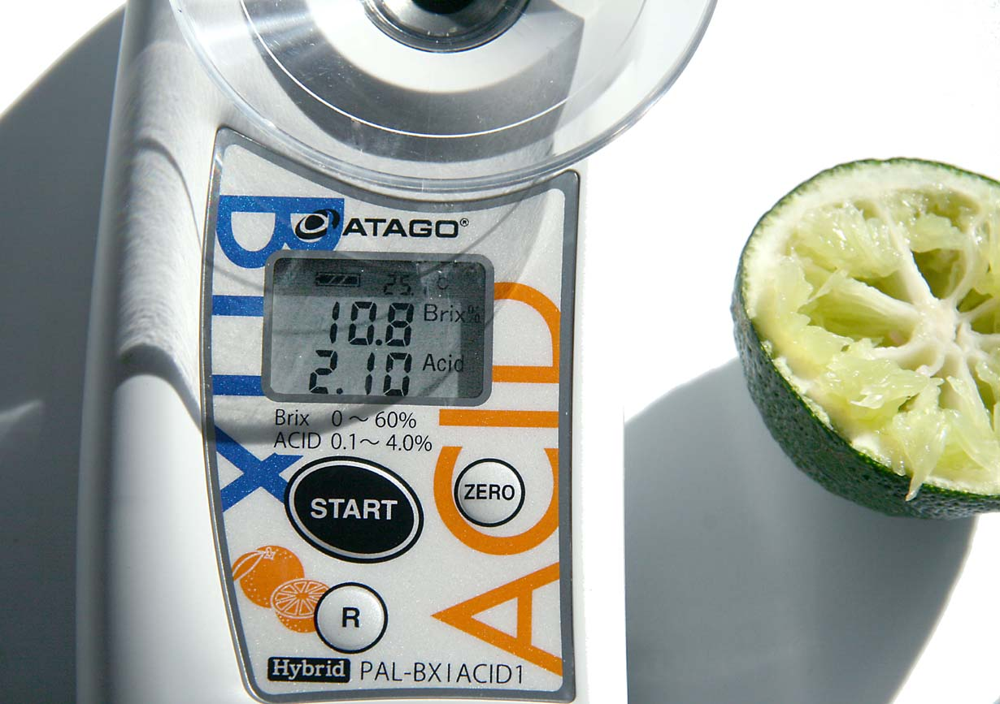

# 白利度（Brix）

白利度（°Brix，符号也写作 °Bx）是表示溶液糖浓度的单位。它的定义很具体：在 20°C 时，1 °Brix 等于每 100 克溶液中含有 1 克蔗糖，也就是蔗糖的质量分数为 1%。葡萄酒与果汁行业用它判断葡萄成熟度、估算潜在酒精度并监控发酵进程。

图：白利度（Brix）。图片：Jpbrigand，CC BY-SA 4.0，via Wikimedia Commons（[原图页面](https://commons.wikimedia.org/wiki/File:Brix_acide_sudachi_23-08-2016.jpg)）。

## 定义与边界

白利度的基准是纯蔗糖溶液，因此严格来说它描述的是“蔗糖质量分数”。在葡萄汁中，可溶性固形物并不只有糖，还有有机酸、矿物质与其他成分，所以折光仪给出的 °Brix 是这些固形物的近似总量。行业仍习惯把它当作糖度使用，但读数的含义要比“糖有多少”宽一点。

边界还在于测量对象。白利度描述的是液体当前的糖或固形物浓度，不是成品酒的甜度，也不是酒精度。发酵把糖转成酒精与二氧化碳之后，原来的白利度读数会下降；成品是否甜，要看发酵结束时的[残糖](ref:residual-sugar)，而不是采收时的白利度。

## 词源与来源

°Brix 的名称来自 19 世纪科学家阿道夫·白利（Adolf Brix），他参与建立了以蔗糖溶液浓度为基础的比重标度。后来制糖、果汁与葡萄酒行业把这一标度标准化，并用折光率或密度读数换算成白利度。今天国际糖分析组织 ICUMSA 与 OIV 的方法文件仍是这一体系的主要技术依据。

白利度不是唯一标度。法国旧文献常用波美度（°Baumé），德国葡萄栽培常用 Oechsle，啤酒行业则常用柏拉图度（°Plato）。它们各自对应不同的测量传统与换算表，不能因为都表示“浓度”就随意互换。

## 测量机制与参数

最常见的两种工具是折光仪与比重计。折光仪测量少量样品在 20°C 下的折射率，再按蔗糖溶液的标准表换算为 °Brix；它样品量小、读数快，适合田间与车间使用。比重计测量液体的密度，再换算成糖度或潜在酒精度；它需要较多样品，但结构简单、稳定性好。

两者在纯糖溶液中读数接近，在发酵液中却会分道扬镳。酒精的折射率与糖不同，发酵开始后折光仪读数会被酒精拉偏，不能直接当作糖度；需要借助修正公式，或先蒸馏再测。比重计也受酒精影响，只是影响方式不同。温度同样关键，标准读数以 20°C 为基准，样品温度偏离时要校正。

## 在酒业中的实际用法

采收前，种植者会连续测量白利度，并把它与总酸、pH、种子成熟度与风味成熟一起判断采收日。白利度上升通常意味着糖在积累，但酸度会同时下降；只盯白利度，可能采到高糖低酸的葡萄。不同品种与产区的目标区间不同，常见酿酒葡萄在 22–26 °Bx 左右，具体取决于风格与年份。

发酵中，白利度下降反映糖被酵母消耗，是判断发酵进程的指标之一。发酵结束后，残余糖分必须另行测量。收购[葡萄汁](ref:must)与决定是否加糖（chaptalisation）时，白利度也是基础数据，但加糖量与合法性受产区法规限制。啤酒行业用[原麦汁浓度](ref:original-gravity)承担类似角色，但原料与标度不同。

## 易混术语对照

第一组是白利度与柏拉图度。两者都以质量分数为基础，但 °Plato 是啤酒酿造针对麦芽浸出物的标度，换算表与白利度不同；同一溶液的两个读数接近，却不能不加修正地互相替代。第二组是白利度与潜在酒精度。白利度是当前糖浓度的读数，潜在酒精度是用换算系数估算的成品酒度，后者还受酵母效率、温度与残糖影响。

第三组是白利度与甜度。白利度高只说明糖或固形物多，若发酵完全，成品仍可能是干型；白利度低也不必然意味着酒不甜，因为发酵可能提前中止。第四组是白利度与波美度、Oechsle。它们服务不同的行业传统与法规体系，数值不能凭印象直接互换。

## 常见误用与争议

第一，把白利度当作甜度。第二，把白利度当作酒精度；0.55–0.64 的系数只是估算区间，不是精确公式。第三，在发酵液中直接相信折光仪读数，忽略酒精造成的偏差。第四，把不同标度的数字直接互换。第五，只用白利度判断采收，忽略酸度、风味与病害。

争议主要出现在“多高才算熟”。高白利度可能来自过熟、脱水或贵腐，也可能只是品种特性；低白利度可能代表未熟，也可能来自冷凉年份的清爽风格。把白利度当成唯一的成熟指标，会掩盖酸度与风味的变化。另一个争议是加糖：它能把白利度不足的葡萄汁补到目标酒度，但合法性、用量与标签要求因产区而异。

## 典型数值与例子

按常见近似系数，潜在酒精度约等于白利度乘以 0.55–0.64。以 24 °Bx 为例，乘以 0.55 得 13.2% vol，乘以 0.60 得 14.4% vol，乘以 0.64 得 15.4% vol；三者都是估算，实际酒度还取决于发酵终点。Wine Folly 的术语表给出一个更直观的例子：27 °Bx 完全发酵后可得到约 14.9%–17.3% ABV 的干型酒。

另一个可核对的数值是定义本身：1 °Brix 等于 100 克溶液中 1 克蔗糖。若把 20 °Bx 的葡萄汁按标准方法测量，读数表示 20°C 下蔗糖质量分数约为 20%，而不是“20 克糖溶于 80 克水”之外的任意解释。理解这一点，就能明白为什么白利度与密度、折射率和温度绑在一起。

## 另见

- [葡萄汁](ref:must)：糖度与发酵起点的关系。
- [原麦汁浓度](ref:original-gravity)：啤酒体系中的类似指标。
- [残糖](ref:residual-sugar)：发酵结束后的糖分与甜度标签。

对照阅读：[葡萄醪（must）](ref:must)、[残糖（residual sugar）](ref:residual-sugar)。

**来源与边界。** 本页关于「白利度（Brix）」的关键事实，主要由以下来源交叉核对：International Organisation of Vine and Wine (OIV)（糖度测量与葡萄成熟度相关术语；20°C 下以蔗糖质量分数（白利度）表示可溶性固形物的折光测量方法）、Wine Folly（白利度与潜在酒精度的近似换算关系（ABV 约为白利度数值的 55%–64%））、International Commission for Uniform Methods of Sugar Analysis（折光法干物质含量与纯蔗糖溶液换算的定义边界）等 6 条来源。价格、批次与状态会变，涉及这些字段时以页面所列来源的最新版本为准。正文为项目自写，来源只作核验，不复制原文。

**并读。** 把「白利度（Brix）」与「葡萄醪（must）」、「原麦汁浓度（original gravity）」、「残糖（residual sugar）」放在一起读时，先确认它们是同一层级还是上下游关系：先确认定义与计量口径，再比较相邻术语与常见误用。本页负责给出术语的基本坐标，对照条目补上具体案例与差异；读完再回到本页，才能分清哪些差别属于术语本身，哪些只是产地、批次或品牌选择。
