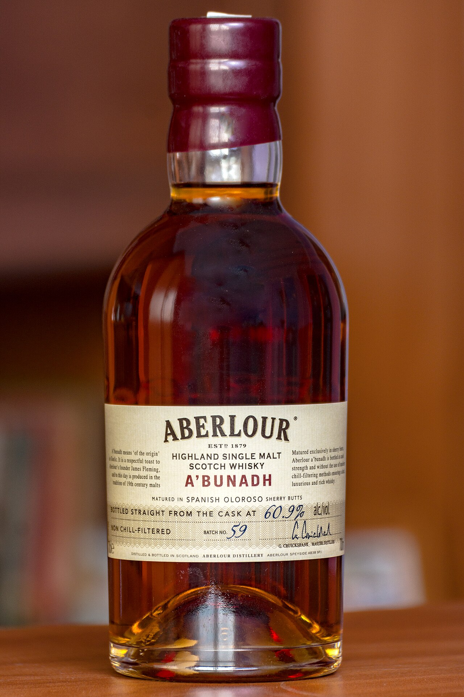

# 桶强（cask strength）

桶强（cask strength，也称原桶强度）指威士忌装瓶时几乎不加水稀释，直接保留酒液在桶中形成的[酒精度](ref:abv)。它描述的是一道装瓶决定，而不是桶型、年份或质量等级。市面上常见的桶强产品约 50%–65% vol，但同一酒厂的不同批次也可能相差数度，因为每桶的自然酒度并不相同。

图：桶强（cask strength）。图片：Paweł Mazurek KRK，CC BY-SA 4.0，via Wikimedia Commons（[原图页面](https://commons.wikimedia.org/wiki/File:Aberlour_A%27bunadh_Batch_59.jpg)）。

## 定义与边界

判断一款酒是否属于桶强，关键看装瓶环节有没有加水把酒度拉低，而不是看它是否标了很高的数字。苏格兰法规要求威士忌装瓶酒度不低于 40% vol，所以“桶强”仍必须满足法定下限；只是它通常远高于这个下限。装瓶时若从桶中约 58% vol 稀释到 40% vol，那便是常规装瓶，不是桶强。

边界还包括“几乎不加水”与“绝不加水”的差别。蒸馏和入桶阶段本来就可能加水调整到规定酒度，因此桶强不等于生产全程无水。它只说明装瓶时没有为了降低酒度而进行大幅稀释。若生产者把不同桶混在一起、再以高酒度装瓶，它仍可称桶强，但不是单一桶。

## 词源与来源

“cask”在英语中泛指木桶，词源可追溯到法语与意大利语中表示“箱、容器”的词；“strength”则指强度、浓度。两个词组合成“cask strength”，是威士忌交易与品鉴圈对“按桶中酒度装瓶”的口语化描述。美国常用“barrel proof”或“barrel strength”，日本则常用“原酒”指未加水稀释的酒液。

这一说法长期是行业惯例，而不是所有产区都写进法规的正式等级。正因如此，不同品牌对它的执行尺度可能不同：有的严格按每桶自然酒度装瓶并标注桶号，有的把多个桶调到统一的高酒度后仍称桶强。读标签时，具体酒度、桶号、装瓶日期和是否单桶，比“cask strength”四个字更能说明问题。

## 机制与参数

威士忌蒸馏后通常加水降到入桶酒度，随后在橡木桶中陈年。陈年期间酒精与水都会蒸发，具体哪一方损失更快取决于仓库温湿度：潮湿环境往往让酒精比例下降更快，干燥环境则可能让水分损失更多，酒度反而上升。因此“桶中酒度”不是固定值，而是时间、桶型、仓库位置与气候共同作用的结果。

苏格兰法规要求威士忌只在容量不超过 700 升的橡木桶中陈年，且不少于三年；这两条限制了蒸发速度和桶材接触面积，也构成桶强产品的背景参数。桶越小，单位体积接触面越大，通常熟成越快；桶越大，变化越缓慢。装瓶时若要把高酒度稀释到目标值，可用近似公式：加水量约等于原酒体积乘以（原酒度除以目标酒度减一）。例如 10 升 58.2% vol 的酒液调到 46% vol，需加水约 2.65 升。

## 在酒业中的实际用法

生产者在装瓶前会先确定产品定位：是追求稳定、易饮的常规版本，还是保留浓度、供爱好者自行加水的桶强版本。桶强版本常用于单一麦芽、单一桶或小批次系列，也会出现在旅游零售、酒厂限定和拍卖市场。它的卖点是“更接近桶中状态”，但这也意味着批次差异更明显。

零售与品鉴场景中，桶强常被用来做对照：同一品牌常规版与桶强版并排，饮者可以先纯饮，再逐次加少量水，观察香气从封闭到展开的过程。加水不是“破坏”，而是品鉴方法的一部分；关键是每次只加几滴，等待酒液稳定后再判断，而不是一次倒进大量水。

## 易混术语对照

第一组是桶强与单一桶。单一桶指酒液来自一个具体的桶，强调不可复制的个体差异；桶强指装瓶时没有大幅稀释。单一桶可以稀释后装瓶，桶强也可以由多个桶调和而成，两者并不互相保证。第二组是桶强与单一麦芽。单一麦芽只规定原料与酒厂来源，允许把同厂多桶酒混合并加水；桶强只规定装瓶酒度，不规定是否单一酒厂。

第三组是桶强与“高酒度”。一款 46% vol 的单一麦芽可能只是常规装瓶，未必是桶强；一款 50% vol 的酒也可能经过稀释。第四组是“cask strength”与“barrel proof”：后者在北美更常用，语义接近，但各生产商的执行细节与标签习惯不同，不能只凭译名判断。

## 常见误用与争议

最常见的误用是把桶强当成质量等级，认为酒度越高酒越好。酒度只改变浓度与香气释放方式，不能替代对平衡、余味和缺陷的判断。第二个误用是把桶强等同于单一桶，忽略了“多桶调和”也可能以桶强装瓶。第三个误用是认为桶强必须纯饮；实际上加水是理解它的常用手段。

争议主要集中在标签透明度。由于“cask strength”并非所有产区都有统一定义，有的产品会把多桶酒调到统一的高酒度再装瓶，消费者若只看四个字，可能误以为每瓶都保留了各自的自然酒度。另一个争议是“不加水”被理解为“全程未加水”，这与蒸馏、入桶时的工艺现实不符。购买时应优先看具体酒度、桶号与批次说明。

## 典型数值与例子

苏格兰威士忌的法定框架给出三个可直接核对的数字：橡木桶容量不超过 700 升、陈年不少于三年、装瓶酒度不低于 40% vol。桶强产品常见落在 50%–65% ABV；常规装瓶则常被稀释到 40%–46% 左右。若一桶酒的自然酒度为 58.2% vol，取 10 升调到 46% vol，按稀释公式需加水约 2.65 升，最终体积约 12.65 升。

以[苏格兰](ref:scotland)产品为例，[麦卡伦](ref:macallan)与[格兰菲迪 18 年](ref:glenfiddich)的常规版本通常经过稀释，适合作为桶强版本的对照；比较时应记录两款的酒度差，而不是只比较品牌或年份。阅读[威士忌](ref:whisky)标签时，把“桶强”“单一桶”“单一麦芽”分别核对，能避免把三个维度混成一个。

## 另见

- [威士忌](ref:whisky)：威士忌的类型、原料与工艺。
- [苏格兰](ref:scotland)：苏格兰威士忌的法定框架与产区。
- [麦卡伦](ref:macallan)：雪莉桶风格的代表。
- [格兰菲迪 18 年](ref:glenfiddich)：常规稀释版本的对照样本。
- [酒精度](ref:abv)：装瓶酒度、稀释与标签规则。

对照阅读：[威士忌](ref:whisky)、[麦卡伦18年雪莉桶](ref:macallan)。

**来源与边界。** 本页关于「桶强（cask strength）」的关键事实，主要由以下来源交叉核对：Scotch Whisky Association（苏格兰威士忌的装瓶与酒精度要求；“橡木桶不超过 700 升、酒精度不低于 40% vol”的法定要点）、UK Government（苏格兰威士忌的法定定义、橡木桶容量与装瓶要求）、Bunnahabhain Distillery（桶强不加水稀释与常见 50–65% ABV 的行业用法）等 6 条来源。价格、批次与状态会变，涉及这些字段时以页面所列来源的最新版本为准。正文为项目自写，来源只作核验，不复制原文。
