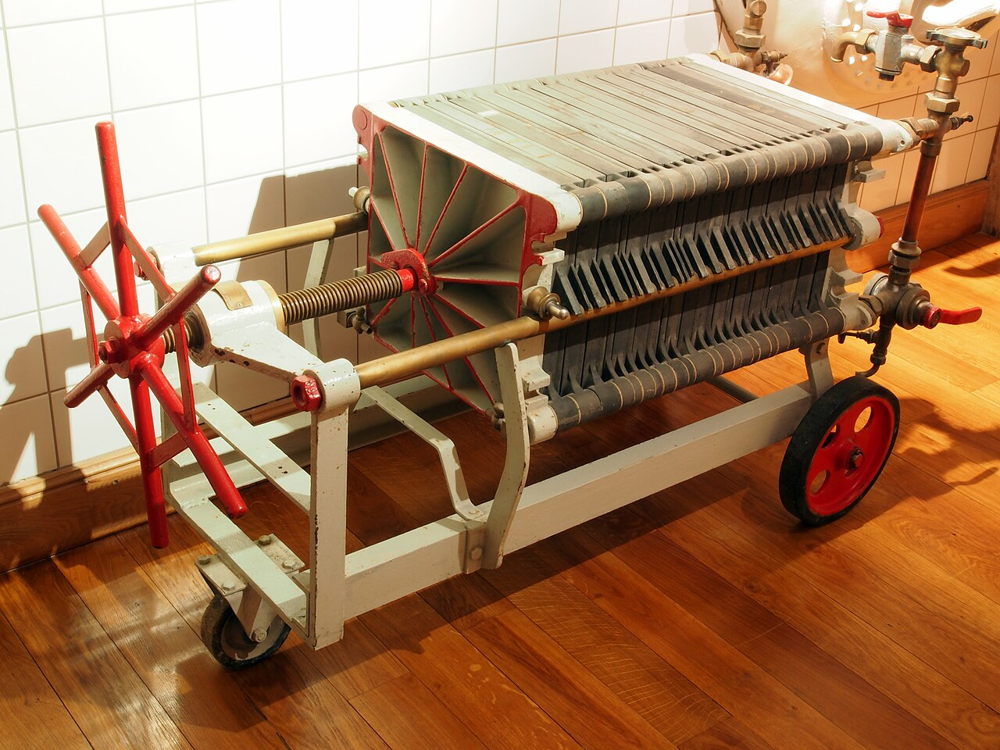

# 冷凝过滤（chill filtration）

冷凝过滤是威士忌装瓶前常见的一道可选工序：把酒液降温到接近冰点，让原本溶解在酒精里的长链脂肪酸酯、脂肪酸和蛋白质析出，再用滤材把它们截留。它的直接目的不是“提高酒精度”或“改变风味”，而是防止成品在低温、冰箱或加水加冰时出现浑浊。是否采用这道工序，取决于酒厂对清澈度、稳定性和风味的取舍，不是一款酒好坏的法定标准。

图：欧洲啤酒博物馆的板框滤机；过滤设备的历史示例，不是威士忌冷凝过滤生产线，也不是本页工艺的实物。图片：AlfvanBeem，CC0，via Wikimedia Commons（[原图页面](https://commons.wikimedia.org/wiki/File:Filter_press_at_the_Mus%C3%A9e_Europ%C3%A9en_de_la_Bi%C3%A8re.JPG)）。

## 定义与目的

威士忌在陈年后含有多种来自谷物、酵母和橡木桶的化合物。其中一些长链脂肪酸酯在酒精浓度较高时溶解良好，但遇到低温或加水降度时溶解度下降，会形成细微的悬浮物，行业里常叫 haze 或 flocking。冷凝过滤的做法，是先把酒液冷却到约 -10°C 至 +4°C（不同酒厂的具体温度不同，常见说法包括约 -1°C），让这些物质提前析出，再让酒液通过纤维素、纸板、硅藻土或金属板等滤材，把析出物和部分较大的颗粒除去。

这样处理过的酒在冷藏或加冰后更不容易发浑，外观更稳定，货架期表现也更可预期。对大规模生产和出口来说，清澈度是消费者对“正常酒液”的预期之一，所以冷凝过滤在 40%–43% ABV 的 mainstream 威士忌中很常见。它不是“杀菌”，也不是“陈年”，更不是把酒液变成另一种产品；它只是装瓶前的一道物理分离。

## 哪些物质会析出

主要的问题是长链脂肪酸的乙酯，例如月桂酸乙酯、棕榈酸乙酯和棕榈油酸乙酯。它们由乙醇与相应的脂肪酸反应生成，在酒精中溶解度较高，在水中溶解度较低；当酒精度降低或温度下降时，它们容易从溶液里出来。蛋白质和部分多糖也可能参与浑浊，尤其是在谷物残留较多或未经过滤的酒液中。不同的化合物对温度的敏感度不同，所以“在冰箱里发浑”与“加水后发浑”并不完全是同一回事。

这些物质并不都是“坏东西”。一些酯类和脂肪酸对口感、油脂感和香气的持久性有贡献；把它们全部除去，可能让酒体显得更干净、更轻，也可能让某些风味变薄。正因如此，冷凝过滤才会成为威士忌圈长期争论的工艺问题，而不是一个纯粹的技术细节。

## 工艺流程

典型流程包括：把待装瓶的酒液放入带冷却夹套的罐中，降温到设定温度并保持一段时间，让析出物形成；随后通过板框过滤机、烛式过滤器或类似的设备，让酒液穿过滤材；最后把滤液升温到装瓶温度，进入灌装线。滤材的孔径、压差、流速和温度都会影响过滤效率与风味保留。过滤过度可能把本可保留的香气和油脂一并带走；过滤不足则可能在成品里留下可见的悬浮物。

不同酒厂会选择不同的温度与滤材组合。有的只做轻度过滤，有的在降度前过滤，有的在装瓶前过滤；也有的完全不做冷凝过滤，而是把酒精度维持在 46% ABV 或以上，利用较高的酒精浓度降低析出风险。没有一种流程是“唯一正确”的，选择取决于目标产品的外观、口感、成本和法规市场。

## 法规与标签边界

英国《2009 年苏格兰威士忌条例》规定苏格兰威士忌的原料、蒸馏、橡木桶陈年、最低酒精度和允许添加物，但没有把冷凝过滤设为强制或禁止的工序，也没有给“non-chill filtered”规定一个检测阈值。换句话说，冷凝过滤是工艺选择，不是法定类别；“non-chill filtered”更多是酒厂的自我声明，消费者需要结合酒厂说明和实际酒精度理解。

这并不意味着标签可以随意写。一般消费者保护法规要求标签声明真实、不误导；如果酒厂声称“non-chill filtered”，就应当能够说明其工艺确实跳过了冷凝过滤。不同市场对“natural”“traditional”等词的监管也不同，购买时应看具体酒厂的说明，而不是只凭一个正面词判断。

## 风味争议

支持冷凝过滤的人强调清澈、稳定和一致性：消费者不希望买到一瓶在低温下出现絮状物的酒；对出口市场来说，外观稳定能减少投诉和退货。反对者则认为，冷凝过滤会带走部分长链酯、脂肪酸和蛋白质，让酒体变薄、油脂感下降，尤其在高酒精度、重泥煤或老酒中，这些物质对质地的贡献更明显。

酒厂的公开说明也分成两派。Bruichladdich 在其工艺文章里明确表示不做冷凝过滤，并指出过滤会移除部分对风味至关重要的成分和带来油脂感的脂肪酸；Glenlivet 的文章则认为冷凝过滤与不过滤各有取舍，没有绝对优劣，关键在个人偏好和产品定位。把任何一方写成“科学定论”都不准确；目前没有统一的盲品结论能证明所有酒款都因过滤而变差或变好。

## 常见误读

第一，冷凝过滤不等于“过滤掉所有风味”。它主要针对会在低温下析出的长链酯和蛋白质，不是把所有香气分子一网打尽；影响大小取决于酒款、过滤强度和目标风味。第二，冷凝过滤不等于“降低酒精度”。降度是加水，过滤是分离，两者可以同时发生，但不是同一件事。第三，non-chill filtered 不等于“没有过滤”。大多数威士忌仍会经过粗滤，去除桶屑和较大颗粒；“non-chill”指的是不做低温过滤，不是完全不过滤。

第四，发浑不等于变质。由脂肪酸酯或蛋白质引起的浑浊通常是无害的，温度回升或酒液回温后可能重新变清；如果伴随异味、漏气或瓶盖损坏，才需要另作判断。第五，46% ABV 不是“非冷凝过滤的法定门槛”。它只是行业里常见的装瓶酒精度，因为高于这个浓度时析出风险较低；酒厂可以在其他酒精度下选择不过滤，也可能在 46% 以上仍然过滤。

## 如何判断与饮用

判断一款酒是否经过冷凝过滤，最可靠的方式是看酒厂官网、产品页或瓶背说明，而不是只看酒精度。若酒厂明确写“non-chill filtered”或“un-chill filtered”，再结合酒精度和是否有“natural colour”声明一起看。若没有声明，不要自行推断；同一酒厂的不同酒款也可能采用不同工艺。

饮用时，冷凝过滤与否不必成为唯一的评价框架。先看香气、口感、余味和你自己的偏好；如果一款非冷凝过滤的酒在加冰后发浑，可以先让它在室温下回温，或少量加水观察变化。浑浊本身不是缺陷，真正的缺陷是异味、漏气或与产品描述明显不符。把工艺信息当成理解酒款的线索，而不是标签上的胜负手。

## 选购与表达

选购时，把“冷凝过滤”放在工艺信息里，而不是质量等级里。你可以问三个问题：这款酒的装瓶酒精度是多少？酒厂是否声明 non-chill filtered？它是否同时声明 natural colour？这三个答案能帮助你判断酒厂的风格取向，但不能单独决定一款酒是否好喝。

写作时，较准确的表达是“该酒厂声明不做冷凝过滤，装瓶酒精度为 46% ABV”，而不是“非冷凝过滤一定更好”。如果要讨论风味差异，最好说明比较的是哪两款酒、是否同酒龄同桶型、是否盲品。冷凝过滤是一个有取舍的工艺选择，不是一场需要站队的道德审判。

相关条目：[威士忌](ref:whisky)、[泥煤（peat）](ref:peat)、[蒸馏](ref:distillation)。

## 延伸阅读与另见

- [威士忌](ref:whisky)：冷凝过滤最常讨论的酒种。
- [泥煤](ref:peat)：泥煤风格与冷凝过滤常被放在一起讨论。
- [蒸馏](ref:distillation)：过滤之前的酒液形成过程。
- [威士忌入门](ref:whisky-intro)：从原料到装瓶的整体框架。
- [拉弗格 10 年](ref:laphroaig)：一款常见非冷凝过滤艾雷岛威士忌。
