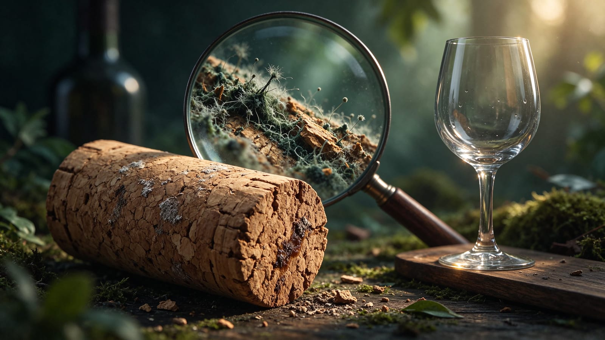

# 软木塞污染（cork taint）

图：软木塞污染的编辑插图：软木塞剖面、霉斑纹理与放大镜；AI 辅助绘制，不是实验室实拍。 图片：Hejiu 编辑团队，项目自有。

## 定义与边界

软木塞污染（cork taint）是葡萄酒最常见的感官缺陷之一，典型表现为潮湿纸板、发霉、陈旧的气味，同时压制酒原有的果香。它主要由一类叫卤代苯甲醚的化合物引起，其中最常见的是 2,4,6-三氯苯甲醚（TCA）。同类化合物还包括 2,4,6-三溴苯甲醚、五氯苯甲醚与四氯苯甲醚等，气味相近但阈值与来源略有差异。

需要区分的是，软木塞污染不是“软木屑掉进酒里”，肉眼可见的木屑不构成污染；它也不是食品安全事件，TCA 带来的是感官缺陷，不是急性中毒风险。软木塞污染还与“软木塞味”这个口语说法不完全等同：后者有时被用来泛指任何霉味，而真正的污染需要化合物与浓度支撑。

## 词源与来源

cork taint 是行业描述性短语，cork 指软木塞，taint 指外来污染或异味。TCA 的化学名 2,4,6-trichloroanisole 由“三氯”（trichloro）、苯环与“苯甲醚”（anisole）构成，中文常直接简称 TCA。这个词把污染源与化学结构绑在一起，但污染并不只来自软木塞：橡木桶、酒窖木材、纸板包装与被霉味污染的水都可能成为来源。

TCA 不是软木树天然产生的物质。澳大利亚葡萄酒研究所的资料指出，TCA 形成需要三个条件同时满足：存在前体 2,4,6-三氯苯酚（TCP）或一般意义上的氯、存在能把 TCP 转化为 TCA 的真菌、以及水分。氯酚类化合物曾广泛用于木材处理，因此在环境中并不罕见；酒窖墙面、托盘与包装材料如果潮湿发霉，就可能成为污染起点。

## 机制或参数

TCA 的感官阈值极低。澳大利亚葡萄酒研究所引用的研究显示，TCA 在黑皮诺葡萄酒中的香气阈值约为 1.4 ng/L；干白中可能更低，饱满型红葡萄酒中可能更高。另一项研究给出的消费者拒绝阈值约为 3.1 ng/L。也就是说，仪器检测不到“明显”浓度时，人已经可能察觉。

不同人的敏感度差异很大。该研究所的资料指出，约 15% 的人群无法闻到葡萄酒中的氯酚，能闻到的人也存在敏感度差异。这解释了一个常见现象：同一瓶酒，一个人说“霉味很重”，另一个人却说“只是有点闷”。

感官描述包括湿纸板、霉味、潮湿地下室、发灰的果香。浓度较高时会出现明显的霉味与苦感；浓度较低时，酒可能只是“香气发闷”“果味不干净”，很难直接指认。这种低浓度情形最容易误判，常被归因于“这瓶酒状态不好”或“醒酒不够”。

## 在酒业中的实际用法

对生产者而言，软木塞污染带来退货、召回与声誉风险，因此行业长期在改进软木处理、检测与筛选流程。常见做法包括对软木塞批次做感官筛选与仪器检测、控制酒窖湿度与霉菌、避免使用含氯清洁剂、对可疑批次做小样陈放试验。也正因如此，螺旋盖、合成塞与玻璃塞等替代方案获得了市场空间。

对消费者而言，如果在餐厅遇到疑似污染的瓶，可以请侍酒师确认并更换；这不是挑剔，而是正常的品质反馈。判断时可以看气味是否持续、是否压制果香、是否在换杯或醒酒后仍然存在。TCA 不会因为醒酒或过滤而消失，换瓶也不会改善，这一点与还原性气味不同。

替代瓶塞并不自动等于更高质量。螺旋盖在保持新鲜度与避免 TCA 方面有优势，但也改变了长期陈年的氧气交换条件；软木塞的传统与透气性同样有支持者。这是工艺取舍，不是简单的“新旧之争”。

## 易混术语对照

软木塞污染与还原常常在杯边被混淆。还原性气味来自缺氧与硫化物代谢，常表现为臭鸡蛋、卷心菜、洋葱或烧焦橡胶，轻度还原可通过醒酒部分缓解；软木塞污染是潮湿纸板与霉味，醒酒不会改善。软木塞污染与[氧化](ref:oxidation)则走向另一个方向。氧化带来苹果、坚果、蜂蜜或雪莉酒式的陈旧感，来自过度接触氧气；它与 TCA 的霉味方向不同。

软木塞污染与一般霉味也需要分开。酒窖潮湿、软木表面霉菌、纸板受潮都可能带来霉味，但未必达到 TCA 阈值；需要结合气味是否压制果香、是否持续、是否有其他污染线索判断。软木塞污染与土味同样不是一回事。湿土、甜菜根或霉味可能来自土臭素（geosmin）或 2-甲基异莰醇（MIB），它们常见于受污染的水源，而不是软木塞。

## 常见误用与争议

第一，把软木塞污染等同于“软木屑掉进酒里”；肉眼可见的木屑并不构成污染。第二，认为所有软木塞都有污染；发生率因批次、来源与工艺而异。第三，认为 TCA 可以通过醒酒或过滤去除；换瓶也不会改善。第四，有霉味就断定 TCA；需要结合其他线索判断，避免误伤一瓶只是还原或温度不当的酒。

争议主要集中在替代瓶塞与污染发生率。支持螺旋盖的人强调避免 TCA 与保持新鲜度；支持软木塞的人强调透气性、陈年潜力与传统。较稳妥的表述是：瓶塞是变量之一，TCA 是可以通过原料筛选、清洁与检测降低的风险，而不是某种瓶塞的必然属性。

## 典型数值或例子

- TCA 在黑皮诺中的香气阈值：约 1.4 ng/L。
- TCA 的消费者拒绝阈值：约 3.1 ng/L。
- 无法闻到氯酚的人群比例：约 15%。
- TCA 形成的三个条件：前体 TCP 或氯、真菌、水分。
- 常见来源：软木塞、橡木桶、酒窖木材、纸板包装、霉味水源。
- 对比例子：一瓶只表现为“香气发闷”的酒，可能 TCA 浓度低于明显霉味阈值；一瓶霉味与苦感明显的酒，通常已超过消费者拒绝阈值。

换成日常语言，软木塞污染不是“有霉味或没霉味”的二元判断，而是化合物、浓度与个体敏感度共同决定的连续谱。

相关条目：[葡萄酒](ref:wine)。

## 另见

- [香气](ref:aroma)：香气层次与缺陷气味的区分。
- [葡萄酒](ref:wine)：葡萄酒的类别与常见缺陷概览。

补充阅读：[下胶（fining）](ref:c-extra-1)、[酸度（acidity）](ref:c-extra-2)。

对照阅读：[香气（aroma）](ref:aroma)、[氧化（oxidation）](ref:oxidation)。

**来源与边界。** 本页关于「软木塞污染（cork taint）」的关键事实，主要由以下来源交叉核对：Oxford University Press（提供关于软木塞污染、TCA 与感官缺陷的条目）、The Australian Wine Research Institute（TCA 的感官阈值、消费者拒绝阈值与感官描述；TCA 形成的三个条件、氯酚来源与人群敏感性差异）、JancisRobinson.com / Oxford University Press（软木塞污染（cork taint）的典型感官描述与成因）等 5 条来源。价格、批次与状态会变，涉及这些字段时以页面所列来源的最新版本为准。正文为项目自写，来源只作核验，不复制原文。
