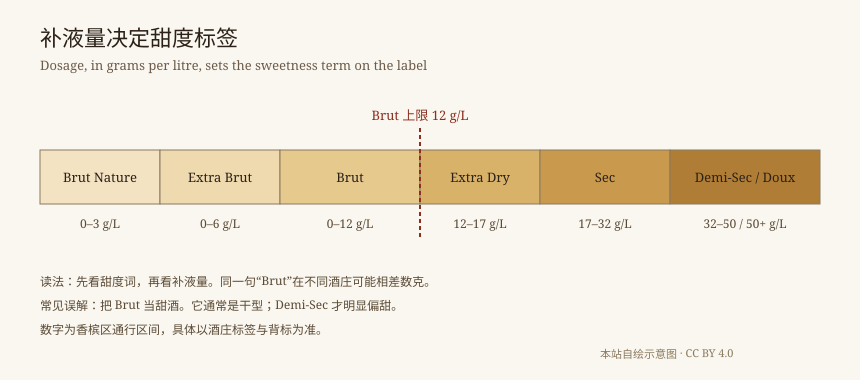

# 补液（dosage）

补液（dosage）是传统法[起泡酒](ref:sparkling-wine)在[除渣](ref:disgorgement)之后、封口之前加入瓶中的少量液体。它通常由同一款基酒与糖调配而成，法语称 liqueur d'expédition。这个动作有两项任务：补回除渣时损失的酒液体积，并决定成品最终的甜度等级。

图：补液量（克/升）与甜度标签的对应关系。本站自绘示意图，CC BY 4.0。

## 定义与边界

补液的边界是“除渣之后加入的调味液”。它不同于二次发酵前加入的发酵液（liqueur de tirage），也不同于发酵结束后残留的糖分。补液可以含糖、含酒，也可以只含酒；糖的种类可以是蔗糖，也可以是浓缩葡萄汁。它的体积很小，但糖浓度高，因此对整瓶酒的甜度有决定性影响。

补液也不等于“所有起泡酒都必须加糖”。法规允许零补液，只要成品满足相应糖分条件并且没有在二次发酵后加糖。罐式发酵的起泡酒同样可以补液，但工艺位置与压力管理不同，不能直接套用传统法的流程。

## 词源与来源

dosage 来自法语 doser，意思是按剂量加入；英语直接借用了这个拼写，没有另造词。liqueur d'expédition 字面意思是“发运液”，因为它在装瓶发运前加入。中文“补液”强调补足体积，“调味液”“加糖液”强调调味与甜度，三者描述的是同一动作的不同侧面。

历史文献里，dosage 与 liqueur 常被混用；现代法规改用糖分区间来定义类别，于是“补液”成为工艺动作，“brut”“sec”等词成为标签类别。理解这层分工，才能避免把工艺与类别当成同义词。

## 机制与参数

补液的计算基础是目标糖度乘以瓶容量。以 750 毫升瓶为例，要做到 10 g/L，需要 7.5 克糖；这个数字尚未扣除基酒本身的残糖，也没有计入补液带入的体积。实际生产中，先测定基酒的残糖，再按目标糖度反推补液配方，最后用小样确认口感。

糖的种类会影响甜感：果糖通常比蔗糖更甜，葡萄糖则相对温和。酸度、温度、二氧化碳压力与酒精度都会改变感知甜度，因此标签上的克数不等于喝起来有多甜。补液后需要静置一段时间，让酒液与糖充分融合，避免分层；同时要控制溶解氧与微生物风险，因为补液会重新打开一个已经稳定的酒体。

补液的体积还会轻微改变酒精度与压力。以 750 毫升瓶补入 25 毫升液体为例，稀释比例约为 3.3%；若补液本身的酒精度低于成品，成品酒度会小幅下降，通常不到 0.5 个百分点。补液温度应接近酒液温度，以减少二氧化碳逸出与泡沫损失。补液用的容器与管路也应保持清洁，避免引入微生物。

## 在酒业中的实际用法

除渣后按目标类别补液，再封口、贴标，是传统法起泡酒的标准流程。欧盟标签规则把起泡酒的甜度词与糖分区间绑定，香槟等传统法产区沿用同一体系。生产者会用老年份储备酒调配补液，以增加坚果、蜂蜜或氧化类香气；也有生产者使用浓缩葡萄汁，强调果味。

零补液产品需要满足 brut nature 的条件：糖分低于 3 g/L，且二次发酵后没有加糖。实践中，“零补液”是工艺描述，标签用词仍受法规约束；两者不能随意互换。补液的配方被视为酒庄风格的一部分，同一基酒因补液不同而呈现不同个性。

## 易混术语对照

- **补液与残糖**：补液是除渣后人为加入的糖，残糖是发酵中止或未完成留下的糖；两者都计入成品糖分，但来源与目的不同。
- **dosage 与 liqueur de tirage**：后者是二次发酵前加入的糖与酵母液，用来产生气泡；前者是除渣后加入的调味液，用来补体积与定甜度。
- **brut nature 与 zéro dosage**：法规上 brut nature 要求糖分低于 3 g/L 且二次发酵后未加糖；“零补液”是工艺描述，标签写法受规则限制。
- **extra dry 与 brut**：在日常语言里 extra dry 听起来更干，但在起泡酒法规中它反而比 brut 更甜（12–17 g/L 对 0–12 g/L）。

## 常见误用与争议

第一，把补液当成偷工减料。除渣必然损失酒液，不补液就得用其他方式补足体积，补液本身是标准工序。第二，把甜度标签等同于口感甜度，忽略酸度与温度的调节作用。第三，以为 brut nature 一定残糖为零；法规允许低于 3 g/L，并非绝对零。第四，以为补液只影响甜度，不影响香气；补入的酒会改变香气层次与口感。

争议之一是“零补液是否更纯粹”。在酸度高、酒体偏瘦的年份，少量补液有助于平衡；在果味成熟、酒体饱满的年份，零补液也未必生硬。把补液数字当成质量裁判，是把风格问题误写成道德问题。另一个争议是补液中的陈年储备酒会带来氧化风味，这是否算“纯粹”，不同生产者与消费者有不同看法。

补液决定成品甜度等级，但不是在发酵后随意加糖；欧盟以成品糖分区间区分 brut nature 到 doux。

补液糖分从 0 到 50 g/L 以上不等；brut nature 要求不补糖，extra brut 仍有少量。

## 典型数值与例子

- brut nature：低于 3 g/L，且二次发酵后未加糖。
- extra brut：0–6 g/L。
- brut：低于 12 g/L。
- extra dry：12–17 g/L。
- sec：17–32 g/L。
- demi-sec：32–50 g/L。
- doux：高于 50 g/L。
- 以 750 毫升瓶计算，10 g/L 对应 7.5 克糖；12 g/L 对应 9 克糖。
- 例：同一基酒补液 3 g/L 与 12 g/L，前者可标为 extra brut 区间，后者接近 brut 上限，入口甜感与配餐适配都会改变。
- 例：基酒残糖为 1 g/L，目标成品为 8 g/L，则补液配方需按每升补入约 7 克糖设计，再按瓶容量换算。

相关条目：[残糖（residual sugar）](ref:residual-sugar)。

## 另见

- [起泡酒](ref:sparkling-wine)：传统法起泡酒的完整流程与风格。
- [除渣](ref:disgorgement)：补液之前的关键工序。
- [残糖](ref:residual-sugar)：糖分来源与甜度标签的关系。

对照阅读：[起泡酒](ref:sparkling-wine)、[除渣（disgorgement）](ref:disgorgement)。

**来源与边界。** 本页关于「补液（dosage）」的关键事实，主要由以下来源交叉核对：International Organisation of Vine and Wine (OIV)（起泡酒工艺与补液在酿造流程中的位置）、European Union（起泡酒甜度分级的糖分区间）、Oxford University Press（提供关于 dosage、liqueur d'expédition 与起泡酒甜度分级的条目）等 4 条来源。价格、批次与状态会变，涉及这些字段时以页面所列来源的最新版本为准。正文为项目自写，来源只作核验，不复制原文。

**并读。** 把「补液（dosage）」与「起泡酒」、「残糖（residual sugar）」、「除渣（disgorgement）」放在一起读时，先确认它们是同一层级还是上下游关系：先确认定义与计量口径，再比较相邻术语与常见误用。本页负责给出术语的基本坐标，对照条目补上具体案例与差异；读完再回到本页，才能分清哪些差别属于术语本身，哪些只是产地、批次或品牌选择。

**适用边界。** 对「补液（dosage）」而言，术语在不同法规与行业语境中含义不同；先看定义来源，再看用法。
