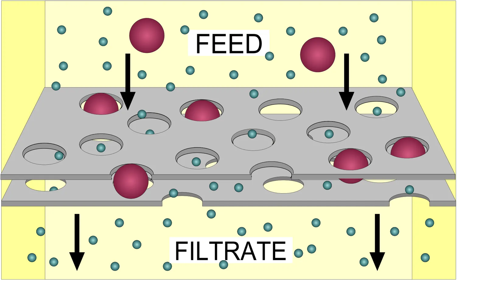

# 过滤（filtration）

过滤（filtration）是让酒液通过滤材，以物理方式截留悬浮颗粒、酵母与细菌的工序。它的直接目标是澄清与微生物稳定，而不是“把味道滤掉”。过滤与下胶（fining）经常被混用，但机制不同：下胶靠吸附、絮凝，把溶解或胶体状态的物质变成可沉降的颗粒；过滤靠孔径，把已经形成的颗粒挡在滤材上。两者常配合使用，却不能互相替代。

图：过滤（filtration）示意图。图片：Wikiwayman，CC BY-SA 3.0，via Wikimedia Commons（[原图页面](https://commons.wikimedia.org/wiki/File:FilterDiagram.svg)）。

## 定义与边界

边界一：过滤不是下胶。边界二：过滤不是“除渣”（disgorgement），后者只排出瓶口聚集的酵母塞。边界三：无菌过滤不等于无菌灌装，灌装环境、瓶与塞同样决定微生物风险。边界四：未过滤不等于未澄清，很多酒靠静置、倒罐与下胶达到澄清，只是不经过滤材。边界五：过滤不能去除已溶解的异味分子，例如 TCA。边界六：过滤效果受酒液温度、黏度与颗粒大小影响，同一孔径在不同条件下表现并不相同。

## 词源与来源

英语 filtration 来自拉丁语 filtrum，原指毛毡或滤布，后来泛指让液体穿过多孔材料、把固体留下的操作。法语 filtration、德语 Filtration 同源。酿酒语境中，filter 既指设备，也指动作；中文“过滤”则更强调“滤除”。历史上有用布、砂、稻草等材料澄清酒液的记载，现代则发展为硅藻土、纤维素滤板、膜滤芯与错流系统。

## 机制与参数

深层过滤（depth filtration）用较厚的滤材，如硅藻土、纤维素滤板或滤芯，颗粒在滤材内部被拦截，容污量较大，适合浑浊度较高的酒液。表面过滤（膜过滤）用孔径较均匀的薄膜，颗粒在表面被截留，孔径常见 0.65、0.45 与 0.2 微米量级。OIV 对“无菌过滤”的表述是使用最大平均孔径 0.65 微米的膜或预制滤板，并要求过滤前对设备进行热水或蒸汽灭菌。AWRI 则把 0.45 微米视为“绝对过滤”，能截留多数酵母与细菌。滤材标注还有“名义”与“绝对”之分：名义值是近似范围，绝对值才适合讨论微生物稳定。错流过滤让酒液沿膜面流动，减少滤饼堆积，适合大流量或高浑浊度。

## 在酒业中的实际用法

典型流程是：发酵结束、静置或倒罐去除大部分[酒泥](ref:lees)，必要时[下胶](ref:fining)，装瓶前过滤。白葡萄酒常在低温下保持澄清，红葡萄酒则更谨慎，因为过度过滤可能带走颜色、单宁与质地。部分生产者选择不过滤，以保留更多颗粒与口感，但需要用二氧化硫、酒精度、pH 与卫生管理来控制风险。无菌过滤通常安排在灌装线前端，滤芯使用前要灭菌，使用后要监测压差与完整性。过滤也会影响果酒、清酒与烈酒的澄清，并不限于葡萄酒。在灌装线上，过滤常与除菌、抗氧化管理一起设计，单靠一道过滤无法解决所有稳定性问题。

## 易混术语对照

第一组：过滤与下胶。下胶处理溶解/胶体物质，过滤处理颗粒；顺序通常是先下胶后过滤。第二组：无菌过滤与无菌灌装。前者降低酒中微生物负荷，后者控制灌装环境与容器；只做前者不能保证成品无菌。第三组：深层过滤与表面过滤。前者容污量大、适合粗滤，后者孔径均匀、适合精滤与除菌。第四组：过滤与倒罐/澄清。倒罐靠重力分离，过滤靠滤材截留；不经过滤的酒也可以经过多次倒罐。

## 常见误用与争议

第一，“过滤一定破坏风味”。影响取决于孔径、滤材、酒款与操作；粗暴过滤确实会损失香气与质地，但适度过滤未必。第二，“未过滤就是更天然、更好”。未过滤只是一种工艺选择，也可能带来微生物与沉淀风险。第三，“过滤能解决软木塞污染”。[软木塞污染](ref:cork-taint)由 TCA 等挥发性化合物造成，过滤无法去除已进入酒中的分子。第四，“0.45 微米就绝对无菌”。绝对过滤需要完整性测试与正确操作，孔径只是前提。争议集中在“风味优先还是稳定优先”，这没有统一答案，取决于酒款定位、运输距离与货架期。

## 典型数值与例子

OIV 的无菌过滤条款给出的最大平均孔径是 0.65 微米；常见膜滤芯为 0.45 微米与 0.2 微米；AWRI 把 0.45 微米称为绝对过滤级别。微生物稳定性检查的典型做法是把约 100 毫升酒样通过 0.45 微米膜，再把膜放在培养基上培养 10 天，观察酵母与细菌生长。深层过滤的孔径常以 0.8 微米量级用于二次倒罐后的粗滤。以上数字说明，过滤是一个“孔径、压差、流量、容污量”共同决定的工程问题，而不是一个开关。

## 与下胶、澄清的配合

下胶常用的膨润土主要去除蛋白质，避免装瓶后蛋白沉淀；过滤则去除下胶后仍未沉降的细小颗粒。若顺序颠倒，先过滤再下胶，下胶形成的絮凝物又会让酒重新变浑。实际排产中，常把下胶、静置、倒罐与过滤安排在同一段准备期内，并在每次操作后检查浊度与稳定性。对红葡萄酒，还要考虑过滤对色素与单宁的影响；对甜酒，则要关注过滤前后的糖分与微生物状态。

## 另见

- [下胶](ref:fining)：吸附与絮凝的澄清方式。
- [酒泥](ref:lees)：悬浮固体的主要来源。
- [软木塞污染](ref:cork-taint)：过滤无法解决的挥发性异味问题。

对照阅读：[下胶（fining）](ref:fining)、[软木塞污染（cork taint）](ref:cork-taint)。

**来源与边界。** 本页关于「过滤（filtration）」的关键事实，主要由以下来源交叉核对：International Organisation of Vine and Wine (OIV)（过滤在酿酒工艺术语中的位置，；无菌过滤的最大平均孔径与设备灭菌要求）、Oxford University Press（提供关于 filtration、sterile filtration 与 unfined/unfiltered 的条目）、The Australian Wine Research Institute（深层过滤与表面绝对过滤的差别、0.45 微米级别与稳定性检查方法）等 5 条来源。价格、批次与状态会变，涉及这些字段时以页面所列来源的最新版本为准。正文为项目自写，来源只作核验，不复制原文。

**并读。** 把「过滤（filtration）」与「下胶（fining）」、「酒泥（lees）」、「软木塞污染（cork taint）」放在一起读时，先确认它们是同一层级还是上下游关系：先确认定义与计量口径，再比较相邻术语与常见误用。本页负责给出术语的基本坐标，对照条目补上具体案例与差异；读完再回到本页，才能分清哪些差别属于术语本身，哪些只是产地、批次或品牌选择。

**适用边界。** 对「过滤（filtration）」而言，术语在不同法规与行业语境中含义不同；先看定义来源，再看用法。

**更新提示。** 「过滤（filtration）」最近核对于 2026-11-07；定义、计量口径与相邻术语会因文献不同，引用前以标准或权威辞书为准。
