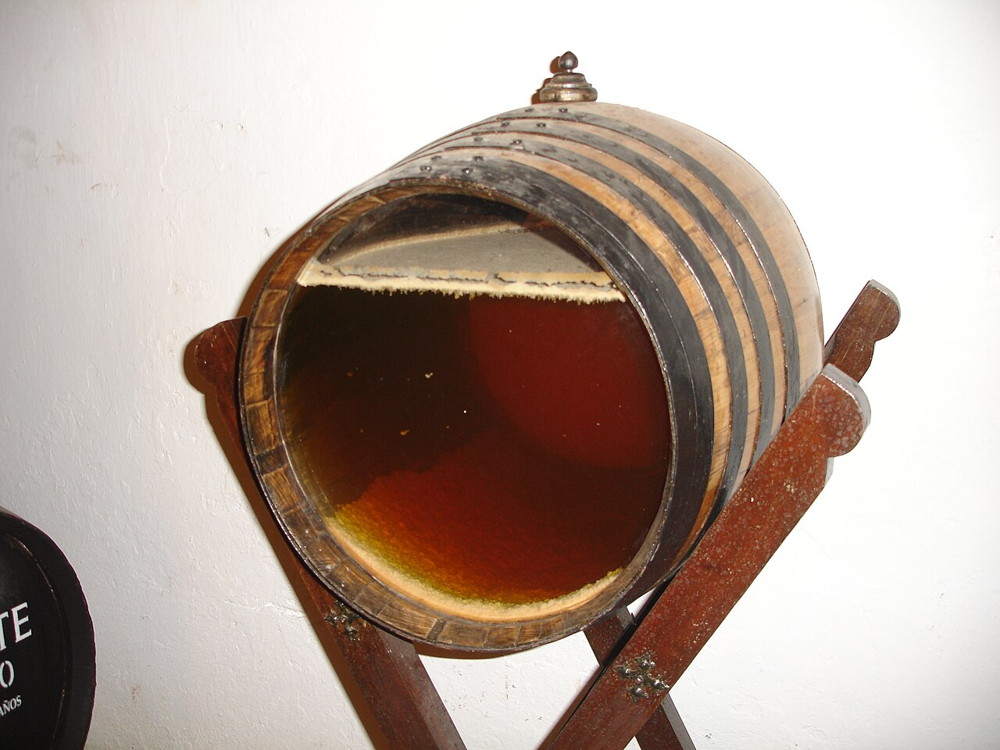

# 酒花（flor）

酒花（flor）是雪莉酒生物陈年（biological ageing）期间，在酒液表面形成的一层酵母膜，西班牙语称 velo de flor（“花之帷幕”）。它由多种酵母菌系组成，主要是 Saccharomyces 属；这层膜把酒液与空气隔开，同时代谢酒精、甘油与溶解氧，生成乙醛等物质。酒花不是霉变，也不是“酒坏了”的标志；在 Fino 与 Manzanilla 中，它是风格成立的前提。

图：酒花（flor）。图片：El Pantera，CC BY-SA 3.0，via Wikimedia Commons（[原图页面](https://commons.wikimedia.org/wiki/File:FLOR-ValdiviaJerez59.jpg)）。

## 定义与边界

边界一：酒花是“膜”，不是酒泥。酒泥在桶底，酒花在液面，二者参与的化学反应不同。边界二：酒花不是所有雪莉的必经步骤，Oloroso 不保留酒花，走氧化路线。边界三：酒花不是霉菌或污染，它是受控的酵母群落；但膜破裂后，醋酸菌与氧气会趁虚而入。边界四：酒花不等于“越厚越好”，活性与连续性比厚度更重要。边界五：酒花是工艺状态，不是风味形容词；酒标上的“Fino”“Manzanilla”才对应具体的法定风格。

## 词源与来源

西班牙语 flor 意为“花”，velo de flor 是“花的帷幕/面纱”，形容薄膜覆盖液面的样子。英语直接借用 flor，而不是译成 flower；在雪莉产区，酒窖师傅会说“la flor está viva”（酒花还活着），把膜当作需要照看的生命。中文“酒花”容易与啤酒花（hops）混淆，这是翻译上的一个坑：雪莉的 flor 与啤酒的 hop 无关。理解词源，有助于避免把“酒花”当成一种原料。

## 机制与参数

基酒先加强到约 15% vol，这个酒精度足以让酒花酵母存活，又能抑制多数醋酸菌与野生酵母；Fino 与 Manzanilla 因此定在 15%，而 Oloroso 会加强到至少 17% vol，使酒花无法维持。酒液装入 500 升的美国橡木桶（butt），留出一定空间，酵母在表面繁殖成膜。膜代谢消耗酒精、甘油、溶解氧与部分挥发酸，产生乙醛、缩醛与酯类，带来面包、杏仁、海风与咸鲜气息。温度、湿度、通风与桶的清洁度都会影响膜的厚度与寿命；膜一旦破裂，氧化与醋化风险上升。膜的厚度通常只有数毫米，肉眼看到的是白色到奶油色的薄层，而不是厚厚一层“菌砖”。酒花酵母也不是单一菌种，而是多个菌系的群落；不同菌系对酒精、温度和营养的耐受度不同，这也是同一产区不同酒窖风格差异的来源之一。

酒花膜主要由 Saccharomyces cerevisiae 的 flor 型菌株组成，也混有少量非酿酒酵母；菌群随季节与酒窖环境变化，膜破裂后酒液转向氧化，酒窖师傅会把这一桶当作 Amontillado 的起点。

酒花对温度与湿度敏感，夏季膜更活跃、冬季变薄，酒窖师傅会据此调整取酒与补液。

## 在酒业中的实际用法

采收后，压榨轻、色泽浅、结构细的基酒被标记为“/”（palo），归入生物陈年；结构更重的批次标记为“O”，直接走向氧化陈年。加强后进入 sobretablas 阶段，约 6 个月到 1 年后再做第二次分类：膜仍然旺盛的桶被标上 palma，确认走 Fino/Manzanilla 路线；膜衰弱或出现缺口的桶则被加强到 17% vol，转为 Oloroso。Amontillado 则是先有酒花、后转氧化的中间形态；Palo Cortado 也常经历类似的转向。索莱拉与 criaderas 的逐级补酒，让酒花持续获得营养，同时保持风格稳定。对生产者而言，维护酒花是一项日常功课：观察液面、控制补酒节奏、保持桶口清洁，必要时还要调整酒精度。如果膜死亡，酒液并不会立刻变成 Oloroso，但会开始缓慢氧化；生产者必须在风味转向之前做出分类决定。

## 易混术语对照

第一组：酒花与[氧化](ref:oxidation)。酒花型陈年刻意隔绝氧气，氧化型陈年主动接触氧气；前者浅色、咸鲜，后者深色、坚果与焦糖。第二组：酒花与酒泥。酒泥是死酵母与固体的沉降层，酒花是活酵母的液面膜；搅动酒泥（bâtonnage）与维护酒花是两套工艺。第三组：Fino 与 Oloroso。两者可能来自同一批基酒，分野在于是否保留酒花与加强到多少度。第四组：酒花与啤酒花。前者是雪莉的酵母膜，后者是啤酒的调味原料，中文同名但英文完全不同。

## 常见误用与争议

第一，把酒花当成霉或“脏东西”。第二，认为所有雪莉都有酒花。第三，认为膜越厚酒越好。第四，把 Fino 的咸鲜味归因于“加盐”，其实主要来自酵母代谢与酒液本身的矿物质感。第五，忽略酒花的脆弱性，以为装桶后可以不管。争议在于“生物陈年是否一定优于氧化陈年”：这是风格选择，不是质量排序；同一酒庄完全可以用同一批基酒做出两种路线。另一争议是酒花酵母的菌系管理，不同菌系的比例会影响乙醛与酯类的平衡。

## 典型数值与例子

Fino/Manzanilla 加强至 15% vol；Oloroso 至少 17% vol；酒花无法在 17% vol 以上维持。索莱拉常用的桶容为 500 升。sobretablas 阶段约 6–12 个月，之后进行第二次分类。Manzanilla 只在 Sanlúcar de Barrameda 的酒窖中陈年，这一地理限制使它带有更明显的海风感。以上数字来自雪莉产区官方资料，可作为阅读酒标与工艺说明的参照。

## 索莱拉与补酒

索莱拉系统把陈年桶按“级”叠放，从最老的 criadera 取酒装瓶，再用较年轻的酒逐级补充。补充量必须略大于取出量，才能维持液面与酒花；补酒太猛会冲散膜，太少则膜因营养不足而衰弱。酒窖师傅通过观察膜的连续性、闻桶口的气味、测量挥发酸来判断状态。这套动态管理解释了为什么雪莉可以长期保持稳定风格，也解释了为什么“同一款无年份雪莉”仍会有细微差异。

相关条目：[香气（aroma）](ref:aroma)。

## 另见

- [氧化](ref:oxidation)：氧化型陈年与生物陈年的对照。
- [香气](ref:aroma)：酒花代谢带来的香气特征。
- [加强酒](ref:fortified-wine)：雪莉酒的整体工艺背景。

补充阅读：[酸度（acidity）](ref:c-extra-1)。

对照阅读：[氧化（oxidation）](ref:oxidation)、[加强葡萄酒](ref:fortified-wine)。

**来源与边界。** 本页关于「酒花（flor）」的关键事实，主要由以下来源交叉核对：International Organisation of Vine and Wine (OIV)（加强酒生物陈年相关术语）、Oxford University Press（提供关于 flor、biological ageing 与 Fino/Manzanilla 的条目）、Consejo Regulador de las D.O. Jerez-Xérès-Sherry（Fino/Manzanilla 与 Oloroso 的加强酒精度、酒花保护作用与分类流程）等 5 条来源。价格、批次与状态会变，涉及这些字段时以页面所列来源的最新版本为准。正文为项目自写，来源只作核验，不复制原文。

**并读。** 把「酒花（flor）」与「氧化（oxidation）」、「香气（aroma）」、「加强葡萄酒」放在一起读时，先确认它们是同一层级还是上下游关系：先确认定义与计量口径，再比较相邻术语与常见误用。本页负责给出术语的基本坐标，对照条目补上具体案例与差异；读完再回到本页，才能分清哪些差别属于术语本身，哪些只是产地、批次或品牌选择。
