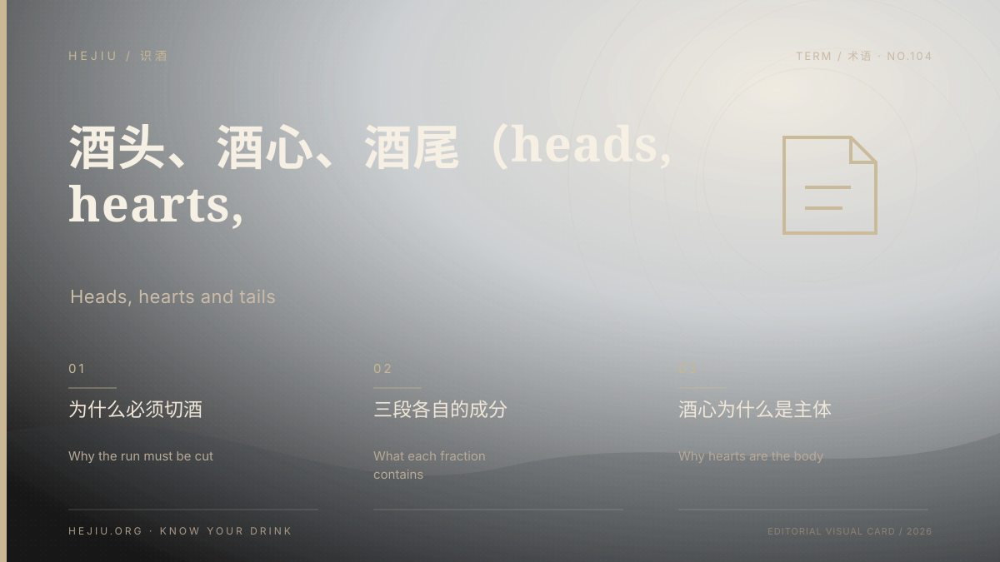

# 酒头、酒心、酒尾（heads, hearts, tails）

酒头、酒心、酒尾是壶式蒸馏过程中对馏出液的三段划分。它们不是三种酒，而是一次蒸馏里先后流出的三个部分。操作者按香气、口感与酒精度切换接收容器：最先流出的是酒头，中间是酒心，最后是酒尾。酒心构成成品主体，酒头与酒尾通常回收，留到下一批再蒸。

图：酒头、酒心、酒尾（heads, hearts, tails） 双语视觉卡（项目自绘 SVG）。不是实拍。

## 为什么必须切酒

发酵液里不只有乙醇和水。酵母在发酵中产生酯类、高级醇、醛类、酸类与硫化物，原料还会带来酚类和其他挥发性物质。这些组分的沸点不同，蒸馏时不会同时、按同一比例进入蒸气。最先蒸出的是低沸点物质，随后是乙醇与一批香气物质，最后是高沸点的油状成分。

如果不分段，把所有馏出液混在一起，成品会同时带上酒头的尖锐刺激和酒尾的油腻沉重。切酒的本质，是在“收得率”与“干净度”之间做取舍。切得越宽，产量越高，但杂质越多；切得越窄，成品越干净，但香气也可能被削掉。这个判断没有通用公式，只能结合设备、原料与目标风格。

## 三段各自的成分

酒头（heads，也称 foreshots）以低沸点物质为主，包括乙醛、乙酸乙酯和甲醇。乙醛带来刺鼻的青苹果或溶剂感，乙酸乙酯在高浓度时有去光水般的气味，甲醇的沸点约 64.7°C，比乙醇更早馏出。酒头通常香气冲、入口尖、刺激感强，不适合直接作为成品主体。

酒心（hearts）是乙醇最集中的一段，同时带有构成风格的酯类与部分酚类。它的酒精度较高，口感相对圆润，香气清晰，刺激感较低。酒心不是“纯乙醇”，恰恰是杂质被控制到合适范围的部分：太少会单薄，太多会粗糙。理解这一点，才能明白为什么酒心被视为成品主体。

酒尾（tails，也称 feints）以高沸点物质为主，包括异戊醇、异丁醇等高级醇，脂肪酸、部分硫化物与酚类。它常带油感、纸板味、皂感或烟熏味，酒精度下降，入口沉重。酒尾并非一律无用：某些酚类与长链酯类能增加酒体的厚度与烟熏层次，所以有些酒厂会刻意保留少量酒尾。

## 酒心为什么是主体

酒心之所以成为主体，是因为它同时满足三个条件：乙醇浓度足够高、香气物质足够丰富、令人不快的组分被压在阈值以下。酒头的低沸点醛类与酯类过量会带来溶剂感，酒尾的高级醇与脂肪酸过量会带来油腻与苦涩，酒心位于两者之间，平衡最好。

但这不意味着酒心越多越好。切酒点若向酒头方向放宽，成品会更有冲击力，也更容易出现刺鼻感；向酒尾方向放宽，酒体会更厚、更有烟熏或油脂感，但风险是浑浊与苦味。不同酒厂会根据自己的设备与风格选择不同的切点，这正是同一产区内部风格差异的重要来源。关于设备如何影响回流，可参见[壶式蒸馏器](ref:pot-still)。

## 酒头与酒尾怎么处理

最常见的做法是回收。酒头与酒尾分别收集，酒头通常并入下一批的初馏液，酒尾则进入“酒尾罐”（feints receiver），在下一次蒸馏时重新加入。这样做的逻辑是：酒头里仍有大量乙醇和可转化香气，酒尾里也有可回收的乙醇与风味物质，直接丢弃既浪费又增加废水负荷。

回收不是无限循环。随着多次回流，某些高沸点杂质会累积，因此酒厂会定期排放一部分酒尾，或把最后的残液单独处理。部分酒厂会把少量酒尾回加到成品中，以获得更厚的酒体；这种做法需要非常谨慎，因为过量会带来浑浊、苦味和稳定性问题。关于酒度的测量与换算，可参见[酒精度](ref:abv)。

## 切点怎么判断

切点的判断依赖三重信号：馏出液的酒精度、香气与口感。酒精度是最直观的量化指标，操作者会连续测量馏出液的酒度，在预设区间附近加密取样。香气与口感则决定最终落点：酒头阶段常有刺鼻的溶剂味，进入酒心后转为花果香，接近酒尾时出现油味与纸板味。

不同酒种的经验区间不同。许多苏格兰酒厂在二次蒸馏时把酒头切点放在约 70%–75% abv，酒尾切点在约 55%–65% abv；追求轻酒体的酒厂会切得更早，追求厚重风格的酒厂会切得更晚。这些数字是常见做法的范围，不是法规，也不能直接套用到其他设备或原料。关于苏格兰威士忌的法定框架，可参见[苏格兰威士忌](ref:scotch-whisky)。

## 不同酒种的差异

威士忌通常进行两次蒸馏，第一次得到低度酒，第二次才切酒心。少数酒厂进行三次蒸馏，切点更窄，酒体更轻。干邑的第二次蒸馏称 bonne chauffe，同样分酒头、酒心与酒尾，酒头与酒尾回加到下一批。朗姆酒的壶式蒸馏常保留更多酒尾，以获得厚重的酯香；塔式蒸馏则通过侧线连续取酒，不存在同样意义上的“分批切酒”。

伏特加追求高度净化，切酒范围窄，随后还会经过活性炭或多次精馏，因此酒头酒尾的香气特征基本被去除。龙舌兰酒通常两次蒸馏，切点相对宽松，保留植物感。可见“酒心是主体”是通用原则，但“酒心要多宽”完全取决于品类目标。关于威士忌的整体工艺，可参见[威士忌](ref:whisky)。

## 常见误解

第一，把酒头酒尾当成“有毒的酒”，以为只要掐掉就绝对安全。甲醇等有害组分的分离并不像切三段那么简单，商业蒸馏依赖连续监测与合规控制，家庭自行蒸馏在多数地区违法且风险高。第二，认为酒心比例越高越好。过窄的切点会丢失构成风格的香气，成品可能干净但空洞。

第三，把切点当成固定配方。设备、原料、发酵状态、季节与目标风格都会改变最佳落点，同一酒厂不同批次也可能微调。第四，认为酒尾一定难喝。少量高质量酒尾能增加厚度与烟熏层次，关键是剂量与时机。第五，把“掐头去尾”理解成把两头全部丢弃。行业里的常规是回收，而不是抛弃。

## 另见

- [蒸馏](ref:distillation)：按沸点分离的基本原理。
- [壶式蒸馏器](ref:pot-still)：回流、壶形与切酒的关系。
- [威士忌](ref:whisky)：两次蒸馏与切酒的典型场景。
- [苏格兰威士忌](ref:scotch-whisky)：切酒所处的法定工艺框架。
- [酒精度](ref:abv)：馏出液酒度的测量与表达。
