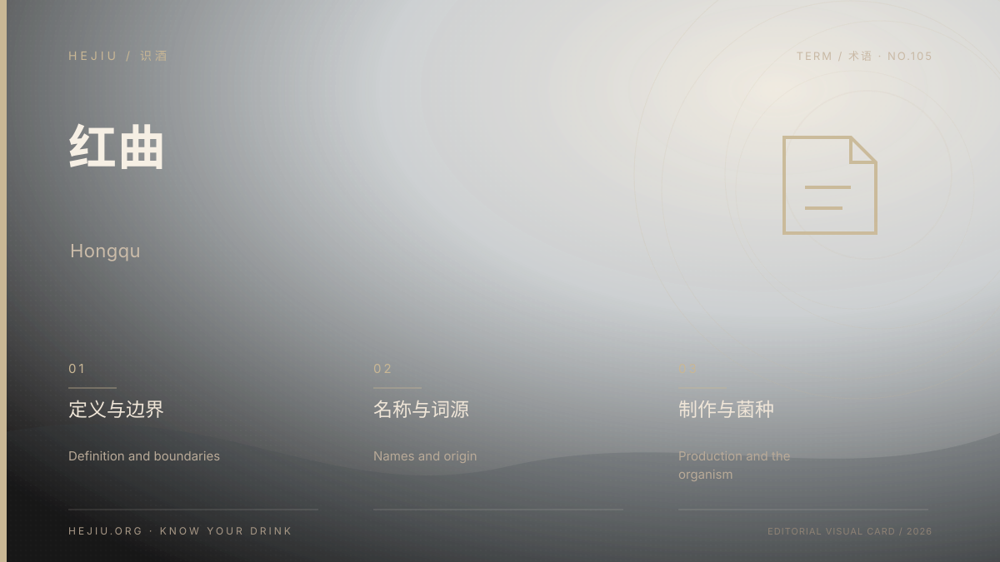

# 红曲

红曲是以大米为原料、接种红曲霉后培养制成的紫红色曲。它既是传统的糖化发酵剂，也是食品着色原料。在[黄酒](ref:yellow-wine)中，红曲形成红曲黄酒这一类型；在烹饪与食品工业中，它还有红糟、红腐乳与色素等独立用途。

图：红曲 双语视觉卡（项目自绘 SVG）。不是实拍。

> **先给结论**
> **一句话：** 这页用一句话讲清红曲的定义、边界和用法。
>
> - **适合谁：** 读到红曲想快速弄懂定义、边界和用法的人。
> - **不适合谁：** 需要法规原文全文或法律/医疗意见的人。
> - **先看这两点：**
>   - 红曲的基本做法是把大米蒸熟，接种红曲霉，在控温控湿的环境中培养，让菌丝生长并产生色素，最后干燥保存。
>   - 中文“红曲”直指颜色与曲种：曲是糖化发酵的载体，红是成品外观。

## 定义与边界

红曲的基本做法是把大米蒸熟，接种红曲霉，在控温控湿的环境中培养，让菌丝生长并产生色素，最后干燥保存。成品呈紫红到暗红，颗粒内部也可能保持米粒形状。红曲是“曲”，不是“色素”：颜色来自微生物培养，而不是外加染料。

它与麦曲、酒药不同：麦曲以小麦为载体培养霉菌，酒药含根霉与酵母，红曲则以红曲霉为主。三者的糖化力、发酵力与香气贡献不同，不能简单互换。[制曲](ref:qu-making)的温度、湿度与翻曲时机，同样决定红曲的质量。红曲也不是“红曲米”的唯一形态：粉末、颗粒与红糟都是不同加工形态，用途与规格不同。

## 名称与词源

中文“红曲”直指颜色与曲种：曲是糖化发酵的载体，红是成品外观。英语常译作 red yeast rice 或 red koji；red yeast rice 强调“红曲霉培养的大米”，red koji 强调“曲”的属性。法语、德语文献也会用“riz rouge de levure”或“Red Yeast Rice”等译法，但学术名称仍以 Monascus 为主。

名称的差异带来理解差异。red yeast rice 在欧美常指食品补充剂，容易让人联想到“降脂”功能；红曲在中国更多指酿酒与食品原料。把这两个语境混在一起，会把一种原料当成一种保健品。本页讨论的是酒类与食品工艺中的红曲，不提供健康建议。

## 制作与菌种

红曲霉（Monascus）是丝状真菌，常见菌种包括 Monascus purpureus。培养时，蒸熟的米饭作为基质，菌丝在米粒表面与内部生长，分泌酶类并把淀粉分解为糖，同时产生色素。温度、湿度、通气与翻曲决定菌丝生长与色素积累；培养不当会出现杂菌污染、颜色不均或异味。

红曲霉的代谢产物不止色素。研究与应用中还会关注莫纳可林类物质（monacolins）与其他次级代谢产物，这也是红曲生产需要菌种管理与过程控制的原因。颜色深浅不能直接等同于质量或功效；菌种、培养基与培养条件都会改变色素组成。

## 色素、风味与代谢物

红曲色素包括红、橙、黄等不同组分，常见描述为红曲红、红曲橙与红曲黄。色素含量与菌种、培养基和培养条件有关，颜色深浅也因此不同。红曲黄酒的红褐色主要来自红曲本身，而不是焦糖色或外加色素；这一点是红曲酒与部分其他黄酒在色泽上的关键差别。

风味上，红曲发酵会带来甜润、醇厚与轻微的曲香，同时影响酸度与苦味。不同产品的糖分类型与酒精度差异较大，应以标签为准。红曲色素在食品工业中作为着色剂使用，红糟则用于闽菜的腌制、烧制与调色；这些用途与酿酒共用原料，但工艺目标不同。

## 在酒业中的实际用法

红曲黄酒以糯米为主料，红曲承担糖化与部分发酵功能。基本流程与黄酒一致：浸米、蒸饭、摊凉或淋凉、拌曲、落缸发酵、压榨、澄清、煎酒、陈酿。红曲的用量、发酵温度与时间，会影响色泽深浅与口感。红曲酒可以理解为以红曲为主要糖化发酵剂的一类黄酒，具体分类仍要看产品标准与标签。

GB/T 13662-2018《黄酒》于 2018-09-17 发布、2019-04-01 实施，规定了黄酒的术语、分类、要求与检验方法。红曲黄酒在其中属于按曲种与工艺区分的一类；糖分类型由总糖指标决定，而不是由产区或颜色决定。把“红曲”当成“甜型”的同义词，会误读标签。

## 黄酒分类与福建产区

福建是红曲黄酒的核心产区。福州一带的福建老酒、龙岩的沉缸酒都属于这一类型；福建古田一带以红曲生产著称。不同产品的糖分类型与酒精度差异较大，应以标签为准。与[绍兴](ref:shaoxing)的糯米麦曲黄酒、[即墨](ref:jimo)的黍米焦糜黄酒相比，红曲路线最直观的差别是颜色与曲种。

福建红曲黄酒常被描述为甜润、醇厚，但并非所有产品都是甜型。按 GB/T 13662-2018 的分类，糖分类型由总糖指标决定；同一产区可以有干型、半干型、半甜型与甜型产品。产区只是风格线索，不是法规分类。

## 易混术语对照

第一组：红曲与麦曲、酒药。麦曲以小麦为载体，酒药含根霉与酵母，红曲以红曲霉为主；三者的微生物组成与酶系不同，不能按“都是曲”就互换。第二组：红曲与红曲米。红曲是工艺产品与曲种，红曲米是具体的米粒形态；红曲还可以磨粉或制成红糟。

第三组：红曲黄酒与绍兴黄酒。前者以红曲为特色，后者以麦曲与糯米工艺为特色；颜色、香气与口感路线不同，但都属于黄酒。第四组：红曲与红糟。红糟是红曲与酒糟混合后的调味料，不是酿酒用的曲；把红糟当成红曲，会混淆原料与成品。[GB/T 13662-2018《黄酒》](ref:gbt-13662-2018)是判断黄酒分类的标准依据，但不能用来判断红糟等非酒产品。

## 安全争议：桔霉素

红曲发酵可能产生桔霉素（citrinin），这是一种需要控制的真菌代谢产物，主要涉及肾脏毒性风险。生产环节通过菌种选择、培养条件与检测来控制风险；监管环节则对相关食品设定限量与标签要求。欧盟法规 2023/915 对以红曲霉发酵大米为基底的食品补充剂设定桔霉素限量 100 µg/kg；这一限量的适用对象是补充剂，不是所有红曲食品。

红曲还含莫纳可林类物质，其中莫纳可林 K 与洛伐他汀结构相同。EFSA 在 2018 年对红曲中莫纳可林的安全性发表意见，相关结论推动了欧盟对红曲补充剂的监管讨论。对消费者而言，最重要的做法是看标签与生产者信息，不把“红曲”当作保健承诺；红曲相关产品的功能宣称应以其批准的类别与说明为准，酒类页面不提供健康建议。

## 常见误用与争议

第一，把红曲当成人工色素。红曲是微生物培养制成的曲，色素由红曲霉产生。第二，认为红曲酒是“加了色素”的酒。红曲黄酒的颜色来自红曲本身。第三，认为红曲一定更健康。红曲是原料与工艺概念，不是功效保证。第四，认为红曲黄酒都是甜型。糖分类型要看总糖指标与标签。第五，认为颜色越红越好。颜色受菌种、用量与发酵条件影响，不能单独作为质量结论。

争议主要集中在桔霉素与功能宣称。支持者强调传统工艺与风味价值，反对者担心发酵过程的毒素风险与补充剂的健康声称；监管的路径是把“酒类原料”“食品着色”“膳食补充剂”分开管理。另一个争议是红曲的名称：red yeast rice 在英文语境中更接近补充剂，中文“红曲”更接近曲种，翻译时若不说明语境，容易造成误解。

## 典型数值与例子

可核验的数字与事实：GB/T 13662-2018 于 2018-09-17 发布、2019-04-01 实施；欧盟 2023/915 对红曲霉发酵大米基底的食品补充剂设定桔霉素限量 100 µg/kg；红曲霉常见菌种为 Monascus purpureus；红曲色素包含红、橙、黄等组分；福建老酒、沉缸酒与古田红曲是常见产区例子。

具体例子：一款福建红曲黄酒可能呈红褐色、口感甜润，但标签上的糖分类型仍由总糖决定；一款红曲补充剂可能标注莫纳可林 K 含量，却不等于酒类原料的规格；一款红糟用于闽菜调色，属于调味料而非酿酒曲。这些例子说明“红曲”在不同产品中的身份不同。

## 另见

- [黄酒](ref:yellow-wine)
- [制曲](ref:qu-making)
- [绍兴市](ref:shaoxing)
- [即墨](ref:jimo)
- [GB/T 13662-2018《黄酒》](ref:gbt-13662-2018)
