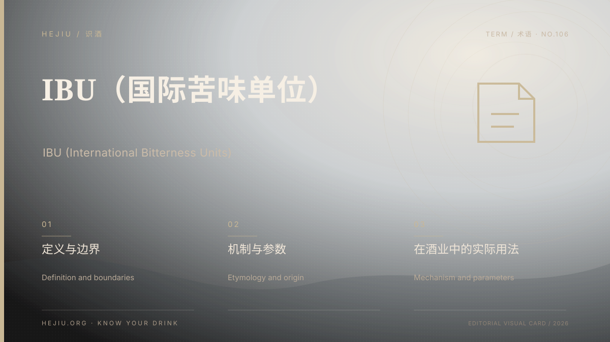

# IBU（国际苦味单位）

IBU（International Bitterness Units）是啤酒行业用来量化苦度的单位。1 IBU 约等于每升啤酒含 1 毫克异α-酸，也就是 1 ppm。它描述的是酒花来源的苦味物质浓度，不是舌头当场感受到的“苦味强度”。同一 IBU 的啤酒，可以因为麦芽甜感、碳酸化与温度而显得截然不同。

图：IBU（国际苦味单位） 双语视觉卡（项目自绘 SVG）。不是实拍。

## 定义与边界

IBU 的测量对象是异α-酸，即α-酸在煮沸中异构化后的产物。它不包括麦芽焙烤带来的苦味、酒花多酚的涩感，也不包括酒精与碳酸化带来的刺激。因此 IBU 是一个“化学指标”，不是完整的感官评分。配方软件算出的 IBU 是预测值，实验室测出的是实测值，两者允许有差异。IBU 也不描述酒花香气，后者来自另一类化合物。它不是各国法规强制要求的标签单位，而是行业与比赛广泛采用的自愿指标；因此“没有标 IBU”不等于“没有苦味”。标签通常把 IBU 取整，实验室却可能报告小数；取整不影响它作为工艺指标的性质。

## 词源与来源

IBU 由 International Bitterness Units 缩写而来，20 世纪后期随啤酒分析标准化而普及。它承接了欧洲 EBC 与美国 ASBC 的苦度测量传统；不同体系曾使用不同方法，但都把异α-酸作为核心对象。今天标签上的 IBU 已成为精酿啤酒交流的通用语言，尽管各国法规并不都要求标注，且不同实验室的结果未必完全可比。EBC 与 ASBC 的方法都围绕异α-酸的吸光或色谱响应建立，但样品前处理、稀释倍数与仪器校准会带来差异。IBU 也不是唯一的苦度表达，EBC 苦度单位与 ppm 在文献中常被互换使用，但换算前要确认测量对象。

## 机制与参数

α-酸（humulone、cohumulone 等）在煮沸中异构化为异α-酸，后者水溶性更好、苦味更稳定。IBU 常用分光光度法测定，特征波长约 275 nm；也有色谱与固相萃取方法。酒花利用率受煮沸时间、酒花形态、pH、麦汁浓度与添加时机影响，常见范围约 20%–35%。同样的酒花用量，不同工艺可以得到不同 IBU；同样标称 40 IBU，苦味的质地也可能完全不同。α-酸含量本身受酒花品种、产地、采收年份与储存条件影响，陈旧酒花会损失部分α-酸；因此配方软件通常需要输入实际α-酸百分比，而不是只看酒花重量。

## 在酒业中的实际用法

酿酒师用 IBU 设计配方、控制批次一致性，并用 BU:GU 比值（苦度与可发酵糖的平衡）判断风格。经验上，BU:GU 约 0.5 时苦味与麦芽甜感较平衡，接近 1.0 时苦味明显更突出；但这不是公式，酵母发酵度、酒体与碳酸化都会改变实际感受。浅色啤酒常见 10–20 IBU，IPA 常在 40 以上，双倍 IPA 常见 60–100；这些是风格参考，不是法规上限。IBU 也用于比赛评分与标签沟通，但不能单独解释酒花香气，因为香气主要来自酒花精油，如香叶烯、葎草烯与芳樟醇。对[啤酒](ref:beer)而言，IBU 是配方语言；对饮者而言，它只是理解苦味的一个入口。

## 易混术语对照

第一组：IBU 与苦味感知。IBU 是异α-酸浓度，感知苦味还受糖分、pH、碳酸化与温度影响。第二组：IBU 与酒花香气。IBU 测苦味酸，酒花香气来自精油与硫醇；高 IBU 不等于高香气。第三组：IBU 与 GU。GU 描述可发酵糖浓度，IBU 描述苦度；二者比值才是平衡线索。第四组：IBU 与 SRM/EBC 色度。色度描述颜色深浅，IBU 描述苦度；深色酒不一定高 IBU，浅色酒也可以很苦。

## 常见误用与争议

第一，把 IBU 当作“越苦越准”的感官刻度；第二，认为 IBU 越高越好；第三，把配方预测值当实测值；第四，忽略麦芽甜感与酒体的平衡；第五，跨风格直接比较 IBU，而不看风格基准。争议还包括“IBU 已过时”的说法：它仍是有效的工艺指标，只是不能替代感官描述。另一个争议是测量口径：分光光度法与色谱法对复杂基质的响应不同，标签值不一定能直接横向比较。

## 典型数值与例子

1 IBU 等于每升 1 毫克异α-酸，也就是 1 ppm。浅色啤酒常见 10–20 IBU，IPA 常在 40 以上，双倍 IPA 常见 60–100；某款标称 45 IBU 的 IPA，若残糖较高，入口可能不如标称 35 IBU 的干型拉格那样“清苦”。测量上，分光光度法常在 275 nm 读取吸光值；酒花利用率常见 20%–35%。[捷克皮尔森](ref:pilsner)是低到中等 IBU、强调清爽苦味的典型；[健力士生啤](ref:guinness)则以焙烤麦芽与柔和苦味见长。这些数字说明 IBU 是工艺参数，不是味觉刻度。把 BU:GU 放在 0.5–1.0 区间来读，比单独看 IBU 更接近实际平衡感；离开风格基准，40 IBU 在拉格与双倍 IPA 中的意义完全不同。

## 记录与表达

记录 IBU 时，同时写下风格、酒精度、原麦汁浓度与 BU:GU 比值；只写“45 IBU”信息不足。描述苦味时区分“苦味强度”“苦味质地”（尖锐、圆润、木质、药草）与“苦味持续时间”。选购时，IBU 可以帮助你避开或选择酒花导向风格，但最终仍要以实际品尝为准；标签上的 IBU 也可能是计算值而非实测值。把 IBU 与[发酵](ref:fermentation)工艺一起看，才能理解为什么同一配方在不同酒厂会得到不同结果；记录时若能把“酒花品种、添加时间、利用率假设”一并写下，IBU 才不只是孤立的数字；把实验室与方法写在备注里，也能减少后续比较的误差。

## 另见

- [啤酒](ref:beer)：啤酒的原料、发酵与风格框架。
- [捷克皮尔森](ref:pilsner)：低到中等 IBU 的清爽苦味。
- [健力士生啤](ref:guinness)：焙烤麦芽与柔和苦味。
- [发酵](ref:fermentation)：苦味物质与发酵过程的关系。

对照阅读：[啤酒](ref:beer)、[健力士世涛啤酒](ref:guinness)。

**来源与边界。** 本页关于「IBU（国际苦味单位）」的关键事实，主要由以下来源交叉核对：Beer Judge Certification Program（啤酒风格的 IBU 典型区间）、ASBC（IBU 与异α-酸的测量口径，未复制方法原文）、Brewers Association（提供关于苦度与风格参数的说明）等 4 条来源。价格、批次与状态会变，涉及这些字段时以页面所列来源的最新版本为准。正文为项目自写，来源只作核验，不复制原文。

**并读。** 把「IBU（国际苦味单位）」与「啤酒」、「皮尔森之源」、「健力士世涛啤酒」放在一起读时，先确认它们是同一层级还是上下游关系：先确认定义与计量口径，再比较相邻术语与常见误用。本页负责给出术语的基本坐标，对照条目补上具体案例与差异；读完再回到本页，才能分清哪些差别属于术语本身，哪些只是产地、批次或品牌选择。

**适用边界。** 对「IBU（国际苦味单位）」而言，术语在不同法规与行业语境中含义不同；先看定义来源，再看用法。
