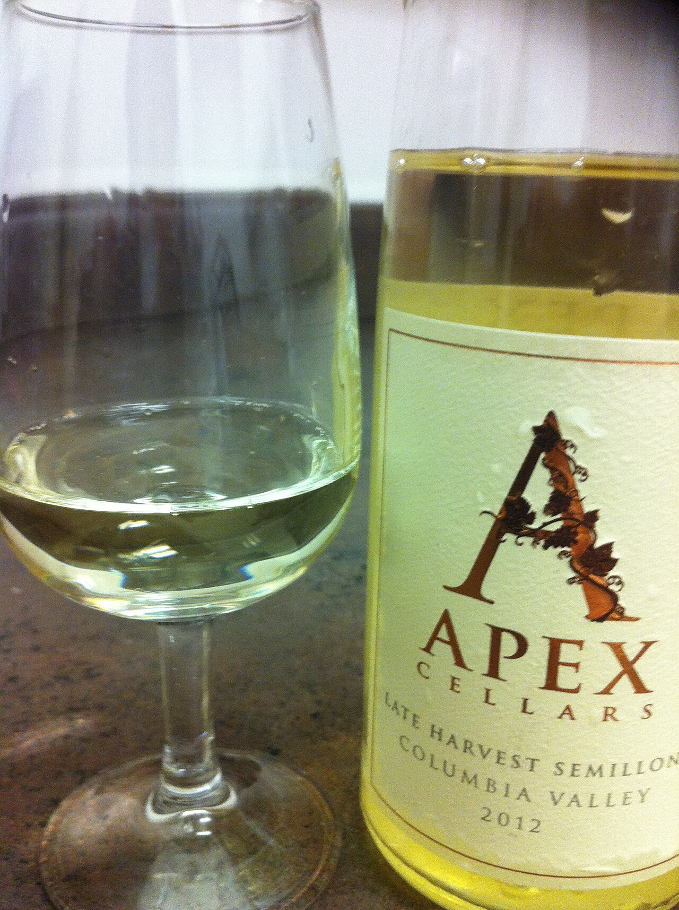

# 晚收（late harvest）

晚收（late harvest，法语 vendange tardive）指葡萄在常规成熟期之后继续留在藤上，延后采收。额外的时间里，果实通过蒸腾失水，糖分与风味物质浓缩，酸度下降，果实变软、颜色加深。晚收是甜酒与高酒精度酒款的重要基础，但它不等于贵腐，也不必然更甜。

图：晚收（late harvest）。图片：Agne27，CC BY-SA 3.0，via Wikimedia Commons（[原图页面](https://commons.wikimedia.org/wiki/File:Late_harvest_Semillon.jpg)）。

## 定义与边界

边界一：晚收是“时间”概念，指采收晚于常规成熟期；贵腐是“微生物”概念，指真菌参与转化。边界二：晚收不必然甜，发酵完全时可以得到干型、高酒精度的酒。边界三：晚收不等于风干（passerillage）；风干可以留在藤上，也可以采下后晾晒，核心是失水而非延迟采收。边界四：晚收标签在不同产区含义不同，有的受法规约束，有的只是描述性用语。边界五：晚收的“晚”是相对于该产区该品种的常规采收期，不是固定的日历日期。

## 词源与来源

英语 late harvest 是描述性短语，法语 vendange tardive 字面即“晚的采收”，德语 Spätlese 意为“晚摘”，三者都强调时间。阿尔萨斯在 1984 年 3 月 1 日的法令中把 Vendanges Tardives 与 Sélection de Grains Nobles 纳入 AOC 规则；德国则在 1971 年的葡萄酒法中把 Spätlese 等成熟度等级制度化。中文“晚收”直译自英文，有时也译“晚摘”，在酒标上常与“迟摘”“晚收甜白”混用。法国 1984 年法令与德国 1971 年葡萄酒法都把“晚”写成可执行的成熟度门槛，而不是模糊描述。

## 机制与参数

晚收的物理机制是蒸腾失水：果实重量下降，糖、酸、矿物质与风味前体的浓度上升。糖度常用 °Brix、°Oechsle 或潜在酒精度衡量；酸度则因呼吸作用与代谢而下降。采收越晚，潜在酒精度越高、酸度越低，风格越成熟；但过晚则可能过熟、酸度不足、腐烂风险上升。贵腐菌、雨水、鸟害与秋季温差都会改变结果。种植者通常结合糖度、酸度、品尝与天气预报，决定采收窗口。失水速度受果皮厚度、果梗与日照影响；皮薄的品种更容易失水，也更容易感病。

## 在酒业中的实际用法

阿尔萨斯：Vendanges Tardives 要求葡萄的自然糖度达到法定最低值，Sélection de Grains Nobles 更高，并且通常需要手工采收与逐粒挑选。加拿大冰酒要求果实在藤上冻结后采收，常在 −8°C 以下进行，属于晚收与冷冻结合的极端形式。德国：Spätlese 属于 Prädikat 体系，要求比常规采收更晚，最低成熟度因产区而异；Auslese、Beerenauslese、Trockenbeerenauslese 逐级提高。奥地利、匈牙利、意大利与加州也有各自的晚收甜酒传统。酿造上，晚收葡萄可能在高糖下缓慢发酵、提前中止或保留较多[残糖](ref:residual-sugar)；是否做成[甜型](ref:sweet)取决于发酵进度与法规。

## 易混术语对照

第一组：晚收与[贵腐](ref:noble-rot)。晚收只是延迟采收，贵腐是真菌转化；两者可重叠，但不能互换。第二组：晚收与风干。晚收靠藤上失水，风干可靠藤上或采后晾晒；目标相似，风险与风味不同。第三组：Spätlese 与 Auslese。前者是“晚摘”，后者是“精选”，成熟度门槛更高；名称不是甜度直接刻度。第四组：Vendanges Tardives 与 Sélection de Grains Nobles。前者是晚收，后者要求贵腐或精选果，糖度门槛更高。第五组：晚收与冰酒。冰酒要求果实在藤上冻结后采收，晚收只要求延迟；二者常重叠，但法规与风险不同。

## 常见误用与争议

第一，认为晚收一定甜；第二，认为晚收一定贵腐；第三，认为越晚越好，忽略酸度与腐烂风险；第四，把不同产区的“晚收”直接横向比较，忽略法规差异；第五，把晚收酒当成“加糖甜酒”，忽略其原料基础。争议集中在“晚收是否应作为质量标志”：它可以反映原料浓度与工艺选择，但质量仍取决于酸度、平衡与干净度；过晚采收的“糖弹”并不等于好酒。第六，把晚收酒的甜度当成发酵控制的结果；很多晚收酒靠高糖原料与提前中止共同实现。

晚收不等于贵腐，也不一定甜：葡萄可能只是失水浓缩，酿出的酒可以是干型或高酒精度；晚收描述采收时间，不描述残糖，瓶标上的具体术语才决定风格。

## 典型数值与例子

阿尔萨斯 1984 年法令规定 Vendanges Tardives 的最低自然糖度为 243 g/L 葡萄醪，Sélection de Grains Nobles 为 279 g/L，具体品种另有规定。德国 Spätlese 的最低成熟度通常从约 76 °Oe 起，随产区与品种变化；1971 年葡萄酒法确立了这套成熟度分级。晚收甜白的酒精度常见约 9%–14% vol，残糖可从约 50 g/L 到 150 g/L 以上。以 24 °Brix 的晚收葡萄为例，潜在酒精度约 13.5%–14.5% vol；若提前中止发酵，则保留更多残糖。晚收葡萄的酸度下降幅度取决于品种与夜间温度；昼夜温差大的产区更容易同时保住酸度与糖度。在阿尔萨斯，Vendanges Tardives 与 Sélection de Grains Nobles 的标注还要求年份与指定品种，酒标信息因此比普通白葡萄酒更具体。

## 采收决策与风险

晚收是一场与天气的博弈。晴天与昼夜温差有利于浓缩与酸度保留；连续降雨会稀释糖度、诱发灰腐；风力过强会让果实过度失水。种植者要防范鸟害、蜂害与霉菌，必要时使用防鸟网或分批采收。采收后还要快速降温、轻柔压榨，避免氧化与发酵异常。晚收酒的年份差异通常比干型酒更明显，因为秋季天气直接决定“能不能等到那一天”。同一地块常分多次采收，先采已达到糖度的果串，留下未达标的继续挂树。晚收并不等于越晚越贵，价格还取决于产量、挑选比例与酒庄定位。

## 另见

- [贵腐](ref:noble-rot)：真菌参与的另一种浓缩路径。
- [甜型](ref:sweet)：甜酒的分类与感知。
- [残糖](ref:residual-sugar)：晚收酒甜度的量化口径。

对照阅读：[贵腐（noble rot）](ref:noble-rot)、[残糖（residual sugar）](ref:residual-sugar)。

**来源与边界。** 本页关于「晚收（late harvest）」的关键事实，主要由以下来源交叉核对：International Organisation of Vine and Wine (OIV)（晚收、甜酒与葡萄成熟度相关术语）、Oxford University Press（提供关于 late harvest、vendange tardive、Spätlese 与 passerillage 的条目）、Légifrance（阿尔萨斯 Vendanges Tardives 与 Sélection de Grains Nobles 的最低自然糖度）等 5 条来源。价格、批次与状态会变，涉及这些字段时以页面所列来源的最新版本为准。正文为项目自写，来源只作核验，不复制原文。

**并读。** 把「晚收（late harvest）」与「贵腐（noble rot）」、「甜型（sweet）」、「残糖（residual sugar）」放在一起读时，先确认它们是同一层级还是上下游关系：先确认定义与计量口径，再比较相邻术语与常见误用。本页负责给出术语的基本坐标，对照条目补上具体案例与差异；读完再回到本页，才能分清哪些差别属于术语本身，哪些只是产地、批次或品牌选择。

**适用边界。** 对「晚收（late harvest）」而言，术语在不同法规与行业语境中含义不同；先看定义来源，再看用法。
