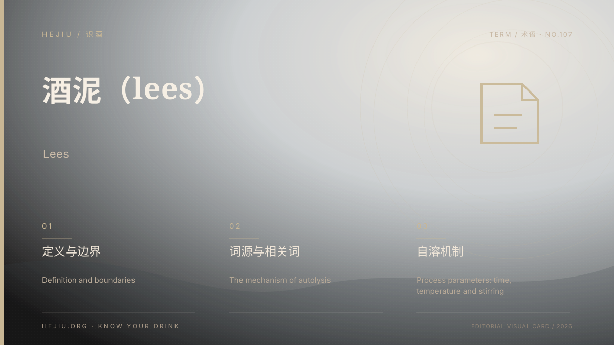

# 酒泥（lees）

酒泥（lees）是[发酵](ref:fermentation)结束后沉降到容器底部的固体物质。它的主要成分是失活的酵母细胞，此外还有葡萄果肉与果皮残渣、酒石酸盐、蛋白质与少量其他颗粒。酒泥不是“脏东西”的同义词，也不是必须立刻清除的废物；在葡萄酒工艺中，它既能带来风味和质感，也能带来缺陷。

图：酒泥（lees） 双语视觉卡（项目自绘 SVG）。不是实拍。

> **先给结论**
> **一句话：** 这页用一句话讲清酒泥（lees）的定义、边界和用法。
>
> - **适合谁：** 读到酒泥（lees）想快速弄懂定义、边界和用法的人。
> - **不适合谁：** 需要法规原文全文或法律/医疗意见的人。
> - **先看这两点：**
>   - lees 来自法语 lie，指酒或醋发酵后沉在底部的酵母与固体；英语借入后成为酒类工艺术语。
>   - 发酵结束后，酵母细胞逐渐死亡。

## 定义与边界

行业里通常区分两类。粗酒泥（gross lees）指发酵结束后最初沉降的较粗颗粒，包含果肉残渣和较重的固体，体积大、易腐败，一般会在发酵结束后不久通过倒罐（racking）分离，常见做法是在 24–48 小时内完成第一次倒罐。细酒泥（fine lees）指较细的酵母细胞和细小颗粒，沉降慢、悬浮时间长。

这个区分很关键。粗酒泥长时间留在酒中容易产生还原味、硫化物气味和苦味；细酒泥则常被有意保留，用来改善口感。把两者混为一谈，会得出“酒泥一定不好”或“酒泥越多越好”两种相反的误解。酒泥也不是“沉淀物”的同义词：酒石酸盐结晶、蛋白质沉淀与微生物浑浊都可能是沉淀，但不属于工艺意义上的酒泥接触。

## 词源与相关词

lees 来自法语 lie，指酒或醋发酵后沉在底部的酵母与固体；英语借入后成为酒类工艺术语。法语 sur lie 意为“在酒泥上”，指酒液与细酒泥一起陈酿；bâtonnage（也写作 battonage）来自 bâton（棍），指用棍搅动酒泥。英语里 autolysis 指酵母自溶，是酒泥接触产生风味与质地的核心过程。

这几个词经常被混用。sur lie 描述状态，bâtonnage 描述动作，autolysis 描述细胞层面的变化；三者相关但不等同。理解了词源，就不会把“带泥陈酿”和“搅泥”当成同一件事。

## 自溶机制

发酵结束后，酵母细胞逐渐死亡。细胞膜与细胞壁在酶的作用下分解，内容物释放到酒液中，这个过程叫自溶（autolysis）。自溶释放的物质包括甘露蛋白、多糖、氨基酸、核苷酸与部分脂类。甘露蛋白能增加酒体的圆润感，改善口感，也可能与蛋白质稳定性和酒石酸稳定性有关。

自溶需要时间与环境。温度较高、酒泥较厚、搅动较频繁时，自溶推进更快；温度低、酒泥薄、酒液澄清时，进程更慢。自溶过度会带来苦味与酵母味，因此酒泥接触不是“越久越好”，而是要在目标风格与风险之间取平衡。红葡萄酒的固体更多，管理难度也更高。

## 工艺参数：时间、温度与搅动

带泥陈酿的常见时长因酒种而异。静止白葡萄酒的 sur lie 常为 6–12 个月，部分风格会延长到 18 个月；传统法起泡酒在瓶中与酵母酒泥共处的时间更长，香槟无年份酒法定最短陈酿期为 15 个月，年份酒为 36 个月。温度通常控制在 10–18 °C，低温有助于保留新鲜果香，高温则加快自溶与还原风险。

搅动频率取决于目标。初期可每周一次或每两周一次，让细酒泥重新悬浮；后期降低频率，避免过度氧化与苦味。搅动会引入氧气，因此需要配合二氧化硫管理与容器顶空控制。密闭容器中的细酒泥容易产生还原性气味，严重时表现为硫化氢或硫醇类缺陷；这时需要通气或倒罐，而不是继续搅动。

## 在酒业中的实际用法

[白葡萄酒](ref:white-wine)是酒泥接触最常见的场景，尤其是追求质感和复杂度而非单纯果香的风格。在不锈钢罐或橡木桶中带泥陈酿，桶型、酒泥厚度与搅动频率会明显改变结果。勃艮第的霞多丽、卢瓦尔河谷的密斯卡岱（Muscadet sur lie）都是常被引用的例子；后者以带泥陈酿后的圆润口感与轻微酵母气息著称。

[起泡酒](ref:sparkling-wine)的基酒也常带泥陈酿；传统法起泡酒在瓶中二次发酵后与酵母酒泥共处数月到数年，除渣前这段时间是面包、饼干类香气的主要来源。部分红葡萄酒也会短期保留细酒泥，以柔化单宁，但红葡萄酒的固体部分更多，管理要求更高。不同酒种使用酒泥的目的不同：白葡萄酒多为质感，起泡酒多为香气与气泡的细腻度，红葡萄酒多为单宁的柔化。

## 感官与质地

酒泥接触的影响大致有三类。第一是口感：自溶释放的甘露蛋白与多糖让酒体更圆润、饱满，减少尖锐感。第二是香气：可以带来面包、饼干、奶油或坚果类的气味，香槟和部分白葡萄酒常借此形成风格。第三是稳定性：酒泥接触消耗溶解氧，降低氧化速度，也可能帮助稳定颜色和蛋白质。

这些效果并非线性叠加。酒泥太薄、时间太短，效果不明显；酒泥太厚、温度太高，又容易出现还原味与苦味。品鉴时把“酵母味”“面包味”“奶油味”分开记录，比笼统地说“有酒泥味”更有用。面包香气也可能来自橡木桶、酵母菌株与陈年时间，不能全部归功于酒泥。

## 易混术语对照

第一组：酒泥与沉淀。沉淀是更宽的概念，包含酒石酸盐、蛋白质、色素聚合物与微生物；酒泥特指发酵后沉降的酵母与有机固体。第二组：sur lie 与 bâtonnage。前者是“带泥陈酿”的状态，后者是“搅动酒泥”的动作；不搅动也可以带泥陈酿，搅动也不一定长时间带泥。

第三组：酒泥接触与过滤。带泥陈酿是陈酿方式，过滤是澄清手段；一款酒可以带泥陈酿后再过滤，也可以不过滤直接装瓶。第四组：酒泥与“死酵母”。酒泥包含死酵母，但还包含果肉残渣、酒石酸盐等；把酒泥等同于死酵母，会忽略固体组成的差异。

## 常见误用与争议

第一，酒泥不等于变质。它是否带来问题，取决于类型、时间、温度与氧气管理。第二，酒泥接触不是“越久越好”，过长会带来还原味和苦味。第三，带泥陈酿不等于不过滤，两者是不同环节。第四，面包香气并非只来自酒泥，橡木桶、酵母菌株与陈年时间都参与其中。

争议主要集中在“还原味”与“复杂度”的边界。支持长时间带泥陈酿的观点认为，酒泥能带来独特的质地与香气；反对者指出，密闭环境下的细酒泥容易产生硫化物缺陷，且生产周期长、占用容器。另一个争议是“酒泥接触能否替代搅动”：部分生产者只保留酒泥而不搅动，认为这样更少氧化；另一些生产者坚持定期搅动，认为这样才能充分释放甘露蛋白。两种做法都取决于酒款目标与风险管理。

## 典型数值与例子

可核验的数字包括：粗酒泥常在发酵结束后 24–48 小时内通过倒罐分离；静止白葡萄酒的 sur lie 常为 6–12 个月；香槟无年份酒法定最短陈酿期 15 个月，年份酒 36 个月；带泥陈酿温度常控制在 10–18 °C；搅动频率可从每周一次逐步降低。

具体例子：一款 Muscadet sur lie 可能在酒泥上停留整个冬季，装瓶前才分离，口感比普通 Muscadet 更圆润；一款无年份香槟在瓶中带泥至少 12 个月，除渣后加入调味液，最终甜度由 dosage 决定；一款过度带泥且密封的白葡萄酒可能出现硫化氢气味，需要通过通气或倒罐纠正。

相关条目：[白葡萄酒](ref:white-wine)、[起泡酒](ref:sparkling-wine)。

## 另见

- [白葡萄酒](ref:white-wine)
- [起泡酒](ref:sparkling-wine)
- [发酵](ref:fermentation)

**来源与边界。** 本页关于「酒泥（lees）」的关键事实，主要由以下来源交叉核对：International Organisation of Vine and Wine (OIV)（酒泥接触在葡萄酒酿造术语中的位置）、Oxford University Press（提供关于 lees、sur lie、bâtonnage 与澄清的条目）、Union des Maisons de Champagne（香槟法定最短陈酿期（无年份 15 个月、年份 36 个月）及带泥陈酿的公开表述）等 5 条来源。价格、批次与状态会变，涉及这些字段时以页面所列来源的最新版本为准。正文为项目自写，来源只作核验，不复制原文。
