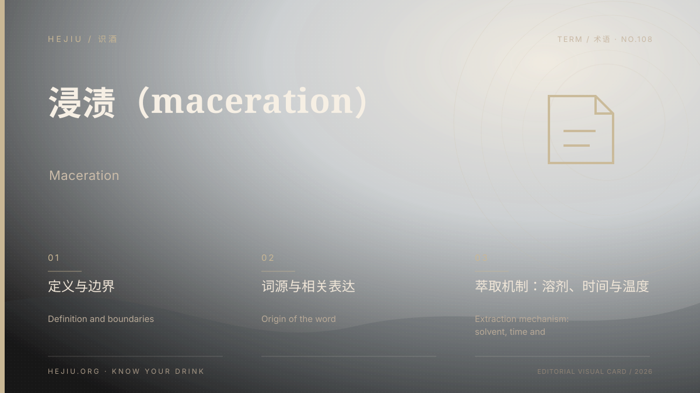

# 浸渍（maceration）

浸渍（maceration）指葡萄汁与固体部分——果皮、果肉、种子，有时还有果梗——保持接触的过程。它不是一个独立的“步骤”，而是一段可以安排在发酵前、发酵中或发酵后的接触时间。颜色、单宁、香气前体和部分口感物质都在这段时间里被带入液相。

图：浸渍（maceration） 双语视觉卡（项目自绘 SVG）。不是实拍。

> **先给结论**
> **一句话：** 这页用一句话讲清浸渍（maceration）的定义、边界和用法。
>
> - **适合谁：** 读到浸渍（maceration）想快速弄懂定义、边界和用法的人。
> - **不适合谁：** 需要法规原文全文或法律/医疗意见的人。
> - **先看这两点：**
>   - 浸渍的核心是“接触”与“提取”。
>   - maceration 来自拉丁语 macerare，意为“泡软、浸软”。

## 定义与边界

浸渍的核心是“接触”与“提取”。葡萄的固体部分含有大量不溶于水的成分：果皮中有花青素与单宁，种子中有较强的缩合单宁，果梗中也有木质味的单宁。要让这些成分进入酒液，必须有溶剂和接触时间。发酵产生的乙醇是最有效的溶剂之一，因此浸渍强度通常随发酵推进而上升。

边界在于：浸渍不等于发酵，也不等于陈年。发酵是糖转酒精的生化过程，陈年是装瓶或入桶后的熟成；浸渍只处理“果汁与固体接触”这一段。白葡萄酒也可以浸渍，只是时间短、温度低；红葡萄酒的带皮发酵则把浸渍与发酵叠在一起。把三者混为一谈，会误读工艺对风味的作用。

## 词源与相关表达

maceration 来自拉丁语 macerare，意为“泡软、浸软”。英语沿用了这个词，法语作 macération，西班牙语作 maceración。中文“浸渍”是意译，强调“浸泡”与“渗入”。在酒类语境中，它常与 skin contact（果皮接触）并用：后者更强调接触的对象，前者更强调过程。

相关词还有 cold soak（冷浸渍）、pumping over（泵送淋皮）、punch down（压帽）与 carbonic maceration（二氧化碳浸渍）。这些词描述的是不同操作或不同路线，不是同义词。冷浸渍是低温下的预发酵接触；泵送与压帽是管理皮渣帽的方法；二氧化碳浸渍则是整串葡萄在二氧化碳环境中的细胞内发酵。

## 萃取机制：溶剂、时间与温度

提取不是简单的“泡得越久越多”。实际结果取决于若干变量：

- 时间：从几小时到数周不等。红葡萄酒常见数天到三周，白葡萄酒通常只有数小时到一天的低温接触，或不浸渍。
- 温度：低温浸渍偏向提取颜色与香气，减少单宁与苦涩；温度升高会加快提取，也加快氧化与微生物风险。冷浸渍常用 5–10 °C。
- 酒精浓度：乙醇含量越高，对单宁和色素的溶解能力越强，所以发酵后期的提取效率更高。
- 搅拌与淋皮：泵送和压帽把浮在表面的皮渣重新浸入液体，提高提取效率，同时引入氧气。
- 固体部分的状态：整串、除梗、破碎程度、果实的成熟度与健康度都会改变提取结果。霉变果实会带来异味。

这些变量可以组合成不同的工艺路线，而不是一套固定配方。生产者根据年份、品种和目标风格调整，这正是同产区酒款差异的重要来源之一。

## 颜色、单宁与香气的不同步

颜色来自花青素，单宁来自多种多酚。二者都受浸渍影响，但并不同步：颜色提取在前期较快，单宁提取更依赖酒精浓度和时间。花青素在低 pH、有二氧化硫保护时更稳定；单宁则可能因为过度提取、未成熟种子或高温而变得粗糙。[单宁](ref:tannin)的量与质地共同决定口感，不能只看颜色深浅。

香气也不是单一变量。果皮中的香气前体在浸渍中进入酒液，随后在发酵与陈年中转化；低温浸渍有助于保留新鲜果香，高温则可能带来更浓的熟果与香料感，也更容易损失细腻度。把“颜色深”当成“香气浓”，是把两个指标混在一起。

## 工艺参数与操作

红葡萄酒的主流做法是带皮发酵，浸渍与[发酵](ref:fermentation)同时进行，发酵结束后再决定是否延长浸渍。延长浸渍可以增加结构，但时间过长会提取过多粗糙单宁。压帽与泵送的频率决定皮渣帽的温度、湿度与提取效率；频率过低容易滋生醋酸菌，频率过高则氧化加快。

白葡萄酒通常先压榨、分离果汁再发酵，以避免颜色和单宁；但不少生产者会做短时间的冷浸渍，以增加香气复杂度。桃红葡萄酒通过短时间接触获得浅色，随后分离果汁继续发酵。二氧化碳浸渍则是另一条路线：整串葡萄在充满二氧化碳的密闭容器中进行细胞内发酵，得到的酒颜色鲜亮、单宁柔和、带有香蕉和红色水果的香气。博若莱新酒是常被引用的例子；它与常规带皮发酵的化学路径不同，不能简单视为“更短的浸渍”。

## 在酒业中的实际用法

酒厂用浸渍来调节风格，而不是追求一个固定数值。轻盈的红葡萄酒可能只浸渍 5–7 天，结构型红葡萄酒可能延长到 14–21 天；白葡萄酒的 skin contact 可能只有 2–24 小时，用于增加香气与轻微质地；桃红常在 2–24 小时内完成颜色提取。具体时长取决于品种、成熟度、温度与目标。

浸渍也影响后续工艺。浸渍较重的红葡萄酒通常需要更长的陈年或更精细的单宁管理；浸渍较轻的酒则更适合早饮。对[红葡萄酒](ref:red-wine)而言，浸渍是结构的基础；对白葡萄酒而言，它是风格的可选工具。把浸渍时间当成质量等级，会忽略品种与年份的差异。

## 易混术语对照

第一组：浸渍与发酵。浸渍是接触与提取，发酵是糖转酒精；两者可以同时发生，也可以分开。第二组：浸渍与陈年。浸渍发生在果汁与固体接触阶段，[橡木桶](ref:oak-ageing)陈年发生在发酵结束后，两者改变的成分不同。

第三组：冷浸渍与二氧化碳浸渍。冷浸渍是低温预发酵接触，仍以液相提取为主；二氧化碳浸渍是整串葡萄的细胞内发酵，化学路径不同。第四组：浸渍与“带皮发酵”。带皮发酵是红葡萄酒的工艺描述，浸渍是其中的提取过程；白葡萄酒也可以浸渍，但不一定带皮发酵。

## 常见误用与争议

第一，浸渍不等于越久越好。过度提取会让单宁粗糙、果味被掩盖。第二，浸渍不是红葡萄酒的专利，白葡萄酒和桃红也会用到，只是时间与温度不同。第三，浸渍与陈年不是同一件事。第四，浸渍时间不能直接等同于质量等级，它只是风格选择。

争议主要集中在“延长浸渍”的价值。支持者认为延长浸渍能增加颜色、结构与陈年潜力；反对者指出，过长的浸渍会带来粗糙单宁与果味损失，且不同年份的果实成熟度差异很大。另一个争议是“整串发酵”与“除梗”的选择：整串带来果梗的单宁与香气，也带来更高的管理难度。对生产者而言，这些选择没有统一答案，只有与年份、品种和目标风格匹配的方案。

浸渍时间越长，颜色与单宁未必同步增加：温度、酒精与果皮状态会让萃取方向改变；浸渍越久越浓是过度简化，也会忽略过度萃取带来的苦感。

## 典型数值与例子

常见区间：红葡萄酒浸渍数天到三周，轻盈风格约 5–7 天，结构型风格约 14–21 天；白葡萄酒 skin contact 常为 2–24 小时；桃红常为 2–24 小时；冷浸渍温度常为 5–10 °C；二氧化碳浸渍常为数天到两周。不同产区与品种会偏离这些区间，数值只作参考。

具体例子：一款博若莱新酒通过二氧化碳浸渍获得鲜亮颜色与香蕉香气；一款勃艮第白葡萄酒可能只做数小时冷浸渍，以增加香气而不提取单宁；一款结构型赤霞珠可能浸渍三周，并通过压帽管理单宁。把这三个例子放在一起，就能看出浸渍是“方向选择”，不是“越长越好”。

## 另见

- [红葡萄酒](ref:red-wine)
- [发酵](ref:fermentation)
- [单宁](ref:tannin)
- [橡木桶陈年](ref:oak-ageing)
