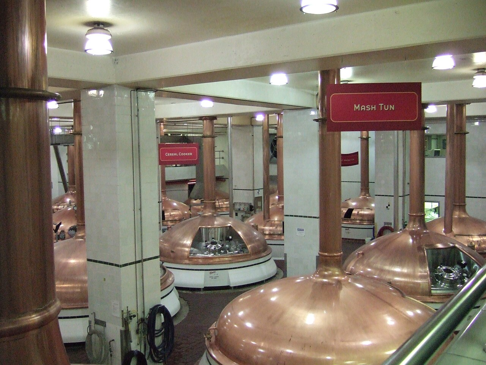

# 糖化醪（mash）

糖化醪是粉碎后的麦芽（grist）与热水在糖化槽中混合形成的糊状物。它不是麦芽汁，而是麦芽汁的前体：淀粉颗粒在热水中糊化，麦芽带来的淀粉酶把淀粉切成糖，蛋白质被蛋白酶分解，最终形成含糖、含氨基酸的液体。糖化结束后的过滤，才把液体与麦糟分开。

糖化醪的状态决定出糖率与糖谱，也决定后续发酵是否顺利。料水比太稠，酶与底物接触不均，过滤困难；太稀，酶浓度下降，糖化时间拉长，能耗上升。温度偏低，酶活性不足；温度偏高，酶过早失活，残糖过多。糖化不是“把谷物泡热”这么简单，而是一场关于温度、时间与浓度的精确控制。

图：啤酒厂的糖化醪槽（mash tun），麦粉与热水在此完成酶解。图片：Sdgjake，CC BY-SA 3.0，via Wikimedia Commons（[原图页面](https://commons.wikimedia.org/wiki/File:Coors_Mash_Tun.jpg)）。

## 料水比与温度：糖化醪的物理状态

糖化醪的浓稠度通常用料水比表示，常见范围是每公斤麦粉配 2.5 至 4 升水。较稠的醪适合蛋白质休止与高浓度糖化，较稀的醪有利于淀粉糊化与均匀受热。工业生产会按麦芽溶解度和设备条件调整，不是固定公式。

温度是糖化醪的核心变量。常用的休止温度包括：蛋白质休止在 50 摄氏度左右，让蛋白酶分解蛋白质、改善泡沫与澄清；糖化休止在 62 至 65 摄氏度，β-淀粉酶与 α-淀粉酶在此区间协同工作；糊化休止在 70 摄氏度以上，让残余淀粉继续糊化；出醪温度在 75 至 78 摄氏度，终止酶活性并降低醪的黏度，便于过滤。

升温速率同样重要。直接大火加热容易让醪局部过热，酶在高温区失活，淀粉却未完全糊化。现代糖化槽多采用蒸汽夹套、搅拌与程序控温，保证温度均匀。传统设备则靠酿酒师的经验与手工搅拌，稳定性和可重复性较差。

## 酶在醪里做什么

糖化醪中的酶主要来自麦芽。α-淀粉酶把淀粉长链切成短链糊精，β-淀粉酶从末端切下麦芽糖；两者共同作用，产生可发酵糖与不可发酵糊精的混合物。蛋白酶把蛋白质分解为多肽与氨基酸，为酵母提供氮源；β-葡聚糖酶分解麦芽中的β-葡聚糖，降低醪的黏度，改善过滤。

pH 对酶活性影响很大。糖化醪的 pH 通常控制在 5.2 至 5.6，接近淀粉酶与蛋白酶的最适区间。钙离子可以稳定 α-淀粉酶、促进蛋白质凝固；过多的碳酸盐会抬高 pH，抑制酶活性。酿酒师会通过调整酿造水或添加酸来修正 pH，而不是听天由命。

糖化醪的糖谱不仅影响酒精度，也影响酒体与泡沫。可发酵糖比例高，酒精度高、残糖低、酒体偏薄；糊精比例高，酒体饱满、泡沫支撑好。同一批麦芽，通过改变休止温度与时间，可以得到完全不同的成品风格。这也是为什么“配方相同、味道不同”在啤酒行业如此常见。

## 从糖化醪到麦芽汁

糖化结束后，糖化醪进入过滤槽。麦糟在滤板上形成过滤床，清亮的麦芽汁从底部流出。最初流出的麦芽汁可能浑浊，含有细小颗粒与脂质，酿酒师会把它回流到过滤槽，直到流出液清亮，这个步骤叫 vorlauf。

随后是洗槽（sparging）：用热水喷洒麦糟，把残留的糖冲出来。洗槽水的温度通常与出醪温度相近，pH 也要控制，避免把麦壳中的单宁洗出来。洗槽过度会降低麦芽汁浓度、带入苦涩味；洗槽不足则浪费糖。酿酒师会根据麦芽汁浓度与产量目标决定何时停止。

过滤结束，糖化醪的固体部分成为麦糟，液体部分成为麦芽汁。麦糟仍含蛋白质、纤维与少量糖，可作为饲料、堆肥或生物质燃料。糖化醪的“废物”并不真的是废物，它是循环经济的一部分。

## 威士忌、清酒与白酒的“醪”

威士忌酒厂同样使用糖化槽。麦芽粉与热水混合，糖化后过滤得到麦芽汁；麦芽汁冷却后发酵成 wash，再进入蒸馏。与啤酒不同，威士忌的麦芽汁通常不加酒花、不煮沸，因此糖化醪的风味更直接地进入最终酒体。

清酒的“醪”（moromi）是蒸米、曲霉与水的混合物，糖化与发酵同时进行，称为并行复发酵。它没有麦芽，也没有过滤槽；结束之后用压榨机把酒液与酒粕分开。把清酒的醪叫 mash 在英文语境中勉强可以，但必须说明酶来自曲霉而不是麦芽。

中国白酒的固态发酵也常被翻译为 solid-state mash。高粱、曲药与水混合，在窖池中糖化与发酵，之后蒸馏。它与啤酒的糖化醪在概念上相通，但含水量、微生物体系与后续工艺完全不同。术语的翻译可以借用，事实不能简化。

## 常见误解与判断

第一个误解是“糖化醪就是麦芽汁”。醪是固液混合物，麦芽汁是过滤后的液体；把两者混为一谈，会忽略过滤对风味与浊度的影响。第二个误解是“糖化时间越长越好”。时间过长会让酶过度作用，产生过多可发酵糖，酒体变薄，也可能带入麦壳的单宁。

第三个误解是“温度计读数就是醪温”。糖化槽不同位置的温度可能不一致，尤其是没有搅拌的设备。酿酒师会在多个点测量，确保酶作用均匀。第四个误解是“碘试验变黑就是失败”。碘试验检测的是淀粉残留；变黑说明糖化未完成，但少量糊精残留未必是缺陷，取决于风格。

判断糖化醪的质量，酿酒师会看温度曲线、pH、碘试验、醪的黏度与过滤速度。家庭酿酒者可以用简易保温桶与碘液，记录每一批的温度与时间，逐步建立自己的工艺参数。糖化醪是经验的载体，不是一张固定的配方表。

相关条目：[制麦](ref:malting)、[糖化](ref:saccharification)。

## 另见与参考资料

- 制麦：参见 [制麦](ref:malting)。
- 糖化：参见 [糖化](ref:saccharification)。
- 发酵：参见 [发酵](ref:fermentation)。
- 蒸馏：参见 [蒸馏](ref:distillation)。
- 啤酒：参见 [啤酒](ref:beer)。
- 威士忌：参见 [威士忌](ref:whisky)。

**来源与边界。** 本页关于「糖化醪（mash）」的关键事实，主要由以下来源交叉核对：American Society of Brewing Chemists（糖化醪的分析项目与糖化终点判断口径）、Master Brewers Association of the Americas（料水比、温度休止与过滤工艺的行业表述）、Brewers Association（糖化设备与精酿啤酒工艺的基本表述）等 5 条来源。价格、批次与状态会变，涉及这些字段时以页面所列来源的最新版本为准。正文为项目自写，来源只作核验，不复制原文。
