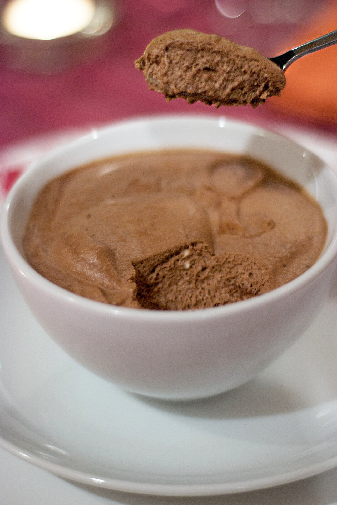

# 气泡质地（mousse）

气泡质地（mousse）是[起泡酒](ref:sparkling-wine)倒入杯中之后，泡沫如何生成、气泡颗粒有多粗、泡沫层能维持多久的综合表现。它属于感官描述，不是化学分析结果，也不是“数气泡”的计数指标。理解这一点，才能把服务细节、酒液成分与酿造工艺分开讨论。

图：气泡质地（mousse）。图片：Lu from Seattle, USA，CC BY 2.0，via Wikimedia Commons（[原图页面](https://commons.wikimedia.org/wiki/File:Chocolate_coffee_mousse.jpg)）。

## 定义与边界

mousse 描述的是酒液离开瓶身后、在杯中的动态状态：气泡从何处成核、上升速度多快、破裂后泡沫是否迅速塌陷。它的边界很明确：瓶内气压是物理量，mousse 是入杯后的感官结果；同一个气压的酒，在不同温度与不同杯具中会呈现不同的 mousse。单个气泡（法语 bulle）只是构成单元，mousse 指的是整体质地。

另一个边界是适用对象。任何含二氧化碳的酒都有 mousse，包括罐式发酵的起泡酒、碳酸化葡萄酒与部分加气果酒；但葡萄酒写作里，这个词更常出现在传统法[起泡酒](ref:sparkling-wine)的语境中。它不用于描述静止酒，也不用于描述烈酒加水后的“水花”。

## 词源与来源

mousse 直接借自法语，本义是“泡沫”，在法语中也指一种泡沫状的甜点。英语葡萄酒书写保留了法语拼写，没有把它意译成 foam。行业里另外两个词各有分工：bead 指杯中连续上升的气泡链，foam 指液面上方的那层泡沫。中文常见的“气泡质地”“泡沫”“气泡”都对应 mousse，但“气泡”容易让人误以为是在数单个气泡。

“mousse”与“mousseux”只差几个字母，却不是一回事。法语 mousseux 是起泡酒的类别名称，指成酒含气的一类酒；mousse 才是泡沫表现。把两者混用，会在一句话里同时谈类别与质地，造成概念漂移。

## 机制与参数

瓶内压力是基础。传统法香槟在接近 20°C 时瓶内压力约为 5–6 bar；香槟行业协会的资料以二次发酵结束时压力增加约每平方厘米 6 千克来表述，约合 5.9 bar，接近普通汽车轮胎的三倍。开瓶后，瓶口处的二氧化碳分压骤降，溶解气体按亨利定律向外逸出，形成气泡。

成核位置通常在杯壁的微小划痕、抛光残留的粉尘或纤维上。杯具若有油脂或洗涤剂残留，成核会被抑制，泡沫很快塌陷。温度升高会降低二氧化碳的溶解度，也让释放速度加快，于是气泡更活跃、泡沫更短命；温度过低则气体释放迟缓，香气也显得封闭。

酒液成分决定泡沫的“骨架”。蛋白质与多糖能延缓气泡膜排液，带泥陈年产生的甘露蛋白对泡沫稳定性尤其重要，这也是[酒泥](ref:lees)接触的价值之一。[补液](ref:dosage)中的糖分会改变泡沫的黏弹性，高糖往往带来更粗、更持久的泡沫，但它与酒质高低没有必然联系。瓶内带泥陈年的时间越长，气泡通常越细密，不过这仍受基酒、压力与温度制约。

## 在酒业中的实际用法

生产端把二次发酵建立气压的阶段称为 prise de mousse，目标通常是让瓶压达到 5–6 bar；压力不足会导致气泡软弱，压力过高则增加爆瓶与软木塞弹出的风险。侍酒端则依据 mousse 判断温度与杯具是否合适：气泡上升过急、泡沫迅速消散，往往提示温度偏高或杯具不洁。

品鉴记录通常把 mousse 拆成几个维度：气泡颗粒是细还是粗、上升是连续还是断续、泡沫层是薄还是厚、持续时间是长还是短。餐饮服务会避免剧烈摇晃与高温，倒酒时沿杯壁缓慢注入，以减少二氧化碳一次性损失。开瓶后即使使用专用塞，第二天的气泡质地也很难恢复到开瓶时的状态。

## 易混术语对照

- **mousse 与 pression（压力）**：压力是瓶内物理量，mousse 是杯中表现；两瓶压力相同的酒，可以因温度与杯型不同而呈现完全不同的气泡质地。
- **mousse 与 bulle（气泡）**：bulle 是单个气泡，mousse 是泡沫整体；说“气泡细”其实是在描述 mousse，而不是在数气泡。
- **mousse 与 mousseux**：mousseux 是起泡酒类别名，mousse 是泡沫表现；拼写接近，概念层级不同。
- **bead 与 foam**：bead 指上升的气泡链，foam 指液面泡沫层；两者都是 mousse 的组成部分，但不能互相替代。

## 常见误用与争议

最常见的误用是把 mousse 当作气泡数量，认为“气泡越多、越热闹就越好”。气泡数量受温度、倒酒方式与杯具洁净度影响很大，同一瓶酒的表现可以差别明显，因此它不适合作为质量判据。

第二种误用是把“气泡细腻”当成唯一标准。强调清爽与果香的年轻起泡酒，气泡可以活泼直接；强调复杂度与质感的酒款，气泡往往更细、更慢。把一种风格偏好写成通用标准，是品鉴话语里常见的越界。

第三个争议是“泡沫持久等于好酒”。高糖、高甘油或某些添加物都能让泡沫更持久，这与酿造质量没有必然关系。另一个争议是年份香槟是否一定气泡更细：带泥时间、基酒结构与瓶压都参与其中，单凭年份标签无法证明。营销还会把杯型的作用夸大，但在盲品中，杯型对香气与气泡路径的影响确实存在。

mousse 描述的是气泡在口中的质地，不是泡沫的厚度；细密持久与粗大短暂是两种方向，不能只按气泡多少判断质量。

## 典型数值与例子

- 传统法香槟瓶内压力约 5–6 bar（接近 20°C）；香槟行业协会以每平方厘米 6 千克表述，约合 5.9 bar，约为汽车轮胎气压的三倍。
- 1 bar 等于 100 kPa，约等于海平面大气压；5–6 bar 即约为大气压的五到六倍。
- 常见侍酒温度在 6–10°C 之间；温度越高，气泡释放越快，泡沫消退越早。
- 标准瓶容量为 750 mL；笛形杯与郁金香杯的收口程度不同，气泡上升路径与香气聚集也不同。
- 例：同一款 brut 在 6°C 与 12°C 下品饮，前者气泡上升缓慢、香气偏封闭，后者气泡活跃但泡沫塌陷更快，说明温度对 mousse 的影响可以肉眼分辨。

相关条目：[补液（dosage）](ref:dosage)。

## 另见

- [起泡酒](ref:sparkling-wine)：传统法与罐式法的气泡差异。
- [补液](ref:dosage)：糖分对泡沫与甜度的影响。
- [酒泥](ref:lees)：酒泥接触与多糖、甘露蛋白的关系。

**来源与边界。** 本页关于「气泡质地（mousse）」的关键事实，主要由以下来源交叉核对：International Organisation of Vine and Wine (OIV)（起泡酒工艺相关术语）、Oxford University Press（提供关于 mousse、气泡形成与起泡酒服务的条目）、Union des Maisons de Champagne（二次发酵建立约每平方厘米 6 千克压力、以及低温缓慢发酵产生细腻泡沫的表述；法文页面）等 4 条来源。价格、批次与状态会变，涉及这些字段时以页面所列来源的最新版本为准。正文为项目自写，来源只作核验，不复制原文。
