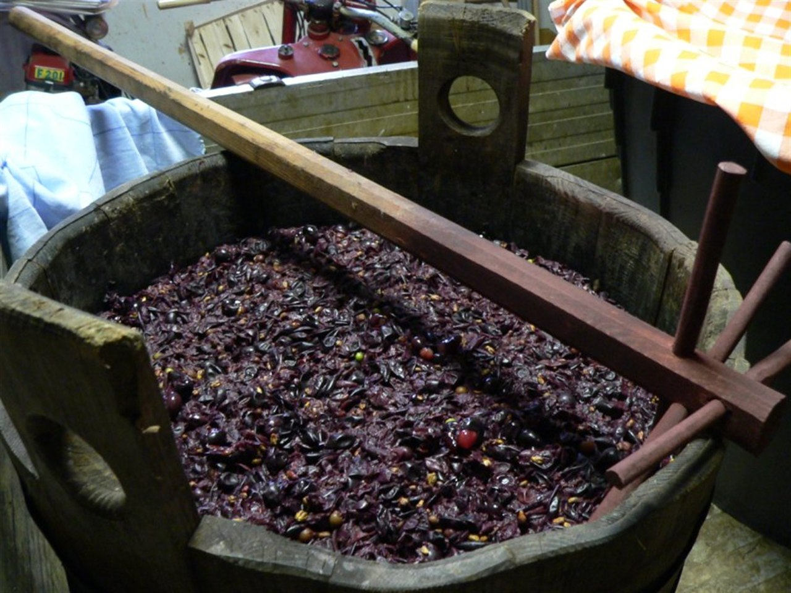

# 葡萄醪（must）

葡萄醪（must）指葡萄经破碎、压榨后得到的汁液，以及其中悬浮的果肉、果皮、种子与少量果梗。它可以是尚未发酵的甜汁，也可以是正在发酵的葡萄醪；在工艺语境里，must 往往同时包含“液体”和“固体”两部分。must 是葡萄酒的起点，它的糖度、酸度、澄清度与含固量，决定了发酵能否顺利、风格会走向哪里。

图：葡萄醪（must）。图片：Wikimedia Commons contributor，CC BY-SA 3.0，via Wikimedia Commons（[原图页面](https://commons.wikimedia.org/wiki/File:Mosto.jpg)）。

## 定义与边界

边界一：must 不等于市售“葡萄汁饮料”。后者通常经过杀菌、调味或稀释，不用于发酵。边界二：must 不等于 wort。wort 是谷物糖化后的麦汁，must 是果实压榨后的汁液；两者都用糖度测量，但原料与酶系统不同。边界三：must 不等于 pomace。pomace 是压榨后剩下的固体渣，must 是压榨得到的液体与悬浮物。边界四：must weight 是“葡萄醪重量/密度”的测量概念，不是 must 本身的同义词。边界五：must 的“重量”在法规中常以每升克数或潜在酒精度表达，和比重不是同一套单位。

## 词源与来源

英语 must 来自拉丁语 mustum，意为“新酒”或“未发酵的葡萄汁”；vinum mustum 就是“新葡萄酒”。法语 moût、意大利语 mosto、德语 Most 同源。这个词在古罗马的酿酒文献中已经出现，后来进入欧洲各语言，专指“尚未变成酒的葡萄汁”。中文旧称“葡萄醪”“葡萄汁”，现代工艺文本有时直接保留 must，以避免与“果汁”混淆。古罗马人把未发酵的汁液与已发酵的酒区分开来，这种区分后来成为欧洲酿酒术语的基础。

## 机制与参数

must 的核心参数是糖、酸、pH 与含固量。糖常用白利度（°Brix）、波美度（°Baumé）、厄克斯勒（°Oechsle）或潜在酒精度表示；经验上 1 °Brix 约对应 0.55–0.6 % vol 的潜在酒精度，20 °Brix 约对应 11%–12% vol。酸度用总酸（g/L，常以酒石酸计）与 pH 表示；pH 偏高会让二氧化硫效果下降、微生物风险上升。白葡萄汁常在取汁后添加二氧化硫（常见约 30–80 mg/L）并低温静置，让固体沉降；红葡萄醪则保留果皮，通过压帽、淋皮或搅拌管理酒帽。OIV 对葡萄酒酸化的累计上限为 54 meq/L（以酒石酸计约 4 g/L），这类参数决定了“调整”的合法边界。must 的含固量影响压榨与澄清：果皮、果肉与种子越多，压榨阻力越大，酚类物质也越多。

must 的浊度是酒厂判断澄清程度的常用指标：过高会带来还原味与发酵失控，过低则酵母缺营养；红葡萄醪在冷浸渍阶段通常保持 8–15°C，以提取颜色与香气而不启动发酵。

## 在酒业中的实际用法

白葡萄酒：破碎、轻压、取汁、低温澄清、发酵。压榨分段，初榨汁（free-run）与后段汁分开处理，后段汁更粗糙、pH 更高。红葡萄酒：破碎或去梗、入罐、带皮发酵、浸渍、压榨。是否放血（saignée）做桃红、是否整串发酵，都会改变 must 的组成。甜酒则可能让 must 在高糖状态下缓慢发酵或中途停止。加糖（chaptalisation）在部分产区允许，但有上限；加酸、降酸同样受法规约束。must 的澄清程度还影响酵母营养：过度澄清会让发酵启动困难。红葡萄醪的发酵温度通常高于白葡萄，以利于色素与单宁的提取；白葡萄则倾向较低温度以保留香气。加糖与加酸都应在发酵前或法规允许的阶段完成，并记录批次与用量。

## 易混术语对照

第一组：must 与 wort。前者来自葡萄，后者来自谷物；糖化逻辑不同。第二组：must 与果汁。must 是酿酒原料，含固体与野生微生物，未必经过杀菌。第三组：must 与 pomace/lees。pomace 是皮渣，lees 是沉降的酵母与固体；must 是尚未分离的混合物。第四组：must weight 与 °Brix。must weight 是密度/重量口径，°Brix 是其中一种糖度表达；两者相关但不相等。

## 常见误用与争议

第一，认为 must 糖度高就一定甜；实际甜度取决于发酵是否完成与[残糖](ref:residual-sugar)。第二，认为澄清越彻底越好；过度澄清会让酵母缺营养、发酵迟缓。第三，认为加糖是自由操作；欧盟与各产区对加糖量、加糖时机与标签都有规定。第四，把红葡萄醪当成“带色葡萄汁”；它包含果皮、种子与果梗，浸渍会带来单宁与颜色。争议在于“加糖是否属于作弊”：法规允许的 enrichment 是应对产区气候与年份差异的工具，但过量或未申报会破坏透明度。第六，把 must 的密度读成酒精度；密度只说明潜在糖分，不等于成品酒精。

## 典型数值与例子

20 °Brix 的 must 潜在酒精度约 11%–12% vol；24 °Brix 约 13.5%–14.5% vol；1 °Brix 约 0.55–0.6 % vol。白葡萄汁的二氧化硫常见添加量约 30–80 mg/L；OIV 酸化累计上限为 54 meq/L，约等于 4 g/L 酒石酸。1 百升（hl）等于 100 升，是酒厂常用的体积单位。must weight 在 20°C 下测量，密度与糖度会随温度变化，因此记录温度与测量方法同样重要。同一样品在高温下读数偏低，这也是酒厂强调标准温度的原因。

## 从破碎到发酵

破碎（crushing）与除梗（destemming）决定 must 里有多少果梗与完整果粒；压榨（pressing）决定汁液与果皮的分离程度；澄清（settling）决定发酵起点。白葡萄常在低温下静置 12–24 小时，让固体下沉，再取清汁；红葡萄则把 must 与果皮一起发酵，用压帽或淋皮保持接触。发酵启动后，must 的糖下降、酒精上升、温度升高，液体部分逐渐变成酒，固体部分成为[酒泥](ref:lees)与皮渣。理解这条链条，就能理解为什么同一品种、不同 must 处理方式会做出完全不同的酒。压榨分段得到的汁液在酚类、pH 与浊度上差异明显，因此酒厂常把初榨汁与后段汁分开入罐。

## 另见

- [浸渍](ref:maceration)：红葡萄酒中果皮与汁液的接触。
- [发酵](ref:fermentation)：糖转化为酒精与二氧化碳。
- [残糖](ref:residual-sugar)：发酵结束后的糖分。
- [酒泥](ref:lees)：发酵后沉降的固体。

对照阅读：[浸渍（maceration）](ref:maceration)、[残糖（residual sugar）](ref:residual-sugar)。

**来源与边界。** 本页关于「葡萄醪（must）」的关键事实，主要由以下来源交叉核对：International Organisation of Vine and Wine (OIV)（must、must weight 与葡萄醪相关术语；葡萄醪处理、酸化与分离技术的术语与限量）、Oxford University Press（提供关于 must、must weight、chaptalisation 与 red-wine fermentation 的条目）、JancisRobinson.com / Oxford University Press（葡萄醪（must）作为未发酵原料的定义）等 5 条来源。价格、批次与状态会变，涉及这些字段时以页面所列来源的最新版本为准。正文为项目自写，来源只作核验，不复制原文。

**并读。** 把「葡萄醪（must）」与「浸渍（maceration）」、「发酵」、「残糖（residual sugar）」放在一起读时，先确认它们是同一层级还是上下游关系：先确认定义与计量口径，再比较相邻术语与常见误用。本页负责给出术语的基本坐标，对照条目补上具体案例与差异；读完再回到本页，才能分清哪些差别属于术语本身，哪些只是产地、批次或品牌选择。

**适用边界。** 对「葡萄醪（must）」而言，术语在不同法规与行业语境中含义不同；先看定义来源，再看用法。
