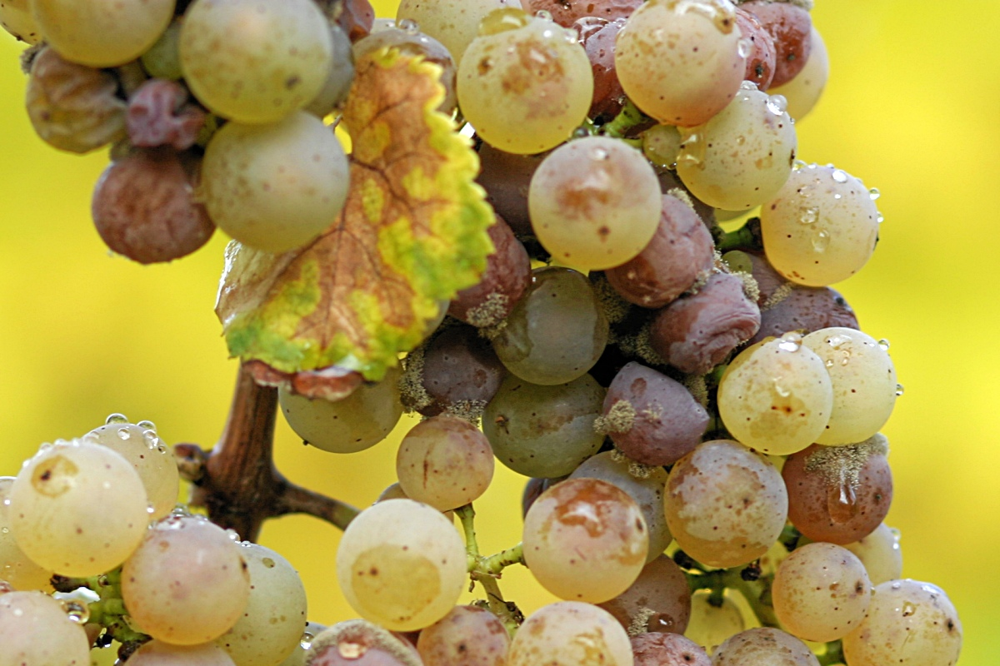

# 贵腐（noble rot）

贵腐（noble rot）指灰葡萄孢菌（Botrytis cinerea）侵染成熟葡萄后，在“夜间潮湿、白天干燥”的交替天气下造成的一种受控失水与成分浓缩现象。它不是一种独立的真菌，也不是“发霉”的同义词：同一菌种在持续潮湿时会造成灰腐（grey rot），果实软烂、异味明显；只有在菌丝仅穿透果皮、果肉尚未被破坏时，才谈得上贵腐。把贵腐理解为“菌种、天气与果实状态共同决定的结果”，比把它当成某种霉菌更准确。

图：贵腐（noble rot）。图片：Photographer: Tom Maack No machine-readable author provided. T.o.m.~commonswiki assumed (based on copyright claims).，CC BY-SA 3.0，via Wikimedia Commons（[原图页面](https://commons.wikimedia.org/wiki/File:Botrytis_riesling.jpg)）。

## 定义与边界

贵腐的边界有三条。第一，菌种相同，结果不同：Botrytis cinerea 既可造成贵腐，也可造成灰腐，区别在湿度序列、通风与果实健康状况。第二，贵腐发生在成熟期：未成熟的硬果不容易被穿透，感染后也难形成典型的浓缩效果。第三，贵腐不是甜酒的充分条件：晚收、风干、冰酒、加强酒都能得到甜酒，贵腐只是其中一条路径。酒标上的“贵腐精选”“noble”等词还受产区法规约束，不能仅凭字面推断工艺。

## 词源与来源

法语 pourriture noble、德语 Edelfäule、意大利语 muffa nobile、匈牙利语 aszúsodás，字面都与“高贵的腐烂”有关。这个命名方式说明，欧洲酿酒传统很早就在同一菌种造成的两种结果之间划线：破坏性的叫“灰腐”，有益的叫“贵腐”。中文“贵腐”是意译，保留了“贵”与“腐”的对照。术语本身不带法规效力，但在苏玳、托卡伊、德国与奥地利等地的分级体系中，它对应的采收与糖度要求是具体的。

## 机制与参数

贵腐菌以分生孢子传播，萌发需要较高湿度，文献常给出约 20°C 与 80% 以上相对湿度的组合；清晨的雾、露让孢子附着并萌发，午后转晴、有风、湿度下降，果面水分蒸发，菌丝停止向果肉深入。菌丝穿透果皮后，浆果通过果面失水，重量可下降三成以上，糖、酸、矿物质与风味前体随之浓缩。真菌还会消耗部分酒石酸、产生甘油与葡萄糖酸，使果汁黏度上升、pH 偏高，并分泌漆酶类氧化酶，增加褐变与压榨难度。采收时常用潜在酒精度、白利度或葡萄醪重量判断成熟度与感染程度。

## 在酒业中的实际用法

苏玳与巴萨克位于加龙河与锡龙河交汇处，秋季晨雾与午后阳光形成稳定的微气候。当地官方资料给出的品种结构是赛美蓉约 80%、长相思约 20%，麝香少量；由于感染不均匀，采收可持续长达三个月，并分三到五次逐粒挑选。托卡伊的 Aszú 同样靠手工挑选贵腐果，传统上用 puttonyos（3–6）标注甜度。德国与奥地利的 Trockenbeerenauslese 也要求逐粒选取贵腐果。酿造上通常轻柔压榨、低温澄清、缓慢发酵，常在橡木桶中完成，成品保留较高[残糖](ref:residual-sugar)，属于[甜型](ref:sweet)酒的重要一支，香气则呈现蜂蜜、杏、柑橘酱与藏红花等层次，与普通成熟果的[香气](ref:aroma)明显不同。

## 易混术语对照

第一组：贵腐与灰腐。两者是同一菌种在不同湿度条件下的两种结果，前者可控、后者失控，不能因为都长“灰毛”就混为一谈。第二组：贵腐与[晚收](ref:late-harvest)。晚收只是把采收推迟，果实可能健康，也可能感染贵腐；贵腐则是真菌参与的成分转化。第三组：贵腐与风干（passerillage）。风干靠失水浓缩，不依赖真菌；贵腐的独特之处在于菌丝代谢带来的香气与酸度变化。第四组：“botrytis”与“noble rot”。前者是菌名，后者是结果，不能把所有受 Botrytis 感染的葡萄都称为贵腐。

## 常见误用与争议

最常见的误用是把“贵腐”当成“发霉的葡萄”，从而认为贵腐酒不卫生；实际上，贵腐酒的安全性取决于压榨、澄清、发酵与二氧化硫管理，而不是菌丝本身。第二种误用是认为贵腐每年都会发生；秋季天气决定了感染率与产量，同一酒庄不同年份的差异可能很大，年份信息在贵腐酒里比在多数干白里更重要。第三种争议是“越甜越好”：贵腐酒的残糖可以很高，但如果没有足够的酸度支撑，就会显得黏腻。第四种争议是产量与成本：逐粒采收、多次过园、低出汁率，使贵腐酒的价格通常高于同产区干白，这不是营销话术，而是工艺结果。

## 典型数值与例子

苏玳与巴萨克：采收期可长达三个月，分三到五次挑选；赛美蓉约 80%、长相思约 20%。托卡伊 Aszú：传统 puttonyos 标注为 3–6。贵腐甜白常见残糖约 100–150 g/L，酒精度约 13%–14% vol。感染期浆果失水可达三成以上，具体取决于雾、晴、风的比例。这些数字不是固定标准，而是帮助读者建立“贵腐酒为什么浓、为什么贵、为什么年份差异大”的参照。

## 年份与产量波动

贵腐酒的年份差异来自秋季天气，而不是单纯的夏季热量。雾太少，感染不足；雨太多，灰腐取代贵腐；持续干燥，果实只会晚收而不会贵腐。生产者通常在同一片园里多次巡查，根据每批果实的状态决定采或不采。于是同一酒庄的年份之间，产量、甜度、酸度与香气都可能明显不同。阅读酒标时，把年份、产区与“贵腐”字样一起看，比只看“甜型”更有信息量。

## 另见

- [晚收](ref:late-harvest)：延后采收的糖分基础。
- [甜型](ref:sweet)：成品甜度的分类与感知。
- [残糖](ref:residual-sugar)：贵腐酒甜度的量化口径。
- [香气](ref:aroma)：贵腐带来的香气层次。

对照阅读：[甜型（sweet）](ref:sweet)、[晚收（late harvest）](ref:late-harvest)。

**来源与边界。** 本页关于「贵腐（noble rot）」的关键事实，主要由以下来源交叉核对：International Organisation of Vine and Wine (OIV)（贵腐与甜酒相关术语）、Oxford University Press（提供关于 noble rot、Botrytis cinerea 与 botrytised wines 的条目）、Sauternes Barsac AOC（苏玳与巴萨克的气候、品种比例与多次挑选采收）等 5 条来源。价格、批次与状态会变，涉及这些字段时以页面所列来源的最新版本为准。正文为项目自写，来源只作核验，不复制原文。

**并读。** 把「贵腐（noble rot）」与「甜型（sweet）」、「香气（aroma）」、「晚收（late harvest）」放在一起读时，先确认它们是同一层级还是上下游关系：先确认定义与计量口径，再比较相邻术语与常见误用。本页负责给出术语的基本坐标，对照条目补上具体案例与差异；读完再回到本页，才能分清哪些差别属于术语本身，哪些只是产地、批次或品牌选择。

**适用边界。** 对「贵腐（noble rot）」而言，术语在不同法规与行业语境中含义不同；先看定义来源，再看用法。

**更新提示。** 「贵腐（noble rot）」最近核对于 2026-11-07；定义、计量口径与相邻术语会因文献不同，引用前以标准或权威辞书为准。
