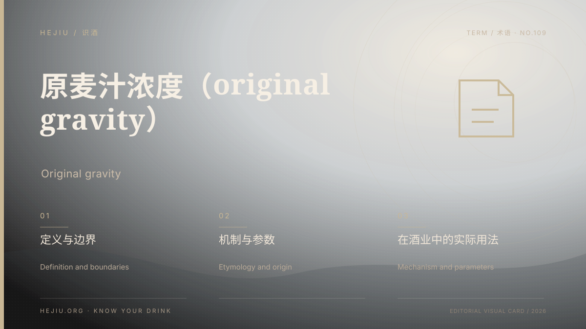

# 原麦汁浓度（original gravity）

原麦汁浓度（original gravity，OG）指糖化结束、接种酵母之前，麦汁中可溶性固形物（主要是糖与非发酵性浸出物）的浓度。它回答的是“这批原料能提供多少浸出物”，而不是“成品有多少酒精”。在啤酒厂里，OG 是配方与工艺控制的起点；在中国啤酒标签上，它常以“原麦汁浓度 10°P”“11°P”出现，容易被误读成酒精度。

图：原麦汁浓度（original gravity） 双语视觉卡（项目自绘 SVG）。不是实拍。

## 定义与边界

OG 的边界有四条。第一，它是发酵前的值；发酵开始后测得的密度是当前密度，不是 OG。第二，它包含不可发酵的浸出物（蛋白质、糊精、矿物质等），因此不等于“糖含量”。第三，它不描述苦度，IBU 是另一套单位。第四，它不等于成品酒精度，酒精由 OG 与终点密度（FG）的差值及发酵度决定。把 OG 当成“酒精度”或“浓度越高越烈”的直观判断，都会失准。此外，OG 描述的是麦汁的浸出物负荷，并不直接等于可发酵糖比例；结晶麦芽、特种麦芽会提高浸出物，却未必同步提高发酵度，因此配方设计不能只看一个数字。

## 词源与来源

“Original gravity”直译是“原始的比重”，来自啤酒厂用比重计测量麦汁的传统；gravity 在这里指密度/比重，不是“重力”，这也是中文读者容易误会的地方。°P（degrees Plato）是欧洲浸出物标度体系的一部分：19 世纪 Balling 标度先用于糖溶液与麦汁，Plato 后来对蔗糖溶液作了修正，形成啤酒业常用的 °P。中文“原麦汁浓度”强调“原”字，正是为了与发酵后的浓度区分。

## 机制与参数

°P 的定义是每 100 克麦汁中含有的浸出物克数，近似质量百分比；比重则用 1.0xx 的形式表达。经验换算中，1.050 的比重约相当于 12.4 °P，1 °P 大致对应 0.004 个比重单位。发酵结束后，用 OG 与 FG 的差值估算酒精度，常用近似式（OG−FG）×131；例如 1.048 降到 1.012，差值 0.036，估算约 4.7% vol。表观发酵度 =（OG−FG）÷（OG−1）×100%，同一条数据可以同时说明“发酵是否彻底”和“酒体是否保留”。温度对密度读数影响明显：比重计通常校准在 20°C，样品偏离时需按温度修正；折光仪在纯麦汁中可直接使用，但发酵后含酒精时必须换算，否则读数会偏高。

## 在酒业中的实际用法

配方设计先定 OG，再定麦芽配比、辅料比例与糖化温度；糖化温度偏低、时间偏长，可发酵糖比例上升，OG 相同也可能得到更干的成品。中国主流啤酒多在 8–12 °P，淡色拉格常见 8–12 °P，皮尔森约 11–12 °P，美式 IPA 约 14–18 °P，世涛约 12–16 °P。风格指南把这些区间与 IBU、酒精度并列，是为了描述结构，而不是给品质排序。在成本核算中，OG 与麦芽用量、辅料比例直接相关，是配方成本与出品率的核心变量。理解[糖化](ref:saccharification)、[发酵](ref:fermentation)与[大麦](ref:barley)的关系，才能解释为什么同为 11 °P 的两款[啤酒](ref:beer)喝起来不同；[捷克皮尔森](ref:pilsner)就是中等 OG、强调清爽平衡的参照。

## 易混术语对照

第一组：OG 与 FG。OG 是起点，FG 是终点；前者决定潜在酒精的上限，后者决定残糖与口感。第二组：OG 与 ABV。OG 是浸出物浓度，ABV 是乙醇体积分数；同一 OG 可以因发酵度不同而得到不同 ABV。第三组：°P 与 °Brix。两者都近似“每 100 克溶液中的固形物克数”，但 °Brix 以蔗糖为基准，°P 针对麦汁浸出物做了修正，跨行业比较时需要换算而不是直接画等号。第四组：原麦汁浓度与标签值。标签值是产品设计值或法定标注值，实际批次会有波动。需要补充的是，°P 与 °Brix 之间没有单一换算系数，因为麦汁浸出物并非纯蔗糖；实验室常用密度与折光双读数反推，配方软件则内置经验模型。

## 常见误用与争议

第一，把 10 °P 读成“10 度酒”，于是以为它比 5% vol 的啤酒“更烈”。第二，认为 °P 越高品质越好，忽略风格与平衡。第三，用发酵后的比重当 OG。第四，忽略发酵度，看到高 OG 就断定高酒精度。第五，在含酒精的样品上用折光仪直接读 °Brix 而不做校正，得到偏高的结果。争议则集中在“原麦汁浓度”是否应被消费者直接理解为“浓淡”：它能反映原料投入，但口感还受酒花、残糖、二氧化碳与苦度影响。

°P 是麦汁浓度，不是酒精度；估算酒精还要看终点密度，单看原麦汁浓度会高估或低估。

°P 与比重可以换算，但不同糖化工艺的浸出物组成不同；精酿配方常两者并用。

## 典型数值与例子

以 1.048（约 12 °P）的麦汁为例，发酵到 1.012，表观发酵度约 75%，估算酒精度约 4.7% vol；若只发酵到 1.020，发酵度约 58%，酒精度约 3.7% vol，残糖更多。常见区间：淡色拉格 8–12 °P，皮尔森 11–12 °P，美式 IPA 14–18 °P，世涛 12–16 °P。中国产品标签的 8–12 °P 区间，与这些风格的“中等浓度”大致对应，但不能跨风格直接比较。

## 测量与记录

工厂通常在糖化结束、洗糟完成、麦汁冷却后取样，在 20°C 下用比重计、密度计或折光仪测量，并记录批次号、原料配比与糖化曲线。实验室方法以 ASBC 的浸出物与比重方法为参照。对精酿者而言，记录 OG、FG、发酵度与酵母代数，比只记一个“目标 OG”更有助于复现。测量温度偏差会直接影响读数，样品中的二氧化碳与颗粒也会干扰，因此取样前要脱气、过滤或静置。若同一批次多点取样，应记录取样时间与洗糟终点，避免把最后一点高比重麦汁误当成整体 OG。

## 另见

- [啤酒](ref:beer)：啤酒的原料、发酵与风格框架。
- [大麦](ref:barley)：麦芽与浸出物的来源。
- [糖化](ref:saccharification)：淀粉转化为可发酵糖的过程。
- [发酵](ref:fermentation)：糖转化为酒精与二氧化碳。
- [捷克皮尔森](ref:pilsner)：中等原麦汁浓度的典型样本。

对照阅读：[啤酒](ref:beer)、[发酵](ref:fermentation)。

**来源与边界。** 本页关于「原麦汁浓度（original gravity）」的关键事实，主要由以下来源交叉核对：Beer Judge Certification Program（啤酒风格描述中原麦汁浓度与酒精度的关系）、ASBC（麦汁浓度与浸出物的测量口径，未复制方法原文）、Brewers Association（提供关于风格参数与原麦汁浓度的说明）等 5 条来源。价格、批次与状态会变，涉及这些字段时以页面所列来源的最新版本为准。正文为项目自写，来源只作核验，不复制原文。

**并读。** 把「原麦汁浓度（original gravity）」与「啤酒」、「大麦」、「发酵」放在一起读时，先确认它们是同一层级还是上下游关系：先确认定义与计量口径，再比较相邻术语与常见误用。本页负责给出术语的基本坐标，对照条目补上具体案例与差异；读完再回到本页，才能分清哪些差别属于术语本身，哪些只是产地、批次或品牌选择。
