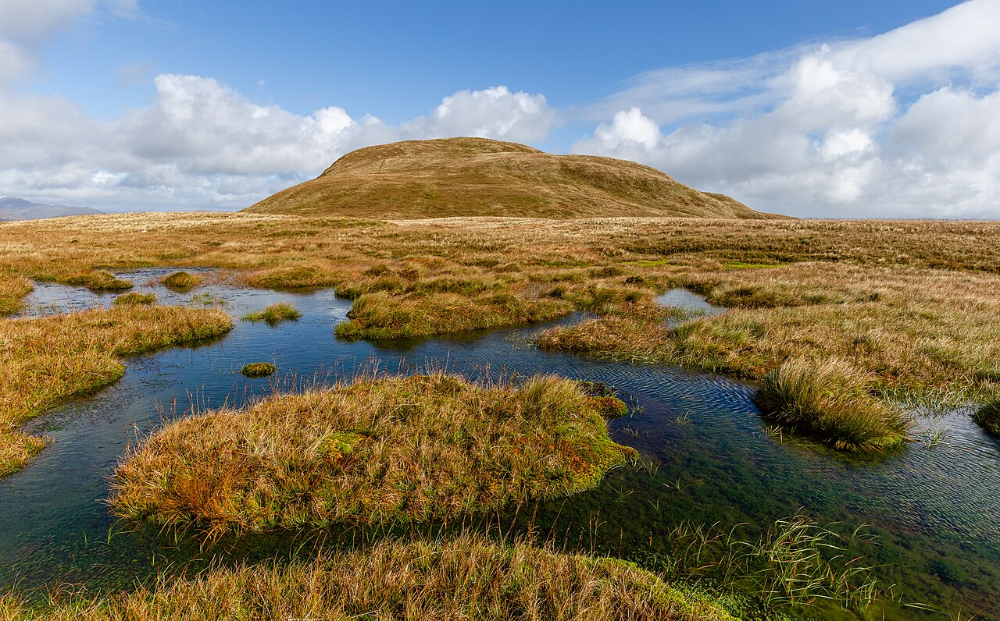

# 泥煤酚值（PPM）

泥煤酚值常写作 phenol ppm 或 peating level，是威士忌行业用来描述“麦芽被泥煤烟熏到什么程度”的一个数量。它最常见的口径，是麦芽中总酚的含量，以毫克每千克（mg/kg）表示；1 ppm 就是 1 mg/kg。它不是瓶中酒液的酚类浓度，也不是一个统一的感官等级：两家酒厂都标 40 ppm，成酒的烟熏强度仍可能因为麦芽、糖化、蒸馏、陈年和稀释方式而明显不同。

图：苏格兰卢斯丘陵 Doune Hill 下方的泥炭沼泽；这是泥煤产地场景，不是 PPM 测量仪，也不是某款酒的酒液。图片：Michal Klajban，CC BY-SA 4.0，via Wikimedia Commons（[原图页面](https://commons.wikimedia.org/wiki/File:A_peat_bog_below_the_top_of_Doune_Hill,_Luss_Hills,_Scotland.jpg)）。

## 定义：ppm 测的是麦芽，不是酒液

在威士忌生产里，ppm 一般出现在麦芽规格或酒厂的产品说明上。大麦发芽后，用泥煤燃烧产生的烟穿过麦芽床，烟中的酚类被麦芽表面吸附，随后在糖化、发酵和蒸馏过程中部分进入酒液。酒厂在麦芽出厂时检测总酚，用 ppm 表示；到了新酒（new make）或陈年酒液，酚类已经经过多次转移和损失，浓度不再是麦芽上的那个数字。因此，把“128.9 ppm”直接理解成“酒液每升含 128.9 毫克酚”是错的。

ppm 是一个比值单位，不带品质判断。它既不代表烟熏的“好坏”，也不代表入口的“强弱”。同样的 ppm，可能因为酚类组成不同而呈现药草、灰烬、焦油或消毒水等不同气息；酚类只是烟熏风味的一部分，不是全部。

## 从泥煤到麦芽：酚类如何进入酒液

泥煤是缺氧沼泽中部分分解的植物残体，燃烧温度低、烟量大。传统窑炉把泥煤作为热源之一，烟经过湿润的麦芽层，酚类随烟附着在麦芽上。泥煤的植物组成、分解程度、含水量和燃烧条件都会影响烟的成分；麦芽的含水量、铺层厚度、烟温与干燥速度，则影响吸附和保留。温度过高可能让部分酚类焦化，烟味变粗；缓慢干燥更利于保留细致的药草与灰烬层次。

这也是为什么“ppm 相同”不等于“风格相同”。艾雷岛的泥煤、苏格兰大陆的泥煤、不同沼泽深度的泥煤，植物组成和燃烧行为并不一样；酒厂还可以选择不同麦芽供应商、不同窑炉和不同烟熏时长。ppm 是一个可比较的规格参数，但它不是配方，也不是产区标签。

## 数值怎么读：80 ppm 与 128 ppm 的差别

以 Bruichladdich 的 Octomore 系列为例，官方产品页在 2026 年给出的标注包括：17.1 为 81.0 PPM，16.2 为 101.4 PPM，14.1 为 128.9 PPM。它们都被酒厂归入“super heavily peated”一类，但数值跨度很大。这个例子说明，ppm 可以帮助消费者在同一系列里做粗比较，却不能单独决定“哪一款更泥煤”。酒精度、陈年桶型、酒龄和装瓶方式都会改变最终感受。

行业里常见的粗略区间是：20–30 ppm 以下偏轻，30–50 ppm 属于明显的泥煤风格，50 ppm 以上进入重度区间，80 ppm 以上常被酒厂称为超重泥煤。但这些区间不是法规，也不是官方分级；不同酒厂对“heavy”与“super heavy”的用法并不统一。看到“ppm 越高越泥煤”时，最好把它当成一个趋势，而不是一条直线。

## 产区与风格：艾雷岛不是唯一答案

艾雷岛因为泥煤资源、海风和多家重泥煤酒厂，常被当作泥煤威士忌的代名词。但泥煤风格并不限于艾雷岛：苏格兰大陆、岛屿区、甚至爱尔兰和日本都有酒厂使用泥煤麦芽。艾雷岛的泥煤常被描述为药草、碘、海藻与灰烬；大陆泥煤可能更偏木质、泥土或篝火。把这些差异全部归因于 ppm，会忽略泥煤来源和酒厂工艺。

同样，艾雷岛也不是每家酒厂都做重泥煤。岛上有以无泥煤或轻泥煤为风格的酒厂；把“艾雷岛”直接等同于“重泥煤”是常见的以偏概全。产区提供地理与历史背景，ppm 提供麦芽规格，两者不能互相替代。

## 工艺变量：糖化、蒸馏与陈年都会改写数字

酚类进入酒液后，并不是均匀地留在每一滴里。糖化用水的温度、pH 和洗糟方式会影响酚类的溶出；发酵会改变部分酚类的前体；蒸馏时，不同的切割点会把酚类分配到酒头、酒心和酒尾。酒厂可以选择保留更多酒尾，让烟熏更重，也可以收紧切割，让酒体更干净。陈年时，酚类会被橡木桶吸附、氧化或与其他化合物反应，时间越长，烟熏往往越融合，而不是简单地“越陈越重”。

稀释也会改变感知。加水或加冰会降低酒精度，让部分香气更容易释放，也可能让烟熏显得更明显或更分散。把 ppm 当成入口强度的唯一指标，会忽略这些变量。

## 常见误读

第一，ppm 不是酒液的酚浓度。它是麦芽规格，成酒的酚类浓度通常低于麦芽标注，而且不同酒款差异很大。第二，ppm 不是法定等级。苏格兰威士忌法规规定原料、蒸馏、橡木桶陈年和最低酒精度，但没有规定泥煤酚值的下限或上限。第三，ppm 不是线性感官刻度。80 ppm 不一定比 100 ppm“轻”，因为酚类组成、切割点和陈年都会改变感受。第四，ppm 不是质量分。高低只说明烟熏强度，不说明工艺水平。

第五，“无泥煤”不等于“没有烟熏”。橡木桶烘烤、发酵和蒸馏也可能带来烟熏或焦香；泥煤酚值是特定来源的指标，不是所有烟熏味的总和。第六，ppm 不是产区证明。同一产区可以有不同 ppm，同一 ppm 也可以来自不同产区。

## 选购与表达

如果你想判断一款酒的泥煤强度，ppm 可以作为起点，但不要只看它。先看酒厂是否标注麦芽酚值，再看酒精度、酒龄、桶型和是否冷凝过滤；如果有品鉴笔记，注意它描述的是药草、灰烬、焦油还是海风，而不是只写“很泥煤”。同一款酒加水前后的变化，也值得记录。

在写作或讨论中，较准确的说法是“这款酒的麦芽标注为 80 ppm”，而不是“这款酒有 80 ppm 的酚”。前者说明数据来源，后者把麦芽规格偷换成酒液浓度。把口径说清楚，比争一个“最泥煤”的称号更有意义。

相关条目：[制麦](ref:malting)。

## 延伸阅读与另见

- [泥煤](ref:peat)：泥煤的形成、燃烧与麦芽烟熏的基础概念。
- [制麦](ref:malting)：发芽、烘干与麦芽规格的形成。
- [威士忌](ref:whisky)：威士忌的原料、蒸馏与陈年框架。
- [艾雷岛](ref:islay)：泥煤威士忌最常被提到的产区。
- [阿贝 10 年](ref:ardbeg)：一款重泥煤单一麦芽的具体酒款页。

对照阅读：[泥煤（peat）](ref:peat)、[威士忌](ref:whisky)。
