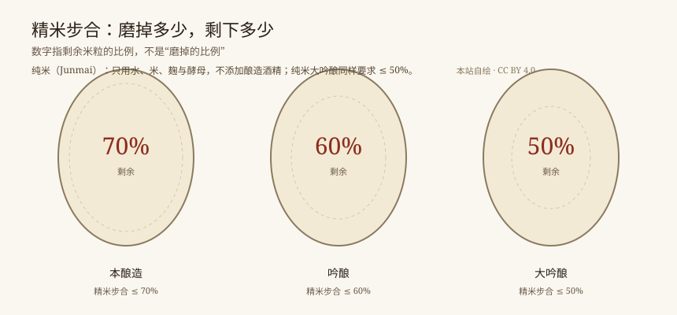

# 精米步合（polishing ratio）

精米步合（polishing ratio，日语 seimaibuai）指清酒酿酒米经过研磨后剩下的重量比例。写成 50%，意思是原米磨去一半、剩下 50%；写成 60%，意思是剩下 60%。它描述的是“米磨到什么程度”，不是“酒有多好”。在日本清酒的特定名称体系里，精米步合是法定条件之一，但必须与是否添加酿造酒精、原料、酵母与工艺一起读。

图：精米步合指剩余米粒的比例，不是磨掉的比例。本站自绘，CC BY 4.0。

## 定义与边界

边界一：精米步合是“剩余比例”，不是“去除比例”。50% 与“磨掉 50%”说的是同一件事，但 60% 表示磨掉 40%，不是磨掉 60%。边界二：它只描述米的研磨程度，不描述米的品种、产地或等级。边界三：它不是质量评分，低步合可能带来更干净的香气，也可能只是成本与定位。边界四：它与“日本酒度”完全不同，后者是成品酒液的密度/糖分指标，不是米的加工指标。

## 词源与来源

日语“精米”（seimai）指把玄米（糙米）研磨成白米，“歩合”（buai）指比例、比率，合起来就是“精米的比例”。中文常译“精米步合”或“精米比率”，也有“精白步合”的说法。这个术语伴随日本清酒的等级制度进入酒标：当酒标写“纯米大吟酿 精米步合 50%”时，两个信息一组，一个是等级，一个是加工参数。英语世界多直接音译为 seimaibuai，因为 polishing ratio 容易被误解为“抛光”而非“研磨去糠”。在日语中，“精米歩合”有时省略为“歩合”，但单独说歩合容易与一般的“比例”混淆，正式文本仍写全称。

## 机制与参数

清酒米的外层（糠层、胚芽）含较多蛋白质、脂肪、矿物质与维生素，过量会带来杂味、影响麹菌的酶解与酵母发酵。研磨把外层逐步去掉，保留富含淀粉的心白（shinpaku）。米粒的吸水速度、蒸煮后的弹性、麹菌穿透的难易，都会随精米步合变化；因此酿酒师要同步调整洗米、浸渍、蒸煮与制麹。精米步合越低，出米率越低、耗时越长、碎米风险越高，成本随之上升。研磨不是“越狠越好”，过度研磨会损失心白、增加碎米，也可能让酒体变薄。

## 在酒业中的实际用法

日本国税厅的制法品质表示基准把特定名称与精米步合绑定：大吟酿要求精米步合不超过 50%，吟酿不超过 60%，本酿造不超过 70%，纯米酒也不超过 70%。纯米大吟酿、纯米吟酿则是在“纯米”（不添加酿造酒精）前提下再满足相应步合。酒标上，特定名称酒需要在原料名附近标示精米步合。实际生产中，酒米如山田锦、五百万石常被用于高精米产品，但品种、产区水质、酵母与温度同样决定风格。清酒的糖化与发酵是并行进行的“并行复发酵”，精米步合通过影响麹菌与水分，间接影响这条链条。

## 易混术语对照

第一组：精米步合与“去除率”。50% 是剩余一半，去除率才是 50%；60% 的去除率是 40%，两者不能混用。第二组：精米步合与日本酒度。前者是米的加工比例，后者是成品酒液的密度/糖分指标；一个在原料端，一个在成品端。第三组：精米步合与特定名称。等级是“名称”，步合是“条件”；低步合不一定自动获得大吟酿名称，还要满足原料与工艺要求。第四组：精米与洗米。精米是研磨，洗米是清洗与浸渍，二者不是同一道工序。

## 常见误用与争议

第一，把精米步合当作质量分数，认为 50% 一定优于 60%。第二，把 50% 读成“只用了 50% 的米”，实际是“剩下 50%”。第三，只看数字，不看纯米/添加酒精、酵母与熟成。第四，认为低步合必然更贵，忽略酒米品种与产量。第五，把清酒的精米与蒸馏酒的原料粉碎混为一谈。争议集中在“低步合是否值得”：支持者认为它带来更纯净的香气与更少的杂味，反对者认为过度研磨浪费原料、增加成本，而且风味差异更多来自麹、酵母与水。

## 典型数值与例子

100% 是玄米，未研磨；50% 表示磨去一半，常用于大吟酿与纯米大吟酿；60% 是吟酿与纯米吟酿的门槛；70% 是本酿造与纯米酒的上限。以“精米步合 50%”为例，100 公斤玄米最终只剩 50 公斤白米，其余 50 公斤成为米糠与碎米。日本清酒的传统容量单位“一石”约合 180 升，用于描述酒藏产量；这与精米步合不是同一维度，但常一起出现在酒藏资料中。高精米产品常见 35%–50% 的步合，具体以酒标为准。

## 酿造与酒标阅读

读清酒标签时，可以按四层顺序：第一层看特定名称（纯米大吟酿、吟酿、本酿造等）；第二层看精米步合；第三层看原料米与酵母；第四层看日本酒度、酸度与是否生酒/熟成。精米步合解释“米磨到什么程度”，日本酒度解释“成品偏辛或偏甜”，两者不能互相替代。对价格的判断也应回到出米率：步合越低，同样的酒藏产量需要更多玄米，成本自然更高，但这不等于风味一定更合口味。

相关条目：[大米](ref:rice)。

## 另见

- [清酒](ref:sake)：清酒的类别、原料与酿造框架。
- [大米](ref:rice)：清酒米与食用米的差别。
- [糖化](ref:saccharification)：麹菌如何把淀粉转化为糖。
- [发酵](ref:fermentation)：清酒发酵与风味形成。
- [日本](ref:japan)：日本清酒产区与风格。

对照阅读：[清酒](ref:sake)、[糖化](ref:saccharification)。

**来源与边界。** 本页关于「精米步合（polishing ratio）」的关键事实，主要由以下来源交叉核对：Japan Sake and Shochu Makers Association（精米步合与特定名称酒的定义）、日本国税庁（清酒标签、精米步合与特定名称酒的法定要求）、Oxford University Press（提供关于清酒、精米与酿造的条目）等 5 条来源。价格、批次与状态会变，涉及这些字段时以页面所列来源的最新版本为准。正文为项目自写，来源只作核验，不复制原文。

**并读。** 把「精米步合（polishing ratio）」与「清酒」、「大米」、「糖化」放在一起读时，先确认它们是同一层级还是上下游关系：先确认定义与计量口径，再比较相邻术语与常见误用。本页负责给出术语的基本坐标，对照条目补上具体案例与差异；读完再回到本页，才能分清哪些差别属于术语本身，哪些只是产地、批次或品牌选择。

**适用边界。** 对「精米步合（polishing ratio）」而言，术语在不同法规与行业语境中含义不同；先看定义来源，再看用法。

**更新提示。** 「精米步合（polishing ratio）」最近核对于 2026-11-07；定义、计量口径与相邻术语会因文献不同，引用前以标准或权威辞书为准。
