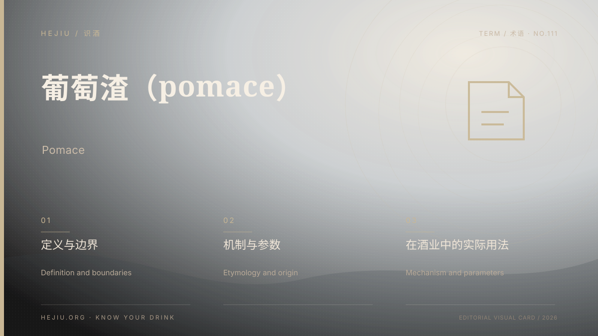

# 葡萄渣（pomace）

葡萄渣（pomace，法语 marc）是葡萄压榨后剩下的固体部分：果皮、果肉残渣、种子，有时还有果梗。它是葡萄酒生产的副产物，但并不是“垃圾”；在意大利、法国、西班牙与巴尔干半岛，它被发酵、蒸馏成具有地方身份的烈酒。理解葡萄渣，要同时看它的成分、含水率、微生物风险与法规身份。

图：葡萄渣（pomace） 双语视觉卡（项目自绘 SVG）。不是实拍。

## 定义与边界

葡萄渣与[酒泥](ref:lees)不同：酒泥是发酵后沉降的酵母与细颗粒，葡萄渣是果实的固体残体。葡萄渣也与酒糟（stillage/vinasse）不同，后者通常指蒸馏后的残余液体。白葡萄酒的渣在压榨后尚未酒精发酵，含糖高、易腐败；红葡萄酒的渣在发酵结束后分离，吸满酒液、颜色深、含水高。三者在工艺与法规上都是不同对象，不能用一个词笼统覆盖。葡萄渣的含水率取决于压榨机类型与压力：篮式压榨、气膜压榨与连续压榨留下的渣，在孔隙、残糖与可蒸馏性上并不相同。

## 词源与来源

pomace 来自中古英语 pomace，与苹果渣（pomace of apples）同源，后泛指压榨后的果实残渣；法语 marc 则指压榨残渣，也用于“Marc de Bourgogne”等烈酒名。意大利 grappa 源于葡萄渣蒸馏的传统，现为受保护的地理标志名称；西班牙与葡萄牙称 orujo，巴尔干地区有 rakija 等称呼。名称的差异不仅是语言问题，也对应不同的原料规定与地理标志。

## 机制与参数

压榨强度决定渣的组成：压得越重，残留酒液越少，但可能带入更多粗糙单宁与苦味；轻柔压榨则让渣更湿、更易发酵。渣的含水率、残糖、酸度与微生物负荷决定处理方式。渣中富含酒石酸盐，可回收酒石酸；也含果皮色素与酚类，会影响蒸馏酒的颜色与涩感。温度越高、堆放越久，醋酸菌与霉菌越活跃。渣中残留的二氧化硫会抑制微生物，却也会在蒸馏时带来刺鼻的硫味；因此“加硫保鲜”与“蒸馏风味”之间需要权衡。渣的“新鲜度”因此是一个工艺参数，而不是一句卫生口号。

## 在酒业中的实际用法

第一是蒸馏。渣可先发酵再蒸馏，意大利称 grappa，法国称 marc，西班牙与葡萄牙称 orujo，巴尔干地区有 rakija。欧盟法规把“葡萄渣烈酒”（grape marc spirit）列为烈酒类别，最低酒精度为 37.5% vol。第二是提取酒石酸，用于食品与化工。第三是堆肥与饲料，但需注意残留二氧化硫与农药。第四是再加工，少数做法加水或加糖再发酵，但产品通常不能标为葡萄酒。意大利 grappa 的法规身份与“葡萄渣”绑定，法国 marc 也常以产地命名；同一原料在不同国家可以对应不同的地理标志与酒精度要求。对酒庄而言，渣的处理既是成本，也是副产品收益的来源。

## 易混术语对照

第一组：pomace 与 lees。pomace 是压榨固体，lees 是发酵沉降物。第二组：pomace 与 must。must 是压榨得到的汁液与固形物混合物，pomace 是取汁后的残渣。第三组：grappa 与 pomace brandy。grappa 是意大利的受保护名称，不是所有葡萄渣烈酒的通用名；法国的 marc、西班牙的 orujo 各有法规身份。第四组：pomace 与 grape skin。果皮是 pomace 的组成部分之一，pomace 还包含果肉残渣、种子，有时还有果梗；把 pomace 等同于果皮，会低估其成分复杂度。

## 常见误用与争议

第一，把葡萄渣等同于酒泥；第二，认为渣酿烈酒是“葡萄酒蒸馏”，其原料其实是固体渣；第三，把 grappa 当作通用名；第四，认为葡萄渣没有价值。争议在于“渣是否应尽快蒸馏”：传统强调新鲜处理以保留果香，现代也有低温储存、青贮与加硫的做法，但加硫会影响后续蒸馏风味与法规合规。另一个争议是压榨强度：追求更多酒液与保留渣的质量，往往需要权衡。还有一个误用，是把“渣酿”当成“低档酒”的同义词；grappa 与 marc 中也有长期陈年、单一产地的高价产品，质量取决于原料处理与蒸馏精度。

葡萄渣与酒泥不同；渣酿烈酒的原料是压榨后的固体，酒泥则主要是沉淀酵母。

## 典型数值与例子

欧盟法规要求葡萄渣烈酒最低酒精度 37.5% vol；grappa 作为意大利地理标志产品，也以葡萄渣为原料。以白葡萄渣为例，压榨后含糖仍高，若在温暖环境中堆放数小时至数天，醋酸菌会把残留酒精转成醋酸，产生醋味。红葡萄渣颜色深、含水高，蒸馏前若浸泡时间过长，成品可能带色与更多涩感；新鲜蒸馏的白渣酒通常无色，经木桶陈年后才转为琥珀色。这些变化说明颜色与风味更多来自处理方式，而不是原料名称。酒石酸盐在渣中富集，冷却后可能形成酒石酸氢钾结晶；工业上可从渣中回收酒石酸，这也是“渣不是垃圾”的一个具体理由。

## 记录与表达

记录葡萄渣产品时，写清原料（白渣或红渣）、是否发酵、蒸馏方式、是否过桶与酒精度。品鉴时区分果香、花香、草本、苦味与涩感；颜色不是判断原料的唯一线索，因为过桶会改变颜色。选购时，grappa、marc、orujo 的名称受产地法规约束，不能只看名称推断原料或工艺；应查看生产者与产地标识。把[浸渍](ref:maceration)与[蒸馏](ref:distillation)的记录放在一起，才能还原渣的来源与处理路径；若只知道“grappa”而不知道原料与蒸馏厂，信息仍然不完整。

## 另见

- [浸渍](ref:maceration)：果皮与汁液接触的提取过程。
- [蒸馏](ref:distillation)：渣酿烈酒的基本原理。
- [酒泥](ref:lees)：发酵沉降物与葡萄渣的区别。

对照阅读：[浸渍（maceration）](ref:maceration)、[酒泥（lees）](ref:lees)。

**来源与边界。** 本页关于「葡萄渣（pomace）」的关键事实，主要由以下来源交叉核对：International Organisation of Vine and Wine (OIV)（葡萄渣与渣酿蒸馏相关术语）、Oxford University Press（提供关于 pomace、marc 与 pomace brandy 的条目）、European Parliament and Council of the European Union（grape marc spirit 的类别定义与最低酒精度 37.5% vol）等 4 条来源。价格、批次与状态会变，涉及这些字段时以页面所列来源的最新版本为准。正文为项目自写，来源只作核验，不复制原文。

**并读。** 把「葡萄渣（pomace）」与「浸渍（maceration）」、「蒸馏」、「酒泥（lees）」放在一起读时，先确认它们是同一层级还是上下游关系：先确认定义与计量口径，再比较相邻术语与常见误用。本页负责给出术语的基本坐标，对照条目补上具体案例与差异；读完再回到本页，才能分清哪些差别属于术语本身，哪些只是产地、批次或品牌选择。

**适用边界。** 对「葡萄渣（pomace）」而言，术语在不同法规与行业语境中含义不同；先看定义来源，再看用法。
