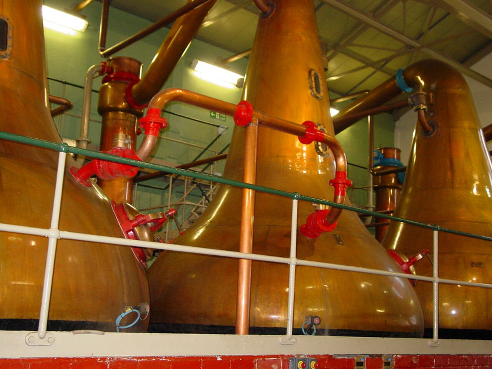

# 壶式蒸馏器（pot still）

图：壶式蒸馏器（pot still）。图片：see Source，CC BY-SA 3.0，via Wikimedia Commons（[原图页面](https://commons.wikimedia.org/wiki/File:Sjb_whiskey_still.jpg)）。

## 定义与边界

壶式蒸馏器（pot still）是分批（间歇）蒸馏使用的铜制设备，其基本结构是一个加热壶、一段连接壶与冷凝器的塔颈（lyne arm 或 neck），以及冷凝装置。它没有连续精馏塔，每一批酒液都要单独装填、加热、馏出、停机、清洗，因此效率低，但保留了更多原料与发酵带来的细节。

先说清楚它不是什么。壶式蒸馏器不等于“手工蒸馏”的同义词：大型壶式蒸馏厂同样存在，设备规模可以很大。它也不等于“只能蒸馏一次”：多数威士忌厂用同一类壶式设备做两次蒸馏，第一次得到低度酒，第二次得到成品。壶式与塔式是设备结构的分野，不是传统与现代、好与坏的道德判断。

## 词源与来源

pot 来自古英语 pott，指壶、罐；still 来自拉丁语 stillare，意为“滴下”，因为冷凝后的酒液是一滴一滴收集的。alembic 则经阿拉伯语 al-anbīq 传入，源头可追溯到希腊语 ambix，指蒸馏器的杯状顶部。中文“壶式蒸馏器”同时描述了容器形状与功能，比“罐式”更直观。

这些词的历史说明，蒸馏技术在不同语言之间传播时，器形与名称一起变化。今天的壶式蒸馏器仍有洋葱形壶顶、天鹅颈与蛇形冷凝管等古老特征，但加热方式、控制系统与材料检测已经现代化。

## 机制或参数

蒸馏壶内装入发酵后的酒液，在苏格兰称为 wash，酒精度约 8%–10% vol。加热后，乙醇与水等组分按沸点差异挥发：乙醇的沸点约 78.4°C，水为 100°C，蒸气沿塔颈上升并进入冷凝器。壶式蒸馏器没有塔板，所谓“回流”（reflux）来自蒸气在塔颈内壁和壶顶的冷凝与回落。塔颈越高、越窄、顶部越平缓，回流量通常越大，馏出物越干净；塔颈低而直，则保留更多重质成分。

铜本身也参与工艺。铜与硫化物结合，能减轻还原味和硫臭味，因此铜制壶体与铜制冷凝器在威士忌蒸馏中有实际作用，不只是传统外观。壶体大小、壶颈高度、塔颈角度、冷凝器类型（管式或虫管式）都会影响回流与铜接触面积，因此两家设备不同的厂即使工艺参数相同，酒体也可能不同。

## 在酒业中的实际用法

一次蒸馏过程中，馏出液不会从头到尾品质一致。操作者按顺序把它分为酒头（heads，也称 foreshots）、酒心（hearts，中段）与酒尾（tails，feints）。酒头和酒尾含有较多杂醇、酯类和硫化物，通常收集后并入下一批再蒸；酒心是中间馏分，是最终装瓶或继续二次蒸馏的部分。“切酒点”是最考验操作经验的环节之一：切得太早，酒心带有尖锐刺激的杂质；切得太晚，则丢失香气和饱满度。

不同产区的做法差异很大。苏格兰多数威士忌厂进行两次壶式蒸馏：第一次得到低度酒（low wines），第二次再馏出成品。少数厂进行三次蒸馏以追求更轻的酒体。干邑传统上采用两次蒸馏，第二次称为 bonne chauffe。爱尔兰的壶式蒸馏器容量更大，并可混合发芽与未发芽大麦。

苏格兰法规对[苏格兰威士忌](ref:scotch-whisky)的蒸馏方式与设备有明确要求：单一麦芽苏格兰威士忌必须在壶式蒸馏器中蒸馏，所有苏格兰威士忌的蒸馏酒度必须低于 94.8% abv，并在橡木桶中陈年至少 3 年，桶容量不超过 700 升，装瓶酒度不低于 40% abv。这些数字是理解其风格边界的基础，也解释了为什么壶式蒸馏与“保留原料风味”常被联系在一起。

## 易混术语对照

壶式与塔式首先在运行方式上不同。壶式是分批操作，回流主要靠塔颈几何与自然冷凝，风味保留较多但效率低；塔式是连续操作，分离能力强、效率高，适合大规模生产与中性基酒。壶式蒸馏器与 alembic 的关系则属于历史谱系。alembic 是历史上的一种蒸馏器形，强调壶顶与冷凝头；现代 pot still 是同一谱系的工业化形态，二者不能完全互换。

一次蒸馏与二次蒸馏的差别落在产品阶段上。一次蒸馏得到的是低度酒，通常不是最终产品；二次蒸馏才得到成品。蒸馏次数是风格选择，不是品质等级。“壶式蒸馏”与“手工小批量”也常被混用。壶式描述设备，手工描述生产组织方式；大型壶式厂也可以高度自动化。

## 常见误用与争议

第一，壶式蒸馏不等于手工小批量，也有大型壶式蒸馏厂。第二，铜制设备不只是装饰，铜接触会实际改变化学组成。第三，二次蒸馏不等于品质更高，蒸馏次数是风格选择。第四，切酒点是工艺判断，不存在“标准酒心比例”可以套用所有酒款。

争议主要围绕“壶式是否等于更复杂”。在[威士忌](ref:whisky)领域，壶式蒸馏常与“更复杂、更有原料特征”的风格联系，但这不是绝对的品质判断；塔式蒸馏的谷物威士忌同样可以高品质，且常作为调和酒的组成。较稳妥的表述是：壶式蒸馏提供了一种保留风味的设备路径，是否好喝仍取决于原料、发酵、切酒与陈年。

## 典型数值或例子

- 发酵酒液 wash 的酒精度：约 8%–10% vol。
- 乙醇沸点：约 78.4°C；水沸点：100°C。
- 苏格兰威士忌蒸馏酒度上限：低于 94.8% abv。
- 苏格兰威士忌最低陈年：3 年；橡木桶容量上限：700 升；装瓶酒度下限：40% abv。
- 常见蒸馏次数：两次；少数厂三次；干邑第二次蒸馏称 bonne chauffe。
- 典型例子：苏格兰麦芽威士忌、干邑、爱尔兰壶式威士忌。

读懂这些数字，才能理解壶式蒸馏器的风格不是由“铜壶”一个词决定的，而是由壶形、回流、切酒点与蒸馏次数共同塑造。

相关条目：[蒸馏](ref:distillation)。

## 另见

- [蒸馏](ref:distillation)：蒸馏的基本原理与设备类型。
- [威士忌](ref:whisky)：威士忌的原料、蒸馏与陈年概况。
- [苏格兰威士忌](ref:scotch-whisky)：法定产区、原料与工艺要求。

对照阅读：[蒸馏](ref:distillation)、[苏格兰威士忌](ref:scotch-whisky)。

**来源与边界。** 本页关于「壶式蒸馏器（pot still）」的关键事实，主要由以下来源交叉核对：The National Archives (UK legislation)（苏格兰威士忌的蒸馏、陈年与装瓶要求）、Encyclopaedia Britannica（壶式蒸馏器的结构与传统应用；补充核对条目背景、术语与制度口径）、The Scotch Whisky Association（苏格兰威士忌的最低装瓶酒度、蒸馏上限与陈年要求）。价格、批次与状态会变，涉及这些字段时以页面所列来源的最新版本为准。正文为项目自写，来源只作核验，不复制原文。
