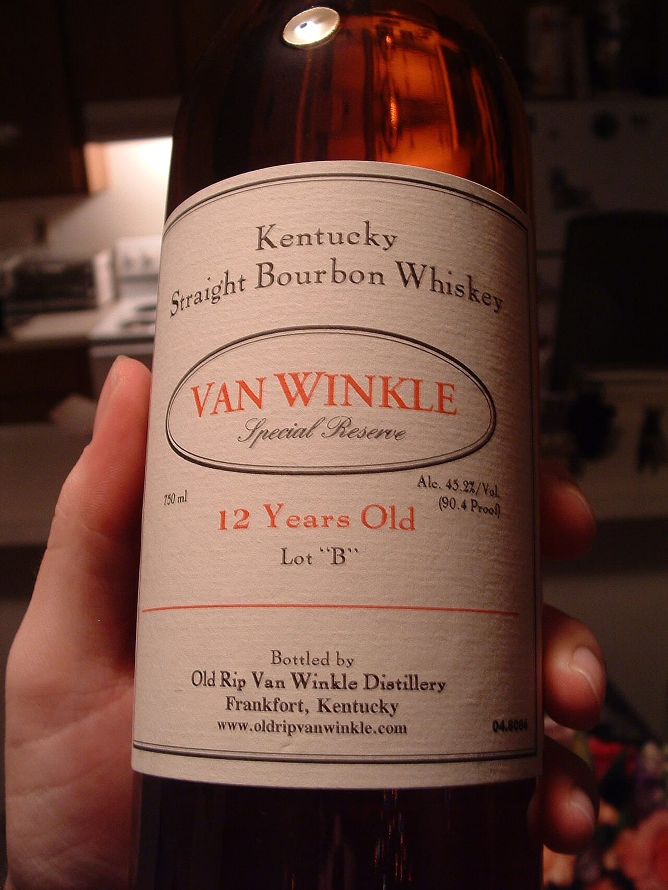

# 标准酒度与 Proof

“标准酒度”在中文语境里常指乙醇的体积分数，写作 % vol 或 ABV；它回答的是“这瓶酒里乙醇占多少体积”。Proof 则是另一套历史口径，尤其在美国烈酒标签和税务文件里常见。两者可以换算，但不能混为一谈：美国 100 proof 等于 50% ABV；英国旧制 100 proof 约等于 57.1% ABV。看到 proof 时，先确认是哪一套制度，再谈数字。

图：Old Rip Van Winkle 波本酒瓶与标签；标签是酒精度/Proof 标示的实际载体，不是比重计或测量仪器。图片：Joe Hall from Oakland, USA，CC BY 2.0，via Wikimedia Commons（[原图页面](https://commons.wikimedia.org/wiki/File:Old_Rip_Van_Winkle_Whiskey_301243232.jpg)）。

## 定义与换算

ABV（alcohol by volume）是 20°C 时乙醇的体积分数。按欧盟《食品信息条例》附件 XII，酒精度超过 1.2% vol 的饮料必须标示实际酒精度，数值保留不超过一位小数，后接“% vol”，测定温度为 20°C。这个基准温度很重要：水和乙醇的热膨胀系数不同，同一瓶酒在不同温度下测得的体积会变化，体积分数也会漂移。把温度固定，不同实验室和不同批次的数据才有可比性。

美制 proof 的法定定义来自 27 CFR 5.1：proof 是液体在 60°F（约 15.56°C）下乙醇体积百分数的两倍。因此 100 proof = 50% ABV，80 proof = 40% ABV，90 proof = 45% ABV，200 proof = 100% ABV。这个“乘以 2”只适用于美国 proof，不是全球通用的换算。英国历史上使用的 proof 体系不同，100 British proof 约等于 57.1% ABV；今天英国酒类标签主要用 ABV，旧制 proof 更多出现在历史文献和复古酒标上。

## 为什么是 60°F

美国把 proof 的基准定在 60°F，而不是 20°C。原因之一是历史计量传统：酒精表、比重计和税务换算表长期以 60°F 为标准温度，TTB 的《蒸馏酒计量手册》也以 60°F 作为报告 proof 的基准。温度低于 60°F 时，比重计读数会低于真实 proof；高于 60°F 时，读数会高于真实 proof，所以必须查表修正。20°C 与 60°F 并不完全相等：20°C 是 68°F，两个基准之间的换算不是简单的“温度计换一下”。

这也是为什么“同一瓶酒，美国标签写 80 proof，欧盟标签写 40% vol”并不矛盾：它们说的是同一件事，只是基准和表达方式不同。反过来，把 80 proof 直接当成 80% ABV，会把酒精度算成两倍，是常见的单位错误。

## 美制 proof 的历史与英国旧制

Proof 这个词来自早期烈酒检验：把酒倒在火药上点燃，若能燃烧，就被认为“above proof”；不能燃烧，则“under proof”。这套粗糙的测试后来被比重计和税务表取代，但“proof”这个名字留了下来。美国在 19 世纪逐步建立以 100 proof = 50% ABV 为基准的体系；英国则长期使用另一套 proof 标准，100 British proof 约为 57.1% ABV，与美制相差明显。

今天讨论“标准酒度”时，最稳妥的写法是同时给出 ABV 和 proof 的制度来源。例如“40% ABV（美制 80 proof）”，而不是只写“80 proof”。如果写“100 proof”，在美制语境里是 50% ABV，在英国旧制语境里则是约 57.1% ABV；不注明制度，读者无法判断。

## 标签与法规

美国蒸馏酒标签的核心要求是标示 ABV。27 CFR 5.65 规定，酒精含量必须以“Alcohol __ percent by volume”“__ percent alcohol by volume”或“Alcohol by volume __ percent”等形式表达；proof 可以作为附加信息出现，但如果使用，必须与 ABV 的强制标示处于同一视野（same field of vision）。这条规则的用意，是让消费者在同一货架上能直接比较，而不是在两套单位之间来回换算。

欧盟的规则则以 20°C 的体积分数为准，超过 1.2% vol 必须标示，数值最多一位小数。中国预包装饮料酒标签受食品安全国家标准与具体产品标准约束，标示方式、允许误差和豁免情形要按品类核对。不同市场对“低度”“高度”的定义也不一样，标签上的数字只能说明酒精含量，不能说明质量等级。

## 测量：比重计、温度与 proof gallon

实验室或酒厂测定 proof，通常用经过校准的比重计（酒精计）和温度计：把酒样放入干净的玻璃量筒，恒温、去气泡，让比重计自由漂浮，读取弯月面与刻度相交的位置，再按温度查表修正到 60°F。TTB 的《计量手册》规定，比重计刻度从 0（水）到 100（proof spirits）再到 200（无水乙醇），并给出不同量程的精密比重计型号。现代酒厂也可以用振荡管密度计或近红外设备，但仍需用标准物质校准。

“proof gallon”是税务单位：在 60°F 下，一加仑含 50% 体积乙醇的液体，或与之等量的酒精。它把体积和酒精度合并成一个可征税的量，所以酒精度不只是标签信息，也是税基。ABV 与 proof 的换算因此同时出现在实验室、生产线和税务申报中，任何一个环节的口径错误都会造成实际差异。

## 常见误读

第一，proof 不是全球统一的“酒精度×2”。美制是×2，英国旧制不是；看到 proof 先问制度。第二，100 proof 不是纯酒精。美制 100 proof 是 50% ABV，200 proof 才是 100% ABV。第三，proof 越高不等于质量越好。酒精度是风格和配方参数，不是品质评分；同一酒种可以有不同度数，法规只划范围。

第四，ABV 不是“原料浓度”。发酵只能把糖转化为乙醇，酒精度首先取决于可发酵糖的数量和酵母耐受能力；蒸馏是把已有乙醇浓缩，不会凭空产生新酒精。第五，ABV 不是“陈年指标”。陈年主要改变香气、颜色和口感结构，未必显著改变酒精度；加强酒和甜酒的酒精度可能来自额外加入的葡萄蒸馏酒。第六，标签数字不是“口感强度”。高酒精度可以用加水、加冰或调酒稀释，低酒精度也可能因香气和质地显得浓郁。

## 饮用与配方中的用法

在配方里，ABV 决定的是“每份饮品含多少乙醇”，而不是“喝起来有多烈”。同样 40 ml 的 40% ABV 烈酒与 40 ml 的 20% ABV 利口酒，乙醇量相差一倍；加冰、加水、加苏打都会改变最终杯中的 ABV。调酒时如果要控制酒精度，最有效的方法是同时调整烈酒用量、稀释量和杯量，而不是只看基酒的标签。

饮用节奏也可以用量化方式理解：一瓶 700 ml、40% ABV 的酒，总乙醇约 280 ml；分成 10 杯，每杯约 28 ml 乙醇。这个数字比“喝了几杯”更能说明摄入量。不同国家的“标准杯”定义并不相同，比较时要注意单位，而不是把“一杯”当成固定量。

## 选购与表达

买酒时，ABV 和 proof 都是起点，不是结论。先看标签的制度与单位，再看酒种、产区、工艺和风格；如果是威士忌、朗姆或金酒，proof 可能出现在美国版标签上，欧盟版则通常只写 % vol。把两个版本放在一起比较时，先换算成同一制度，再谈“度数高低”。

写作时，较准确的表达是“40% ABV（美制 80 proof，60°F 基准）”，或者“英国旧制 100 proof 约 57.1% ABV”。把温度、制度和换算写清楚，读者才不会把两个不同的数字当成同一个概念。标准酒度不是一条孤立的数字，它是一套测量、标签和税务共同使用的语言。

相关条目：[酒精度（ABV）](ref:abv)、[原麦汁浓度（original gravity）](ref:gravity)、[蒸馏](ref:distillation)。

## 延伸阅读与另见

- [酒精度](ref:abv)：20°C 体积分数的定义与标签规则。
- [原麦汁浓度](ref:gravity)：发酵前可溶性固形物的浓度。
- [蒸馏](ref:distillation)：乙醇浓缩与切酒的基本工序。
- [比重计](ref:hydrometer)：读取密度并换算 proof 的工具。
- [威士忌](ref:whisky)：proof 与 ABV 最常出现的酒种之一。
