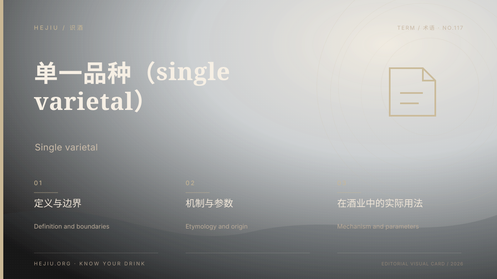

# 单一品种（single varietal）

单一品种（single varietal）指以一种葡萄为主体的[葡萄酒](ref:wine)。它强调的是品种身份，而不是产地、酒庄或工艺。标签上写“赤霞珠”或“霞多丽”，通常意味着这款酒的风味主要由该品种决定，但“主体”在法规里有具体比例，远不是“100%”那么简单。

图：单一品种（single varietal） 双语视觉卡（项目自绘 SVG）。不是实拍。

## 定义与边界

单一品种的边界由“品种比例”决定。欧盟葡萄酒标签规则规定，只标一个品种名时，至少 85% 的产品必须来自该品种；如果标出两个或更多品种名，则这些品种必须合计构成 100% 的产品。美国的规定是至少 75%，且这 75% 必须全部种在标签所示产区。澳大利亚采用 850 mL/L 的口径，也就是 85%。

因此，单一品种不等于“100% 该品种”。一款标“赤霞珠”的酒，可能另有 15% 的其他品种；一款写“100% Cabernet Sauvignon”的酒，才是生产者对全比例的明确声明。判断时必须区分“法规允许的最低比例”与“生产者主动声明的更高比例”。

## 词源与来源

“varietal”来自“variety（品种）”，在葡萄酒语境中指“以品种为标识的酒”；“single varietal”强调只以一种品种为主体。英语行业也用“varietal wine”指品种酒，用“monovarietal”作为同义说法。中文“单一品种”“单酿”都是对同一概念的不同译法，语气略有差异。

品种标示不是自古就有的标签项目。它随着葡萄酒贸易、消费者认知与法规体系的发展而普及：生产者需要一种比产区更直观的语言来说明风味，消费者也需要在酒架上快速识别。于是各国建立了品种比例门槛，把“品种名”从描述性词语变成有法律约束的声明。

## 机制与参数

单一品种的比例参数直接决定标签能否成立。欧盟的 85% 门槛意味着其余 15% 可以是其他品种，也可以来自不同地块或年份；美国 75% 门槛还附带产区条件，要求这 75% 必须种在标示产区。澳大利亚的 850 mL/L 是同一逻辑的另一种表达：每升酒液中至少 850 毫升来自该品种。

比例之外，产地与法规也会改变“单一品种”的含义。某些法定产区只允许特定品种，或要求必须混酿；在这些产区，即使某品种占绝对多数，标签也可能不单独写品种名。另一些产区允许品种名与产区名并列，但会附加更严格的比例或种植条件。读标签时，品种、产区与法规要一起看。

## 在酒业中的实际用法

生产者选择单一品种，通常是为了突出品种个性、便于消费者识别、简化市场沟通，或在法规允许的范围内建立清晰的产品线。[赤霞珠](ref:cabernet-sauvignon)单一品种常强调黑色水果、结构与单宁；[霞多丽](ref:chardonnay)常强调苹果、柑橘与橡木或酒泥带来的质地；[雷司令](ref:riesling)常强调酸度、柑橘与矿物感。这些是典型倾向，不是每瓶酒的保证。

在酒单与零售中，“single varietal”常作为一个分类，帮助饮者比较同一品种在不同产区的表现。它与[混酿](ref:blend)构成两条路线：单一品种强调识别度，混酿强调平衡与整合。两者不是高低关系，而是表达目标不同。对[白葡萄酒](ref:white-wine)而言，单一品种还能帮助饮者把品种香气与酿造工艺的影响分开。

## 易混术语对照

第一组是单一品种与单一葡萄园。前者说品种构成，后者说地块来源；同一品种可以来自多个葡萄园，同一葡萄园也可以种多个品种。第二组是单一品种与单一桶。前者是农业与标签概念，后者是容器概念；单一桶强调一个桶的不可复制性，与品种比例无关。

第三组是单一品种与 100% 品种。法规门槛允许少量其他品种，因此“单一品种”是“以该品种为主”，不是“只含该品种”。第四组是单一品种与混酿。前者以品种识别为核心，后者以组合与平衡为核心；混酿也可以以某个品种为主，但标签通常不会只写一个品种名。第五组是 varietal 与 variety：前者是形容词/标签用语，后者是植物学上的品种。

## 常见误用与争议

第一，把单一品种等同于 100% 该品种。第二，把单一品种等同于单一葡萄园或单一桶。第三，认为单一品种一定优于混酿。第四，忽略各国 85%、75%、850 mL/L 的门槛差异。第五，只看品种名，不看产区、年份与生产者。

争议主要集中在“85% 是否足够”。支持者认为它给了生产者调配空间，也让标签更灵活；批评者认为消费者看到品种名时往往预期更高比例，85% 的门槛可能造成理解落差。另一个争议是“100%”声明的核查：不同国家的执法与检测能力不同，标签上的“100%”不一定都能被逐批验证。购买时应结合官方认证与生产者的透明度判断。

## 典型数值与例子

三个可直接核对的数字是：欧盟单一品种至少 85%；美国至少 75%，且这 75% 必须种在标示产区；澳大利亚至少 850 mL/L，即 85%。这些门槛说明同一款“赤霞珠”在不同国家的法律含义可能不同。若一款酒标“100% Cabernet Sauvignon”，它高于欧盟与美国的最低门槛，属于生产者的主动声明。

以[雷司令](ref:riesling)为例，单一品种标签可以帮助饮者预期高酸度与柑橘、矿物感；但同一品种在冷凉产区与温暖产区的表现差异很大，不能只凭品种名判断。把品种比例、产区与年份并列记录，才是完整的阅读方式。

## 另见

- [葡萄酒](ref:wine)：理解单一品种（single varietal）在葡萄酒语境中的类别、年份与产地规则。
- [赤霞珠](ref:cabernet-sauvignon)：结构与单宁的典型品种。
- [霞多丽](ref:chardonnay)：质地与橡木表达的典型品种。
- [雷司令](ref:riesling)：酸度与香气辨识度高的品种。
- [白葡萄酒](ref:white-wine)：品种表达与风格差异。
- [混酿](ref:blend)：与单一品种相对的另一条路线。

**来源与边界。** 本页关于「单一品种（single varietal）」的关键事实，主要由以下来源交叉核对：European Union（品种标示的 85% 规则与标签要求）、U.S. Department of the Treasury（美国葡萄酒品种标示的 75% 规则；链接为机构首页）、Oxford University Press（提供关于单一品种、混酿与标签的条目）等 7 条来源。价格、批次与状态会变，涉及这些字段时以页面所列来源的最新版本为准。正文为项目自写，来源只作核验，不复制原文。

**并读。** 把「单一品种（single varietal）」与「葡萄酒」、「赤霞珠」、「霞多丽」放在一起读时，先确认它们是同一层级还是上下游关系：先确认定义与计量口径，再比较相邻术语与常见误用。本页负责给出术语的基本坐标，对照条目补上具体案例与差异；读完再回到本页，才能分清哪些差别属于术语本身，哪些只是产地、批次或品牌选择。
