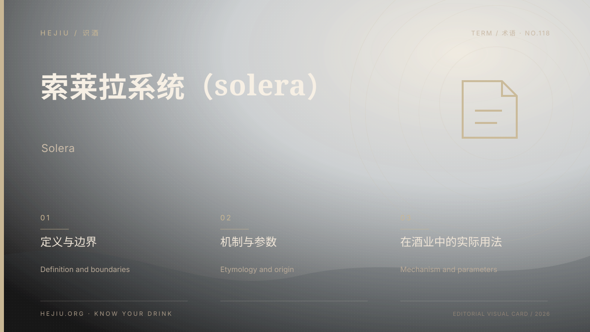

# 索莱拉系统（solera）

索莱拉（solera）是一种分级叠放、逐级取补的陈年与调配体系。最底层存放最老的酒，称为 solera；其上是若干级 criadera，越往上酒越年轻。取酒从底层取出，上一级补入，逐级上推，最顶端补入新酒。成品因此是多个年份、多个层级的混合物，而不是某一桶老酒。传统雪莉酒使用的 butt 桶容量约为 600 升；桶的材质、新旧与清洗方式，也会影响氧化程度与微生物环境。

图：索莱拉系统（solera） 双语视觉卡（项目自绘 SVG）。不是实拍。

## 定义与边界

索莱拉不是“单一陈年时间”，也不是“把新酒倒进老酒”这么简单。它有固定的容器排列、固定的取补方向与长期维护制度；每一级通常承载一个相对年份队列。取出的比例、补入的比例、级数与维护年限共同决定成品的平均年龄与风格。级数并没有全球统一的上限，不同酒庄会按产品目标设置；级数越多，维护成本与老酒权重也越高。它可以在加强酒、醋、朗姆酒与白兰地中出现，但不同产品的法规与命名不同。把雪莉的规则直接套到其他产品上，容易误判。

## 词源与来源

solera 在西班牙语中本义与“地面、底座”有关，指最底层的一排桶；criadera 来自 criar（养育、培育），指上层用来“喂养”底层的年轻酒。雪莉产区的 criaderas y solera 体系在赫雷斯-谢雷斯-桑卢卡尔法定产区的规范中被系统化。取酒称 saca，补入称 rocío，这两个动作构成体系的循环。名称后来被朗姆酒、醋与白兰地借用，但工艺细节并不完全相同。

## 机制与参数

典型操作是从 solera 取出一定比例的酒装瓶，再从第一级 criadera 取出相同比例补入，依次向上，最后用新发酵并加强的基酒补入最高一级。传统上每次取出的比例约为三分之一，但不同酒庄与产品会调整。级数越多、维护越久，成品中老酒的权重越高。由于每级都混合了不同年份，成品没有单一年份标签，平均年龄只能通过体系结构与认证来推断。体系的稳定来自“取走多少、补回多少”的长期平衡。实际操作中，取补通常每年进行数次，而不是每天流动；频繁小量取补有利于风格连续，但也需要更严格的卫生与温度管理。氧化程度、酒花（在 Fino 中）与酒精度，都会随层级与时间变化。

## 在酒业中的实际用法

在雪莉酒，索莱拉用于 Fino、Amontillado、Oloroso 等风格；生物陈年与氧化陈年都可能使用同一套取补逻辑。Fino 依靠酒花（flor）形成生物陈年，Amontillado 往往先经历生物陈年再转入氧化陈年，Oloroso 则从一开始就以氧化为主；同一套索莱拉结构，可以服务不同风格。西班牙还设 VOS（平均陈年 20 年以上）与 VORS（平均陈年 30 年以上）认证，用于标示经长期索莱拉陈年的酒。意大利传统巴萨米克醋也使用多桶串联的索莱拉式取补，摩德纳传统巴萨米克醋最低陈年 12 年，extravecchio 为 25 年。部分朗姆酒与马德拉酒也借用这一名称，但法规身份各异。

## 易混术语对照

第一组：solera 与 blend。[混酿](ref:blend)可以是一次性组合；solera 是持续流动的分级体系。第二组：solera 与 vintage。solera 成品通常没有单一[年份](ref:vintage)；年份酒强调采收年。第三组：solera 与“老酒”。solera 底层虽老，但成品必然含有较年轻的补入酒，不能等同于纯老酒。第四组：solera 与 criadera。solera 是最底层，criadera 是其上的层级；两者是同一体系的组成部分，不是两种并列的酒。

## 常见误用与争议

第一，把 solera 等同于低质量或“勾兑”；稳定风格正是其设计目标。第二，认为 solera 越老越好；平均年龄取决于级数、比例与维护时间。第三，把 solera 当作单一年份；成品是多层混合。第四，认为所有标有 solera 的产品都受同样法规约束；雪莉、醋与朗姆酒的规则差别很大。争议在于“平均年龄”的标注方式：不同体系对年龄的计算与认证并不统一，消费者需要分辨法定认证与产品宣传。还有一个误用，是把 solera 当作一种酒名；它其实是一套陈年与调配结构，Fino、Oloroso 等才是风格名。

索莱拉没有单一年份，风格稳定来自逐级取补，不是简单勾兑；底层最老的酒也不是每瓶都全部来自底层。

## 典型数值与例子

雪莉的 VOS 认证要求平均陈年 20 年以上，VORS 要求 30 年以上；这是可核验的年龄门槛。摩德纳传统巴萨米克醋最低陈年 12 年，extravecchio 为 25 年。操作上，传统 saca 每次约取三分之一，再由上级等量补入。以一款 VORS Oloroso 为例，瓶中酒液包含多个年份的成分，标签上的“30 年”指认证的平均年龄，而不是单一年份。传统雪莉 butt 约 600 升，这个容量让取补比例与层级设计更容易计算；理解这一点，就不会把 solera 误读成“某一年的老酒”。

## 记录与表达

记录索莱拉产品时，至少写清产品类型、级数（若可知）、认证年龄与取补比例；不要只写“solera”。品鉴时可关注其风格稳定性与氧化、生物陈年的方向：Fino 偏生物陈年，Oloroso 偏氧化陈年。选购时，VOS/VORS 是可核验的年龄线索；无认证的“solera”可能只是产品名，需查看生产者与法规背景。对[加强酒](ref:fortified-wine)而言，索莱拉是结构，不是年份；把结构、风格与法定认证分开记录，才不会把营销词当成质量结论。

相关条目：[混酿（blend）](ref:blend)、[年份（vintage）](ref:vintage)。

## 另见

- [混酿](ref:blend)：组合酒液的一般概念。
- [年份](ref:vintage)：单一年份与无年份体系的区别。
- [加强酒](ref:fortified-wine)：雪莉等加强酒的工艺背景。

**来源与边界。** 本页关于「索莱拉系统（solera）」的关键事实，主要由以下来源交叉核对：International Organisation of Vine and Wine (OIV)（加强酒陈年与调配相关术语）、Oxford University Press（提供关于 solera、criadera 与 Sherry 陈年体系的条目）、Consejo Regulador de las Denominaciones de Origen Jerez-Xérès-Sherry（criaderas y solera 的动态取补体系；VOS 与 VORS 的平均陈年门槛）。价格、批次与状态会变，涉及这些字段时以页面所列来源的最新版本为准。正文为项目自写，来源只作核验，不复制原文。

**并读。** 把「索莱拉系统（solera）」与「混酿（blend）」、「年份（vintage）」、「加强葡萄酒」放在一起读时，先确认它们是同一层级还是上下游关系：先确认定义与计量口径，再比较相邻术语与常见误用。本页负责给出术语的基本坐标，对照条目补上具体案例与差异；读完再回到本页，才能分清哪些差别属于术语本身，哪些只是产地、批次或品牌选择。

**适用边界。** 对「索莱拉系统（solera）」而言，术语在不同法规与行业语境中含义不同；先看定义来源，再看用法。
