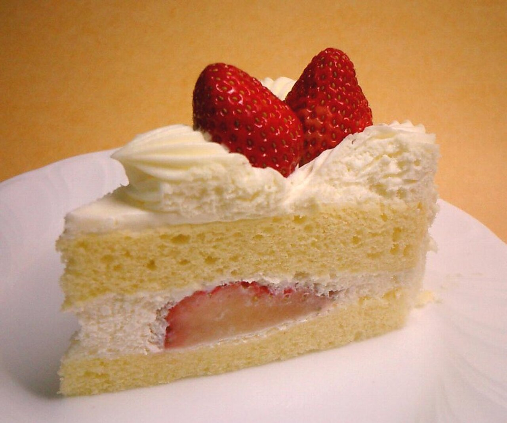

# 甜型（sweet）

图：甜型（sweet）。图片：Tomomarusan，CC BY 2.5，via Wikimedia Commons（[原图页面](https://commons.wikimedia.org/wiki/File:Strawberry_shortcake.jpg)）。

## 定义与边界

甜型首先是味觉概念：舌头感知糖类带来的甜味。它同时也是一个法规标签：在欧盟葡萄酒标签规则中，非起泡酒的“甜型”指残糖达到 45 g/L 及以上；残糖不超过 45 g/L 的上一档是半甜型。起泡酒使用另一套术语，甜型对应的 doux 门槛是 50 g/L 以上，因此不能把静酒与起泡酒的“甜型”数字直接互换。

另有一层边界，是“甜”与“甜型”的区别。甜是一种主观感知，受温度、酸度、酒精和气泡影响；甜型是一个以残糖为门槛的标签类别。两款都被标为甜型的酒，实际甜感可能差别很大：一款刚过 45 g/L，另一款可能达到 150 g/L。标签只能说明它落在哪个区间，不能说明它喝起来有多甜。

## 词源与来源

sweet 来自古英语 swēte，可追溯到原始日耳曼语 *swōtuz，与拉丁语 suavis、希腊语 hēdys 有远亲关系。这个词最初描述味觉上的甘甜，后来扩展到“令人愉悦”“温柔”等比喻义。葡萄酒里的 sweet 保留了味觉本义，但在标签上又被制度化成一个残糖区间。

中文“甜型”是意译与行业分类的结合：“甜”描述味觉，“型”强调它是一类风格或标签，而不是单一化合物。理解这一点，可以避免把“甜型”误读为“加了糖”或“糖分越高越好”。

## 机制或参数

甜味主要由葡萄糖、果糖和蔗糖等糖类触发，人类舌部的 T1R2/T1R3 受体负责感知。果糖通常比葡萄糖更甜，因此同样残糖下，糖的组成会影响甜感。发酵把糖转化为酒精，残糖是发酵停止或提前终止后留下的糖；加强酒在发酵中途加入酒精杀死酵母，从而保留糖分；起泡酒的调味液则在除渣后决定最终甜度。

酸度、酒精、温度和气泡都会调节甜感。高酸让甜味显得清爽，低酸则容易显得糖浆般黏腻；高酒精会增强甜感与热度；温度过低会压抑香气并让甜感显得钝，温度过高则会放大甜腻。气泡带来刺痛感与清爽感，也会改变甜度的主观强度。

法规参数同样重要。非起泡酒的干型上限是 4 g/L，或在总酸不低于残糖 2 g/L 的条件下不超过 9 g/L；半干型上限为 12 g/L，或在总酸条件下不超过 18 g/L；半甜型不超过 45 g/L；甜型为 45 g/L 及以上。起泡酒的 brut 低于 12 g/L，extra dry 为 12–17 g/L，sec 为 17–32 g/L，demi-sec 为 32–50 g/L，doux 高于 50 g/L。

## 在酒业中的实际用法

甜型的生产路径主要有五类。第一是晚收：葡萄留在藤上继续成熟，糖分浓缩，酸度下降。第二是贵腐：贵腐菌感染葡萄，水分蒸发，糖与风味物质浓缩，常见于甜白。第三是冰酒：葡萄在藤上冻结后压榨，冰晶留下，糖与酸同时浓缩。第四是加强：在发酵过程中加入中性酒精，杀死酵母并保留残糖，形成[加强酒](ref:fortified)。第五是起泡酒的调味液：除渣后加入含糖液体，决定最终甜度。

不同路径带来不同结构。晚收与贵腐甜酒通常保留较高酸度，甜酸平衡更明显；加强酒带酒精强化感，口感更厚重；[起泡酒](ref:sparkling)的甜型版本还多了气泡与清爽感。把甜型当成单一风格，会忽略这些差异。

在标签与销售端，甜型是消费者筛选的重要线索，但不能替代技术资料。购买时应同时查看残糖、总酸、酒精度与酿造方式；在餐厅，甜型酒常按甜度与配餐建议排列，而不是只按颜色分类。对生产者而言，甜型的难点在于稳定：高残糖配合低酸、低酒精或不当储存，可能带来再次发酵或微生物风险。

## 易混术语对照

甜与果味经常被混为一谈。成熟的水果香气可以出现在干型酒里，果味不等于糖分；一款闻起来像水蜜桃的干型酒，残糖可能低于 4 g/L。甜型与干型则位于甜度标签的两端，中间还有半干与半甜；把“不甜”与“干”完全等同，会忽略总酸与酒精带来的甜感错觉。

甜型与残糖的关系，是标签区间与具体数值的关系。残糖是克每升的数值，甜型是法规区间；一款 45 g/L 的酒与一款 150 g/L 的酒都可以叫甜型，但残糖相差三倍以上。甜型与甜点酒则属于不同的分类逻辑。甜点酒是用途或品类描述，甜型是甜度标签；有些甜点酒残糖不高，靠风味浓度与酒精支撑，也有些甜型酒并不适合配甜点。

## 常见误用与争议

第一，把甜型等同于低质量。许多甜酒需要特定的天气、手工采收与长期陈年，成本并不低。第二，认为甜酒只能配甜点。咸味、蓝纹奶酪与辛辣菜肴也能与甜酒形成对比。第三，把“甜”与“果香”混为一谈；干型酒也可以有成熟的果香。第四，忽略开瓶后的保存：甜酒糖分高，开瓶后仍可能氧化或发酵，应冷藏并尽快饮用。

争议集中在标签与感官的落差。不同产区的甜度阈值并不完全一致，同一款酒在不同温度、不同杯型下也可能显得更甜或更不甜；消费者按标签购买，实际体验却可能偏离。较稳妥的做法是把甜型视为“残糖区间”，再结合酸度、酒精与风格判断它是否平衡。

## 典型数值或例子

- 非起泡酒甜型：45 g/L 及以上；半甜型：不超过 45 g/L。
- 非起泡酒干型：不超过 4 g/L，或在总酸不低于残糖 2 g/L 时不超过 9 g/L。
- 起泡酒 doux：高于 50 g/L；demi-sec：32–50 g/L；sec：17–32 g/L。
- 起泡酒 extra dry：12–17 g/L；brut：低于 12 g/L。
- 对比例子：一款 50 g/L 的甜型酒与一款 150 g/L 的贵腐酒，都可以落入甜型标签，但口感浓度差异明显。
- 典型品种：[雷司令](ref:riesling)在晚收与贵腐形态下能保留高酸，即使残糖很高仍显得清爽。

从这些门槛可以看出，甜型不是“越甜越好”的单一阶梯，而是由残糖、酸度、酒精与工艺共同塑造的区间。

## 另见

- [葡萄酒](ref:wine)：理解甜型（sweet）在葡萄酒语境中的类别、年份与产地规则。
- [加强酒](ref:fortified)：加强工艺如何保留残糖。
- [起泡酒](ref:sparkling)：调味液与甜度分级。
- [雷司令](ref:riesling)：高酸支撑甜酒的典型品种。
- [残糖](ref:residual-sugar)：甜度分级的核心数值。
- [半干](ref:semi-dry)：甜型之前的中间区间。
- [干型](ref:dry)：甜度分级的另一端。

对照阅读：[葡萄酒](ref:wine)、[起泡酒](ref:sparkling)。

**来源与边界。** 本页关于「甜型（sweet）」的关键事实，主要由以下来源交叉核对：European Union（甜型的残糖阈值与标签分级）、International Organisation of Vine and Wine (OIV)（甜味葡萄酒与加强酒的糖分相关定义）、Oxford University Press（提供关于贵腐、冰酒、晚收与甜酒的条目）等 5 条来源。价格、批次与状态会变，涉及这些字段时以页面所列来源的最新版本为准。正文为项目自写，来源只作核验，不复制原文。
