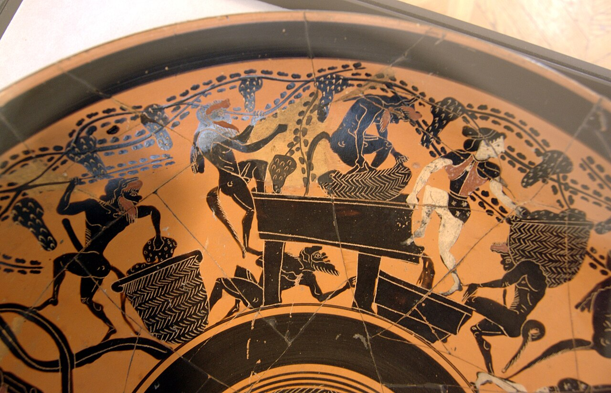

# 年份（vintage）

年份（vintage）指葡萄采收的那一年。“2018 年份”表示酿酒葡萄在 2018 年采收；它记录的是当年的天气、成熟条件与采收选择，不是装瓶日期，也不是酒龄。理解年份，先要把它与酒龄、装瓶日期和无年份酒款分开。

图：年份（vintage）。图片：Chiusi Painter，Public domain，via Wikimedia Commons（[原图页面](https://commons.wikimedia.org/wiki/File:Cup_vintage_Cdm_Paris_320_n1.jpg)）。

## 定义与边界

年份是“采收年”的标签，而不是“酒几岁”的标签。欧盟葡萄酒标签规则要求，标示年份时至少 85% 的葡萄必须在该年采收；这条门槛说明年份不是随意添加的装饰，而是有比例条件的声明。对于在南半球 1 月或 2 月采收的产品，标签年份按上一日历年度计算。

边界还包括“年份酒”与“无年份酒”。无年份（non-vintage，NV）不是没有信息，而是有意把不同年份的基酒调配在一起，以稳定风格。只有在法规与产品声明都满足条件时，标签上的年份才表示基酒主要来自那一年；把 NV 当成“劣质”或“来路不明”是误解。

## 词源与来源

“vintage”来自法语 vendange，原意是葡萄采收，后来在英语中兼指“采收季”和“某一年采收的酒”。葡萄酒行业把它固定为标签术语；烈酒行业则常把 vintage 用作“蒸馏年份”，与葡萄酒的采收年不是同一件事。同一张酒标上的数字，先要确认它属于哪个体系。

年份制度在不同品类里演化出不同规则。香槟用无年份调配维持酒庄风格，只在优秀年份做年份香槟；波特用年份声明标记单次采收的高质量酒；威士忌的年龄数字通常按瓶中最年轻酒液计算。三者都出现“年份”字样，但法律含义与市场含义并不相同。

## 机制与参数

年份差异来自生长季的温度、降水、日照、病虫害压力与采收时机。冷凉年份可能酸度高、成熟慢；温暖年份可能糖分高、酸度低；多雨年份可能带来病害与稀释。对[波尔多](ref:bordeaux)这类受海洋性气候影响的产区，年份差异尤其明显；气候稳定的产区差异可能较小。

年份并不等于品质排名。同一产区的好年份与差年份是相对的：某年可能有利于早熟品种，却不利于晚熟品种；可能有利于左岸，却不利于右岸。把年份简化为“大年/小年”，会忽略品种、地块、采收决策与生产者的选择。年份是条件，不是结论。

## 在酒业中的实际用法

在[葡萄酒](ref:wine)零售中，年份用于比较同一酒庄不同年份的风格与价格；在拍卖与收藏中，年份是估价的重要维度。对[起泡酒](ref:sparkling)而言，无年份版本追求稳定，年份版本强调那一年的表达；香槟法规要求无年份至少窖藏 15 个月，年份香槟至少 36 个月，这两个数字直接影响上市时间与价格。

[加强酒](ref:fortified)中的年份波特必须来自单次采收，并强制标示采收年份；IVDP 的认证与装瓶时间规则把它与普通调配波特区分开。[威士忌](ref:whisky)标签上的年龄数字通常指瓶中最年轻酒液的陈年时间，而不是采收年；只有少数产品会单独标注蒸馏年份。购买时先确认数字属于哪套规则，再比较产品。

## 易混术语对照

第一组是年份与酒龄。年份是采收年，酒龄是从采收或蒸馏到当前的时间；一瓶 2018 年份的酒在 2026 年饮用，酒龄约 8 年，但装瓶可能发生在 2020 年。第二组是年份与装瓶日期。年份记录葡萄何时采收，装瓶日期记录酒何时离开容器，两者可以相差数年。

第三组是年份与无年份。年份酒强调单一年份的来源，NV 强调跨年份调配的稳定风格；NV 不是“没有年份信息”，而是产品设计。第四组是葡萄酒年份与威士忌年份。前者指采收年，后者通常指酒龄；把威士忌的“12 年”当成“2012 年采收”是常见误读。第五组是“年份波特”与“年份风格波特”。前者有严格定义与认证，后者可能只是市场描述。

## 常见误用与争议

第一，把年份当成酒龄。第二，认为年份越老越好；陈年潜力取决于酒的结构、储存条件与类型。第三，把无年份酒当成劣质酒。第四，只看年份，不看产区、品种与生产者。第五，把某一年的评价套用到所有产区与所有品种。

争议集中在“年份评分”的权威性。同一年的同一产区，不同酒庄、不同地块可能给出完全不同的结果；用一个大年分数概括整个产区，会掩盖微气候与酿造差异。另一个争议是年份声明的真实性：欧盟以 85% 葡萄比例设门槛，但不同国家、不同品类的执行细则不同，消费者应结合官方认证与标签信息判断。

## 典型数值与例子

欧盟年份规则给出一个明确门槛：至少 85% 的葡萄须在标示年份采收；南半球 1 月或 2 月采收的产品，年份按上一日历年度计算。香槟的窖藏要求是无年份至少 15 个月、年份至少 36 个月。年份波特必须来自单次采收并标示采收年份，IVDP 在采收后第二年 1 月至 6 月进行认证，装瓶可延续到第三年 7 月 30 日。

一个常见的换算例子是：2018 年份酒在 2020 年装瓶，2026 年饮用时，距采收约 8 年，距装瓶约 6 年。把这两个时间分开记录，能避免把“年份老”误认为“瓶中陈年长”。同样，威士忌标签上的“18 年”应按最年轻酒液理解，而不是平均年龄。

## 另见

- [葡萄酒](ref:wine)：理解年份（vintage）在葡萄酒语境中的类别、年份与产地规则。
- [起泡酒](ref:sparkling)：无年份与年份版起泡酒的差别。
- [加强酒](ref:fortified)：年份波特与长期瓶陈。
- [威士忌](ref:whisky)：酒龄标注与年份数字的含义。
- [波尔多](ref:bordeaux)：年份差异最受关注的产区之一。

对照阅读：[葡萄酒](ref:wine)、[加强葡萄酒](ref:fortified)。

**来源与边界。** 本页关于「年份（vintage）」的关键事实，主要由以下来源交叉核对：International Organisation of Vine and Wine (OIV)（葡萄酒年份与标签相关定义）、European Union（年份标示与葡萄酒标签规则）、UK Government (retained EU legislation)（“至少 85% 的葡萄须在标示年份采收”的年份标示条件）等 8 条来源。价格、批次与状态会变，涉及这些字段时以页面所列来源的最新版本为准。正文为项目自写，来源只作核验，不复制原文。

**并读。** 把「年份（vintage）」与「葡萄酒」、「起泡酒」、「加强葡萄酒」放在一起读时，先确认它们是同一层级还是上下游关系：先确认定义与计量口径，再比较相邻术语与常见误用。本页负责给出术语的基本坐标，对照条目补上具体案例与差异；读完再回到本页，才能分清哪些差别属于术语本身，哪些只是产地、批次或品牌选择。
