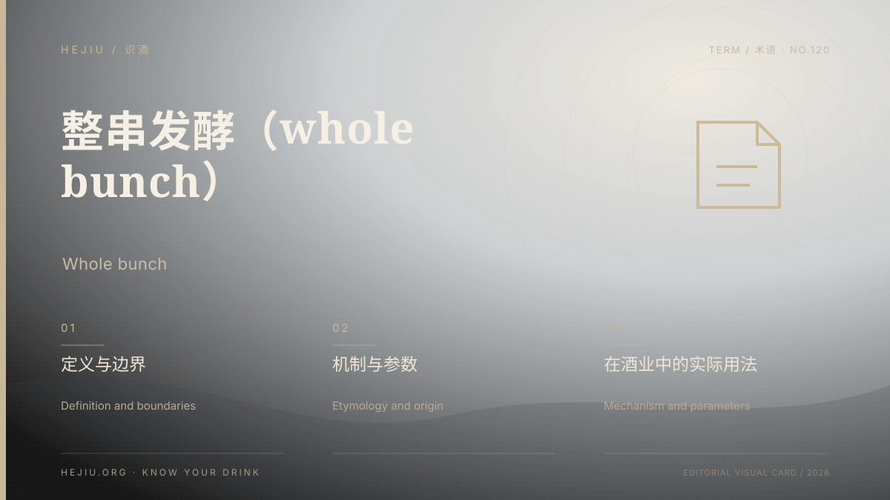

# 整串发酵（whole bunch）

整串发酵（whole bunch，北美常写 whole cluster）指把未经破碎的整串葡萄，连同果梗一起装入发酵容器。它可以是全部原料，也可以只占一部分，其余葡萄除梗破碎后混入。这个选择改变的不是“是否发酵”，而是发酵的环境、提取的方向与氧化的节奏。

图：整串发酵（whole bunch） 双语视觉卡（项目自绘 SVG）。不是实拍。

## 定义与边界

严格意义上的整串发酵，果实保持完整或基本完整，果梗仍在串上；葡萄汁主要仍由酵母发酵，而不是像碳酸浸渍那样以细胞内发酵为主。它不同于“整串压榨”：后者是白葡萄在压榨阶段不破碎，目的是轻柔取汁；前者是带梗进入发酵，目的是让果梗参与浸渍。二者可以同时出现，但概念不同。把整串发酵说成一种“酒类”或“等级”也不准确，它只是工艺选择。实际生产中，整串比例常用 0%–100% 的连续刻度；有的酒庄走中间路线，用 20%–50% 整串来兼顾结构与可控性，而不是全有或全无。

## 词源与来源

whole bunch 与 whole cluster 都是英语描述性说法，不是法语法定术语。法语常用 vendange entière（整串采收）或 fermentation en grappes entières。勃艮第与罗讷河谷的现代使用，与 20 世纪后期对果梗、氧化与提取的重新认识有关；在此之前，除梗破碎已是主流。今天它既是传统技术的延续，也是一种风格声明，常被酒庄用来表达“更少干预”的取向。20 世纪 80–90 年代，勃艮第与罗讷河谷的一些生产者重新强调整串，把它与果梗成熟度、氧化管理和降低机械破碎联系起来；此后这一做法逐渐传播到新世界。

## 机制与参数

果梗通常占整串重量的约 3%–5%，却占据发酵罐体积的 20%–30%。完整果梗在发酵液中缓慢释放木质素、酚类与钾：酚类带来更紧的骨架与香料感，钾则会抬高 pH，常被估计为 0.1–0.2 个单位，并降低二氧化硫的有效性。果梗还会改变热分布，使发酵更缓慢。比例、果梗成熟度、品种、容器与温度共同决定结果；同样的 50% 整串，在成熟年份与未成熟年份可以是两种酒。果梗中的钾来自细胞液，pH 上升会让花青素色调偏蓝，也会降低二氧化硫的分子态比例，因此整串酒在发酵与陈年阶段通常需要更细致的氧化与硫管理。果梗单宁与果皮单宁的结构也不同：前者常被描述为更“线状”、更干，后者更圆润。

## 在酒业中的实际用法

在勃艮第，黑皮诺常以整串比例来增加结构、香料与新鲜感，Domaine de la Romanée-Conti 以接近 100% 整串著称；罗讷河谷的 Syrah 也常用整串，尤其在北罗讷的 Côte-Rôtie 与 Cornas。比例从 10% 到 100% 不等：成熟年份果梗更木质化，可承受更高比例；未成熟年份则要降低，以免生青与苦涩。白葡萄可以整串压榨，但那属于压榨工艺，不应与带梗发酵混为一谈。整串入罐还有操作层面的效果：完整果串在罐内形成空隙，减少机械泵送与果皮破损，发酵初期氧化更慢；但空隙也可能让温度分布不均，需要更频繁的压帽或淋皮。对需要长期陈年的酒款，生产者常用整串来增加骨架，而不是单纯追求“更自然”。

## 易混术语对照

第一组：whole bunch 与 carbonic maceration。碳酸浸渍强调二氧化碳环境下的细胞内发酵，整串发酵仍主要依赖酵母；二者可以重叠，但不同义。第二组：whole bunch 与 whole bunch pressing。前者带梗发酵，后者整串压榨取汁。第三组：stem inclusion 与 stem addition。前者是整串带入的果梗，后者可能指额外添加果梗，工艺与法规含义不同。第四组：whole bunch 与 destemmed。destemmed 指除梗，整串则保留果梗；两者不是程度差异，而是原料状态差异。

## 常见误用与争议

第一，认为整串必然带来苦涩；成熟果梗与适度比例可以只带来结构与香料。第二，认为比例越高越好；过量会抬高 pH、稀释果味、增加挥发酸风险。第三，把整串发酵等同于碳酸浸渍。第四，把白葡萄整串压榨说成整串发酵。争议在于果梗的“成熟度”难以量化：同一条果梗，有人尝到木质甜香，有人只尝到生青，酒庄对同一批原料的判断可能相反。还有一个误用，是把“整串”当作“完全不除梗”的同义词；实际上整串比例可以精确到百分比，部分除梗、部分整串是常见做法。

## 典型数值与例子

果梗约占整串重量的 3%–5%，却可占罐容的 20%–30%；它对 pH 的影响常被估计为 0.1–0.2 个单位。勃艮第的 Domaine de la Romanée-Conti 以接近 100% 整串发酵闻名；罗讷河谷的 Côte-Rôtie 与 Cornas 也把整串作为 Syrah 的常见选项。一个 100% 整串、果梗未充分成熟的批次，可能出现生青与苦涩；同一酒庄在成熟年份把比例降到 30%–50%，则更常见。把 10% 整串与 100% 整串放在一起比较，会发现前者更多是“点缀”，后者才真正改变提取与热分布；比例是判断风格的第一把尺。

## 记录与表达

描述整串时，至少记录四项：整串比例、果梗成熟度、是否混入除梗果实、容器与发酵温度。只说“整串发酵”信息不足；同样标为整串，10% 与 100% 是不同工艺。若酒标没有比例，可查酒庄技术资料或年份报告；仍查不到时，应在记录中注明“比例未知”，而不是默认它接近 100%。选购时可以把“带梗”当作风格线索：它常指向更紧的骨架、胡椒与草本气息，但不保证质量；仍要结合年份、品种与酒体判断。

相关条目：[浸渍（maceration）](ref:maceration)、[单宁（tannin）](ref:tannin)、[发酵](ref:fermentation)。

## 另见

- [浸渍](ref:maceration)：果皮、果梗与汁液接触的提取过程。
- [单宁](ref:tannin)：果梗与果皮带来的结构差异。
- [发酵](ref:fermentation)：整串条件下的发酵管理。

补充阅读：[酸度（acidity）](ref:c-extra-1)、[酒精度（ABV）](ref:c-extra-2)。

**来源与边界。** 本页关于「整串发酵（whole bunch）」的关键事实，主要由以下来源交叉核对：International Organisation of Vine and Wine (OIV)（整串发酵与浸渍相关术语）、Oxford University Press（提供关于 whole bunch、whole cluster 与 stem inclusion 的条目）、Wine Folly（整串发酵在 Pinot Noir 中的用法及果梗带来单宁的说明）等 4 条来源。价格、批次与状态会变，涉及这些字段时以页面所列来源的最新版本为准。正文为项目自写，来源只作核验，不复制原文。

**并读。** 把「整串发酵（whole bunch）」与「浸渍（maceration）」、「单宁（tannin）」、「发酵」放在一起读时，先确认它们是同一层级还是上下游关系：先确认定义与计量口径，再比较相邻术语与常见误用。本页负责给出术语的基本坐标，对照条目补上具体案例与差异；读完再回到本页，才能分清哪些差别属于术语本身，哪些只是产地、批次或品牌选择。
