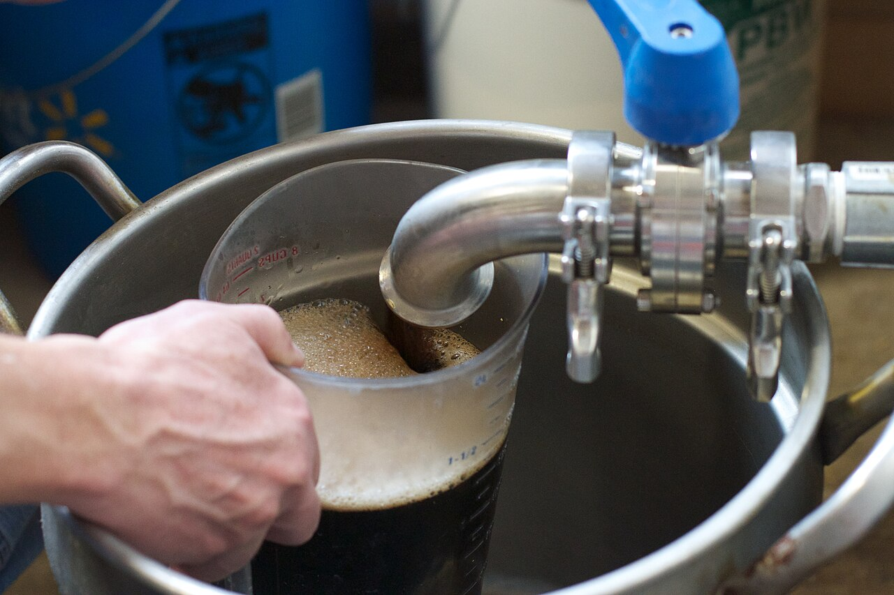

# 麦芽汁（wort）

麦芽汁是糖化结束后，从麦糟中分离出来的含糖液体。它带着谷物与水经过酶解后的糖、糊精、氨基酸、维生素和矿物质，是啤酒发酵的直接原料。用一句话概括：麦芽汁是“还没发酵、也没加酒花的啤酒前体”。

在啤酒厂，麦芽汁的糖度决定可发酵糖的总量，进而决定酒精度与酒体；它的氨基酸谱决定酵母能否健康繁殖；它的浊度与脂质含量影响泡沫、风味稳定性与过滤难度。因此，同一款麦芽、同一套设备，糖化与过滤的微小差异，可能让最终的啤酒完全不同。

图：糖化过滤后流出的麦芽汁，尚未加入啤酒花。图片：cogdogblog，CC BY 2.0，via Wikimedia Commons（[原图页面](https://commons.wikimedia.org/wiki/File:Here_Comes_Some_Wort!_(8424827095).jpg)）。

## 从谷物到液体：麦芽汁是怎么来的

流程从制麦开始：大麦浸水发芽，产生淀粉酶与蛋白酶，再烘干或焙烤，形成不同颜色的麦芽。酿酒厂把麦芽粉碎成麦粉（grist），与热水在糖化槽中混合，形成糖化醪。酶在适宜温度下把淀粉切成麦芽糖、麦芽三糖与葡萄糖，也把蛋白质分解成氨基酸。

糖化结束后，糖化醪进入过滤槽（lauter tun）。麦糟形成天然的过滤床，清亮的麦芽汁从底部流出，这个过程叫“洗槽”或“过滤”。为了把残留糖冲出来，酿酒师会用热水喷洒麦糟，称为 sparging。过滤出来的液体就是麦芽汁；麦糟则成为饲料或废弃物。

水质同样重要。酿造水中的钙、镁、碳酸盐与硫酸盐影响酶活性、pH 与酒花苦味的表现。历史上，不同产区的啤酒风格与当地水质强相关：硬水适合英式苦啤，软水适合皮尔森。现代酒厂会调整水质，但“水是啤酒的骨架”这一说法并不过时。

## 麦芽汁里有什么

麦芽汁的主要成分是水，约占八成以上；其余是糖、糊精、蛋白质与氨基酸、矿物质、维生素与少量脂质。糖中以麦芽糖最多，其次是麦芽三糖和葡萄糖；糊精不被酵母发酵，却贡献酒体与饱腹感。氨基酸与游离氨基酸氮（FAN）是酵母的氮源，过高会导致杂醇与生物胺，过低则发酵迟缓。

麦芽汁的浓度通常用柏拉图度（°P）或比重表示。十二度的麦芽汁接近普通啤酒的起点，十六度以上常见于烈性啤酒。浓度只说明糖的总量，不说明糖谱；同样十二度的麦芽汁，可发酵糖比例不同，酒精度与残糖就会不同。

麦芽汁的浊度也值得注意。适度浑浊带来脂质与酵母营养，过量则影响泡沫与保存。现代酒厂倾向“清亮麦芽汁”，但传统比利时与英式酒厂会保留一定浑浊，以换取更饱满的口感。没有绝对标准，只有风格与稳定性之间的权衡。

## 煮沸、加花与冷却

麦芽汁离开过滤槽后，进入煮沸锅。煮沸的目的有四个：灭菌、终止酶活性、让酒花中的α-酸异构化产生苦味、让蛋白质凝固形成热凝固物。煮沸通常持续一小时左右，酒花分批次加入：早加给苦味，晚加给香气，回旋沉淀阶段加给风味。

煮沸还会驱除 unwanted 的挥发性物质，例如二甲基硫（DMS）及其前体。DMS 过高会让啤酒带煮玉米味，因此煮沸强度与时间必须足够。煮沸结束后，麦芽汁进入回旋沉淀槽，离心力把热凝固物与酒花渣聚到中心，形成“trub”。

接下来是冷却与充氧。麦芽汁必须迅速降到酵母适宜的温度，避免感染；同时通过充氧让酵母在繁殖阶段获得足够的氧。冷却后的麦芽汁被称为“充氧麦芽汁”，随后投入酵母，进入发酵。此时它才真正开始变成啤酒。

## 啤酒与威士忌：同一词，不同路线

啤酒路线中，麦芽汁要加酒花煮沸，然后发酵。威士忌路线中，麦芽汁不加酒花，通常也不煮沸，而是冷却后直接发酵成“wash”，再进入蒸馏。两者的前段工艺相似：制麦、糖化、过滤；分岔点在“是否加花煮沸”和“是否蒸馏”。

苏格兰威士忌行业把发酵后的液体称为 wash，把糖化后的含糖液体称为 wort。wash 的酒精度通常较低，经过壶式或柱式蒸馏后得到新酒。啤酒厂的麦芽汁则要保留酒花苦味与香气，因此煮沸是风味构建的核心步骤，而不是单纯的杀菌。

清酒常被拿来类比：蒸熟的米、曲霉与水的混合物叫“醪”（moromi），并行糖化与发酵，最后压榨取酒。它与麦芽汁的逻辑相似——都是含糖液体在微生物作用下变成酒——但原料、酶来源与过滤方式完全不同。把 sake 的醪直接叫 wort，会掩盖这些差异。

## 常见误解与判断

第一个误解是“麦芽汁就是啤酒”。麦芽汁没有酒花、没有发酵、没有二氧化碳，只能算半成品。第二个误解是“麦芽汁越清越好”。清亮有助于稳定性，但过度过滤会损失泡沫蛋白与风味。第三个误解是“糖度越高越好”。高糖度带来高酒精度，也可能带来发酵停滞与残糖失衡。

判断麦芽汁质量，酿酒师会看糖度、pH、浊度、颜色、碘试验（确认淀粉是否完全糖化）与酵母可发酵性。家庭酿酒者可以用比重计或折射仪测糖度，用碘液判断糖化终点。商业麦芽汁浓缩液则要看生产日期与保存条件，因为糖与氨基酸都会随时间和温度变化。

对普通饮酒者，麦芽汁不是必需的知识；但理解它，能解释为什么同一款“啤酒”有深浅、甜苦与酒体差异。麦芽汁是风味的起点，酵母与酒花只是后续的导演。

相关条目：[制麦](ref:malting)、[糖化](ref:saccharification)。

麦芽汁不是啤酒，也不是威士忌：啤酒在麦芽汁发酵后保留酒花与气泡，威士忌则要经过蒸馏；同一词在不同工艺里指不同中间产物，不能拿它当成品酒名。

## 另见与参考资料

- 制麦：参见 [制麦](ref:malting)。
- 糖化：参见 [糖化](ref:saccharification)。
- 发酵：参见 [发酵](ref:fermentation)。
- 啤酒：参见 [啤酒](ref:beer)。
- 威士忌：参见 [威士忌](ref:whisky)。
- 清酒：参见 [清酒](ref:sake)。

**来源与边界。** 本页关于「麦芽汁（wort）」的关键事实，主要由以下来源交叉核对：American Society of Brewing Chemists（麦芽汁的糖度、比重、浊度与发酵性等分析口径）、Master Brewers Association of the Americas（糖化、过滤与麦汁煮沸的工艺顺序）、Brewers Association（精酿啤酒的原料与工艺流程表述）等 5 条来源。价格、批次与状态会变，涉及这些字段时以页面所列来源的最新版本为准。正文为项目自写，来源只作核验，不复制原文。
