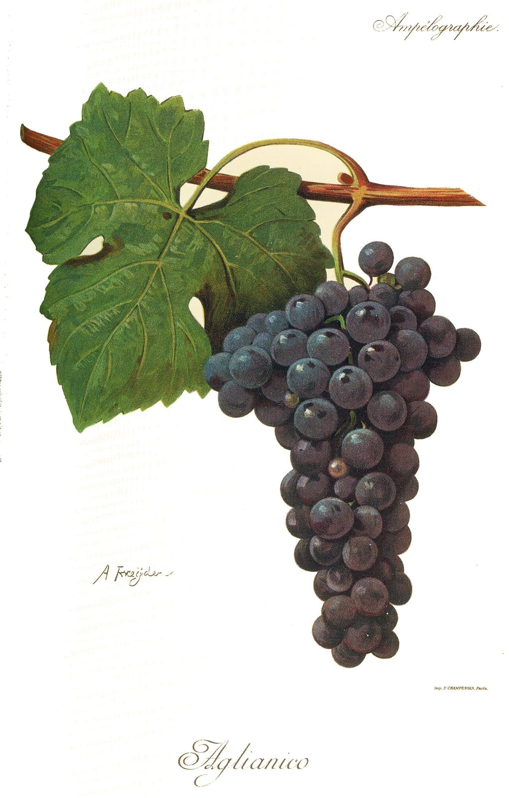

# 艾格尼科

艾格尼科（Aglianico）是意大利南部最有分量的红葡萄之一，主要种在巴斯利卡塔的武尔图雷火山（Monte Vulture）与坎帕尼亚的内陆丘陵。它晚熟、色深、单宁与酸度都高，年轻时常常紧闭、涩口，需要几年瓶陈才逐渐展开。把它称为"南方的内比奥罗"并不准确，但它确实与内比奥罗一样，属于"高酸高单宁、靠时间换复杂度"的类型。在意大利南部的红葡萄酒版图里，它是少数能与北部名酒正面比较陈年潜力的品种（ref:italy）。

图：艾格尼科。图片：Alexis Kreyder，Public domain，via Wikimedia Commons（[原图页面](https://commons.wikimedia.org/wiki/File:Aglianico_Viala_Vermorel.jpg)）。

> **先给结论**
> **一句话：** 这页判断艾格尼科适不适合你，以及怎么比较其他品种。
>
> - **适合谁：** 正在比较艾格尼科与其他品种、想弄懂风味差异的人。
> - **不适合谁：** 只想要单一名庄推荐、不关心品种本身的人。
> - **先看这两点：**
>   - 高单宁与高酸需要油脂与蛋白质来平衡：炖牛肉、烤羊腿、野味、番茄慢炖的肉酱、硬质奶酪都合适。
>   - 品种名 Aglianico，中文音译艾格尼科，也有阿利亚尼科、阿格丽安尼科等写法。

## 定义与别名

品种名 Aglianico，中文音译艾格尼科，也有阿利亚尼科、阿格丽安尼科等写法。它属于 Vitis vinifera，是意大利本土红品种。常见别名与产区名容易混淆：Aglianico del Vulture 是巴斯利卡塔的法定产区（DOCG），Taurasi 是坎帕尼亚的同品种 DOCG，两者都是酒名而不是不同品种。历史上还有 Aglianica、Uva Aglianica 等写法。酒标上只写 Aglianico 时，可能来自多个南部产区；写 Taurasi 或 Aglianico del Vulture 时，则有具体的产地、品种比例与陈年规定。它在酒类归属上属于红葡萄酒（ref:red-wine），而不是加强酒或甜酒。

## 亲本与起源

"艾格尼科"被认为与意大利语 ellenico（希腊的）有关，指向它在古希腊殖民时期传入意大利南部的说法。这个说法有历史背景支撑：坎帕尼亚与巴斯利卡塔正是大希腊（Magna Graecia）的核心区域，当地自古有希腊系葡萄。但名字只是线索，DNA 研究尚未给出确定的亲本组合，也没有证据表明它就是从希腊某地直接引进的单一品种。可以确认的是，它在意大利南部有数百年的栽培记录，长期作为混酿与地方酒存在，20 世纪后期才以单一品种和法定产区的形式被重新重视。

## 植物学特征

果穗中等、较紧凑，果粒中等、圆形，成熟时呈深蓝黑色，果皮厚。厚皮与较高的果皮果肉比例带来深色与大量单宁（ref:tannin），这是它陈年潜力的基础。叶片中等大、五裂。艾格尼科发芽较晚，成熟也很晚，在意大利南部通常要到十月下旬甚至十一月才采收，是当地最晚熟的品种之一。晚熟意味着它需要温暖、向阳且排水良好的地块；在积温不足的年份，单宁与糖分难以同时成熟，酒会显得生青而干涩。

## 栽培特性

艾格尼科长势旺，需要控制负载，否则枝叶过密、果实不熟。它发芽晚，避开了春季霜冻，但成熟期遇到秋雨容易感染灰霉，因此酒农倾向选择通风良好的坡地。厚果皮对病害有一定耐受性，但对水分过剩敏感，雨季前的排水管理很关键。传统上采用短梢修剪与较高的种植密度，以限制产量。武尔图雷的高海拔地块昼夜温差大，果实能在保持酸度的同时积累糖分；坎帕尼亚内陆的黏土与石灰岩土壤则给酒更饱满的酒体与更厚的果味。

## 武尔图雷的火山土

武尔图雷是休眠火山，土壤由火山灰、凝灰岩与熔岩风化而成，排水好、含矿物盐，部分地块夹有黏土。这里的艾格尼科通常种在海拔较高的坡地，酒更紧致，香气偏烟熏、碎石与黑莓，单宁线条清晰。与坎帕尼亚的图拉斯相比，武尔图雷的酒往往更"瘦"、更矿物，年轻时更需要醒酒。火山土不是魔法，真正决定风格的是海拔、坡度、成熟度与陈年方式；但土壤的排水与保肥差异，确实让同一品种在两个产区呈现不同轮廓。

## 产区分布

巴斯利卡塔的武尔图雷是核心，Aglianico del Vulture 覆盖多个村庄，葡萄园多分布在海拔 400 至 700 米之间。坎帕尼亚的图拉斯（Taurasi）位于阿韦利诺省，酒体更饱满、单宁更强；塔布尔诺（Taburno）也是 DOCG。此外，坎帕尼亚的 Falerno del Massico 与伊尔皮尼亚（Irpinia）一带有以艾格尼科为主的酒，普利亚与莫利塞也有种植。意大利之外，澳大利亚、美国与阿根廷有少量试验性栽培，规模远不及本土产区。

## 法定规则

Aglianico del Vulture 于 2011 年从 DOC 升为 DOCG，规定至少 90% 艾格尼科，并有最低陈年要求，具体月数以最新规范为准。Taurasi 于 1993 年成为 DOCG，要求至少 85% 艾格尼科，总陈年不少于三年，其中包含橡木桶阶段；Riserva 要求更长。Aglianico del Taburno 于 2011 年成为 DOCG。这些规则的核心不是"越陈越好"，而是保证晚熟、高单宁的品种有足够时间柔化。购买时看产区与年份，比只看"Riserva"字样更有意义。

## 酿造与陈年

艾格尼科的浸渍时间通常较长，从两周到四周不等，以充分提取颜色与单宁；发酵温度较高，帮助萃取。由于单宁强，很多酒庄会用大橡木桶或旧桶进行陈年（ref:oak-ageing），避免新桶的香草与烘烤味压过品种本身的烟熏、黑色水果与花香。现代派会使用部分新桶与小桶，风格更圆润；传统派强调长时间在大桶中熟成，保持酸度与骨架。无论哪种路线，装瓶后通常还需要数年才能舒展，尤其是图拉斯。过重的橡木与过早装瓶，都会让单宁显得更干。

## 感官风格

年轻艾格尼科颜色深、边缘偏紫，香气以黑莓、黑樱桃、李子、紫罗兰、黑胡椒与甘草为主，常带烟熏、焦油与皮革的气息。入口酸度高、单宁厚重，酒体饱满，酒精不低，余味长但年轻时收尾干涩（ref:acidity）。陈年后单宁变得细密，出现干无花果、可可、烟草、森林地表与松露的复杂气息。武尔图雷的版本更偏矿物与烟熏，图拉斯更偏果味与力量。优质酒可以陈放二十年以上，普通级别也建议五到八年后再喝。

## 配餐与侍酒

高单宁与高酸需要油脂与蛋白质来平衡：炖牛肉、烤羊腿、野味、番茄慢炖的肉酱、硬质奶酪都合适。饮用前建议醒酒一到两小时，年轻酒款可以更久；温度以 16 至 18 摄氏度为宜。不要搭配清淡的海鲜或甜味酱汁，单宁会显得突兀。它的酸度也让它适合搭配番茄与橄榄油较多的南意大利菜，这一点常被忽略。

## 代表生产者与年份

武尔图雷的代表包括 Paternoster、D'Angelo、Basilisco、Elena Fucci（Titolo）、Grifalco 与 Cantine del Notaio；坎帕尼亚有 Mastroberardino、Feudi di San Gregorio、Terredora di Paolo、Villa Raiano 与 Pietracupa。年份差异主要来自秋季降雨与热量积累：炎热干燥的年份酒更浓缩、酒精更高；凉爽多雨的年份需要更严格的筛选，风格更清爽但单宁可能更硬。图拉斯的某些经典年份常被讨论，但不宜用年份排名代替实际品鉴。

## 常见误区

第一，认为艾格尼科一定源自希腊；名字与历史背景支持这一说法，但基因证据并不充分。第二，把 Taurasi 与 Aglianico del Vulture 当成同一款酒；它们是不同产区的法定名称。第三，称它为"南方巴罗洛"；这种类比方便但过度简化，两者的香气与法规都不同。第四，认为它天生粗糙；单宁强不等于粗劣，问题往往在于饮用太早。第五，以为它只适合混酿；单一品种装瓶已是主流。第六，把 Aglianico 与 Aglianico del Vulture 混用；后者是产区名，不是另一个品种。

## 延伸阅读

- [葡萄酒](ref:wine)：艾格尼科所属的饮料大类。
- [红葡萄酒](ref:red-wine)：艾格尼科的酒种归属。
- [意大利](ref:italy)：南部法定产区体系的背景。
- [单宁](ref:tannin)：理解艾格尼科结构的核心概念。
- [酸度](ref:acidity)：它能在南方保持清爽的原因。
- [橡木桶陈年](ref:oak-ageing)：柔化单宁与增添香气的工艺。

相关条目：[葡萄酒](ref:wine)、[红葡萄酒](ref:red-wine)。

**关键事实。**

| 项目 | 内容 |
| --- | --- |
| 一句话定位 | 意大利南部（巴斯利卡塔与坎帕尼亚）的红葡萄，晚熟、色深、单宁与酸度都很高；图拉斯与 Vulture 火山土是它的两个标志性产区，酒需要陈年才能舒展 |
| 物种 | Vitis vinifera |
| 代表产区 | 意大利 |

**来源与边界。** 本页关于「艾格尼科」的关键事实，主要由以下来源交叉核对：International Organisation of Vine and Wine (OIV)（品种描述与 Vitis 物种框架）、Oxford University Press（提供关于艾格尼科、图拉斯与意大利南部红葡萄酒的条目；由原条目末尾参考资料迁移，未逐条复核访问日期）、Italian Wine Central（Aglianico del Vulture、Taurasi 等法定产区与品种概况）。价格、批次与状态会变，涉及这些字段时以页面所列来源的最新版本为准。正文为项目自写，来源只作核验，不复制原文。
