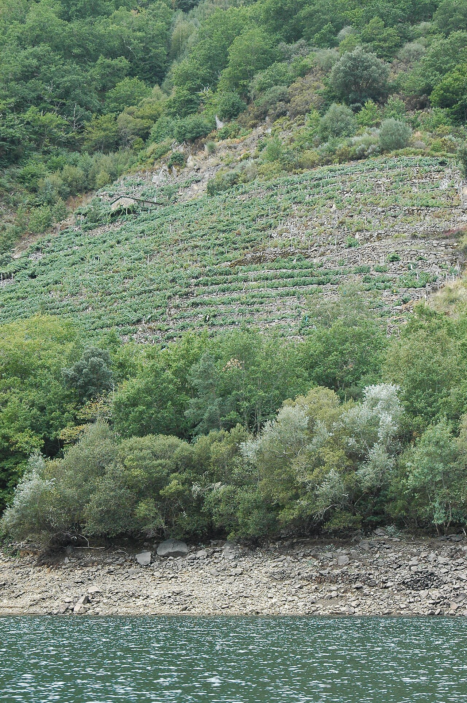
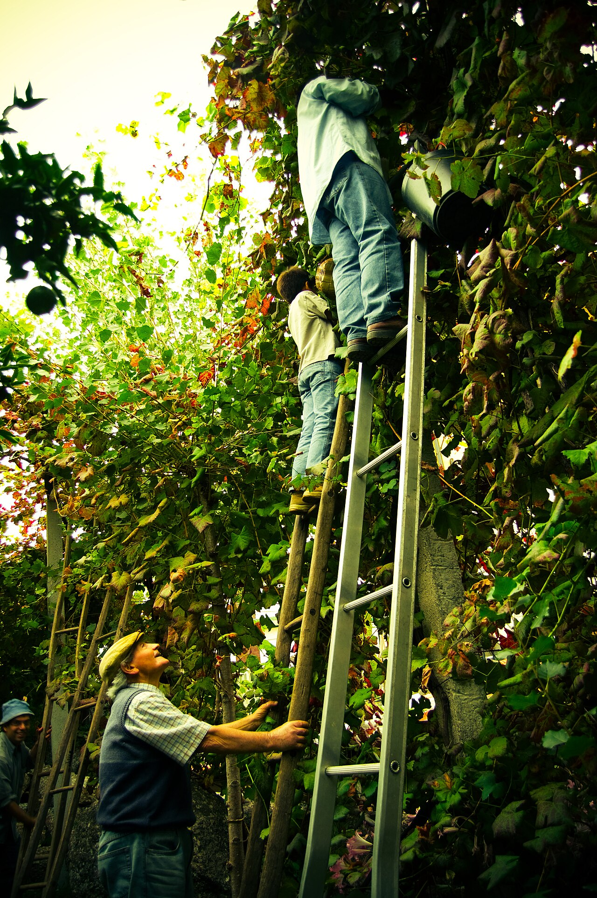

# 阿尔巴利诺

阿尔巴利诺（Albariño）是西班牙加利西亚沿海的代表性白葡萄，也是葡萄牙绿酒产区里被称为 Alvarinho 的同一个品种。它生长在大西洋气候的湿润角落，果皮较厚、酸度高，酒里常有柠檬、青苹果、白花与湿石头的味道，收尾带一点咸鲜感。与许多以果香取胜的白葡萄不同，阿尔巴利诺的魅力在于酸度、香气与质地的结合；它既能做清爽的年轻酒，也能通过酒泥接触与橡木陈年获得更复杂的层次(ref:wine)。

图：阿尔巴利诺。摄影：Albarino Vineyards。署名：chicadelatele，CC BY 2.0，来自 Wikimedia Commons（[来源](https://commons.wikimedia.org/w/index.php?curid=4106753)）。

> **先给结论**
> **一句话：** 这页判断阿尔巴利诺适不适合你，以及怎么比较其他品种。
>
> - **适合谁：** 正在比较阿尔巴利诺与其他品种、想弄懂风味差异的人。
> - **不适合谁：** 只想要单一名庄推荐、不关心品种本身的人。
> - **先看这两点：**
>   - 阿尔巴利诺属于欧洲葡萄 Vitis vinifera，是白葡萄品种。
>   - 阿尔巴利诺原产于伊比利亚半岛西北部，也就是今天西班牙加利西亚与葡萄牙米尼奥一带。

## 定义与别名

阿尔巴利诺属于欧洲葡萄 Vitis vinifera，是白葡萄品种。西班牙语写作 Albariño，葡萄牙语写作 Alvarinho，两者指向同一品种；中文“阿尔巴利诺”是西班牙语的音译。它常被误认为雷司令（Riesling），但 DNA 研究已经否定了这种亲缘关系，两者在香气类型、酸度结构与栽培需求上都不同。酒标上的“Albariño”是品种名，不是产区名；产区名是里亚斯·拜萨斯（Rías Baixas）或绿酒（Vinho Verde）。理解这一点，有助于避免把品种风格与产区风格混为一谈(ref:white-wine)。

## 亲本与起源

阿尔巴利诺原产于伊比利亚半岛西北部，也就是今天西班牙加利西亚与葡萄牙米尼奥一带。关于它由莱茵河畔的修士带入的说法流传很广，但缺乏可靠证据；更常见的“雷司令亲缘”说法也已被基因研究否定。DNA 分析提示，阿尔巴利诺与加利西亚的 Caíño 家族存在亲缘关系，有研究把 Caíño Blanco 视为阿尔巴利诺与 Caíño Bravo 的后代；不过具体亲本关系仍有讨论空间。它在当地至少有数百年的种植记录，长期适应了大西洋的高降雨与花岗岩土壤。19 世纪末根瘤蚜之后，当地酒农重新嫁接种植，20 世纪后期随着里亚斯·拜萨斯法定产区的建立，阿尔巴利诺才从地方酒变成国际品种。

## 植物学特征

阿尔巴利诺的果粒较小，果皮较厚，果穗较松散，这些特征让它在多雨的沿海气候中比许多薄皮白葡萄更能抵抗灰霉病。厚果皮也带来一定的酚类物质，使酒在酸度之外还有轻微的苦感与质地。果实糖分积累中等，酸度下降较慢，因此成熟期仍能保持清爽的苹果酸与酒石酸。香气上，它含有萜类与硫醇类化合物，表现为柑橘、白花与核果。不同克隆与不同年份的成熟度会明显影响香气强度；过熟时会出现香蕉、蜜瓜与酒精感，失去典型的酸度与海风感(ref:acidity)。

## 栽培特性

阿尔巴利诺的栽培难点主要来自水分与病害。加利西亚年降雨量高，葡萄园需要良好的排水与通风，当地传统的棚架式（parral）栽培把枝条抬到高处，让果穗远离地面湿气，也增加了叶面积。它适合花岗岩、砂质与冲积土，根系深时更能应对夏季干旱。发芽较早，春霜有一定风险；成熟期中等，采收窗口常被秋季降雨打断，因此酒农需要在酸度、香气与糖分之间快速决策。产量控制对品质很重要：高产会让酒变得水感、香气寡淡；低产与老藤则能给出更集中的果味与更长的收尾。

## 产区分布

西班牙加利西亚的里亚斯·拜萨斯（Rías Baixas）是阿尔巴利诺的核心产区(ref:spain)，官方划分为 Val do Salnés、O Rosal、Condado do Tea、Soutomaior 与 Ribeira do Ulla 五个子产区。Val do Salnés 最靠近大西洋，酒风偏咸鲜、酸度明亮；O Rosal 靠近米尼奥河，常与 Loureiro、Treixadura 混酿，香气更柔和；Condado do Tea 内陆一些，果味更成熟。葡萄牙北部的绿酒产区（Vinho Verde）是另一个核心(ref:vinho-verde)，其中蒙桑-梅尔加苏（Monção e Melgaço）以 Alvarinho 单一品种酒最著名。西班牙其他地区、美国加州、澳大利亚、新西兰、乌拉圭与巴西也有种植，但风格通常更偏果味。

## 法定规则

里亚斯·拜萨斯于 1988 年获得法定产区（D.O.）地位。当地规定白葡萄酒中阿尔巴利诺至少占 70%，若酒标单独标注“Albariño”，则通常要求 100% 使用该品种；不同子产区与酒款类型还有各自的产量、酒精度与陈年要求。葡萄牙绿酒产区（Vinho Verde）同样对 Alvarinho 有品种与产区规范，蒙桑-梅尔加苏子产区的 Alvarinho 可以标注品种名，但必须符合相应比例与酒精度要求。两国都禁止把其他品种的酒冒充阿尔巴利诺，具体参数以最新法规为准。对消费者而言，酒标上的“Rías Baixas”与“Vinho Verde”比单纯的品种名更能说明风格。

## 酿造

阿尔巴利诺的主流做法是不锈钢罐低温发酵，以保留柑橘、白花与硫醇类香气；发酵结束后进行短时间酒泥接触（lees contact），增加圆润感与面包气息，但通常避免苹果酸-乳酸发酵，以保持高酸度。部分酒庄使用旧橡木桶、大木桶或蛋形水泥罐，让酒获得更多质地与氧化复杂度；也有酒庄进行短时间皮接触，提取香气与轻微单宁。残糖通常很低，风格以干型为主。阿尔巴利诺也可以酿成起泡酒，或与 Loureiro、Treixadura 等品种混酿。无论哪种方式，酿造的核心都是保护酸度与香气，而不是用橡木掩盖品种特征。

## 感官风格

年轻阿尔巴利诺以柠檬、青柠、葡萄柚、青苹果、桃子、杏、金银花与橙花为主，常伴随湿石头、海盐与白胡椒气息。酒体中等，酸度高，酒精通常在 12% 至 13% 之间，收尾带有轻微苦感与咸鲜感。酒泥接触会增加奶油、面包与坚果的层次，旧橡木则带来更宽的质地而不明显增加香草味。它与海鲜、贝类、沙拉与清淡的鱼料理非常契合。大多数阿尔巴利诺适合在装瓶后几年内饮用，以享受其新鲜度；结构良好的酒款可以陈放更久，发展出蜂蜜、干果与矿物气息。

## 代表生产者与年份

西班牙代表酒庄包括 Pazo de Señoráns、Martín Códax、Fillaboa、Terras Gauda、Mar de Frades 与 Granbazán。Pazo de Señoráns 以精细的酒泥接触与陈年潜力著称，Martín Códax 是推动品种国际化的关键生产者，Terras Gauda 的 O Rosal 混酿则展示了阿尔巴利诺与其他本地品种的配合。葡萄牙方面，Soalheiro 与 Anselmo Mendes 是 Alvarinho 的重要代表，前者强调蒙桑-梅尔加苏的酸度与矿物感。年份差异主要来自采收期降雨与温度：凉爽年份酸度更高、香气更紧，温暖年份果味更熟、酒精略高；具体表现仍取决于子产区与采收决策。

## 常见误区

第一，把阿尔巴利诺当成雷司令。两者没有已确认的亲子关系，香气与酸度结构也不同。第二，认为阿尔巴利诺一定是甜酒。大多数阿尔巴利诺是干型，绿酒产区的轻微气泡与残糖属于风格差异，不是品种必然。第三，把 Albariño 与 Alvarinho 当成两个品种。它们是同一品种的西班牙语与葡萄牙语名称。第四，以为阿尔巴利诺只产自西班牙。葡萄牙绿酒产区同样重要。第五，把“Vinho Verde”当成品种名。它是产区名，可以包含多个白葡萄品种。第六，认为阿尔巴利诺必须年轻饮用。优质酒款通过酒泥接触与瓶中陈年可以获得更复杂的质地。

## 延伸阅读

- [葡萄酒](ref:wine)：白葡萄酒在整体分类中的位置。
- [白葡萄酒](ref:white-wine)：阿尔巴利诺所属的酒类。
- [西班牙](ref:spain)：里亚斯·拜萨斯所在的产区框架。
- [绿酒](ref:vinho-verde)：葡萄牙 Alvarinho 的核心产区。
- [酸度](ref:acidity)：理解阿尔巴利诺清爽风格的关键指标。

**关键事实。**

| 项目 | 内容 |
| --- | --- |
| 一句话定位 | 西班牙西北部加利西亚的白葡萄，在葡萄牙称 Alvarinho；果皮较厚、酸度高，带柑橘、白花与海风般的咸鲜感，适合搭配海鲜 |
| 物种 | Vitis vinifera |
| 代表产区 | 西班牙、绿酒 |

**来源与边界。** 本页关于「阿尔巴利诺」的关键事实，主要由以下来源交叉核对：International Organisation of Vine and Wine (OIV)（品种描述与 Vitis 物种框架）、Oxford University Press（提供关于阿尔巴利诺、里亚斯·拜萨斯与酸度的条目；由原条目末尾参考资料迁移，未逐条复核访问日期）、Consejo Regulador de la D.O. Rías Baixas（里亚斯·拜萨斯子产区、品种规则与风格概况）等 5 条来源。价格、批次与状态会变，涉及这些字段时以页面所列来源的最新版本为准。正文为项目自写，来源只作核验，不复制原文。

## 相关图像

图：绿酒。图片：Feliciano Guimarães，CC BY 2.0，via Wikimedia Commons（[原图页面](https://commons.wikimedia.org/wiki/File:Vindimadores_em_vinha_de_enforcado_15.jpg)）。关联图像：阿尔巴利诺。
