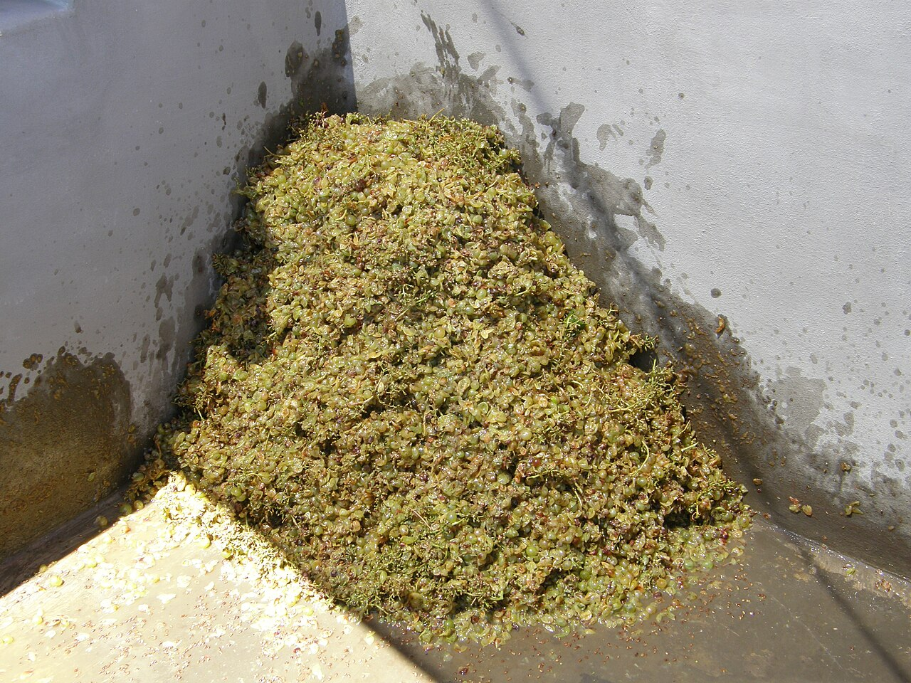

# 阿斯蒂科

阿斯蒂科（Assyrtiko）是希腊爱琴海岛屿圣托里尼的标志性白葡萄，也是少数能在强烈日照、强风与贫瘠火山土上同时保持高酸度与浓郁度的品种。它的酒通常为干型，酒体中等到饱满，带有柠檬、青苹果、火石与海盐的气息；在圣托里尼，它还与当地独特的篮状整枝、沙质火山土和自根老藤联系在一起。近二十年，阿斯蒂科从"希腊地方品种"变成国际市场上被认真对待的白葡萄之一，也是少数能让高酸与成熟度并存的品种。

图：阿斯蒂科的产区风貌。图片：Klearchos Kapoutsis，CC BY 2.0，via Wikimedia Commons（[原图页面](https://commons.wikimedia.org/wiki/File:White_wine_grape_pressing_in_Santorini.jpg)）。这张照片用于说明阿斯蒂科的主要种植环境，不是阿斯蒂科的品种标本照。

> **先给结论**
> **一句话：** 这页判断阿斯蒂科适不适合你，以及怎么比较其他品种。
>
> - **适合谁：** 正在比较阿斯蒂科与其他品种、想弄懂风味差异的人。
> - **不适合谁：** 只想要单一名庄推荐、不关心品种本身的人。
> - **先看这两点：**
>   - 阿斯蒂科的高酸与咸感适合海鲜：生蚝、海胆、烤鱼、炸小鱼、柠檬橄榄油调的菜式，也能配羊乳奶酪与番茄类前菜。
>   - 品种学名为 Assyrtiko，中文常音译为阿斯蒂科，也有阿西尔提可、阿西提科等写法。

## 定义与别名

品种学名为 Assyrtiko，中文常音译为阿斯蒂科，也有阿西尔提可、阿西提科等写法。它属于欧洲葡萄 Vitis vinifera，是希腊本土白品种。圣托里尼当地还保留若干生物型（biotype），果粒大小与成熟节奏略有差异，但品种身份相同。酒标上通常直接写 Assyrtiko；"Santorini" 是产区名，"Nykteri" 是传统风格名，"Vinsanto" 是甜酒名，三者都不是品种名。把阿斯蒂科与同岛的 Athiri、Aidani 混为一谈也不准确，后两者酸度更低、香气更柔，在混酿中主要提供果味与体积。它的酒几乎都归入白葡萄酒大类（ref:white-wine），但也可以酿成带皮浸渍的橙酒。

## 亲本与起源

阿斯蒂科的亲本尚未确定。DNA 研究显示它属于基克拉泽斯群岛的古老品种群，而不是近代育种产物；有研究探讨它与希腊其他白品种的关系，但没有形成公认的亲子组合。它的栽培史与圣托里尼的火山活动紧密相连：约公元前 1600 年的米诺斯火山喷发覆盖了岛屿，此后葡萄种植在火山灰与浮石上重新建立。威尼斯与奥斯曼时期，圣托里尼的甜酒经地中海贸易外销，Vinsanto 之名常被认为来自意大利语 "vino santo"（圣酒）。19 世纪，岛上的葡萄酒还销往俄国与东地中海市场。

## 植物学特征

果穗中等、较松散，果粒中小、近圆，成熟时由黄绿转为金黄，果皮相对其他白品种偏厚，果肉多汁。叶片中等大、五裂，边缘锯齿明显。阿斯蒂科的酸度在成熟后期下降缓慢，糖分积累中等，这使它在炎热岛屿上仍能保持 pH 3.0 上下的清爽感（ref:acidity）。较厚的果皮含有更多酚类物质，因此短时间浸皮就能做出带轻微单宁与茶感的橙酒风格。晚熟是它的另一个特征，采收通常排在当地其他白品种之后，这也意味着它需要更长的日照与更稳定的秋季天气。

## 栽培特性

阿斯蒂科长势旺，根系深，耐旱、抗风，能在有机质极低的土壤里结果。它的主要风险不是寒冷，而是干旱、强风与成熟期的秋雨。圣托里尼的传统整枝叫 kouloura：把藤蔓编成贴地的篮状，果穗藏在内部，既能挡风，也能减少水分蒸发与日灼。因为岛上土壤为沙质火山土、与大陆隔离，根瘤蚜未能立足，许多老藤自根生长（ungrafted），这在欧洲并不多见。当地几乎不灌溉，葡萄依靠夜间海雾与露水；产量天然偏低，这也是酒体集中的原因之一。希腊本土的新园则更容易高产，需要更严格的控制。

## 圣托里尼的火山土

圣托里尼的土壤以浮石、火山灰与熔岩碎屑为主，颜色从灰白到深黑，排水极快、保肥力差。当地人把白色浮石土称作 aspra，把混有黑色火山砂的地块另作区分。这种土壤常被描述为给酒带来火石、烟熏与咸感，但更确切地说，是低养分、强排水与海风共同塑造了紧致、低产、高酸的果实；"矿物感"是感官描述，不宜当作土壤成分直接进入酒中的化学结论（ref:terroir）。岛屿西侧的火山口悬崖与东侧平原在日照、风力上也有差异，酒农会据此分开酿造，再决定是否混调。

## 其他产区分布

圣托里尼之外，阿斯蒂科在希腊本土迅速扩张：哈尔基季基半岛、阿提卡、色萨利、德拉马与克里特都有种植，伯罗奔尼撒也有实验性栽培。希腊本土的气候更温暖、土壤更多样，酒通常更饱满、酸度略低，香气偏黄桃与柑橘。海外最知名的是澳大利亚克莱尔谷与玛格丽特河，加州、南非与新西兰也有少量试验。不同产地的共同点是：阿斯蒂科需要充足光照与水分管理，否则容易失去酸度骨架；而一旦酸度不足，它中性的一面就会暴露出来。

## 法定规则

圣托里尼的干白属于 PDO Santorini，以阿斯蒂科为主体，允许混入少量 Athiri 与 Aidani，具体比例以最新法规为准。Vinsanto PDO 使用日晒晾干的葡萄，以阿斯蒂科为主、辅以 Aidani 与 Athiri，经数年橡木桶陈年，甜度高、酸度也高——这是它与多数甜酒最不一样的地方。Nykteri 是圣托里尼的传统风格名，历史上指夜间采收、连夜压榨、在橡木桶中发酵的干白，酒精度较高，常带橡木与成熟果味。希腊其他产区也有以阿斯蒂科为名的 PGI 或地方酒，规则比圣托里尼宽松，酒标上的产地信息因此很重要。

## 酿造与发酵

阿斯蒂科的酿造核心是"保留酸度"。多数干白在不锈钢罐中低温发酵（ref:fermentation），发酵温度通常控制在 15 至 18 摄氏度，以保留柑橘与花香；是否做苹果酸-乳酸发酵取决于风格，追求清爽的酒庄通常避免，追求质地的酒庄会部分进行。带酒泥搅拌可以增加圆润感与咸鲜味；橡木桶主要用于 Nykteri 和部分高端干白，新桶比例通常克制，以免掩盖品种香气。橙酒风格会延长浸皮数天到数周，得到茶色、带单宁的口感。Vinsanto 则把葡萄在阳光下晒十天以上，糖分浓缩后缓慢发酵，再在旧桶中陈年多年。

## 感官风格

年轻阿斯蒂科以柠檬、青柠、葡萄柚、青苹果、未熟白桃与白花为主，随后是火石、湿石、烟熏与海盐的气息；入口酸度高而线性，酒体中等到饱满，酒精通常在 12.5% 至 14% 之间，余味带咸感与苦杏仁。圣托里尼的酒因为低产量与老藤，浓度明显高于希腊本土的年轻园。陈年五到十年后，会出现蜂蜡、蜂蜜、干草与坚果的气息，酸度仍然是骨架。Nykteri 更饱满、更圆润，橡木与酒精感更明显，年轻时也更需要醒酒。

## 配餐与侍酒

阿斯蒂科的高酸与咸感适合海鲜：生蚝、海胆、烤鱼、炸小鱼、柠檬橄榄油调的菜式，也能配羊乳奶酪与番茄类前菜。干白建议在 8 至 10 摄氏度饮用，Nykteri 可以稍高。因为酸度强，它不太怕油脂与油炸食物；但搭配过甜的酱汁会显得突兀。Vinsanto 适合配坚果、蓝纹奶酪或单独作为餐后酒，冰镇后小杯慢饮即可。

## 代表生产者与年份

圣托里尼的代表包括 Santo Wines（合作社）、Domaine Sigalas、Hatzidakis、Argyros、Gaia（Thalassitis）、Venetsanos 与 Vassaltis；澳大利亚的 Jim Barry 是把阿斯蒂科带出希腊的代表之一。年份差异主要来自降雨与风：春季干旱、夏季炎热的年份酒更浓缩、酒精更高；有秋雨的年份需要更严格的筛选。圣托里尼的产量小、需求大，价格通常高于希腊本土的同品种酒，但不宜用价格直接判断质量，酒庄的园地与陈年方式更关键。

## 常见误区

第一，认为阿斯蒂科都是甜的；Vinsanto 只是其中一个甜型分支，主流是干白。第二，认为它只产自圣托里尼；希腊本土与澳大利亚已有规模种植。第三，把高酸当成不成熟；这是品种特征，也是它配餐能力的来源。第四，把"火山土"直接等同于"矿物味"；风土影响真实存在，但感官描述不应被当作化学结论。第五，认为它不适合陈年；优质圣托里尼干白可以陈放十年以上。第六，把 Nykteri、Vinsanto 当成葡萄品种名。

## 延伸阅读

- [葡萄酒](ref:wine)：阿斯蒂科所属的饮料大类。
- [白葡萄酒](ref:white-wine)：阿斯蒂科的主要酒种。
- [酸度](ref:acidity)：理解阿斯蒂科骨架的关键指标。
- [风土](ref:terroir)：圣托里尼火山土与海风的讨论框架。
- [发酵](ref:fermentation)：干白与甜酒风格分化的工艺基础。

相关条目：[葡萄酒](ref:wine)、[白葡萄酒](ref:white-wine)、[酸度（acidity）](ref:acidity)。
