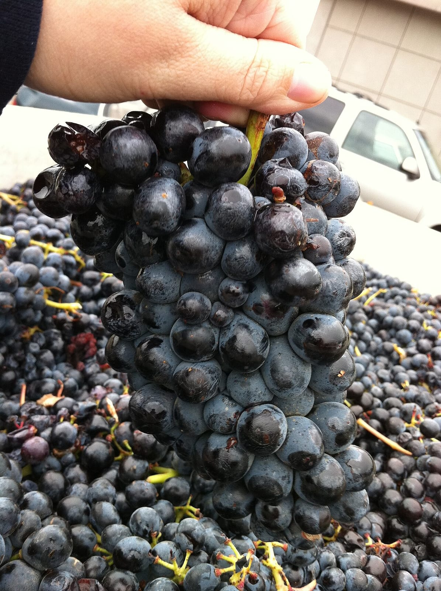

# 巴贝拉

巴贝拉（Barbera）是意大利皮埃蒙特最重要的红葡萄品种之一。它的特点很明确：颜色深、酸度高、单宁中等，喝起来“有骨架但不涩”。在皮埃蒙特，它常与内比奥罗并列出现，前者提供日常的果味与酸度，后者提供更强的单宁与陈年潜力。巴贝拉也是少数在炎热年份仍能保持酸度的红葡萄，这让它在气候变化下重新受到重视。

图：巴贝拉。图片：Agne27，CC BY-SA 3.0，via Wikimedia Commons（[原图页面](https://commons.wikimedia.org/wiki/File:Barbera_cluster.JPG)）。

## 定义与别名

巴贝拉的英文名是 Barbera，中文一般直接音译为巴贝拉。它属于欧洲葡萄 Vitis vinifera。常见的法定名称包括 Barbera d'Asti、Barbera del Monferrato 与 Barbera d'Alba，这些是产区名称，不是不同品种。酒标上通常直接标注品种名，少数会标注“Superiore”表示更长的陈年与更高的酒精度要求。把巴贝拉当作“便宜的内比奥罗”并不准确，两者在酸度、单宁与成熟节奏上差异明显。

## 亲本与起源

巴贝拉的亲本尚未确定。长期研究认为它原产于皮埃蒙特，至少在 17 世纪已有种植记录；也有说法把它与西班牙的某些品种联系起来，但基因证据不足。可以确认的是，它在蒙费拉托（Monferrato）与朗格（Langhe）一带长期作为混酿与日常饮用品种存在，直到 19 世纪后期才逐渐以单一品种装瓶。它的名字可能来自意大利语“barbera”，指一种酸涩的饮料，这与它的高酸特征相符。

## 植物学特征

果穗中等，果粒偏大，果皮颜色深、厚度中等。深色果皮带来良好的色素与花青素，中等厚度的果皮则让单宁不至于过强。它发芽较早，成熟期中等，介于多切托与内比奥罗之间。果粒多汁、糖分积累中等，酸度下降慢，这是它最重要的栽培优势。与内比奥罗相比，它的果皮更厚、单宁更柔顺，成熟也更均匀。

## 栽培特性

巴贝拉长势旺、产量高，对土壤与气候的适应性强，耐热、耐旱，在贫瘠坡地上也能稳定结果。它发芽早，春霜是主要风险；果皮较厚，对灰霉病有一定耐受性。高产是双刃剑：不控制负载时，酒会显得稀释、酸度尖锐；控制产量后，颜色与风味集中度明显提升。皮埃蒙特的老藤巴贝拉多种在坡地，根系深，成熟更均衡。

## 皮埃蒙特的产区分布

巴贝拉在皮埃蒙特全境都有种植，但集中在三个区域。阿斯蒂（Asti）与蒙费拉托（Monferrato）是核心，土壤以石灰岩、黏土与砂岩为主，酒体更饱满、酸度更明亮；阿尔巴（Alba）与朗格（Langhe）的巴贝拉更优雅，常与内比奥罗地块交错。此外，亚历山德里亚（Alessandria）与库内奥（Cuneo）也有种植。皮埃蒙特之外，伦巴第、艾米利亚-罗马涅与撒丁岛有少量种植，新世界也有实验性栽培。

## 法定分级与规则

巴贝拉在皮埃蒙特有三个主要法定名称。Barbera d'Asti 于 2008 年升为 DOCG，规定至少 90% 巴贝拉，其余可混入少量本土红葡萄；Barbera d'Alba 为 DOC，要求至少 85% 巴贝拉；Barbera del Monferrato 也是 DOC，风格更偏日常。标注“Superiore”通常要求更低的产量、更高的最低酒精度与更长的陈年时间。具体参数以各产区最新规范为准，酒标上的年份与酒庄往往比级别更能说明风格。

## 酿造与酸度

巴贝拉的高酸度来自苹果酸含量高、酸度下降慢。传统做法是短时间浸渍、低温发酵，以保留果味与颜色，随后在不锈钢罐中完成苹果酸-乳酸发酵，降低尖锐感。现代优质酒款会延长浸渍、使用小橡木桶陈年，增加单宁与香料感，但过度用桶会掩盖酸度与果味。典型的总酸在 8 至 10 克/升之间，pH 常在 3.2 至 3.4，这让它比许多温暖产区的红葡萄更清爽。

## 感官风格

年轻巴贝拉以酸樱桃、黑莓、李子、紫罗兰与白胡椒为主，酸度高、单宁中等，酒体中等偏饱满。经橡木陈年的版本会出现香草、可可、烟草与甘草，口感更圆润；未经橡木的版本则更直接、更适合配餐。它的颜色深但单宁不重，这让它既能搭配番茄酱、烤肉与硬质奶酪，也能在年轻时饮用。陈年潜力中等，优质单一园可以陈放十年以上。

## 与内比奥罗的区别

两者常被放在一起比较。内比奥罗颜色偏浅、单宁极高、酸度也高，香气以玫瑰、焦油与红果为主，需要长时间陈年；巴贝拉颜色更深、单宁更柔、酸度同样高，香气更偏酸樱桃与黑莓，适合较早饮用。内比奥罗对地块与年份更挑剔，巴贝拉更稳定、更高产。把巴贝拉当作“内比奥罗的替代品”会低估它在配餐与日常饮用中的独立价值。

## 代表生产者与年份

皮埃蒙特的代表酒庄包括 Giacomo Conterno、Vietti、Braida、Coppo、Paolo Scavino 与 Michele Chiarlo。Braida 的 Bricco dell'Uccellone 常被视为“现代派橡木巴贝拉”的标志；Conterno 与 Vietti 则更强调单一园与陈年潜力。年份差异主要来自夏季高温与采收期降雨：炎热年份酸度仍能保持，但酒精更高；凉爽年份更清爽、颜色略浅。市场方面，巴贝拉长期是皮埃蒙特性价比最高的红葡萄酒之一。

## 常见误区

第一，认为巴贝拉只是“日常酒”。优质单一园可以陈年。第二，把高酸当成缺点。高酸是配餐与清爽感的基础。第三，认为颜色深等于单宁重。巴贝拉的色素多、单宁却较柔。第四，把 Barbera d'Asti 与 Barbera d'Alba 当成同一产区。两者地块与规则不同。第五，以为所有巴贝拉都要过橡木桶。传统风格更强调果味与酸度。第六，把巴贝拉与内比奥罗混为一谈。两者的品种特征与陈年逻辑不同。

## 延伸阅读

- [葡萄酒](ref:wine)：巴贝拉在葡萄酒总体分类中的位置。
- [红葡萄酒](ref:red-wine)：巴贝拉所属的酒类。
- [皮埃蒙特](ref:piedmont)：巴贝拉的核心产区。
- [意大利](ref:italy)：意大利葡萄酒的产区与法规框架。
- [内比奥罗](ref:nebbiolo)：常与巴贝拉对照的品种。

相关条目：[葡萄酒](ref:wine)、[红葡萄酒](ref:red-wine)、[皮埃蒙特](ref:piedmont)。

**关键事实。**

| 项目 | 内容 |
| --- | --- |
| 一句话定位 | 意大利皮埃蒙特的红葡萄品种，酸度高、单宁中等、颜色深，耐热且产量稳定；常与内比奥罗形成“高酸配高单宁”的对照 |
| 物种 | Vitis vinifera |
| 代表产区 | 意大利、皮埃蒙特 |

**来源与边界。** 本页关于「巴贝拉」的关键事实，主要由以下来源交叉核对：International Organisation of Vine and Wine (OIV)（品种描述与 Vitis 物种框架）、Oxford University Press（提供关于巴贝拉、皮埃蒙特与酸度风格的条目；由原条目末尾参考资料迁移，未逐条复核访问日期）、Regione Piemonte（皮埃蒙特产区与巴贝拉法定名称的概况）等 5 条来源。价格、批次与状态会变，涉及这些字段时以页面所列来源的最新版本为准。正文为项目自写，来源只作核验，不复制原文。

## 相关图像

图：Piedmont vineyard in autumn。图片：Giorgio Montersino，CC BY-SA 2.0，via Wikimedia Commons（[原图页面](https://commons.wikimedia.org/w/index.php?curid=5816942)）。关联图像：巴贝拉。
