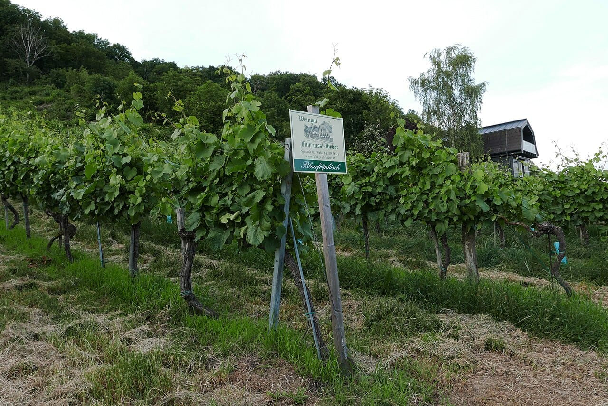

# 蓝弗兰克

奥地利布尔根兰的红葡萄，也在匈牙利称 Kékfrankos、捷克称 Frankovka；带深色、黑樱桃、胡椒与香料，酸度高、单宁中高，陈年潜力好。

蓝弗兰克是中东欧的红葡萄，布尔根兰、匈牙利与捷克各有自己的名字与风格；它晚熟、酸高、单宁中高，带黑樱桃、胡椒与香料。

图：Blaufränkisch：Ried Neuberg Blaufränkisch（Wikimedia Commons）。图片：Geolina163，CC BY-SA 4.0，via Wikimedia Commons（[原图页面](https://commons.wikimedia.org/wiki/File:Ried_Neuberg_Blaufr%C3%A4nkisch.jpg)）。

## 定义与命名

蓝弗兰克是中东欧的红葡萄品种，奥地利布尔根兰是它的核心产区；在匈牙利称 Kékfrankos，在捷克与斯洛伐克称 Frankovka，在克罗地亚等地还有 Modri Frank 等写法。它晚熟、皮厚，酸度高、单宁中高，成熟时带黑樱桃、黑莓、胡椒与甘草。

“Blaufränkisch”字面可解作“蓝色的弗兰克”，名称与法兰克人定居、地名或果实颜色有关，但没有一条词源被完全证实。它与 Cabernet Franc（品丽珠）不是同一品种，也不等同于德国的 Franken 产区；同名或近名现象在中欧很多，读标签时要看学名或产地，而不是只看“Frank”。

在奥地利，它是受保护的品种名称，布尔根兰的三个产区各有自己的风格；在匈牙利与捷克，它更多作为混酿成分或地方品种出现。欧盟没有为“Blaufränkisch”单列跨国法规，酒标上的品种名与产区名要分开读。

## 起源与传播

蓝弗兰克的亲本关系至今没有完全定论，基因研究把它与中欧多个古老品种联系起来，但起源地仍有争议。可以确定的是，它在 18 世纪已在布尔根兰、下奥地利与匈牙利西部种植，随后随德语居民、贸易与修道院酒庄扩散。

1921 年布尔根兰划归奥地利后，蓝弗兰克成为当地红葡萄酒的支柱；二战与冷战时期，产量导向的种植让许多老藤被拔除，1980 年代以后，Moric、Weninger 等酒农重新强调老藤、低产量与大桶陈年，把它从“普通红葡萄”提升为风土品种。

在匈牙利，Kékfrankos 是埃格尔“公牛血”（Egri Bikavér）与塞克萨德混酿的重要成分；在捷克，Frankovka 常与圣劳伦特混酿。传播不是简单复制：各地选不同的克隆、砧木与修剪方式，成熟节奏与酸度也随之改变。

## 植物学与栽培

果粒中等、皮厚，出汁率不高；发芽早、成熟晚，需要长而温暖的秋季。酸度高、单宁中高，颜色深，抗病性中等；在冷凉年份容易酸度过高，在过熟年份则可能失去胡椒与花香。

树势偏旺，需通过修剪、引缚与疏叶控制冠层，避免果实遮阴；产量过高会稀释香气与单宁。布尔根兰的坡地、砾石与黏土土壤提供排水与热量，Leithaberg 的石灰岩与 Eisenberg 的片岩让酒更紧、更矿物。

## 风格与味觉

酒色深 ruby 到紫红，香气以黑樱桃、黑莓、黑李子、胡椒、甘草与紫罗兰为主；入口酸度高，单宁中高但不算厚重，收口带矿物与香料。年轻时偏紧，陈年后出现皮革、烟草、干果与森林地表。

传统派用大橡木桶或旧桶，强调酸度与矿物；现代派用较小比例的新桶、更晚采收与整串发酵，酒体更饱满、香料更明显。整串比例高时，茎秆带来草本与胡椒；去梗则更干净、果味更纯。

老藤蓝弗兰克产量低、果粒小，颜色与单宁更集中，陈年潜力可达 10–20 年；普通大区级适合 3–8 年内饮用。判断典型性，先看酸度与胡椒香气，再看单宁是否过重。

在奥地利，Blaufränkisch 也常与梅洛、赤霞珠混酿成 Cuvée；单品种版本更强调酸度与胡椒，混酿则更饱满、更适合早饮。

## 主要产区与代表酒款

奥地利布尔根兰的 Mittelburgenland 以黏土与暖气候做出更饱满的酒；Leithaberg 的石灰岩带来矿物与紧致；Eisenberg 的片岩与森林边缘更冷，酸度更高、果味更红。三个产区都可以标注 Blaufränkisch。

匈牙利 Kékfrankos 的核心在埃格尔、塞克萨德与维拉尼，常与 Kékfrankos、Merlot、Cabernet Franc 混酿；捷克 Frankovka 在摩拉维亚与波希米亚都有种植。代表生产者包括 Moric、Weninger、Prieler、Heinrich、Esterházy、Grof 等。

在匈牙利，Kékfrankos 常与 Kékmedoc 等品种混酿，风格比奥地利更饱满、更偏黑樱桃与香料；在捷克，Frankovka 更轻、酸度更高。同一品种在不同国家的法规与混酿传统，会改变它的最终形状。

## 怎么喝与配餐

饮用温度 14–16°C，年轻酒可以醒 30–60 分钟，老酒只需短暂换瓶；杯型选中等口径的勃艮第杯，让胡椒与花香展开。配餐适合烤猪肉、炖牛肉、红椒粉菜肴、野味与硬质奶酪；高酸能切开油脂，单宁与香料适合红肉。

不要配清淡海鲜或过甜酱汁，酒精与酸度会显得突兀。开瓶后冷藏，2–3 天内喝完；老酒氧化更快，最好一次喝完。

蓝弗兰克的高酸也适合配番茄、醋汁与红椒粉菜肴；单宁中等的版本不必配重酱汁。

## 选购与常见误区

先看品种名与产区：奥地利 Blaufränkisch、匈牙利 Kékfrankos、捷克 Frankovka 是同一种，但风格不同；再看年份、酒精度与陈年方式。价格高可能来自老藤或名庄，不代表更适合早饮。

常见误读：把它当成品丽珠；以为“弗兰克”都来自德国 Franken；以为颜色深就一定厚重。蓝弗兰克可以是轻盈、胡椒感强的，也可以是浓郁、可陈年的，关键在产区与酿造。

年份对蓝弗兰克影响明显：冷凉年份酸度高、单宁更紧，需要更长时间陈年；温暖年份果味更熟、胡椒感更强。老藤与低产量的酒通常更集中，年轻藤版本更适合早饮；不要只看酒庄名，先看产区与年份。

## 参见

- [红葡萄酒](ref:red)：带皮发酵与单宁的来源。
- [橡木桶陈酿](ref:oak)：桶型与陈年对结构的影响。
- [风土（terroir）](ref:terroir)：产地、土壤与气候。
- [年份](ref:vintage)：成熟度与酸度的年际差异。
- [赤霞珠](ref:cabernet)：常见红葡萄的对照。

对照阅读：[红葡萄酒](ref:red)、[风土（terroir）](ref:terroir)、[橡木桶陈酿](ref:oak)。

**关键事实。**

| 项目 | 内容 |
| --- | --- |
| 一句话定位 | 奥地利布尔根兰的红葡萄，也在匈牙利称 Kékfrankos、捷克称 Frankovka；带深色、黑樱桃、胡椒与香料，酸度高、单宁中高，陈年潜力好 |
| 物种 | Vitis vinifera |

**来源与边界。** 本页关于「蓝弗兰克」的关键事实，主要由以下来源交叉核对：Julius Kühn-Institut（品种名称、同义词、起源与全球分布）、OIV（葡萄品种与栽培框架）、USDA ARS（植物分类、种质与栽培信息）等 4 条来源。价格、批次与状态会变，涉及这些字段时以页面所列来源的最新版本为准。正文为项目自写，来源只作核验，不复制原文。

**并读。** 把「蓝弗兰克」与「红葡萄酒」、「橡木桶陈酿」、「风土（terroir）」放在一起读时，先确认它们是同一层级还是上下游关系：先确认品种身份与允许产区，再比较成熟期、抗性、克隆与酿造表现。本页负责给出品种的基本坐标，对照条目补上具体案例与差异；读完再回到本页，才能分清哪些差别属于品种本身，哪些只是产地、批次或品牌选择。

## 相关图像

图：橡木桶陈酿的编辑插图：桶壁烘烤层、酒液与取样管；AI 辅助绘制，不是酒窖实拍。。图片：Hejiu 编辑团队，使用豆包 Seedream 5.5 AI 辅助生成；项目自制，不是现场照片（[项目说明](https://hejiu.org/about/)）。关联图像：蓝弗兰克。
